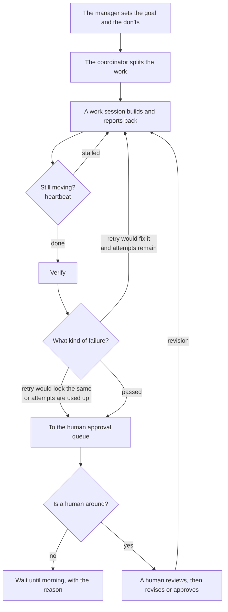

Today I was splitting work on an automation app across several AI sessions, and looking again at how the work should keep moving while no one is around. In [yesterday's post](#/post/agent-coordinator-review-loop) I wrote about the coordinator, approval levels, and the review loop. Today is about what happens when you actually run that structure: a session stalls mid-task, the same failure repeats, or you have to decide how far to auto-retry at night when no one is there.

## How one loop runs

It makes more sense if you picture a company org chart. A manager sets the goal, a coordinator splits the work, and work sessions actually build things. When a session finishes, it reports to the coordinator and gets the next job right away. If you don't have a regular check — a heartbeat — asking "are you still going?", you may only notice a session that asked a question and then sat still the next morning.

The flow looks like this.

1. The manager sets the goal and the don'ts (for example, publishing and uploading stay with a human).
2. The coordinator splits the work and hands it to a work session.
3. The work session builds, then reports when it's done, and gets the next job right away.
4. A watcher checks status on a regular beat. If something has stalled, it pushes the same instruction again.
5. When there's a result, it goes through verification.
6. If the failure is the kind that a retry would fix, it retries within a set number of attempts.
7. If a retry would come out the same, or the attempts are used up, it goes to a human.
8. A human looks at it, then either sends a revision or approves it.

Steps 5–7 are the point. If every verification failure gets retried automatically, the ones that need a judgment come out the same no matter how many times you rerun them, and you only spend more. So I split failures into two kinds. Something like background music being too loud can be retried automatically. Whether a still frame was already in the source, or a sound glitch is real, a human should hear or see it. For hours when no one can approve, I set a retry cap and a cost cap per attempt together. If it still fails, it sits in the approval queue in the morning, with the reason attached.

That's human-in-the-loop. It isn't a person touching every step. It's putting a person only at the spots automation can't handle. A gate is that spot, fixed like a checkpoint, and a heartbeat is what keeps the loop from going quiet in the middle.

Barry Zhang at Anthropic makes a similar point in [How We Build Effective Agents](https://www.youtube.com/watch?v=D7_ipDqhtwk). Agents can choose their next step, which makes them more useful, but cost and the price of a mistake go up too. If mistakes are serious and hard to catch, he says to narrow the permissions or have a human look in the middle. That's the same direction as leaving night-time retries on, but with caps on attempts and cost, and handing judgment-heavy failures to a person. The same ideas are in the post [Building effective agents](https://www.anthropic.com/research/building-effective-agents).

Using several sessions isn't really about dividing the work. It's about who holds the state after the split, and who cuts off a stall, a failure, or a runaway cost.
