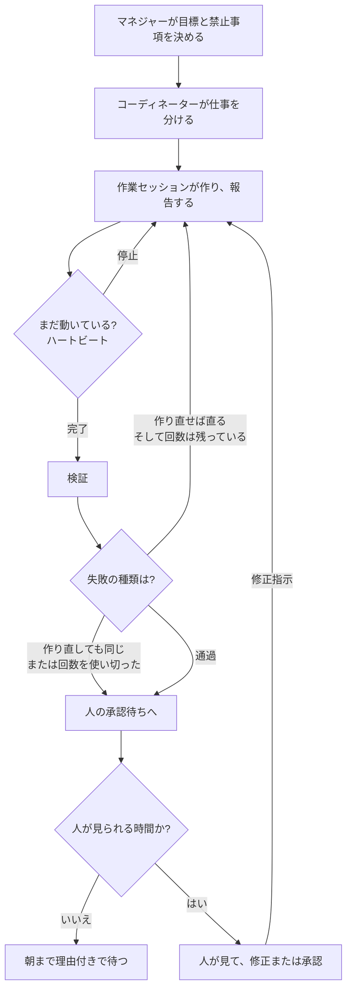

今日は自動化アプリの仕事をいくつかのAIセッションに分けて、人が席を外しているあいだも作業が進む仕組みを改めて見た日だった。[昨日の記事](#/post/agent-coordinator-review-loop)ではコーディネーターと承認の段階、レビューループを書いた。今日はその下を実際に回すときに出る問題、つまりセッションが途中で止まったり、同じ失敗を繰り返したり、人がいない夜にどこまで自動で作り直すかを書いておく。

## 一周はどう回るか

会社の組織図みたいに見るとわかりやすい。マネジャーが大きな目標を決め、コーディネーターが仕事を分け、作業セッションが実際に作る。作業が終わったらコーディネーターに報告し、次の仕事をすぐ受け取る。途中で「まだ動いているか」を定期的に確認する監視（ハートビート）を置いておかないと、質問を残したまま止まっているセッションに、朝になってやっと気づくことになる。

流れはこうだ。

1. マネジャーが目標と禁止事項（公開・アップロードは人が行う、など）を決める。
2. コーディネーターが仕事を分け、作業セッションに任せる。
3. 作業セッションが作り、終わったら報告する。終われば次の仕事をすぐ受け取る。
4. 監視が定期的に状態を見る。止まっていれば、同じ指示をもう一度押し込む。
5. 結果が出たら検証する。
6. 作り直せば直る失敗なら、決めておいた回数の範囲でやり直す。
7. 作り直しても結果が同じ失敗か、回数を使い切ったら人に渡す。
8. 人が見て、修正の指示を出すか、承認する。

肝は5–7だ。検証に落ちたからといって무조건やり直すと、判断が必要な問題は何度回しても同じになり、コストだけが増える。だから失敗を二種類に分ける。背景音の大きさのように、作り直せば直るものは自動で再試行する。画面がもともと止まっていたのか、音の飛びが本当かは人が見る。人が承認できない時間帯には、再試行の回数と1回あたりの費用の上限を並べて決めておき、最後まで失敗したら、朝に理由とともに承認待ちへ上げておく。

これをヒューマン・イン・ザ・ループと呼ぶ。人がすべての段階に触るのではなく、自動では済まない地点だけを輪の中に入れることだ。ゲート（承認の地点）はその輪を検問所のように固定した場所で、ハートビートは輪が途中で途切れないように確認する装置だ。

AnthropicのBarry Zhangがエージェントの作り方を話した動画（[How We Build Effective Agents](https://www.youtube.com/watch?v=D7_ipDqhtwk)）でも、似た話をしている。エージェントは次の段階を自分で決められるから便利になる一方で、コストも失敗の代償も大きくなる。失敗が大きく、見つけにくいなら、権限を絞るか、途中で人に見てもらえ、という。夜の再試行は残しつつ回数と費用の上限を置き、判断が必要な失敗は人に渡す、という向きと同じだ。文章では [Building effective agents](https://www.anthropic.com/research/building-effective-agents) にもまとまっている。

複数のセッションを使う構造は、「仕事を分けること」より、分けたあとに誰が状態を持ち、停止・失敗・コストを誰が止めるかの問題に近いな、と思った。
