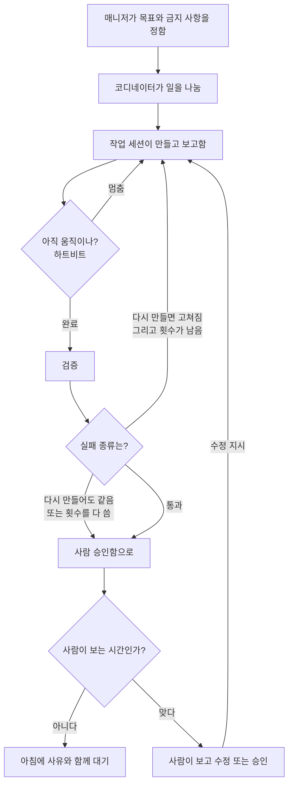

오늘은 자동화 앱 일을 AI 세션 여러 개에 나눠 놓고, 사람이 자리를 비운 동안에도 일이 앞으로 가게 하는 구조를 다시 본 날이었다. [어제 글](#/post/agent-coordinator-review-loop)에서는 코디네이터와 승인 단계, 리뷰 루프를 적었다. 오늘은 그 아래를 실제로 돌릴 때 생기는 문제, 즉 세션이 중간에 멈추거나, 같은 실패를 반복하거나, 사람이 없는 밤에 어디까지 자동으로 다시 만들지를 적어 본다.

## 한 바퀴가 어떻게 도나

구조를 회사 조직처럼 보면 이해가 빠르다. 매니저가 큰 목표를 정하고, 코디네이터가 일을 나누고, 작업 세션이 실제로 만든다. 작업이 끝나면 코디네이터에게 보고하고, 다음 일을 바로 받는다. 중간에 「아직 하고 있는지」를 주기적으로 확인하는 감시(하트비트)를 두지 않으면, 질문을 남기고 가만히 있는 세션을 아침이 되어서야 발견하게 된다.

흐름은 이렇다.

1. 매니저가 목표와 금지 사항(예: 공개·업로드는 사람이 한다)을 정한다.
2. 코디네이터가 일을 나누고 작업 세션에 맡긴다.
3. 작업 세션이 만들고, 끝나면 보고한다. 끝나면 다음 일을 바로 받는다.
4. 감시가 주기적으로 상태를 본다. 멈춰 있으면 같은 지시를 다시 밀어 넣는다.
5. 결과가 나오면 검증한다.
6. 다시 만들면 고쳐지는 실패면, 정해 둔 횟수 안에서 다시 만든다.
7. 다시 만들어도 결과가 같은 실패거나, 횟수를 다 썼으면 사람에게 넘긴다.
8. 사람이 보고, 수정 지시를 내리거나 승인한다.

핵심은 5–7번이다. 검증에 실패했다고 무조건 다시 만들면, 판단이 필요한 문제는 몇 번을 돌려도 같아지고 비용만 든다. 그래서 실패를 두 종류로 나눈다. 배경음 크기처럼 다시 만들면 고쳐지는 것은 자동으로 재시도한다. 화면이 원래 멈춰 있던 건지, 소리가 진짜로 튀는지는 사람이 본다. 사람이 승인하지 못하는 시간대에는 재시도 횟수와 1회 비용 상한을 같이 정해 두고, 끝까지 실패하면 아침에 사유와 함께 승인함에 올려 둔다.

이걸 휴먼 인 더 루프라고 부른다. 사람이 모든 단계를 만지는 게 아니라, 자동으로 안 되는 지점만 고리에 넣는 것이다. 게이트(승인 지점)는 그 고리를 검문소처럼 고정해 둔 자리이고, 하트비트는 고리가 중간에 끊기지 않게 확인하는 장치다.

Anthropic의 Barry Zhang이 에이전트 만드는 법을 설명한 영상([How We Build Effective Agents](https://www.youtube.com/watch?v=D7_ipDqhtwk))에서도 비슷한 이야기를 한다. 에이전트는 스스로 다음 단계를 정할 수 있어서 쓸모가 커지지만, 비용과 실수의 대가도 같이 커진다. 실수가 크고 발견하기 어려우면 권한을 줄이거나, 사람이 중간에 보게 하라고 한다. 우리가 밤에 재시도를 열어 두되 횟수와 비용 상한을 두고, 판단이 필요한 실패는 사람에게 넘기는 것과 같은 방향이다. 글로는 [Building effective agents](https://www.anthropic.com/research/building-effective-agents)에도 정리되어 있다.

여러 세션을 쓰는 구조는 「일을 나누는 것」보다, 나눈 뒤에 누가 상태를 들고 있고, 멈춤과 실패와 비용을 누가 끊느냐의 문제에 가깝더라.
