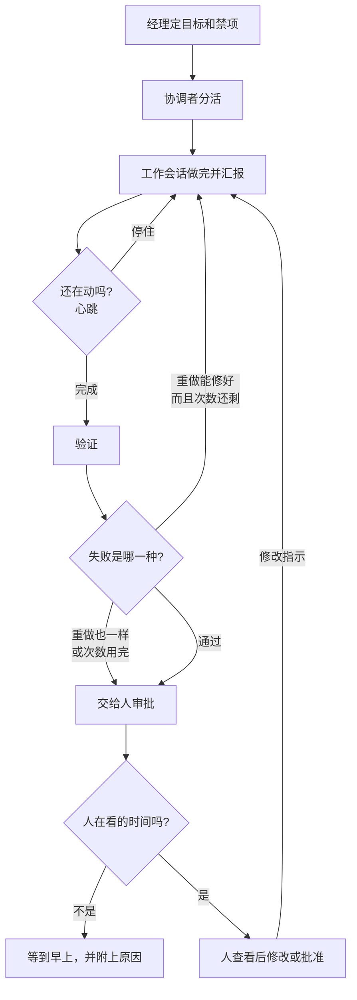

今天把自动化应用的工作分给好几个 AI 会话，又重新看了一遍：人不在的时候，事情要怎么继续往前走。[昨天那篇](#/post/agent-coordinator-review-loop)写了协调者、审批分级和审查循环。今天写的是这套结构真正转起来时会出现的问题：会话做到一半停下、同一失败反复出现、夜里没人时自动重做可以走到哪一步。

## 一轮是怎么转的

按公司组织来想会比较清楚。经理定大目标，协调者分活，工作会话真正去做。做完就向协调者汇报，并马上接下一项。如果不定期确认「还在动吗」（心跳检测），一个问完问题就停住的会话，可能要到早上才被发现。

流程是这样的。

1. 经理定目标和禁项（比如公开、上传由人来做）。
2. 协调者把活分开，交给工作会话。
3. 工作会话做完就汇报，然后马上接下一项。
4. 监视按固定节奏看状态。停住了，就把同一条指示再推一次。
5. 有结果就做验证。
6. 如果是重做就能修好的失败，就在规定次数内重做。
7. 如果重做结果还是一样，或次数用完了，就交给人。
8. 人看过之后，要么给出修改，要么批准。

关键在第 5 到第 7 步。验证一失败就自动重做的话，需要判断的问题再跑多少次也一样，只会多花钱。所以失败要分成两类。背景声音量这类，重做就能修好的，可以自动再试。画面本来就停着，还是声音真的炸了，得人来看、来听。人没法审批的时段，把重做次数和单次费用上限放在一起定好。如果还是失败，早上就带着原因进审批队列。

这就是 human-in-the-loop。不是人摸每一个步骤，而是只把自动化处理不了的点放进环里。门（审批点）是把这个点像检查站一样固定下来的位置，心跳则是防止环在中途断开的装置。

Anthropic 的 Barry Zhang 在视频 [How We Build Effective Agents](https://www.youtube.com/watch?v=D7_ipDqhtwk) 里也讲过类似的话。代理能自己决定下一步，所以更有用，但成本和出错的代价也会变大。如果错误严重又不容易发现，就该收窄权限，或让人在中间看一眼。我们保留夜间重试，同时加上次数和费用上限，并把需要判断的失败交给人，方向是一样的。文章版在 [Building effective agents](https://www.anthropic.com/research/building-effective-agents)。

用多个会话，重点不太像是「把活分开」，更像是分开之后谁拿着状态，以及停住、失败和费用由谁来切断。
