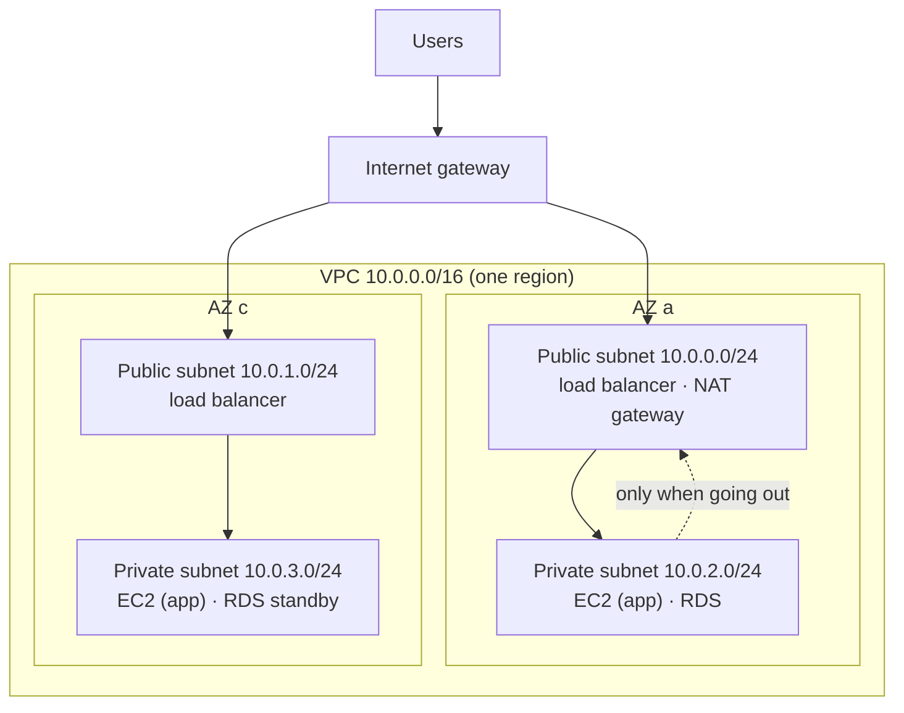
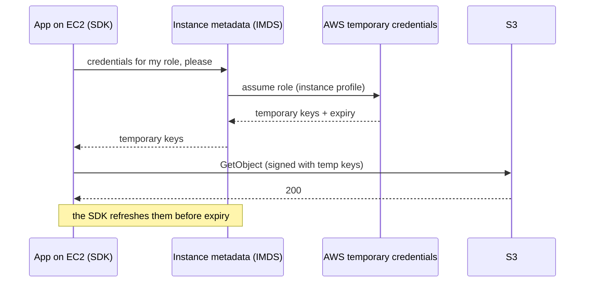

Open the AWS console for the first time and there are over 200 services, but to put one web service up you really need three: EC2 to rent servers, VPC as the private network the servers live in, and IAM to decide who can do what. General cloud concepts (IaaS, regions, AZs) are in [Cloud Basics](#/post/cloud-basics), so here I go through these three in the order you'd actually set them up.

## The whole setup in one picture

A common shape for putting a web service on AWS. The doors from outside sit only in public subnets; servers and the DB hide in private subnets.



Two AZs so that if one data center stops, the other takes over. How the load balancer spreads traffic across EC2 in both AZs is in [Load Balancers](#/post/infra-load-balancer).

## 1. EC2: a rented virtual server

1. **Instance**: one virtual server rented from EC2. A VM that a hypervisor carves out of a physical server.
2. **Instance type**: written like `t3.micro` or `m7g.large`. The first letter is the family (t burstable general purpose, m general purpose, c compute, r memory, g GPU, and so on), the number is the generation, a trailing g means an ARM (Graviton) processor, and the last part is the size. Each size step roughly doubles vCPUs and memory.
3. **AMI (Amazon Machine Image)**: the template instances are stamped from. It contains the OS and preinstalled software. Save a server you've configured as an AMI and you can make as many identical servers as you like. Similar idea to a [Docker image](#/post/cloud-docker), but the unit is a whole VM.
4. **EBS (Elastic Block Store)**: a network disk attached to an instance. It lives separately from the instance, so data survives when the instance is stopped. Instance store, by contrast, is a disk on the physical host: fast, but gone when you stop.
5. **Stop vs. terminate**: stop just powers off, so compute charges stop but EBS charges continue. Terminate is deletion. By default the root EBS volume is deleted along with it.
6. **Purchase options**: On-Demand, pay as you go; Savings Plans/Reserved Instances, a discount for committing to 1–3 years; Spot, cheap spare capacity that AWS can reclaim with a two-minute warning. Spot suits batch jobs that are fine being interrupted.

You'll also meet the key pair (SSH key) used for the first login, and user data, a script run once at boot. The key pair's private key can only be downloaded once; lose it and you can't get it again.

## 2. VPC: a private network just for your servers

1. **VPC**: your own virtual network inside a region. You start by choosing an address range (CIDR) like `10.0.0.0/16`. `/16` means the first 16 bits are fixed: 65,536 addresses.
2. **Subnet**: a slice of the VPC range attached to one AZ. A subnet can't span AZs, which is why the picture has subnets per AZ.
3. **Route table and internet gateway (IGW)**: whether a subnet is public or private is decided by its route table, not its name. If the route to `0.0.0.0/0` (everywhere else) points to the IGW, it's a public subnet.
4. **NAT gateway**: the exit private-subnet servers use when they need to go out, for package updates or external API calls. Outbound connections only; nothing from outside can connect in first. It charges per hour and per GB processed, which quietly adds up on small projects.
5. **Security groups and network ACLs**: both are firewalls but behave differently. Covered in the table below.

I did the address math with Python's `ipaddress`. AWS reserves 5 addresses per subnet (the first four and the last one).

```python
import ipaddress
vpc = ipaddress.ip_network('10.0.0.0/16')
print('VPC', vpc, '주소', vpc.num_addresses)
subnets = list(vpc.subnets(new_prefix=24))[:4]
names = ['public-a', 'public-c', 'private-a', 'private-c']
for name, s in zip(names, subnets):
    usable = s.num_addresses - 5          # AWS가 서브넷마다 5개를 예약
    print(f'{name:10} {s}  전체 {s.num_addresses}, 쓸 수 있는 것 {usable}, 예: {s[4]} ~ {s[-2]}')
print('10.0.1.37은 어느 서브넷?', [n for n, s in zip(names, subnets) if ipaddress.ip_address('10.0.1.37') in s])
```

```
VPC 10.0.0.0/16 주소 65536
public-a   10.0.0.0/24  전체 256, 쓸 수 있는 것 251, 예: 10.0.0.4 ~ 10.0.0.254
public-c   10.0.1.0/24  전체 256, 쓸 수 있는 것 251, 예: 10.0.1.4 ~ 10.0.1.254
private-a  10.0.2.0/24  전체 256, 쓸 수 있는 것 251, 예: 10.0.2.4 ~ 10.0.2.254
private-c  10.0.3.0/24  전체 256, 쓸 수 있는 것 251, 예: 10.0.3.4 ~ 10.0.3.254
10.0.1.37은 어느 서브넷? ['public-c']
```

(`주소` = addresses, `전체` = total, `쓸 수 있는 것` = usable, `어느 서브넷?` = which subnet?) A `/24` has 256 addresses but only 251 are usable. Making the VPC range too small at the start is a pain to grow later, so the usual move is to take a generous range and slice subnets out of it. IP and routing themselves are in [DNS and IP Routing](#/post/net-dns-routing).

### Security group vs. network ACL

| | Security group (SG) | Network ACL (NACL) |
|---|---|---|
| Attached to | an instance (network interface) | a subnet |
| State | stateful: replies to allowed requests are allowed automatically | stateless: the return direction needs its own rule |
| Rules | allow only | allow and deny |
| Evaluation | looks at all rules; passes if any allows | checks in number order; the first matching rule decides |
| Referencing others | possible, e.g. "traffic from things with this SG" | IP ranges only |

AWS docs recommend security groups as the primary tool, and NACLs as a coarse, subnet-level secondary guard, for example to block specific IPs. A pattern you see a lot: "the DB security group allows port 5432 only from the app server security group," referencing a security group instead of IPs. When app servers scale out or IPs change, the rule doesn't need touching.

## 3. IAM: who can do what

1. **User**: long-term credentials (password, access keys) for one person or program.
2. **Group**: a bundle of users to grant permissions in one go.
3. **Role**: permissions a principal borrows temporarily. It issues temporary credentials valid only while in use. EC2 instances, Lambda and other AWS accounts assume roles.
4. **Policy**: JSON describing permissions: `Effect` (Allow/Deny), `Action` (e.g. `s3:GetObject`), `Resource` (an ARN), and optionally `Condition`.
5. **Root account**: the account created at sign-up. It has every permission, so AWS recommends not using it day to day and locking it away with MFA.

The evaluation rule is the key. Simplifying AWS's documented evaluation logic: if nothing allows it, default deny; if something allows it, allow; but if any explicit Deny matches anywhere, deny no matter what. I imitated that order in a small piece of code.

```python
import fnmatch

def allowed(policies, action, resource):
    """AWS 문서의 평가 순서를 단순화: 명시적 Deny > Allow > 기본 거부"""
    decision = '기본 거부(아무 Allow도 없음)'
    for p in policies:
        for st in p['Statement']:
            if any(fnmatch.fnmatch(action, a) for a in st['Action']) and \
               any(fnmatch.fnmatch(resource, r) for r in st['Resource']):
                if st['Effect'] == 'Deny':
                    return '거부(명시적 Deny)'
                decision = '허용'
    return decision

read_bucket = {'Statement': [{'Effect': 'Allow', 'Action': ['s3:GetObject', 's3:ListBucket'],
                              'Resource': ['arn:aws:s3:::my-logs', 'arn:aws:s3:::my-logs/*']}]}
no_delete = {'Statement': [{'Effect': 'Deny', 'Action': ['s3:Delete*'], 'Resource': ['*']}]}
admin = {'Statement': [{'Effect': 'Allow', 'Action': ['*'], 'Resource': ['*']}]}

cases = [([read_bucket], 's3:GetObject', 'arn:aws:s3:::my-logs/2026/11/25.log'),
         ([read_bucket], 's3:PutObject', 'arn:aws:s3:::my-logs/x.log'),
         ([read_bucket], 's3:GetObject', 'arn:aws:s3:::other-bucket/a.txt'),
         ([admin, no_delete], 's3:DeleteObject', 'arn:aws:s3:::my-logs/x.log'),
         ([admin, no_delete], 'ec2:RunInstances', '*')]
for pol, act, res in cases:
    print(f'{act:18} {res:45} -> {allowed(pol, act, res)}')
```

```
s3:GetObject       arn:aws:s3:::my-logs/2026/11/25.log           -> 허용
s3:PutObject       arn:aws:s3:::my-logs/x.log                    -> 기본 거부(아무 Allow도 없음)
s3:GetObject       arn:aws:s3:::other-bucket/a.txt               -> 기본 거부(아무 Allow도 없음)
s3:DeleteObject    arn:aws:s3:::my-logs/x.log                    -> 거부(명시적 Deny)
ec2:RunInstances   *                                             -> 허용
```

(`허용` = allowed, `기본 거부(아무 Allow도 없음)` = default deny (no Allow), `거부(명시적 Deny)` = denied (explicit Deny).) Even with admin (`*`) permissions, one Deny policy blocked the delete. Real AWS layers organization policies (SCPs), resource-based policies, permission boundaries and session policies on top, so this code shows only the skeleton. To check for real, use AWS's IAM policy simulator.

### Keeping keys off servers: attach a role to EC2

When an app on EC2 needs to read S3, putting access keys in `.env` makes it easy for them to leak onto the server disk and into the repo. AWS's recommended way is to attach a role to the instance.



If there are no keys in code or environment variables, the SDK looks up temporary keys from instance metadata. They expire within hours and rotate automatically, so even if leaked the damage window is short. The general principle of keeping keys out of code is in [Environment Variables and Secrets](#/post/cloud-secrets) and [Managing Keys and Secrets](#/post/sec-keys).

## Common misconceptions

- A public subnet is one with "public" in its name: it's public only if its route table has a route to the IGW. The name means nothing.
- A stopped instance costs nothing: only compute charges stop. EBS, Elastic IPs and NAT gateways keep billing. Since 2024, public IPv4 addresses are also charged hourly.
- You block an IP with a deny rule in a security group: security groups only allow. Blocking specific sources is a job for NACLs.
- An admin policy means everything works: an explicit Deny anywhere wins. Organization policies (SCPs) can also block from above.
- Servers in private subnets have no internet at all: going out through a NAT gateway works. Only connections initiated from outside don't.

## Core concepts you should be able to explain yourself

1. **EC2 instance and type**: a rented VM. The type name is family, generation, processor and size.
2. **AMI and EBS**: AMI is the template for stamping out servers; EBS is a network disk that lives separately from the instance.
3. **Purchase options**: On-Demand, commitment discounts, Spot (cheap but can be reclaimed after a 2-minute warning).
4. **VPC, subnet, CIDR**: a private network inside a region, an address slice tied to one AZ, and the notation for the range.
5. **Public/private subnets**: public if the route table has an IGW route. Private subnets go out only via a NAT gateway.
6. **Security group vs. NACL**: instance-level, stateful, allow-only vs. subnet-level, stateless, allow and deny.
7. **IAM users, groups, roles, policies**: principals with long-term credentials, bundles, temporarily borrowed permissions, permissions written in JSON.
8. **Policy evaluation**: default deny → allow if something allows → deny unconditionally if an explicit Deny matches.
9. **EC2 role (instance profile)**: no keys on the server; temporary credentials come from metadata.

## Related reading

← [Cloud & Deployment map](#/post/cloud-map)

- [Cloud Basics](#/post/cloud-basics): IaaS, PaaS, SaaS, regions and AZs
- [Load Balancers](#/post/infra-load-balancer): what sits in front, in the public subnets
- [Autoscaling](#/post/infra-autoscaling): growing and shrinking EC2 automatically
- [Authentication and Authorization](#/post/be-auth): the general version of IAM-style permission models (RBAC)

## Reference links

- AWS docs, What is Amazon EC2?: https://docs.aws.amazon.com/AWSEC2/latest/UserGuide/concepts.html
- AWS docs, What is Amazon EBS?: https://docs.aws.amazon.com/ebs/latest/userguide/what-is-ebs.html
- AWS docs, Spot Instance interruption notices: https://docs.aws.amazon.com/AWSEC2/latest/UserGuide/spot-instance-termination-notices.html
- AWS docs, How Amazon VPC works: https://docs.aws.amazon.com/vpc/latest/userguide/how-it-works.html
- AWS docs, Subnet CIDR blocks (5 reserved addresses): https://docs.aws.amazon.com/vpc/latest/userguide/subnet-sizing.html
- AWS docs, NAT gateways: https://docs.aws.amazon.com/vpc/latest/userguide/vpc-nat-gateway.html
- AWS docs, Infrastructure security in Amazon VPC (security groups and NACLs): https://docs.aws.amazon.com/vpc/latest/userguide/infrastructure-security.html
- AWS docs, Policy evaluation logic: https://docs.aws.amazon.com/IAM/latest/UserGuide/reference_policies_evaluation-logic.html
- AWS docs, Use an IAM role to grant permissions to applications running on EC2: https://docs.aws.amazon.com/IAM/latest/UserGuide/id_roles_use_switch-role-ec2.html
- AWS docs, Security best practices in IAM: https://docs.aws.amazon.com/IAM/latest/UserGuide/best-practices.html

Further reading (well-illustrated Korean posts on the same topic)

- Inpa Dev, EC2 concepts and setup (Instance / EBS / AMI): https://inpa.tistory.com/entry/AWS-%F0%9F%93%9A-EC2-%EA%B0%9C%EB%85%90-%EC%82%AC%EC%9A%A9-%EA%B5%AC%EC%B6%95-%EC%84%B8%ED%8C%85-%F0%9F%92%AF-%EC%A0%95%EB%A6%AC-%EC%9D%B8%EC%8A%A4%ED%84%B4%EC%8A%A4-EBS-AMI
- Inpa Dev, VPC concepts: building the infrastructure [Subnet / Routing / Internet Gateway]: https://inpa.tistory.com/entry/AWS-%F0%9F%93%9A-VPC-%EC%82%AC%EC%9A%A9-%EC%84%9C%EB%B8%8C%EB%84%B7-%EC%9D%B8%ED%84%B0%EB%84%B7-%EA%B2%8C%EC%9D%B4%ED%8A%B8%EC%9B%A8%EC%9D%B4-NAT-%EB%B3%B4%EC%95%88%EA%B7%B8%EB%A3%B9-NACL-Bastion-Host
- Inpa Dev, VPC concepts: security settings [Security Group / NACL]: https://inpa.tistory.com/entry/AWS-%F0%9F%93%9A-VPC-%EA%B0%9C%EB%85%90-%EC%82%AC%EC%9A%A9-%EB%B3%B4%EC%95%88-%EC%84%A4%EC%A0%95-Security-Group-NACL
- Inpa Dev, EC2 pricing models, explained simply: https://inpa.tistory.com/entry/AWS-%F0%9F%93%9A-EC2-%EA%B0%80%EA%B2%A9-%EC%9A%94%EA%B8%88-%EB%AA%A8%EB%8D%B8-%EC%9B%90%EB%A6%AC-%F0%9F%92%B0-%ED%8C%8C%ED%97%A4%EC%B9%98%EA%B8%B0
- Inpa Dev, IAM concepts and creating IAM users and policies: https://inpa.tistory.com/entry/AWS-%F0%9F%93%9A-IAM-%EA%B0%9C%EB%85%90-%EC%9B%90%EB%A6%ACuser-group-policy-role-IAM-%EA%B3%84%EC%A0%95-%EC%A0%95%EC%B1%85-%EC%83%9D%EC%84%B1
