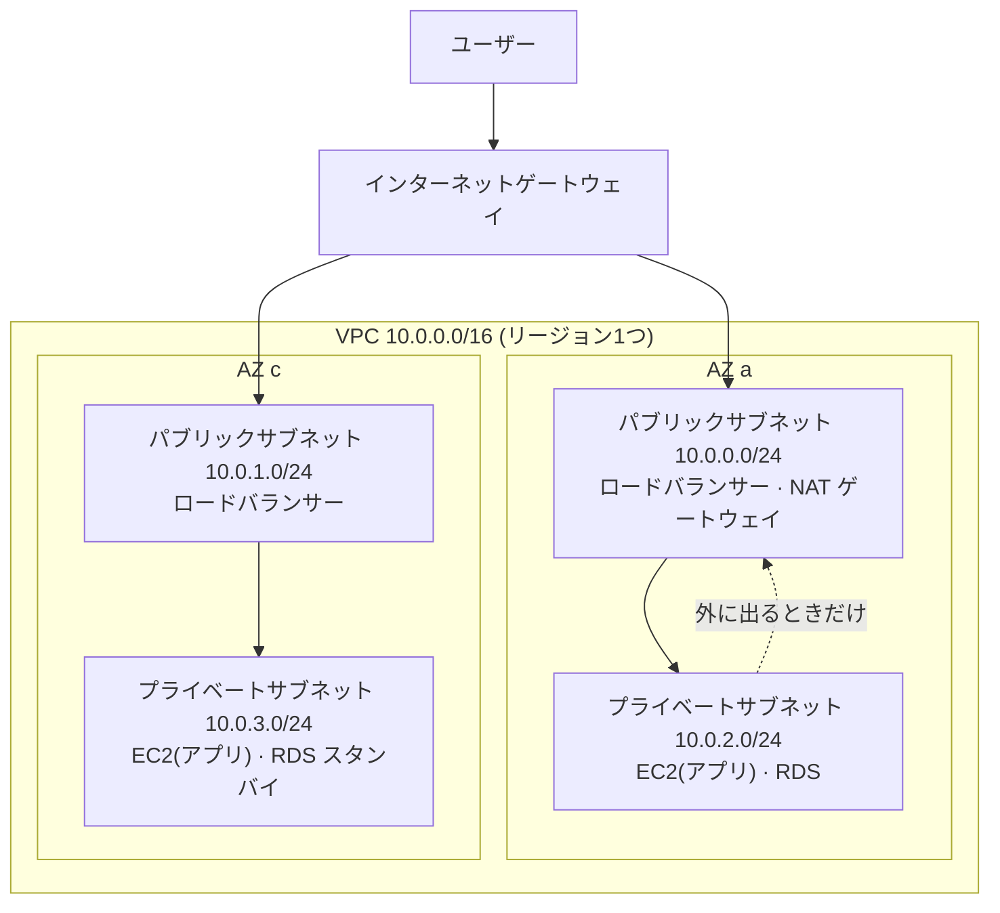
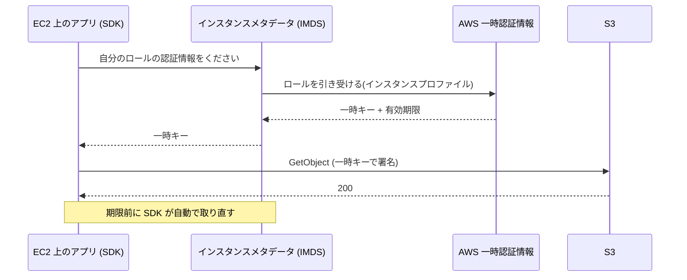

AWS コンソールを初めて開くとサービスが200以上ありますが、ウェブサービスを1つ載せるのに必ず知っておくべきものは3つでした。サーバーを借りる EC2、そのサーバーを置くプライベートネットワークの VPC、誰が何をできるかを決める IAM です。クラウド全般の概念(IaaS・リージョン・AZ)は [クラウドの基礎](#/post/cloud-basics) にあるので、ここではこの3つを実際の構成順に見ていきます。

## 1枚で見る構成

ウェブサービスを AWS に載せるときによく使う形です。外から入る入口はパブリックサブネットにだけ置き、サーバーと DB はプライベートサブネットに隠します。



AZ を2つ使うのは、データセンターが1つ止まってももう一方が受けられるようにするためです。ロードバランサーが2つの AZ の EC2 に振り分ける話は [ロードバランサー](#/post/infra-load-balancer) にあります。

## 1. EC2: 借りて使う仮想サーバー

1. **インスタンス**: EC2 で借りた仮想サーバー1台。物理サーバーの上でハイパーバイザーが切り分けた VM です。
2. **インスタンスタイプ**: `t3.micro`、`m7g.large` のように書きます。先頭の文字がファミリー(t はバースト型の汎用、m は汎用、c はコンピューティング、r はメモリ、g は GPU 系など)、数字が世代、後ろに付く g は ARM (Graviton) プロセッサ、最後がサイズです。サイズが1段上がるごとに vCPU とメモリがおおよそ2倍になります。
3. **AMI (Amazon Machine Image)**: インスタンスを作り出す型。OS とあらかじめ入れたソフトウェアが入っています。自分で設定したサーバーを AMI にしておけば、同じサーバーを何台でも作れます。[Docker イメージ](#/post/cloud-docker) と似た発想ですが、単位は VM 全体です。
4. **EBS (Elastic Block Store)**: インスタンスに付けるネットワークディスク。インスタンスとは別に存在するので、インスタンスを停止してもデータが残ります。逆にインスタンスストアは物理サーバーに付いたディスクで、速いけれど停止すると消えます。
5. **停止と終了**: 停止 (stop) は電源を切っただけなのでコンピューティング料金はかかりませんが、EBS の料金はかかり続けます。終了 (terminate) は削除です。ルート EBS は既定の設定では終了と一緒に消されます。
6. **購入方法**: 使った分だけ払うオンデマンド、1〜3年の利用を約束して割引を受ける Savings Plans・リザーブドインスタンス、余った容量を安く使う代わりに AWS が2分前に予告して回収できるスポット。スポットは途中で止まっても構わないバッチ処理に向いています。

サーバーに初めて接続するときに使うキーペア (SSH キー) と、起動時に1回だけ実行するスクリプトを入れる user data もよく出てきます。キーペアの秘密鍵はダウンロードできるのが1回だけなので、なくすと再取得できません。

## 2. VPC: 自分のサーバーだけが使うプライベートネットワーク

1. **VPC**: リージョンの中に作る自分専用の仮想ネットワーク。最初に `10.0.0.0/16` のようなアドレス範囲 (CIDR) を決めます。`/16` は先頭16ビットが固定という意味で、アドレスは65,536個です。
2. **サブネット**: VPC のアドレス範囲を切り分けて1つの AZ に紐づけたもの。サブネットは AZ をまたげません。なので上の図のように AZ ごとにサブネットを分けます。
3. **ルートテーブルとインターネットゲートウェイ (IGW)**: サブネットがパブリックかプライベートかは、名前ではなくルートテーブルが決めます。`0.0.0.0/0`(それ以外のすべて)への経路が IGW を向いていればパブリックサブネットです。
4. **NAT ゲートウェイ**: プライベートサブネットのサーバーがパッケージ更新や外部 API 呼び出しのように外へ出る必要があるときに通る出口。外向きの接続だけができ、外から先に入ってくる接続はできません。時間あたりの料金と処理したデータ GB あたりの料金がかかり、小さなプロジェクトでは意外と大きなコストになります。
5. **セキュリティグループとネットワーク ACL**: どちらもファイアウォールですが性質が違います。下の表で別に見ます。

アドレス計算は Python の `ipaddress` でやってみました。AWS はサブネットごとにアドレスを5つ(先頭4つと最後の1つ)予約します。

```python
import ipaddress
vpc = ipaddress.ip_network('10.0.0.0/16')
print('VPC', vpc, '주소', vpc.num_addresses)
subnets = list(vpc.subnets(new_prefix=24))[:4]
names = ['public-a', 'public-c', 'private-a', 'private-c']
for name, s in zip(names, subnets):
    usable = s.num_addresses - 5          # AWS가 서브넷마다 5개를 예약
    print(f'{name:10} {s}  전체 {s.num_addresses}, 쓸 수 있는 것 {usable}, 예: {s[4]} ~ {s[-2]}')
print('10.0.1.37은 어느 서브넷?', [n for n, s in zip(names, subnets) if ipaddress.ip_address('10.0.1.37') in s])
```

```
VPC 10.0.0.0/16 주소 65536
public-a   10.0.0.0/24  전체 256, 쓸 수 있는 것 251, 예: 10.0.0.4 ~ 10.0.0.254
public-c   10.0.1.0/24  전체 256, 쓸 수 있는 것 251, 예: 10.0.1.4 ~ 10.0.1.254
private-a  10.0.2.0/24  전체 256, 쓸 수 있는 것 251, 예: 10.0.2.4 ~ 10.0.2.254
private-c  10.0.3.0/24  전체 256, 쓸 수 있는 것 251, 예: 10.0.3.4 ~ 10.0.3.254
10.0.1.37은 어느 서브넷? ['public-c']
```

(`주소` はアドレス、`전체` は全体、`쓸 수 있는 것` は使えるもの、`어느 서브넷?` はどのサブネット?という意味です。)`/24` 1つで256個ですが、実際に使えるのは251個です。VPC を最初に作るときに範囲を小さくしすぎると後で広げるのが面倒なので、余裕を持って取り、サブネットを切り分けて使うのが普通です。IP とルーティングそのものは [DNS と IP・ルーティング](#/post/net-dns-routing) にあります。

### セキュリティグループ vs ネットワーク ACL

| | セキュリティグループ (SG) | ネットワーク ACL (NACL) |
|---|---|---|
| 付く場所 | インスタンス(ネットワークインターフェース) | サブネット |
| 状態 | ステートフル: 入ってきたリクエストの応答は自動で許可 | ステートレス: 応答方向にも別のルールが必要 |
| ルール | 許可だけを書く | 許可と拒否の両方 |
| 評価 | すべてのルールを見て1つでも許可すれば通過 | 番号順に見て最初に一致したルールで決定 |
| 他の対象の参照 | 「この SG が付いたものからのトラフィック」のように可能 | IP 範囲のみ |

AWS のドキュメントは、セキュリティグループを基本の手段として使い、NACL は特定の IP を止めるといったサブネット単位の粗い補助装置として使うよう勧めています。実務でよく使うパターンは「DB のセキュリティグループはアプリサーバーのセキュリティグループからの5432番ポートだけ許可」のように、IP の代わりにセキュリティグループを参照するものです。アプリサーバーが増えたり IP が変わったりしても、ルールを直す必要がありません。

## 3. IAM: 誰が何をできるか

1. **ユーザー (User)**: 人やプログラム1つに与える長期の認証情報(パスワード、アクセスキー)。
2. **グループ (Group)**: ユーザーをまとめて権限を一度に与える単位。
3. **ロール (Role)**: 特定の主体が一時的に借りて使う権限。使っている間だけ有効な一時認証情報が発行されます。EC2 インスタンス、Lambda、別の AWS アカウントがロールを引き受けます。
4. **ポリシー (Policy)**: 権限を書いた JSON。`Effect` (Allow/Deny)、`Action`(例: `s3:GetObject`)、`Resource` (ARN)、必要なら `Condition` からなります。
5. **ルートアカウント**: サインアップ時に作ったアカウント。すべての権限があるので日常の作業には使わず、MFA をかけてしまっておくのが AWS の推奨です。

評価のルールが核心です。AWS ドキュメントの評価ロジックを単純化するとこうなります。何も許可していなければ既定で拒否、どこかで許可されていれば許可、ただしどこかで明示的な Deny が1つでも一致すれば無条件に拒否。この順序を小さなコードで真似してみました。

```python
import fnmatch

def allowed(policies, action, resource):
    """AWS 문서의 평가 순서를 단순화: 명시적 Deny > Allow > 기본 거부"""
    decision = '기본 거부(아무 Allow도 없음)'
    for p in policies:
        for st in p['Statement']:
            if any(fnmatch.fnmatch(action, a) for a in st['Action']) and \
               any(fnmatch.fnmatch(resource, r) for r in st['Resource']):
                if st['Effect'] == 'Deny':
                    return '거부(명시적 Deny)'
                decision = '허용'
    return decision

read_bucket = {'Statement': [{'Effect': 'Allow', 'Action': ['s3:GetObject', 's3:ListBucket'],
                              'Resource': ['arn:aws:s3:::my-logs', 'arn:aws:s3:::my-logs/*']}]}
no_delete = {'Statement': [{'Effect': 'Deny', 'Action': ['s3:Delete*'], 'Resource': ['*']}]}
admin = {'Statement': [{'Effect': 'Allow', 'Action': ['*'], 'Resource': ['*']}]}

cases = [([read_bucket], 's3:GetObject', 'arn:aws:s3:::my-logs/2026/11/25.log'),
         ([read_bucket], 's3:PutObject', 'arn:aws:s3:::my-logs/x.log'),
         ([read_bucket], 's3:GetObject', 'arn:aws:s3:::other-bucket/a.txt'),
         ([admin, no_delete], 's3:DeleteObject', 'arn:aws:s3:::my-logs/x.log'),
         ([admin, no_delete], 'ec2:RunInstances', '*')]
for pol, act, res in cases:
    print(f'{act:18} {res:45} -> {allowed(pol, act, res)}')
```

```
s3:GetObject       arn:aws:s3:::my-logs/2026/11/25.log           -> 허용
s3:PutObject       arn:aws:s3:::my-logs/x.log                    -> 기본 거부(아무 Allow도 없음)
s3:GetObject       arn:aws:s3:::other-bucket/a.txt               -> 기본 거부(아무 Allow도 없음)
s3:DeleteObject    arn:aws:s3:::my-logs/x.log                    -> 거부(명시적 Deny)
ec2:RunInstances   *                                             -> 허용
```

(`허용` は許可、`기본 거부(아무 Allow도 없음)` は既定の拒否(Allow なし)、`거부(명시적 Deny)` は拒否(明示的 Deny)です。)管理者権限 (`*`) があっても、Deny ポリシー1つが削除を止めました。実際の AWS はここに組織単位のポリシー (SCP)、リソースベースのポリシー、アクセス許可の境界、セッションポリシーまで重ねて判断するので、このコードは骨組みだけを示しています。実際に確かめるなら AWS の IAM ポリシーシミュレーターを使います。

### サーバーにキーを置かない方法: EC2 にロールを付ける

EC2 上のアプリが S3 を読む必要があるとき、アクセスキーを `.env` に入れると、キーがサーバーのディスクやコードリポジトリに漏れやすくなります。AWS が勧める方法はロールをインスタンスに付けることです。



SDK はコードや環境変数にキーがなければ、インスタンスメタデータから一時キーを探して使います。キーは数時間で期限が切れて自動で入れ替わるので、漏れても被害の時間が短く済みます。キーをコードの外に置く一般原則は [環境変数とシークレット管理](#/post/cloud-secrets) と [キー・シークレット管理](#/post/sec-keys) にあります。

## よくある誤解

- パブリックサブネットは名前に public を付けたサブネット: ルートテーブルに IGW への経路があって初めてパブリックです。名前には何の意味もありません。
- インスタンスを停止すればお金はかからない: 止まるのはコンピューティング料金だけです。EBS、固定 IP (Elastic IP)、NAT ゲートウェイの料金はかかり続けます。2024年からはパブリック IPv4 アドレスにも時間料金がかかります。
- セキュリティグループに拒否ルールを入れて特定の IP を止める: セキュリティグループは許可しか書けません。特定の相手を止めるのは NACL で行います。
- 管理者ポリシーを付けたから何でもできる: どこかの明示的な Deny が勝ちます。組織のポリシー (SCP) も上から止められます。
- プライベートサブネットのサーバーはインターネットがまったく使えない: NAT ゲートウェイを通って外に出るのはできます。外から先に入ってこられないだけです。

## 自分で説明できるべき核心概念

1. **EC2 インスタンスとタイプ**: 借りて使う VM。タイプ名はファミリー・世代・プロセッサ・サイズ。
2. **AMI と EBS**: AMI はサーバーを作り出す型、EBS はインスタンスとは別に存在するネットワークディスク。
3. **購入方法**: オンデマンド、約束による割引、スポット(安いが2分の予告で回収されうる)。
4. **VPC・サブネット・CIDR**: リージョン内のプライベートネットワーク、1つの AZ に紐づくアドレスの切れ端、その範囲を書く表記法。
5. **パブリック/プライベートサブネット**: ルートテーブルに IGW の経路があればパブリック。プライベートサブネットは NAT ゲートウェイ経由でだけ外に出る。
6. **セキュリティグループ vs NACL**: インスタンス単位・ステートフル・許可のみ vs サブネット単位・ステートレス・許可と拒否。
7. **IAM のユーザー・グループ・ロール・ポリシー**: 長期の認証情報を持つ主体、まとまり、一時的に借りる権限、権限を書いた JSON。
8. **ポリシー評価**: 既定で拒否 → Allow があれば許可 → 明示的 Deny があれば無条件に拒否。
9. **EC2 ロール(インスタンスプロファイル)**: サーバーにキーを置かず、メタデータから一時認証情報を受け取る。

## おすすめの記事

← [クラウド・デプロイマップ](#/post/cloud-map)

- [クラウドの基礎](#/post/cloud-basics): IaaS・PaaS・SaaS、リージョンと AZ
- [ロードバランサー](#/post/infra-load-balancer): パブリックサブネットの前段に置く装置
- [オートスケーリングと拡張](#/post/infra-autoscaling): EC2 を自動で増減させる
- [認証と認可](#/post/be-auth): IAM と同じ権限モデル (RBAC) の一般論

## 根拠となるリンク

- AWS ドキュメント, What is Amazon EC2?: https://docs.aws.amazon.com/AWSEC2/latest/UserGuide/concepts.html
- AWS ドキュメント, What is Amazon EBS?: https://docs.aws.amazon.com/ebs/latest/userguide/what-is-ebs.html
- AWS ドキュメント, Spot Instance interruption notices: https://docs.aws.amazon.com/AWSEC2/latest/UserGuide/spot-instance-termination-notices.html
- AWS ドキュメント, How Amazon VPC works: https://docs.aws.amazon.com/vpc/latest/userguide/how-it-works.html
- AWS ドキュメント, Subnet CIDR blocks (予約アドレス5つ): https://docs.aws.amazon.com/vpc/latest/userguide/subnet-sizing.html
- AWS ドキュメント, NAT gateways: https://docs.aws.amazon.com/vpc/latest/userguide/vpc-nat-gateway.html
- AWS ドキュメント, Infrastructure security in Amazon VPC (セキュリティグループと NACL): https://docs.aws.amazon.com/vpc/latest/userguide/infrastructure-security.html
- AWS ドキュメント, Policy evaluation logic: https://docs.aws.amazon.com/IAM/latest/UserGuide/reference_policies_evaluation-logic.html
- AWS ドキュメント, Use an IAM role to grant permissions to applications running on EC2: https://docs.aws.amazon.com/IAM/latest/UserGuide/id_roles_use_switch-role-ec2.html
- AWS ドキュメント, Security best practices in IAM: https://docs.aws.amazon.com/IAM/latest/UserGuide/best-practices.html

参考(同じテーマを図で分かりやすくまとめた韓国語の記事)

- Inpa Dev, EC2 の概念と設定まとめ (Instance / EBS / AMI): https://inpa.tistory.com/entry/AWS-%F0%9F%93%9A-EC2-%EA%B0%9C%EB%85%90-%EC%82%AC%EC%9A%A9-%EA%B5%AC%EC%B6%95-%EC%84%B8%ED%8C%85-%F0%9F%92%AF-%EC%A0%95%EB%A6%AC-%EC%9D%B8%EC%8A%A4%ED%84%B4%EC%8A%A4-EBS-AMI
- Inpa Dev, VPC の概念と使い方 - インフラ構築 [Subnet / Routing / Internet Gateway]: https://inpa.tistory.com/entry/AWS-%F0%9F%93%9A-VPC-%EC%82%AC%EC%9A%A9-%EC%84%9C%EB%B8%8C%EB%84%B7-%EC%9D%B8%ED%84%B0%EB%84%B7-%EA%B2%8C%EC%9D%B4%ED%8A%B8%EC%9B%A8%EC%9D%B4-NAT-%EB%B3%B4%EC%95%88%EA%B7%B8%EB%A3%B9-NACL-Bastion-Host
- Inpa Dev, VPC の概念と使い方 - セキュリティ設定 [Security Group / NACL]: https://inpa.tistory.com/entry/AWS-%F0%9F%93%9A-VPC-%EA%B0%9C%EB%85%90-%EC%82%AC%EC%9A%A9-%EB%B3%B4%EC%95%88-%EC%84%A4%EC%A0%95-Security-Group-NACL
- Inpa Dev, EC2 の料金モデルをやさしく解説: https://inpa.tistory.com/entry/AWS-%F0%9F%93%9A-EC2-%EA%B0%80%EA%B2%A9-%EC%9A%94%EA%B8%88-%EB%AA%A8%EB%8D%B8-%EC%9B%90%EB%A6%AC-%F0%9F%92%B0-%ED%8C%8C%ED%97%A4%EC%B9%98%EA%B8%B0
- Inpa Dev, IAM の概念と IAM アカウント・ポリシーの作成: https://inpa.tistory.com/entry/AWS-%F0%9F%93%9A-IAM-%EA%B0%9C%EB%85%90-%EC%9B%90%EB%A6%ACuser-group-policy-role-IAM-%EA%B3%84%EC%A0%95-%EC%A0%95%EC%B1%85-%EC%83%9D%EC%84%B1
