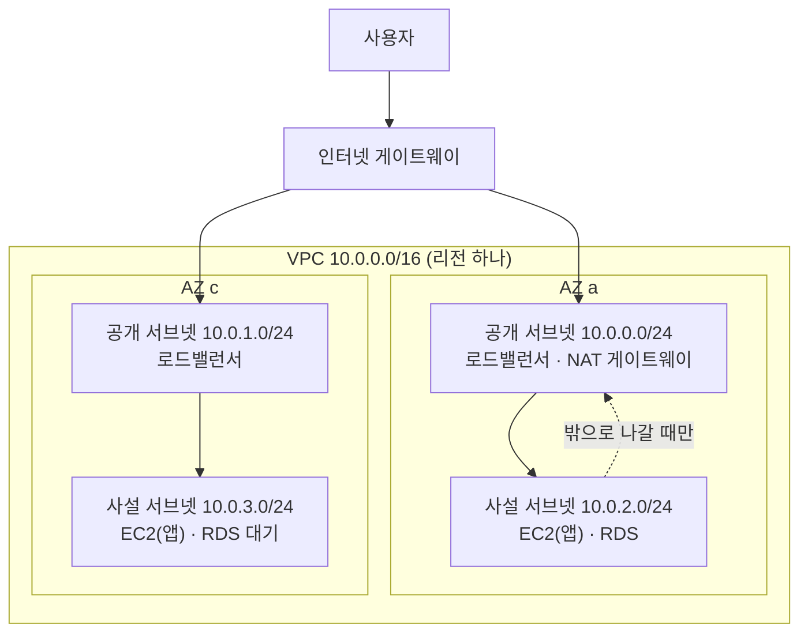
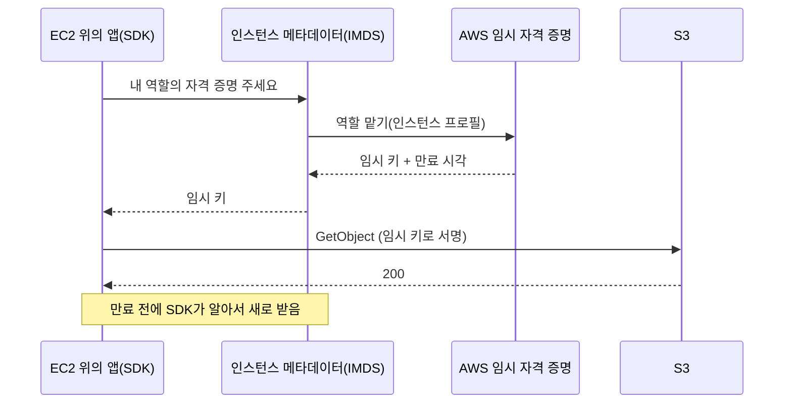

AWS 콘솔을 처음 열면 서비스가 200개가 넘는데, 웹 서비스 하나를 올리는 데 꼭 알아야 하는 건 세 가지였다. 서버를 빌리는 EC2, 그 서버를 넣을 사설 네트워크인 VPC, 누가 무엇을 할 수 있는지 정하는 IAM. 클라우드 일반 개념(IaaS·리전·AZ)은 [클라우드 기초](#/post/cloud-basics)에 있으니 여기서는 이 셋을 실제 구성 순서대로 본다.

## 한 장으로 보는 구성

웹 서비스를 AWS에 올릴 때 흔히 쓰는 모양이다. 바깥에서 들어오는 문은 공개 서브넷에만 두고, 서버와 DB는 사설 서브넷에 숨긴다.



AZ를 두 개 쓰는 이유는 데이터센터 하나가 멈춰도 다른 쪽이 받게 하려는 것이다. 로드밸런서가 두 AZ의 EC2에 나눠 보내는 이야기는 [로드밸런서](#/post/infra-load-balancer)에 있다.

## 1. EC2: 빌려 쓰는 가상 서버

1. **인스턴스**: EC2에서 빌린 가상 서버 한 대. 물리 서버 위에 하이퍼바이저가 나눠 준 VM이다.
2. **인스턴스 유형**: `t3.micro`, `m7g.large`처럼 적는다. 앞 글자가 계열(t는 버스트형 범용, m은 범용, c는 계산, r은 메모리, g는 GPU 계열 등), 숫자가 세대, 뒤에 붙은 g는 ARM(Graviton) 프로세서, 마지막이 크기다. 크기가 한 단계 오를 때마다 vCPU와 메모리가 대략 두 배가 된다.
3. **AMI(Amazon Machine Image)**: 인스턴스를 찍어 내는 틀. OS와 미리 깔아 둔 소프트웨어가 들어 있다. 내가 세팅한 서버를 AMI로 떠 두면 똑같은 서버를 몇 대든 만든다. [Docker 이미지](#/post/cloud-docker)와 비슷한 생각인데 단위가 VM 전체다.
4. **EBS(Elastic Block Store)**: 인스턴스에 붙이는 네트워크 디스크. 인스턴스와 따로 살아서, 인스턴스를 멈춰도 데이터가 남는다. 반대로 인스턴스 스토어는 물리 서버에 붙은 디스크라 빠르지만 멈추면 사라진다.
5. **중지와 종료**: 중지(stop)는 전원만 끈 상태라 컴퓨팅 요금은 안 나가지만 EBS 요금은 계속 나간다. 종료(terminate)는 삭제다. 루트 EBS는 기본 설정상 종료와 함께 지워진다.
6. **구매 방식**: 쓴 만큼 내는 온디맨드, 1~3년 사용을 약정하고 할인받는 Savings Plans·예약 인스턴스, 남는 용량을 싸게 쓰는 대신 AWS가 2분 전 예고하고 회수할 수 있는 스팟. 스팟은 중간에 꺼져도 괜찮은 배치 작업에 맞는다.

서버에 처음 접속할 때 쓰는 키 페어(SSH 키)와, 부팅할 때 한 번 돌릴 스크립트를 넣는 user data도 자주 만난다. 키 페어의 개인 키는 내려받는 순간 한 번뿐이라 잃어버리면 다시 받을 수 없다.

## 2. VPC: 내 서버만 쓰는 사설 네트워크

1. **VPC**: 리전 안에 만드는 나만의 가상 네트워크. 처음에 `10.0.0.0/16` 같은 주소 범위(CIDR)를 정한다. `/16`은 앞 16비트가 고정이라는 뜻이고 주소가 65,536개다.
2. **서브넷**: VPC 주소 범위를 잘라 AZ 하나에 붙인 것. 서브넷은 AZ를 넘지 못한다. 그래서 위 그림처럼 AZ마다 서브넷을 따로 둔다.
3. **라우팅 테이블과 인터넷 게이트웨이(IGW)**: 서브넷이 공개인지 사설인지는 이름이 아니라 라우팅 테이블이 정한다. `0.0.0.0/0`(그 밖의 모든 곳)으로 가는 경로가 IGW를 향하면 공개 서브넷이다.
4. **NAT 게이트웨이**: 사설 서브넷의 서버가 패키지 업데이트나 외부 API 호출처럼 밖으로 나가야 할 때 거치는 출구. 나가는 연결만 되고 바깥에서 먼저 들어오는 연결은 안 된다. 시간당 요금과 처리한 데이터 GB당 요금이 붙어서 작은 프로젝트에서는 은근히 큰 비용이 된다.
5. **보안 그룹과 네트워크 ACL**: 둘 다 방화벽인데 성격이 다르다. 아래 표로 따로 본다.

주소 계산은 파이썬 `ipaddress`로 해 봤다. AWS는 서브넷마다 주소 5개(맨 앞 4개와 마지막 1개)를 예약한다.

```python
import ipaddress
vpc = ipaddress.ip_network('10.0.0.0/16')
print('VPC', vpc, '주소', vpc.num_addresses)
subnets = list(vpc.subnets(new_prefix=24))[:4]
names = ['public-a', 'public-c', 'private-a', 'private-c']
for name, s in zip(names, subnets):
    usable = s.num_addresses - 5          # AWS가 서브넷마다 5개를 예약
    print(f'{name:10} {s}  전체 {s.num_addresses}, 쓸 수 있는 것 {usable}, 예: {s[4]} ~ {s[-2]}')
print('10.0.1.37은 어느 서브넷?', [n for n, s in zip(names, subnets) if ipaddress.ip_address('10.0.1.37') in s])
```

```
VPC 10.0.0.0/16 주소 65536
public-a   10.0.0.0/24  전체 256, 쓸 수 있는 것 251, 예: 10.0.0.4 ~ 10.0.0.254
public-c   10.0.1.0/24  전체 256, 쓸 수 있는 것 251, 예: 10.0.1.4 ~ 10.0.1.254
private-a  10.0.2.0/24  전체 256, 쓸 수 있는 것 251, 예: 10.0.2.4 ~ 10.0.2.254
private-c  10.0.3.0/24  전체 256, 쓸 수 있는 것 251, 예: 10.0.3.4 ~ 10.0.3.254
10.0.1.37은 어느 서브넷? ['public-c']
```

`/24` 하나에 256개지만 실제로 쓸 수 있는 건 251개다. VPC를 처음 만들 때 범위를 너무 작게 잡으면 나중에 늘리기 번거로우니 넉넉하게 잡고 서브넷을 잘라 쓰는 게 보통이다. IP와 라우팅 자체는 [DNS와 IP·라우팅](#/post/net-dns-routing)에 있다.

### 보안 그룹 vs 네트워크 ACL

| | 보안 그룹(SG) | 네트워크 ACL(NACL) |
|---|---|---|
| 붙는 곳 | 인스턴스(네트워크 인터페이스) | 서브넷 |
| 상태 | 상태 저장(stateful): 들어온 요청의 응답은 자동 허용 | 상태 비저장(stateless): 응답 방향도 규칙이 따로 필요 |
| 규칙 | 허용만 적는다 | 허용과 거부 둘 다 |
| 평가 | 모든 규칙을 보고 하나라도 허용하면 통과 | 번호 순서대로 보다가 처음 맞는 규칙으로 결정 |
| 다른 대상 참조 | "이 SG가 붙은 것에서 오는 트래픽" 식으로 가능 | IP 범위만 |

AWS 문서는 보안 그룹을 기본 수단으로 쓰고, NACL은 특정 IP를 막는 것처럼 서브넷 단위의 굵은 보조 장치로 쓰라고 권한다. 실무에서 자주 쓰는 패턴은 "DB 보안 그룹은 앱 서버 보안 그룹에서 오는 5432 포트만 허용"처럼 IP 대신 보안 그룹을 참조하는 것이다. 앱 서버가 늘거나 IP가 바뀌어도 규칙을 안 고쳐도 된다.

## 3. IAM: 누가 무엇을 할 수 있나

1. **사용자(User)**: 사람이나 프로그램 하나에 주는 장기 자격 증명(비밀번호, 액세스 키).
2. **그룹(Group)**: 사용자를 묶어 권한을 한 번에 주는 단위.
3. **역할(Role)**: 특정 주체가 잠깐 빌려 쓰는 권한. 쓰는 동안만 유효한 임시 자격 증명이 나온다. EC2 인스턴스, Lambda, 다른 AWS 계정이 역할을 맡는다.
4. **정책(Policy)**: 권한을 적은 JSON. `Effect`(Allow/Deny), `Action`(예: `s3:GetObject`), `Resource`(ARN), 필요하면 `Condition`으로 이뤄진다.
5. **루트 계정**: 가입할 때 만든 계정. 모든 권한이 있어서 일상 작업에는 쓰지 않고 MFA를 건 채 잠가 두라는 게 AWS 권장 사항이다.

평가 규칙이 핵심이다. AWS 문서의 평가 로직을 단순화하면 이렇다. 아무것도 허용하지 않았으면 기본 거부, 어딘가에서 허용하면 허용, 그런데 어디서든 명시적 Deny가 하나라도 맞으면 무조건 거부. 이 순서를 작은 코드로 흉내 내 봤다.

```python
import fnmatch

def allowed(policies, action, resource):
    """AWS 문서의 평가 순서를 단순화: 명시적 Deny > Allow > 기본 거부"""
    decision = '기본 거부(아무 Allow도 없음)'
    for p in policies:
        for st in p['Statement']:
            if any(fnmatch.fnmatch(action, a) for a in st['Action']) and \
               any(fnmatch.fnmatch(resource, r) for r in st['Resource']):
                if st['Effect'] == 'Deny':
                    return '거부(명시적 Deny)'
                decision = '허용'
    return decision

read_bucket = {'Statement': [{'Effect': 'Allow', 'Action': ['s3:GetObject', 's3:ListBucket'],
                              'Resource': ['arn:aws:s3:::my-logs', 'arn:aws:s3:::my-logs/*']}]}
no_delete = {'Statement': [{'Effect': 'Deny', 'Action': ['s3:Delete*'], 'Resource': ['*']}]}
admin = {'Statement': [{'Effect': 'Allow', 'Action': ['*'], 'Resource': ['*']}]}

cases = [([read_bucket], 's3:GetObject', 'arn:aws:s3:::my-logs/2026/11/25.log'),
         ([read_bucket], 's3:PutObject', 'arn:aws:s3:::my-logs/x.log'),
         ([read_bucket], 's3:GetObject', 'arn:aws:s3:::other-bucket/a.txt'),
         ([admin, no_delete], 's3:DeleteObject', 'arn:aws:s3:::my-logs/x.log'),
         ([admin, no_delete], 'ec2:RunInstances', '*')]
for pol, act, res in cases:
    print(f'{act:18} {res:45} -> {allowed(pol, act, res)}')
```

```
s3:GetObject       arn:aws:s3:::my-logs/2026/11/25.log           -> 허용
s3:PutObject       arn:aws:s3:::my-logs/x.log                    -> 기본 거부(아무 Allow도 없음)
s3:GetObject       arn:aws:s3:::other-bucket/a.txt               -> 기본 거부(아무 Allow도 없음)
s3:DeleteObject    arn:aws:s3:::my-logs/x.log                    -> 거부(명시적 Deny)
ec2:RunInstances   *                                             -> 허용
```

관리자 권한(`*`)이 있어도 Deny 정책 하나가 삭제를 막았다. 실제 AWS는 여기에 조직 단위 정책(SCP), 리소스 기반 정책, 권한 경계, 세션 정책까지 겹쳐서 판단하니 이 코드는 뼈대만 보여 준다. 실제로 확인하려면 AWS의 IAM 정책 시뮬레이터를 쓰면 된다.

### 서버에 키를 두지 않는 법: EC2에 역할 붙이기

EC2의 앱이 S3를 읽어야 할 때 액세스 키를 `.env`에 넣으면 키가 서버 디스크와 코드 저장소로 새기 쉽다. AWS가 권하는 방법은 역할을 인스턴스에 붙이는 것이다.



SDK는 키가 코드나 환경변수에 없으면 인스턴스 메타데이터에서 임시 키를 찾아 쓴다. 키가 몇 시간이면 만료되고 자동으로 바뀌니, 새어 나가도 피해 시간이 짧다. 키를 코드 밖에 두는 일반 원칙은 [환경변수와 시크릿 관리](#/post/cloud-secrets)와 [키·시크릿 관리](#/post/sec-keys)에 있다.

## 흔한 오해

- 공개 서브넷은 이름에 public을 붙인 서브넷이다: 라우팅 테이블에 IGW로 가는 경로가 있어야 공개다. 이름은 아무 의미가 없다.
- 인스턴스를 중지하면 돈이 안 나간다: 컴퓨팅 요금만 멈춘다. EBS, 고정 IP(Elastic IP), NAT 게이트웨이 요금은 계속 나간다. 2024년부터는 공인 IPv4 주소도 시간당 요금이 붙는다.
- 보안 그룹에 거부 규칙을 넣어 특정 IP를 막는다: 보안 그룹은 허용만 적는다. 특정 대상을 막는 건 NACL로 한다.
- 관리자 정책을 줬으니 다 된다: 어딘가의 명시적 Deny가 이긴다. 조직 정책(SCP)도 위에서 막을 수 있다.
- 사설 서브넷 서버는 인터넷이 아예 안 된다: NAT 게이트웨이를 거쳐 나가는 건 된다. 바깥에서 먼저 들어오는 게 안 될 뿐이다.

## 직접 설명할 수 있어야 할 핵심 개념

1. **EC2 인스턴스와 유형**: 빌려 쓰는 VM. 유형 이름은 계열·세대·프로세서·크기다.
2. **AMI와 EBS**: AMI는 서버를 찍어 내는 틀, EBS는 인스턴스와 따로 사는 네트워크 디스크.
3. **구매 방식**: 온디맨드, 약정 할인, 스팟(싸지만 2분 예고 후 회수될 수 있음).
4. **VPC·서브넷·CIDR**: 리전 안의 사설 네트워크, AZ 하나에 붙는 주소 조각, 그 범위를 적는 표기법.
5. **공개/사설 서브넷**: 라우팅 테이블에 IGW 경로가 있으면 공개. 사설 서브넷은 NAT 게이트웨이로만 밖에 나간다.
6. **보안 그룹 vs NACL**: 인스턴스 단위·상태 저장·허용만 vs 서브넷 단위·상태 비저장·허용과 거부.
7. **IAM 사용자·그룹·역할·정책**: 장기 자격 증명을 가진 주체, 묶음, 잠깐 빌리는 권한, 권한을 적은 JSON.
8. **정책 평가**: 기본 거부 → Allow가 있으면 허용 → 명시적 Deny가 있으면 무조건 거부.
9. **EC2 역할(인스턴스 프로필)**: 서버에 키를 두지 않고 메타데이터에서 임시 자격 증명을 받는다.

## 같이 보면 좋은 글

← [클라우드·배포 map](#/post/cloud-map)

- [클라우드 기초](#/post/cloud-basics): IaaS·PaaS·SaaS, 리전과 AZ
- [로드밸런서](#/post/infra-load-balancer): 공개 서브넷 앞단에 놓이는 장치
- [오토스케일링과 확장](#/post/infra-autoscaling): EC2를 자동으로 늘리고 줄이기
- [인증과 인가](#/post/be-auth): IAM과 같은 권한 모델(RBAC)의 일반론

## 근거 링크

- AWS 문서, What is Amazon EC2?: https://docs.aws.amazon.com/AWSEC2/latest/UserGuide/concepts.html
- AWS 문서, What is Amazon EBS?: https://docs.aws.amazon.com/ebs/latest/userguide/what-is-ebs.html
- AWS 문서, Spot Instance interruption notices: https://docs.aws.amazon.com/AWSEC2/latest/UserGuide/spot-instance-termination-notices.html
- AWS 문서, How Amazon VPC works: https://docs.aws.amazon.com/vpc/latest/userguide/how-it-works.html
- AWS 문서, Subnet CIDR blocks (예약 주소 5개): https://docs.aws.amazon.com/vpc/latest/userguide/subnet-sizing.html
- AWS 문서, NAT gateways: https://docs.aws.amazon.com/vpc/latest/userguide/vpc-nat-gateway.html
- AWS 문서, Infrastructure security in Amazon VPC (보안 그룹과 NACL): https://docs.aws.amazon.com/vpc/latest/userguide/infrastructure-security.html
- AWS 문서, Policy evaluation logic: https://docs.aws.amazon.com/IAM/latest/UserGuide/reference_policies_evaluation-logic.html
- AWS 문서, Use an IAM role to grant permissions to applications running on EC2: https://docs.aws.amazon.com/IAM/latest/UserGuide/id_roles_use_switch-role-ec2.html
- AWS 문서, Security best practices in IAM: https://docs.aws.amazon.com/IAM/latest/UserGuide/best-practices.html

참고(같은 주제를 그림으로 잘 정리한 글)

- Inpa Dev, EC2 개념 원리 & 사용 세팅 총정리 (Instance / EBS / AMI): https://inpa.tistory.com/entry/AWS-%F0%9F%93%9A-EC2-%EA%B0%9C%EB%85%90-%EC%82%AC%EC%9A%A9-%EA%B5%AC%EC%B6%95-%EC%84%B8%ED%8C%85-%F0%9F%92%AF-%EC%A0%95%EB%A6%AC-%EC%9D%B8%EC%8A%A4%ED%84%B4%EC%8A%A4-EBS-AMI
- Inpa Dev, VPC 개념 & 사용 - 인프라 구축 [Subnet / Routing / Internet Gateway]: https://inpa.tistory.com/entry/AWS-%F0%9F%93%9A-VPC-%EC%82%AC%EC%9A%A9-%EC%84%9C%EB%B8%8C%EB%84%B7-%EC%9D%B8%ED%84%B0%EB%84%B7-%EA%B2%8C%EC%9D%B4%ED%8A%B8%EC%9B%A8%EC%9D%B4-NAT-%EB%B3%B4%EC%95%88%EA%B7%B8%EB%A3%B9-NACL-Bastion-Host
- Inpa Dev, VPC 개념 & 사용 - 보안 설정 [Security Group / NACL]: https://inpa.tistory.com/entry/AWS-%F0%9F%93%9A-VPC-%EA%B0%9C%EB%85%90-%EC%82%AC%EC%9A%A9-%EB%B3%B4%EC%95%88-%EC%84%A4%EC%A0%95-Security-Group-NACL
- Inpa Dev, EC2 요금 모델 정말 알기 쉽게 설명: https://inpa.tistory.com/entry/AWS-%F0%9F%93%9A-EC2-%EA%B0%80%EA%B2%A9-%EC%9A%94%EA%B8%88-%EB%AA%A8%EB%8D%B8-%EC%9B%90%EB%A6%AC-%F0%9F%92%B0-%ED%8C%8C%ED%97%A4%EC%B9%98%EA%B8%B0
- Inpa Dev, IAM 개념 원리 & IAM 계정 · 정책 생성하기: https://inpa.tistory.com/entry/AWS-%F0%9F%93%9A-IAM-%EA%B0%9C%EB%85%90-%EC%9B%90%EB%A6%ACuser-group-policy-role-IAM-%EA%B3%84%EC%A0%95-%EC%A0%95%EC%B1%85-%EC%83%9D%EC%84%B1
