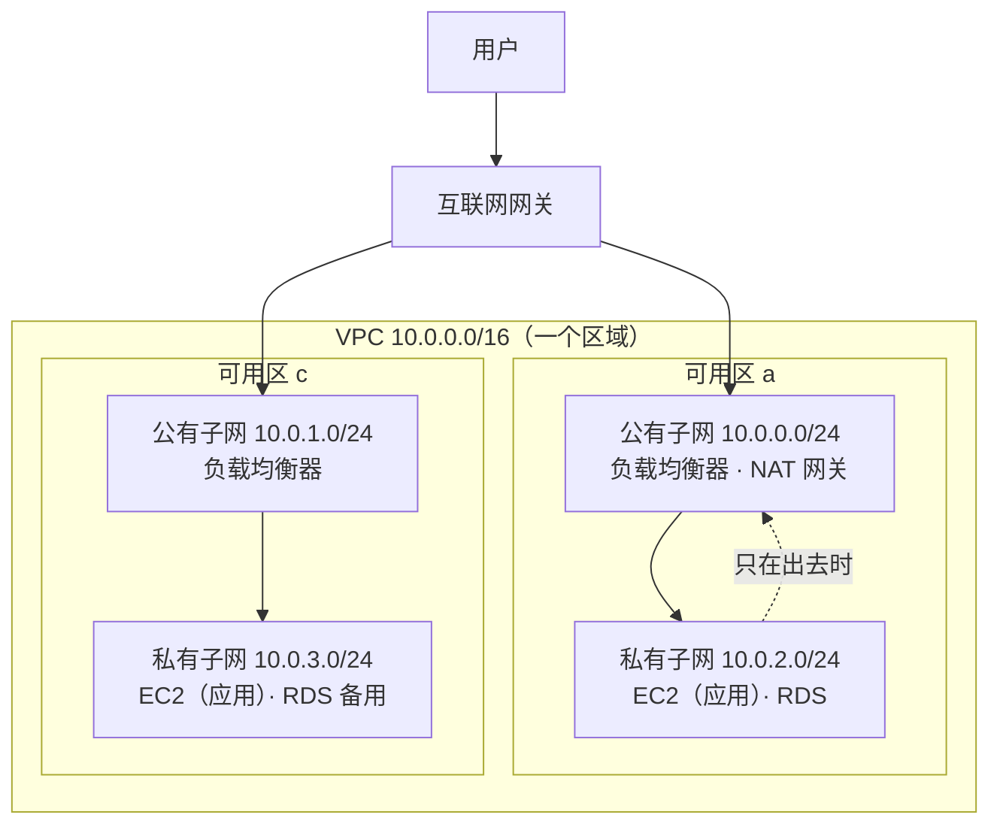
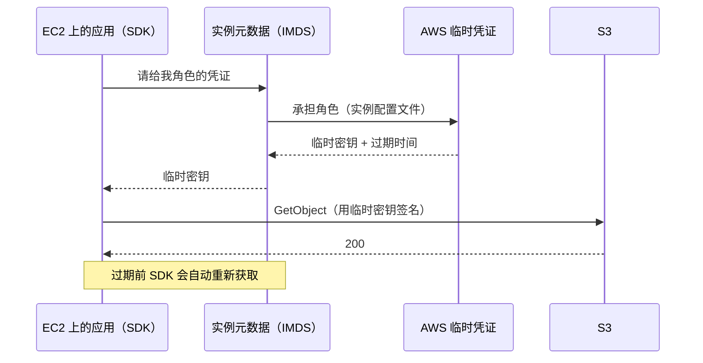

第一次打开 AWS 控制台，服务有 200 多个，但要把一个 Web 服务放上去，必须懂的只有三个：租服务器的 EC2，放服务器的私有网络 VPC，以及决定谁能做什么的 IAM。云的通用概念（IaaS、区域、可用区）在 [云计算基础](#/post/cloud-basics) 里，这里按实际搭建的顺序看这三个。

## 一张图看整体结构

把 Web 服务放到 AWS 上时常见的形态。外部进来的入口只放在公有子网，服务器和数据库藏在私有子网里。



用两个可用区，是为了一个数据中心停了另一个还能接住。负载均衡器把流量分给两个可用区的 EC2，见 [负载均衡](#/post/infra-load-balancer)。

## 1. EC2：租来用的虚拟服务器

1. **实例**：从 EC2 租的一台虚拟服务器。是虚拟机管理程序在物理服务器上切出来的虚拟机。
2. **实例类型**：写成 `t3.micro`、`m7g.large` 这样。第一个字母是系列（t 是突发型通用，m 是通用，c 是计算，r 是内存，g 是 GPU 系列等），数字是代数，后面带的 g 表示 ARM（Graviton）处理器，最后是规格。规格每升一级，vCPU 和内存大约翻倍。
3. **AMI（Amazon Machine Image）**：生成实例的模板，里面有操作系统和预装的软件。把配置好的服务器做成 AMI，想要几台一样的服务器都行。和 [Docker 镜像](#/post/cloud-docker) 思路类似，但单位是整台虚拟机。
4. **EBS（Elastic Block Store）**：挂在实例上的网络磁盘。它和实例分开存在，所以实例停止了数据还在。相反，实例存储是物理服务器上的磁盘，快，但一停就没了。
5. **停止与终止**：停止（stop）只是关机，不收计算费用，但 EBS 费用照收。终止（terminate）就是删除。根 EBS 卷按默认设置会随终止一起删除。
6. **购买方式**：按用量付费的按需实例；承诺使用 1～3 年换折扣的 Savings Plans、预留实例；便宜使用闲置容量、但 AWS 可以提前 2 分钟通知后回收的竞价实例（Spot）。Spot 适合中途被停也没关系的批处理任务。

第一次登录服务器时用的密钥对（SSH 密钥），以及启动时只运行一次的脚本 user data 也经常碰到。密钥对的私钥只能下载一次，丢了就拿不回来。

## 2. VPC：只给自己服务器用的私有网络

1. **VPC**：在区域里建的自己的虚拟网络。一开始要定一个 `10.0.0.0/16` 这样的地址范围（CIDR）。`/16` 表示前 16 位固定，有 65,536 个地址。
2. **子网**：把 VPC 地址范围切一块，绑定到一个可用区。子网不能跨可用区，所以像上图那样每个可用区各建子网。
3. **路由表与互联网网关（IGW）**：子网是公有还是私有，看的不是名字而是路由表。去往 `0.0.0.0/0`（其他所有地方）的路由指向 IGW，就是公有子网。
4. **NAT 网关**：私有子网的服务器需要出去时（比如更新软件包、调用外部 API）经过的出口。只能出、不能让外部先连进来。按小时收费，还按处理的数据量（GB）收费，小项目里是一笔不小的开销。
5. **安全组与网络 ACL**：两者都是防火墙，但性质不同，下面用表格单独看。

我用 Python 的 `ipaddress` 算了一下地址。AWS 在每个子网保留 5 个地址（最前面 4 个和最后 1 个）。

```python
import ipaddress
vpc = ipaddress.ip_network('10.0.0.0/16')
print('VPC', vpc, '주소', vpc.num_addresses)
subnets = list(vpc.subnets(new_prefix=24))[:4]
names = ['public-a', 'public-c', 'private-a', 'private-c']
for name, s in zip(names, subnets):
    usable = s.num_addresses - 5          # AWS가 서브넷마다 5개를 예약
    print(f'{name:10} {s}  전체 {s.num_addresses}, 쓸 수 있는 것 {usable}, 예: {s[4]} ~ {s[-2]}')
print('10.0.1.37은 어느 서브넷?', [n for n, s in zip(names, subnets) if ipaddress.ip_address('10.0.1.37') in s])
```

```
VPC 10.0.0.0/16 주소 65536
public-a   10.0.0.0/24  전체 256, 쓸 수 있는 것 251, 예: 10.0.0.4 ~ 10.0.0.254
public-c   10.0.1.0/24  전체 256, 쓸 수 있는 것 251, 예: 10.0.1.4 ~ 10.0.1.254
private-a  10.0.2.0/24  전체 256, 쓸 수 있는 것 251, 예: 10.0.2.4 ~ 10.0.2.254
private-c  10.0.3.0/24  전체 256, 쓸 수 있는 것 251, 예: 10.0.3.4 ~ 10.0.3.254
10.0.1.37은 어느 서브넷? ['public-c']
```

（`주소` 是地址，`전체` 是总数，`쓸 수 있는 것` 是可用数，`어느 서브넷?` 是“在哪个子网？”。）一个 `/24` 有 256 个地址，实际能用的是 251 个。VPC 一开始范围定得太小，以后扩起来很麻烦，所以通常给足范围，再从中切子网。IP 和路由本身见 [DNS 与 IP 路由](#/post/net-dns-routing)。

### 安全组 vs 网络 ACL

| | 安全组（SG） | 网络 ACL（NACL） |
|---|---|---|
| 挂在哪里 | 实例（网络接口） | 子网 |
| 状态 | 有状态：允许进来的请求，其响应自动放行 | 无状态：返回方向也要单独写规则 |
| 规则 | 只写允许 | 允许和拒绝都可以 |
| 评估 | 看所有规则，有一条允许就放行 | 按编号顺序看，第一条匹配的规则决定 |
| 引用其他对象 | 可以，比如“来自挂了这个 SG 的对象的流量” | 只能写 IP 范围 |

AWS 文档建议把安全组当作主要手段，NACL 则作为子网级的粗粒度辅助手段，比如封禁特定 IP。实际中常见的模式是“数据库安全组只允许来自应用服务器安全组的 5432 端口”，用安全组代替 IP 来引用。应用服务器增加或 IP 变了，规则都不用改。

## 3. IAM：谁能做什么

1. **用户（User）**：给一个人或一个程序的长期凭证（密码、访问密钥）。
2. **组（Group）**：把用户打包、一次性授予权限的单位。
3. **角色（Role）**：某个主体临时借用的权限，只在使用期间有效的临时凭证。EC2 实例、Lambda、其他 AWS 账号会承担角色。
4. **策略（Policy）**：写着权限的 JSON，由 `Effect`（Allow/Deny）、`Action`（例如 `s3:GetObject`）、`Resource`（ARN），以及必要时的 `Condition` 组成。
5. **根账号**：注册时创建的账号。它拥有全部权限，所以 AWS 建议日常不要用，开启 MFA 后锁起来。

评估规则是核心。把 AWS 文档的评估逻辑简化一下就是：什么都没允许就默认拒绝；某处允许了就允许；但只要任何地方有一条显式 Deny 匹配，就无条件拒绝。我用一小段代码模仿了这个顺序。

```python
import fnmatch

def allowed(policies, action, resource):
    """AWS 문서의 평가 순서를 단순화: 명시적 Deny > Allow > 기본 거부"""
    decision = '기본 거부(아무 Allow도 없음)'
    for p in policies:
        for st in p['Statement']:
            if any(fnmatch.fnmatch(action, a) for a in st['Action']) and \
               any(fnmatch.fnmatch(resource, r) for r in st['Resource']):
                if st['Effect'] == 'Deny':
                    return '거부(명시적 Deny)'
                decision = '허용'
    return decision

read_bucket = {'Statement': [{'Effect': 'Allow', 'Action': ['s3:GetObject', 's3:ListBucket'],
                              'Resource': ['arn:aws:s3:::my-logs', 'arn:aws:s3:::my-logs/*']}]}
no_delete = {'Statement': [{'Effect': 'Deny', 'Action': ['s3:Delete*'], 'Resource': ['*']}]}
admin = {'Statement': [{'Effect': 'Allow', 'Action': ['*'], 'Resource': ['*']}]}

cases = [([read_bucket], 's3:GetObject', 'arn:aws:s3:::my-logs/2026/11/25.log'),
         ([read_bucket], 's3:PutObject', 'arn:aws:s3:::my-logs/x.log'),
         ([read_bucket], 's3:GetObject', 'arn:aws:s3:::other-bucket/a.txt'),
         ([admin, no_delete], 's3:DeleteObject', 'arn:aws:s3:::my-logs/x.log'),
         ([admin, no_delete], 'ec2:RunInstances', '*')]
for pol, act, res in cases:
    print(f'{act:18} {res:45} -> {allowed(pol, act, res)}')
```

```
s3:GetObject       arn:aws:s3:::my-logs/2026/11/25.log           -> 허용
s3:PutObject       arn:aws:s3:::my-logs/x.log                    -> 기본 거부(아무 Allow도 없음)
s3:GetObject       arn:aws:s3:::other-bucket/a.txt               -> 기본 거부(아무 Allow도 없음)
s3:DeleteObject    arn:aws:s3:::my-logs/x.log                    -> 거부(명시적 Deny)
ec2:RunInstances   *                                             -> 허용
```

（`허용` 是允许，`기본 거부(아무 Allow도 없음)` 是默认拒绝（没有任何 Allow），`거부(명시적 Deny)` 是拒绝（显式 Deny）。）即使有管理员权限（`*`），一条 Deny 策略也挡住了删除。真实的 AWS 还会叠加组织级策略（SCP）、基于资源的策略、权限边界、会话策略来判断，所以这段代码只展示了骨架。真要验证，可以用 AWS 的 IAM 策略模拟器。

### 不在服务器上放密钥的方法：给 EC2 挂角色

EC2 上的应用需要读 S3 时，如果把访问密钥写进 `.env`，密钥很容易泄露到服务器磁盘和代码仓库。AWS 推荐的做法是给实例挂上角色。



代码和环境变量里没有密钥时，SDK 会到实例元数据里找临时密钥来用。密钥几小时就过期并自动轮换，即使泄露，受害时间也很短。把密钥放在代码之外的通用原则，见 [环境变量与密钥管理](#/post/cloud-secrets) 和 [密钥与机密管理](#/post/sec-keys)。

## 常见误解

- 公有子网就是名字里带 public 的子网：路由表里有指向 IGW 的路由才是公有。名字没有任何意义。
- 实例停止了就不花钱：停的只是计算费用。EBS、弹性 IP、NAT 网关照样收费。从 2024 年起，公网 IPv4 地址也按小时收费。
- 在安全组里加拒绝规则来封某个 IP：安全组只能写允许。封禁特定来源要用 NACL。
- 给了管理员策略就什么都能做：任何地方的显式 Deny 都优先。组织策略（SCP）也能从上层拦住。
- 私有子网的服务器完全上不了网：经过 NAT 网关出去是可以的，只是外部不能先连进来。

## 必须能自己讲清楚的核心概念

1. **EC2 实例与类型**：租来的虚拟机。类型名由系列、代数、处理器、规格组成。
2. **AMI 与 EBS**：AMI 是生成服务器的模板，EBS 是与实例分开存在的网络磁盘。
3. **购买方式**：按需、承诺折扣、Spot（便宜但可能在 2 分钟通知后被回收）。
4. **VPC、子网、CIDR**：区域内的私有网络、绑定到一个可用区的地址片段、表示范围的写法。
5. **公有/私有子网**：路由表里有 IGW 路由就是公有。私有子网只能经 NAT 网关出去。
6. **安全组 vs NACL**：实例级、有状态、只允许 vs 子网级、无状态、允许和拒绝。
7. **IAM 的用户、组、角色、策略**：持有长期凭证的主体、分组、临时借用的权限、写着权限的 JSON。
8. **策略评估**：默认拒绝 → 有 Allow 就允许 → 有显式 Deny 就无条件拒绝。
9. **EC2 角色（实例配置文件）**：服务器上不放密钥，从元数据获取临时凭证。

## 推荐阅读

← [云部署 map](#/post/cloud-map)

- [云计算基础](#/post/cloud-basics)：IaaS、PaaS、SaaS，区域与可用区
- [负载均衡](#/post/infra-load-balancer)：放在公有子网前端的设备
- [自动扩缩容](#/post/infra-autoscaling)：自动增减 EC2
- [认证与授权](#/post/be-auth)：与 IAM 同类的权限模型（RBAC）的一般理论

## 参考链接

- AWS 文档, What is Amazon EC2?: https://docs.aws.amazon.com/AWSEC2/latest/UserGuide/concepts.html
- AWS 文档, What is Amazon EBS?: https://docs.aws.amazon.com/ebs/latest/userguide/what-is-ebs.html
- AWS 文档, Spot Instance interruption notices: https://docs.aws.amazon.com/AWSEC2/latest/UserGuide/spot-instance-termination-notices.html
- AWS 文档, How Amazon VPC works: https://docs.aws.amazon.com/vpc/latest/userguide/how-it-works.html
- AWS 文档, Subnet CIDR blocks （保留 5 个地址）: https://docs.aws.amazon.com/vpc/latest/userguide/subnet-sizing.html
- AWS 文档, NAT gateways: https://docs.aws.amazon.com/vpc/latest/userguide/vpc-nat-gateway.html
- AWS 文档, Infrastructure security in Amazon VPC （安全组与 NACL）: https://docs.aws.amazon.com/vpc/latest/userguide/infrastructure-security.html
- AWS 文档, Policy evaluation logic: https://docs.aws.amazon.com/IAM/latest/UserGuide/reference_policies_evaluation-logic.html
- AWS 文档, Use an IAM role to grant permissions to applications running on EC2: https://docs.aws.amazon.com/IAM/latest/UserGuide/id_roles_use_switch-role-ec2.html
- AWS 文档, Security best practices in IAM: https://docs.aws.amazon.com/IAM/latest/UserGuide/best-practices.html

参考（用图解把同一主题讲得很清楚的韩语文章）

- Inpa Dev, EC2 概念与使用设置总结（Instance / EBS / AMI）: https://inpa.tistory.com/entry/AWS-%F0%9F%93%9A-EC2-%EA%B0%9C%EB%85%90-%EC%82%AC%EC%9A%A9-%EA%B5%AC%EC%B6%95-%EC%84%B8%ED%8C%85-%F0%9F%92%AF-%EC%A0%95%EB%A6%AC-%EC%9D%B8%EC%8A%A4%ED%84%B4%EC%8A%A4-EBS-AMI
- Inpa Dev, VPC 概念与使用 - 搭建基础设施 [Subnet / Routing / Internet Gateway]: https://inpa.tistory.com/entry/AWS-%F0%9F%93%9A-VPC-%EC%82%AC%EC%9A%A9-%EC%84%9C%EB%B8%8C%EB%84%B7-%EC%9D%B8%ED%84%B0%EB%84%B7-%EA%B2%8C%EC%9D%B4%ED%8A%B8%EC%9B%A8%EC%9D%B4-NAT-%EB%B3%B4%EC%95%88%EA%B7%B8%EB%A3%B9-NACL-Bastion-Host
- Inpa Dev, VPC 概念与使用 - 安全设置 [Security Group / NACL]: https://inpa.tistory.com/entry/AWS-%F0%9F%93%9A-VPC-%EA%B0%9C%EB%85%90-%EC%82%AC%EC%9A%A9-%EB%B3%B4%EC%95%88-%EC%84%A4%EC%A0%95-Security-Group-NACL
- Inpa Dev, 通俗讲解 EC2 计费模式: https://inpa.tistory.com/entry/AWS-%F0%9F%93%9A-EC2-%EA%B0%80%EA%B2%A9-%EC%9A%94%EA%B8%88-%EB%AA%A8%EB%8D%B8-%EC%9B%90%EB%A6%AC-%F0%9F%92%B0-%ED%8C%8C%ED%97%A4%EC%B9%98%EA%B8%B0
- Inpa Dev, IAM 概念与创建 IAM 账号·策略: https://inpa.tistory.com/entry/AWS-%F0%9F%93%9A-IAM-%EA%B0%9C%EB%85%90-%EC%9B%90%EB%A6%ACuser-group-policy-role-IAM-%EA%B3%84%EC%A0%95-%EC%A0%95%EC%B1%85-%EC%83%9D%EC%84%B1
