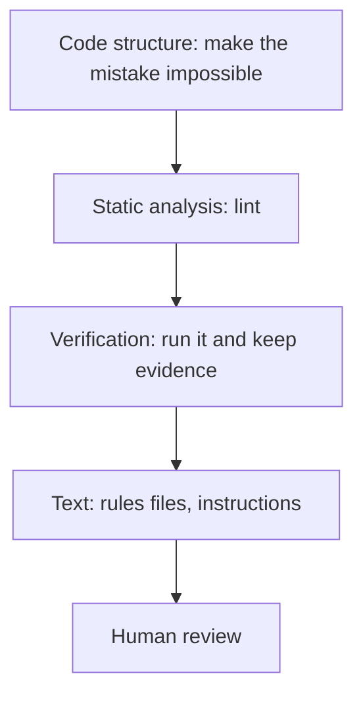

In the evening I watched a video breaking down a talk on why agent-written code keeps turning into a mess ([link](https://www.youtube.com/watch?v=ueA116hO_ho)). Then I gathered the mistakes the agents in my automation app made today, and the video was basically about us.

## One more line in the rules file

When an agent slipped up, I added one more "don't do this" line to its instructions. The trouble is, if it skips or forgets that line, the same thing happens again. The video ranks where to spend effort, top to bottom:

The higher, the more it pays off. I was mostly living in the bottom two. The idea is that every correction becomes a check a machine runs the same way every time (a deterministic check), or a design change that makes the mistake impossible. And people look at evidence, like screenshots, videos and check output, instead of code.

## What I collected today

1. **Test under the same conditions as production**: the check passed, but the app failed when it re-ran. The check ran everything; the app re-ran only part. If the conditions differ, a pass means nothing. The check should run the exact command the app runs.
2. **Don't fail silently (fail fast)**: some code returned an empty value when it couldn't find something and just kept going. When the input changed, a whole important part dropped out and nobody noticed. Stopping loudly is better. Stale values lingering and getting reused are the same kind of bug.
3. **Separate warnings from failures**: a minor warning stopped the whole job. Errors were classified by matching part of a string, so a word inside a warning got it filed as the wrong failure. Severity and error codes should live in a proper structure.
4. **Edge cases**: code that never thought about an empty list blew up right away. That's the kind of thing one test can block.
5. **Tell outside failures apart**: being blocked by an outside service isn't the same as a bug in our code. First decide whether it's a retry or a fix.

## Block the new ones first

Trying to clean up everything that already piled up never ends. Block new bad patterns with checks first, and shrink the old ones slowly later. Apparently this is called a ratchet: it only tightens one way.

We already had a fair number of checks. We just never made them mandatory. Tomorrow, starting with number one.
