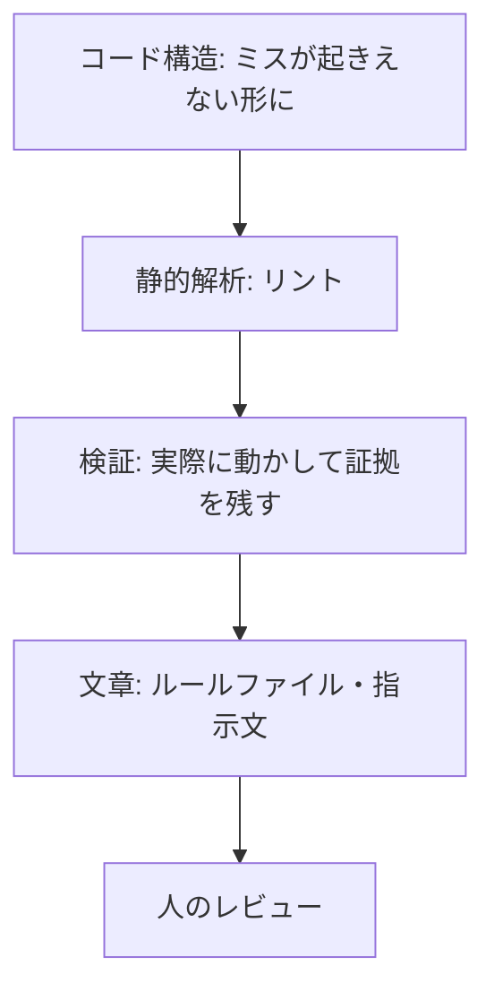

夜、エージェントが書いたコードがなぜすぐ散らかるのかを扱った発表の解説動画（[リンク](https://www.youtube.com/watch?v=ueA116hO_ho)）を観た。そのあと自動化アプリでエージェントたちが今日やったミスを集めてみたら、動画の話はほぼ自分たちの話だった。

## ルールファイルにもう一行

エージェントがミスすると、指示文に「これはやらないで」を一行足していた。問題は、その行を読まなかったり忘れたりすると、同じことがまた起きることだ。動画では手を入れる場所を上からこう並べていた。

上ほど効き目が大きい。自分がやっていたのはほぼ下の二段だった。一度直すたびに、それを機械が毎回同じように捕まえる検査（決定的な検査）に変えるか、設計を変えてそのミスを不可能にしろ、という話だった。そして人はコードの代わりに、スクリーンショットや動画、検査結果といった証拠を見る。

## 今日集めたミス

1. **本番と同じ条件で試す**: 点検は通ったのに、アプリで再実行したら失敗した。点検は全体を回し、アプリは一部だけ回していた。条件が違えば合格に意味はない。点検はアプリが実際に呼ぶコマンドそのままで回すべきだ。
2. **黙って失敗しない（fail fast）**: 探す値がないと空の値を返してそのまま進むコードがあった。入力が変わると大事な部分がまるごと抜けたのに、誰も気づかなかった。見つからなければすぐ大きく止まる方がいい。古い値が残って使われるのも同じ種類だ。
3. **警告と失敗を分ける**: 些細な警告で作業全体が止まった。エラーを文字列の一部で照合して分類していたので、警告文の中の文字のせいで別の失敗に分類されたりもした。深刻度とエラーコードは構造として別に持つのがよさそうだ。
4. **境界条件**: リストが空のときを考えていないコードがすぐ落ちた。空リストはテスト一つで防げる類いだ。
5. **外部の失敗を見分ける**: 外のサービスに弾かれたのは、こちらのコードのミスとは違う。再試行で済むのか、直すべきなのかをまず分ける。

## 新しいものから止める

すでに溜まったものを全部片づけようとすると終わらない。新しく出てくる悪いパターンを先に検査で止めて、古いものは後でゆっくり減らす。ラチェットのように一方向にだけ締めるやり方というらしい。

検査ツールはもう結構あった。必ず通るようにしていなかっただけだ。明日は1番から。
