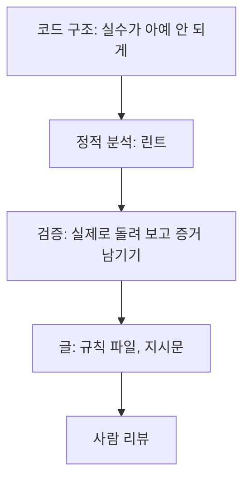

저녁에 에이전트로 짠 코드가 왜 자꾸 엉망이 되는지 다룬 발표 해설 영상([링크](https://www.youtube.com/watch?v=ueA116hO_ho))을 봤다. 그러고 자동화 앱에서 에이전트들이 오늘 낸 실수를 모아 놓고 보니, 영상 얘기가 우리 얘기였다.

## 규칙 파일에 한 줄 더

에이전트가 실수하면 나는 지시문에 "이건 하지 마"를 한 줄 더 적었다. 문제는 그 줄을 안 읽거나 잊으면 똑같은 일이 또 난다는 거다. 영상에서는 손볼 곳을 위에서부터 이렇게 놓았다.

위로 갈수록 효과가 크다. 내가 하던 건 거의 맨 아래 두 칸이었다. 한 번 교정할 때마다 그걸 기계가 매번 똑같이 잡는 검사(결정적 검사)로 바꾸거나, 설계를 바꿔서 그 실수가 불가능하게 만들라는 얘기였다. 그리고 사람은 코드 대신 스크린샷, 영상, 검사 결과 같은 증거를 본다.

## 오늘 모은 실수들

1. **운영과 같은 조건으로 시험하기**: 점검은 통과했는데 앱에서 다시 돌리니 실패했다. 점검은 전체를 돌렸고, 앱은 일부만 다시 돌렸다. 조건이 다르면 통과는 의미가 없더라. 점검은 앱이 실제로 부르는 명령 그대로 돌려야 한다.
2. **조용히 실패하지 않기(fail fast)**: 찾는 값이 없으면 빈 값을 돌려주고 그냥 넘어가는 코드가 있었다. 입력이 바뀌자 중요한 부분이 통째로 빠졌는데 아무도 몰랐다. 못 찾으면 바로 크게 멈추는 쪽이 낫다. 옛 값이 남아 있다가 쓰이는 것도 같은 종류다.
3. **경고와 실패 나누기**: 사소한 경고에 전체 작업이 멈췄다. 오류를 문자열 일부로 맞춰서 분류하다 보니, 경고 문장 안의 글자 때문에 엉뚱한 실패로 분류되기도 했다. 심각도와 오류 코드를 구조로 따로 두는 게 맞는 것 같다.
4. **경계 조건**: 목록이 비었을 때를 생각 안 한 코드가 바로 터졌다. 빈 목록은 테스트 하나로 막을 수 있는 종류다.
5. **외부 실패 구분하기**: 바깥 서비스가 막은 건 우리 코드 잘못과 다르다. 다시 시도하면 될 일인지, 고쳐야 할 일인지부터 갈라야 한다.

## 새 것부터 막는다

이미 쌓인 걸 다 치우려 하면 끝이 안 난다. 새로 생기는 나쁜 패턴을 먼저 검사로 막고, 옛날 건 나중에 천천히 줄인다. 이런 걸 래칫처럼 한쪽으로만 조이는 방식이라고 하더라.

검사 도구는 이미 꽤 있었다. 그걸 반드시 거치게 만들지 않았을 뿐이다. 내일은 1번부터.
