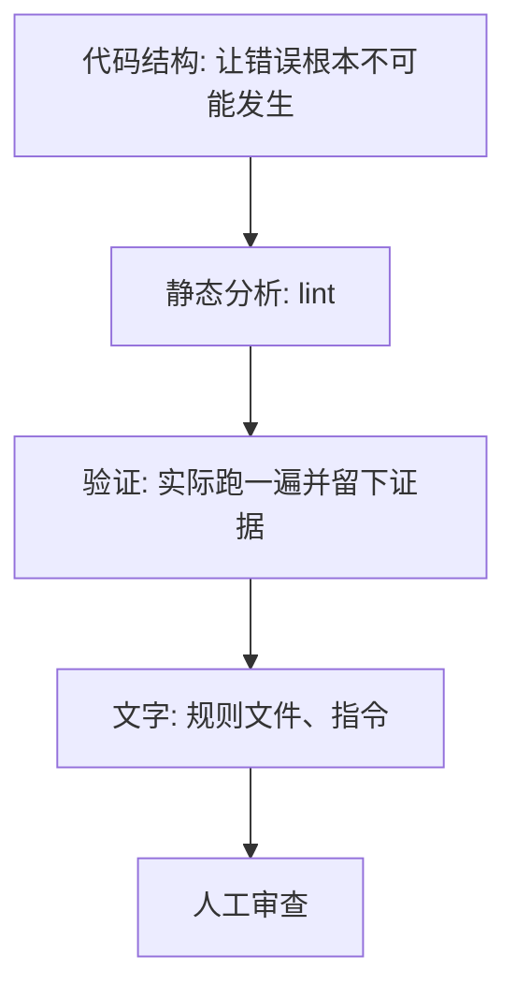

晚上看了一个解说视频，讲的是为什么代理写的代码总会变得一团糟（[链接](https://www.youtube.com/watch?v=ueA116hO_ho)）。然后把自动化应用里代理们今天犯的错收集起来一看，视频说的基本就是我们。

## 规则文件里再加一行

代理一出错，我就在指令里再加一行“别这么做”。问题是，它没读或者忘了那一行，同样的事就会再发生。视频把该下功夫的地方从上到下这样排：

越往上效果越大。我做的几乎都在最下面两格。意思是每纠正一次，就把它变成机器每次都以同样方式抓住的检查（确定性检查），或者改设计让这个错误不可能出现。人看的不是代码，而是截图、视频、检查结果这样的证据。

## 今天收集到的错误

1. **用和生产相同的条件测试**：检查通过了，应用重跑时却失败。检查跑的是全部，应用只重跑了一部分。条件不同，通过就没有意义。检查应该原样运行应用实际调用的命令。
2. **不要悄悄失败（fail fast）**：有段代码找不到值就返回空值，然后继续往下走。输入一变，重要的部分整个丢了，却没人发现。找不到就立刻大声停下更好。旧值残留下来被继续使用，也是同一类问题。
3. **区分警告和失败**：一个小警告让整个任务停了。错误是靠匹配字符串的一部分来分类的，结果警告句子里的几个字让它被归成了错误的失败类型。严重程度和错误码应该用结构单独存放。
4. **边界条件**：没考虑列表为空的代码马上就崩了。空列表这种事，一个测试就能挡住。
5. **分清外部失败**：被外部服务拦住，和我们代码的错不一样。先分清是重试就行，还是需要修。

## 先挡住新的

想把已经堆积的全部清理掉，是没有尽头的。先用检查挡住新出现的坏模式，旧的以后慢慢减少。据说这叫棘轮方式：只往一个方向拧紧。

检查工具其实已经有不少了。只是从来没让它们成为必经之路。明天从第1条开始。
