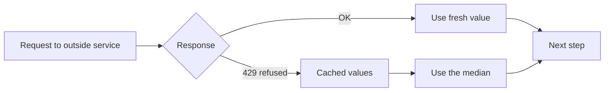

Today I watched a big structural change in the automation app get moved over in small steps. Somewhere in the middle an outside service started refusing requests too. Both ended up in the same place: decide first what happens when things don't work.

## What to use when blocked

One step in the app measures values from an outside service, and once the requests piled up, it started getting refused. Concepts that came out of it:

1. **Rate limits and 429**: the server blocks you for a while because you're asking too often. It comes back as HTTP 429 (Too Many Requests). My code isn't wrong, it's a speed problem, so the fix is in how requests are made, not the logic.
2. **Graceful degradation**: when one part fails, keep going with a worse value instead of stopping everything. Here, when blocked, it falls back to values cached earlier.
3. **Median, not mean**: averaging the cached values lets one outlier drag the result. The median is the middle value, so outliers barely move it. A fallback should be safe more than precise, so this felt right.

## A way back first

The DB changes were done step by step on a copy of the database, not the live one. Each step got a backup and a SQL script that undoes just that step. If a migration only has "up" and no "down", the only fix when something breaks is restoring the whole backup. Small steps also make it obvious where things went wrong.

The key structure changed too. Rows used to be identified by one field; now they need two together, so it became a composite primary key. Changing a primary key touches everything that references that table, which is exactly why it should be tried on a copy first.

## Tests that were already broken

The full test run afterwards had a fair number of failures, with a note saying they were unrelated to this change. To actually check that, you need a baseline: the same tests run before the change. Without one, you can't tell "was already failing" from "I just broke it" (a regression). Next time I'll run them once before touching anything.

There's also a new way to change settings through chat. If its change history lives only in memory, a restart wipes it. Keeping it means writing it to the DB. Where an audit log goes comes down to whether you still need it after a restart.

Today, deciding what happens when things fail was more useful than polishing what happens when they work.
