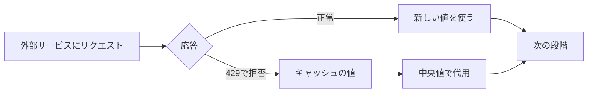

今日は自動化アプリで大きな構造変更をいくつかの段階に分けて移すのを見ていた。途中で外部サービスがリクエストを断ってくることもあった。どちらも「うまくいかない時を先に決めておく」という話にまとまった。

## 止められた時に何を使うか

アプリには外部サービスから値を測ってくる段階があって、リクエストが増えたら拒否が返ってきた。そこで出てきた概念。

1. **レートリミットと429**: サーバーが「聞きすぎ」としてしばらくリクエストを止めること。HTTP の 429(Too Many Requests)で返ってくる。コードが間違っているわけではなく速さの問題なので、直すのはロジックではなくリクエストの仕方。
2. **グレースフルデグラデーション**: 一部が動かない時、全体を止めずに質の落ちる値でも進めること。今回は止められたら前に取っておいたキャッシュの値で代わりにした。
3. **平均ではなく中央値**: キャッシュの値をまとめる時、平均だと外れ値ひとつに引っ張られる。中央値は真ん中の値なので外れ値にあまり揺れない。代わりの値は正確さより無難さが大事なので、こっちが合っていると思う。

## 戻る道を先に

DB の構造変更は本番ではなくコピーの DB で段階ごとにやった。段階ごとにバックアップを取り、その段階だけを元に戻す SQL も残した。マイグレーションに up だけあって down がないと、問題が起きた時はバックアップを丸ごと戻すしかない。段階が小さければ、どこでずれたかもすぐ分かる。

同じ作業でキーの構造も変わった。前はひとつの項目で行を区別していたけど、今は二つの値を組み合わせる必要があって、複合主キーにした。主キーを変えるとその表を参照するところが全部影響を受けるので、こういう変更ほどコピーで先に試すべきだ。

## もともと壊れていたテスト

終わってから全体のテストを回したら、失敗がそこそこ出た。今回の変更とは関係ないという説明がついていたけど、それを確かめるには変更前に同じテストを回したベースラインが要る。ベースラインがないと「もともと失敗していたもの」と「自分が新しく壊したもの」(リグレッション)を区別できない。次は変える前に一度回しておくことにした。

設定をチャットで変える機能もついたけど、その変更履歴をメモリだけに置くと再起動で消える。残すなら DB に書く必要がある。監査ログをどこに置くかは、結局「再起動のあとも要るか」で分かれる。

今日は、うまくいく時を磨くより、うまくいかない時を決めておくほうが役に立った。
