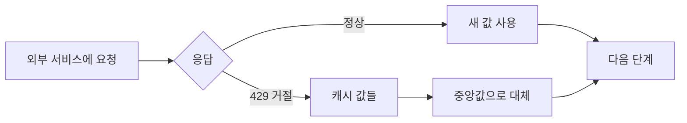

오늘은 자동화 앱에서 큰 구조 변경을 몇 단계로 나눠서 옮기는 걸 지켜봤다. 중간에 외부 서비스가 요청을 막는 일도 있었는데, 둘 다 "안 될 때를 먼저 정해 둔다"는 쪽으로 정리됐다.

## 막혔을 때 뭘 쓸지

앱이 외부 서비스에서 값을 재 오는 단계가 있는데, 요청이 많아지니 거절이 왔다. 그래서 나온 개념들.

1. **레이트 리밋과 429**: 서버가 "너무 자주 물어본다"며 일정 시간 요청을 막는 것. HTTP 응답 코드 429(Too Many Requests)로 온다. 내 코드가 틀린 게 아니라 속도 문제라서, 고칠 곳도 코드 로직이 아니라 요청 방식이다.
2. **우아한 성능 저하(graceful degradation)**: 한 부분이 안 될 때 전체를 멈추지 않고 덜 좋은 값으로라도 계속 가는 것. 이번엔 막히면 예전에 받아 둔 캐시 값들로 대신하게 했다.
3. **평균 말고 중앙값**: 캐시 값을 하나로 합칠 때 평균을 쓰면 튀는 값 하나에 끌려간다. 중앙값은 가운데 값이라 이상치에 덜 흔들린다. 대체값은 정확하기보다 무난해야 해서 이쪽이 맞는 것 같다.

## 되돌릴 길부터

DB 구조를 바꾸는 작업은 운영 쪽이 아니라 복사본 DB에서 단계별로 했다. 단계마다 백업을 뜨고, 그 단계를 원래대로 돌리는 SQL을 같이 남겼다. 마이그레이션에서 업(up)만 있고 다운(down)이 없으면, 문제가 생겼을 때 백업 전체를 통째로 되살리는 수밖에 없다. 단계가 작으면 어디서 틀어졌는지도 바로 보인다.

같은 작업에서 키 구조도 바뀌었다. 예전엔 한 항목으로만 행을 구분했는데, 이제는 두 값을 묶어서 구분해야 해서 복합 기본키(composite primary key)로 바꿨다. 기본키를 바꾸는 건 그 표를 참조하는 곳이 다 영향을 받아서, 이런 변경일수록 복사본에서 먼저 해 보는 게 맞다.

## 원래 깨져 있던 테스트

끝나고 전체 테스트를 돌렸더니 실패가 꽤 나왔다. 이번 변경과 무관하다는 설명이 붙었는데, 그걸 확인하려면 변경 전에 같은 테스트를 돌린 기준선(baseline)이 있어야 한다. 기준선이 없으면 "원래 실패하던 것"과 "내가 새로 깨뜨린 것"(회귀, regression)을 구분할 수가 없다. 다음엔 바꾸기 전에 한 번 먼저 돌려 두기로 했다.

설정을 채팅으로 바꾸는 기능도 붙었는데, 그 변경 이력을 메모리에만 두면 재시작하면 사라진다. 남기려면 DB에 따로 적어야 한다. 감사 로그(audit log)를 어디에 둘지는 결국 "재시작 뒤에도 필요한가"로 갈리더라.

안 될 때를 정해 두는 쪽이, 될 때를 다듬는 것보다 오늘은 더 쓸모 있었다.
