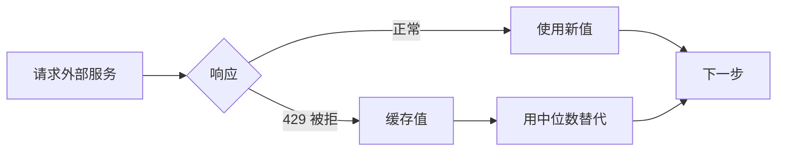

今天在自动化应用里看着一次大的结构改动被拆成几个阶段慢慢迁移。中途外部服务还开始拒绝请求。两件事最后都落到同一个想法：先想好不行的时候怎么办。

## 被挡住时用什么

应用里有一步要从外部服务测量数值，请求一多就被拒了。由此出现的概念：

1. **限流和 429**:服务器嫌你问得太频繁，暂时挡住请求。返回的是 HTTP 429(Too Many Requests)。不是代码写错了，是速度问题，所以要改的是请求方式，而不是逻辑。
2. **优雅降级(graceful degradation)**:某个部分不行时，不让整体停下，而是用差一点的值继续走。这次被挡住时，就用之前缓存的值代替。
3. **用中位数而不是平均数**:把缓存值合成一个时，平均数会被一个异常值拉偏。中位数取中间的值，几乎不受异常值影响。替代值要的是稳妥而不是精确，我觉得这样更合适。

## 先留好退路

数据库结构的改动不是在线上库，而是在复制出来的库上分阶段做的。每个阶段都先备份，并留下只撤销这一阶段的 SQL。迁移如果只有 up 没有 down,出问题时只能整份恢复备份。阶段小，哪里出错也一眼就能看出来。

同一次改动里键的结构也变了。以前用一个字段区分每一行，现在需要两个值组合起来，于是改成了复合主键。改主键会影响所有引用这张表的地方，越是这种改动越该先在副本上试。

## 本来就坏的测试

改完跑了一遍全部测试，失败的不少。附带的说明是和这次改动无关，可要确认这一点，得有改动前跑过同样测试的基线。没有基线，就分不清"本来就失败的"和"我新弄坏的"(回归)。下次改之前先跑一遍。

还加了用聊天改设置的功能，但改动记录只放在内存里的话，一重启就没了。想留下来就得写进数据库。审计日志放哪儿，说到底取决于重启之后还需不需要它。

今天，先想好失败时怎么办，比打磨成功时的样子更有用。
