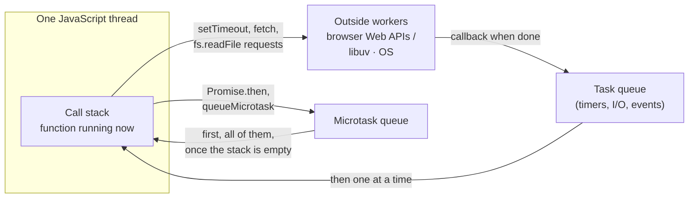
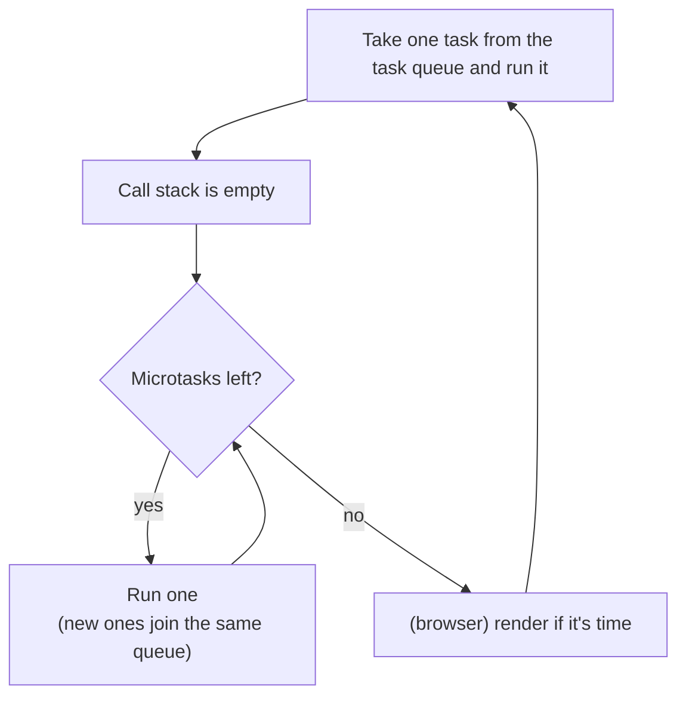

JavaScript runs on a single thread, so how does it handle thousands of requests at once? The answer was the event loop. My code runs one thing at a time, hands every waiting job to the outside (the browser or the OS), and runs the callback when the "done" notice comes back. Background on processes and threads is in [Processes and Threads](#/post/os-process-thread), and the sync/async vocabulary is in [Concurrency vs. Parallelism, Sync vs. Async](#/post/os-concurrency-async).

## The structure in one picture



## 1. The call stack and run-to-completion

1. **Call stack**: calling a function pushes a frame; returning pops it. A JavaScript thread has only one call stack, so only one function runs at any instant.
2. **Run-to-completion**: per MDN, each message (task) is processed completely before any other message starts. A running function is never interrupted by other code midway. That removes most of the race-condition worries of threaded programming, but if one takes long, nothing else happens meanwhile.
3. **Heap**: a large memory region where objects are allocated. It's why variables captured in closures are still alive when a callback runs later.

## 2. The task queue and the microtask queue

1. **Task (macrotask)**: the initial script run, events like clicks, `setTimeout`/`setInterval` callbacks, I/O completion callbacks. The event loop takes one task and runs it until the call stack is empty.
2. **Microtask**: `Promise` `.then/.catch/.finally`, the code after `await`, `queueMicrotask`. After every task the microtask queue is drained completely before moving to the next task, including microtasks added during the draining.
3. **Rendering (browser)**: screen updates get their chance between tasks, after the microtasks are drained. That's why a long task or endless microtasks freeze the screen.



## 3. Node.js event loop phases

Node runs its event loop with a C library called libuv. The official docs split one turn into phases.

| Phase | What it does |
|---|---|
| timers | `setTimeout`/`setInterval` callbacks whose time has come |
| pending callbacks | some system callbacks deferred from the last turn |
| poll | waits for new I/O events and runs I/O callbacks (most work happens here) |
| check | `setImmediate` callbacks |
| close callbacks | close callbacks like `socket.on('close')` |

And Node has one more queue of its own. The **`process.nextTick`** queue is processed as soon as the current operation finishes, even before Promise microtasks. The official docs say nextTick runs right after the current operation regardless of the event loop phase, and warn that calling it recursively can starve I/O. That's for CommonJS (`.js`, `require`), though. When I ran the same two lines as an ES module (`.mjs`), `promise` printed before `nextTick`. ES module evaluation itself runs inside a Promise job, so the microtasks are reportedly drained first.

### Guess the order (ran it)

The numbers are the order things actually printed. Node 24 on Linux; three runs, same result.

```js
const fs = require('node:fs');
console.log('1 동기 시작');
setTimeout(() => console.log('6 setTimeout 0'), 0);
setImmediate(() => console.log('7 setImmediate'));
Promise.resolve().then(() => console.log('4 Promise.then'));
queueMicrotask(() => console.log('5 queueMicrotask'));
process.nextTick(() => console.log('3 process.nextTick'));
fs.readFile(__filename, () => {
  console.log('8 readFile 콜백 (poll 단계)');
  setTimeout(() => console.log('10 I/O 안의 setTimeout 0'), 0);
  setImmediate(() => console.log('9 I/O 안의 setImmediate'));
});
console.log('2 동기 끝');
```

```
1 동기 시작
2 동기 끝
3 process.nextTick
4 Promise.then
5 queueMicrotask
6 setTimeout 0
7 setImmediate
8 readFile 콜백 (poll 단계)
9 I/O 안의 setImmediate
10 I/O 안의 setTimeout 0
```

(`동기 시작/끝` = sync start/end, `콜백 (poll 단계)` = callback (poll phase), `I/O 안의` = inside I/O.) How to read it: synchronous code (1, 2) runs first. Once the stack is empty, nextTick (3), then the Promise-type microtasks (4, 5). Only then does the event loop enter its phases: timers (6), check (7). When the file read completes, its callback (8) runs in the poll phase, and for what it schedules, check comes right after poll, so `setImmediate` (9) comes before `setTimeout 0` (10).

One caution. The order of `setTimeout 0` and `setImmediate` scheduled at the top of the main module (6, 7) is not guaranteed per the official docs; it says it depends on process performance. Inside an I/O callback, `setImmediate` always comes first.

## 4. Things that block the event loop

1. **Long synchronous computation**: parsing tens of MB of JSON, big loops, synchronous crypto. Every other request waits meanwhile. In [Processes and Threads](#/post/os-process-thread) there's an experiment where computing Fibonacci 40 on the main thread kept a timer from firing even once for 0.8 seconds.
2. **Synchronous APIs**: functions with Sync in the name like `fs.readFileSync`. Use them only for things like reading config at startup.
3. **Endless microtasks**: if microtasks keep queueing microtasks, the queue never empties and tasks never get their turn.

<details>
<summary>Microtasks starving a timer (ran it)</summary>

```js
let n = 0;
const t0 = Date.now();
setTimeout(() => console.log(`타이머 실행: ${Date.now() - t0}ms 뒤, 그동안 마이크로태스크 ${n}개`), 0);
function spin() { if (++n < 5_000_000) queueMicrotask(spin); }
spin();
```

```
타이머 실행: 202ms 뒤, 그동안 마이크로태스크 5000000개
```

(= "timer ran after 202ms; 5,000,000 microtasks meanwhile.") The 0ms timer only ran after 0.2 seconds, because the queue didn't empty until all 5 million microtasks finished. With endless recursion the timer would never run. Recursing with `setTimeout` makes each step a separate task, so other work can slip in between.

</details>

## 5. async/await is not a thread

`await` means "pause this function here, and when the Promise settles, continue the rest as a microtask." It doesn't create a new thread. So it can overlap I/O waits, but it doesn't make computation faster. A common mistake is `await`ing unrelated I/O line by line, making them sequential for no reason.

```js
const sleep = (t) => new Promise(r => setTimeout(r, t));   // 300ms 걸리는 I/O 흉내
async function seq() { await sleep(300); await sleep(300); await sleep(300); }
async function par() { await Promise.all([sleep(300), sleep(300), sleep(300)]); }
```

```
차례로 await 3번: 902ms
Promise.all로 동시에: 301ms
```

(= "await three times in a row: 902ms / at once with Promise.all: 301ms.") The thread is idle while waiting, so start all the waits first and wait once. `await` sequentially only when a later step needs an earlier result.

## 6. When you need more CPU anyway: worker_threads and cluster

The event loop is strong for I/O-heavy servers and weak for computation-heavy work. Node gives two exits. Detailed experiments are in [Processes and Threads](#/post/os-process-thread).

| | worker_threads | cluster |
|---|---|---|
| What it adds | JS threads inside one process | processes running the same server code |
| Memory | separate V8 heaps, can share via `SharedArrayBuffer` | not shared |
| Communication | `postMessage` | IPC messages with the primary |
| Use it for | moving image processing, compression, heavy computation off the request path | running one server per core and splitting requests |

These days many people skip cluster and run one container per core, letting a [load balancer](#/post/infra-load-balancer) or [Kubernetes](#/post/cloud-k8s-intro) split traffic. Same idea: one event loop uses one core.

## Common misconceptions

- `setTimeout(fn, 0)` runs immediately: it's a minimum delay. Its turn comes only after the current task and queued microtasks finish.
- JavaScript is single-threaded, so it can't do anything concurrently: only my code runs line by line; the waiting (network, timers, files) proceeds concurrently outside.
- `async` functions run on a background thread: same thread. Everything before the first `await` runs synchronously right away.
- Promise callbacks and setTimeout callbacks go in the same queue: Promises use the microtask queue, so they come first.
- In Node, `setImmediate` is always later (or earlier) than `setTimeout 0`: in the main module the order isn't guaranteed; inside an I/O callback `setImmediate` comes first.

## Core concepts you should be able to explain yourself

1. **Event loop**: a loop that takes jobs from queues one at a time and runs them on the call stack. Waiting is handed off to the outside.
2. **Call stack and run-to-completion**: one function at a time; each task runs to the end.
3. **Task vs. microtask**: after each task, all microtasks are drained. Promises and await are microtasks.
4. **Node phases**: timers → pending → poll → check → close. `setImmediate` is check, I/O callbacks are poll.
5. **process.nextTick**: right after the current operation, before Promises. Overuse starves I/O.
6. **Blocking**: long synchronous computation, Sync APIs and endless microtasks stall the loop.
7. **async/await**: not a thread but syntax over Promises. Overlap independent I/O with `Promise.all`.
8. **worker_threads vs. cluster**: CPU work onto another thread; the server across several processes.

## Related reading

← [Backend map](#/post/be-map)

- [Processes and Threads](#/post/os-process-thread): memory layout, how Chrome and Node use processes and threads
- [Concurrency vs. Parallelism, Sync vs. Async](#/post/os-concurrency-async): the four blocking/non-blocking combinations
- [Sockets and WebSockets](#/post/net-socket): the `select`-based floor under the event loop
- [Async Processing and Message Queues](#/post/be-async-queue): async that hands work outside the process

## Reference links

- MDN, JavaScript execution model (event loop): https://developer.mozilla.org/en-US/docs/Web/JavaScript/Reference/Execution_model
- MDN, Using microtasks in JavaScript with queueMicrotask(): https://developer.mozilla.org/en-US/docs/Web/API/HTML_DOM_API/Microtask_guide
- HTML Standard, Event loops: https://html.spec.whatwg.org/multipage/webappapis.html#event-loops
- Node.js docs, The Node.js Event Loop: https://nodejs.org/en/learn/asynchronous-work/event-loop-timers-and-nexttick
- Node.js docs, Don't Block the Event Loop (or the Worker Pool): https://nodejs.org/en/learn/asynchronous-work/dont-block-the-event-loop
- Node.js docs, Worker threads: https://nodejs.org/api/worker_threads.html
- Node.js docs, Cluster: https://nodejs.org/api/cluster.html

Further reading (well-illustrated Korean posts on the same topic)

- Inpa Dev, Sync/async and blocking/non-blocking, fully explained: https://inpa.tistory.com/entry/%F0%9F%91%A9%E2%80%8D%F0%9F%92%BB-%EB%8F%99%EA%B8%B0%EB%B9%84%EB%8F%99%EA%B8%B0-%EB%B8%94%EB%A1%9C%ED%82%B9%EB%85%BC%EB%B8%94%EB%A1%9C%ED%82%B9-%EA%B0%9C%EB%85%90-%EC%A0%95%EB%A6%AC
- Inpa Dev, Async vs. sync communication on the web: https://inpa.tistory.com/entry/WEB-%F0%9F%8C%90-%EB%B9%84%EB%8F%99%EA%B8%B0Async%ED%86%B5%EC%8B%A0-%EB%8F%99%EA%B8%B0Sync%ED%86%B5%EC%8B%A0
