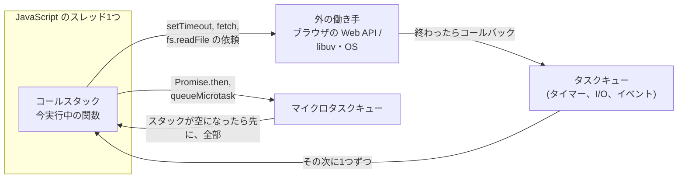
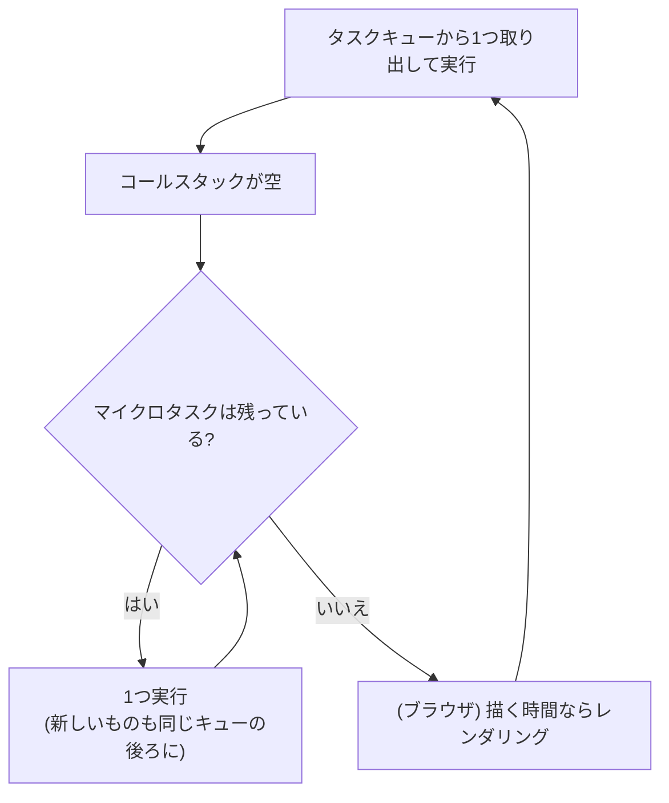

JavaScript は1つのスレッドで動くのに、どうやって数千のリクエストを同時に受けるのか。答えはイベントループでした。自分のコードは一度に1つだけ動き、待つ仕事はすべて外(ブラウザや OS)に任せて、終わったという通知が来たらそのときコールバックを実行します。プロセス・スレッドの背景は [プロセスとスレッド](#/post/os-process-thread) に、同期・非同期の用語整理は [並行性と並列性、同期と非同期](#/post/os-concurrency-async) にあります。

## 1枚で見る構造



## 1. コールスタックと run-to-completion

1. **コールスタック**: 関数を呼ぶとフレームが1つ積まれ、終わると外れます。JavaScript のスレッドにはコールスタックが1つしかないので、ある瞬間に実行される関数は1つだけです。
2. **run-to-completion**: MDN の説明では、メッセージ(タスク)1つの処理は、他のメッセージを始める前に完全に終わります。実行中の関数が途中で他のコードに割り込まれることはありません。なのでスレッドプログラミングの競合状態の心配が大きく減りますが、1つが長引くとその間は何もできません。
3. **ヒープ**: オブジェクトが割り当てられる大きなメモリ領域。コールバックが後で実行されても、クロージャで捕まえた変数が生きている理由です。

## 2. タスクキューとマイクロタスクキュー

1. **タスク(マクロタスク)**: スクリプトの最初の実行、クリックのようなイベント、`setTimeout`・`setInterval` のコールバック、I/O 完了のコールバック。イベントループはタスクを1つ取り出し、コールスタックが空になるまで実行します。
2. **マイクロタスク**: `Promise` の `.then/.catch/.finally`、`await` の次の行、`queueMicrotask`。タスクが1つ終わるたびに、マイクロタスクキューを最後まで空にしてから次のタスクに進みます。空にしている途中で新しく入ったマイクロタスクも一緒に処理します。
3. **レンダリング(ブラウザ)**: 画面の更新はタスクの合間、マイクロタスクを全部空にした後に機会が来ます。なので長いタスクや終わらないマイクロタスクは画面を止めます。



## 3. Node.js のイベントループのフェーズ

Node は libuv という C ライブラリでイベントループを回します。公式ドキュメントは1周をいくつかのフェーズに分けています。

| フェーズ | すること |
|---|---|
| timers | 時間になった `setTimeout`・`setInterval` のコールバック |
| pending callbacks | 前の周で後回しにされた一部のシステムコールバック |
| poll | 新しい I/O イベントを待ち、I/O コールバックを実行(ほとんどの仕事はここ) |
| check | `setImmediate` のコールバック |
| close callbacks | `socket.on('close')` のようなクローズのコールバック |

そして Node 独自のキューがもう1つあります。**`process.nextTick`** のキューは現在の処理が終わるとすぐ、Promise のマイクロタスクよりも先に処理されます。公式ドキュメントは、nextTick はイベントループのフェーズに関係なく現在の処理の直後に動くと説明し、再帰的に呼ぶと I/O が飢餓状態になりうると警告しています。ただしこれは CommonJS (`.js`、`require`) の場合です。ES モジュール (`.mjs`) で同じ2行を動かすと、`promise` が `nextTick` より先に出力されました。ES モジュールは評価そのものが Promise の処理の中で進むので、マイクロタスクが先に空になると言われています。

### 順番当て (実行確認)

番号は実際に出力された順番です。Node 24、Linux で3回動かして同じ結果でした。

```js
const fs = require('node:fs');
console.log('1 동기 시작');
setTimeout(() => console.log('6 setTimeout 0'), 0);
setImmediate(() => console.log('7 setImmediate'));
Promise.resolve().then(() => console.log('4 Promise.then'));
queueMicrotask(() => console.log('5 queueMicrotask'));
process.nextTick(() => console.log('3 process.nextTick'));
fs.readFile(__filename, () => {
  console.log('8 readFile 콜백 (poll 단계)');
  setTimeout(() => console.log('10 I/O 안의 setTimeout 0'), 0);
  setImmediate(() => console.log('9 I/O 안의 setImmediate'));
});
console.log('2 동기 끝');
```

```
1 동기 시작
2 동기 끝
3 process.nextTick
4 Promise.then
5 queueMicrotask
6 setTimeout 0
7 setImmediate
8 readFile 콜백 (poll 단계)
9 I/O 안의 setImmediate
10 I/O 안의 setTimeout 0
```

(`동기 시작/끝` は同期の開始/終了、`콜백 (poll 단계)` はコールバック(poll フェーズ)、`I/O 안의` は I/O の中の、という意味です。)読み方はこうです。同期コード (1, 2) が先に全部動きます。スタックが空になると nextTick (3)、次に Promise 系のマイクロタスク (4, 5)。その後でやっとイベントループのフェーズに入り、timers (6)、check (7) が動きます。ファイル読み込みが終わると poll フェーズでコールバック (8) が動き、その中で予約したものは poll の次が check なので、`setImmediate` (9) が `setTimeout 0` (10) より先です。

1つ注意点があります。メインモジュールの先頭で予約した `setTimeout 0` と `setImmediate` の順番 (6, 7) は、公式ドキュメント上保証されていません。プロセスの性能によって変わりうると書かれています。I/O コールバックの中では `setImmediate` が常に先です。

## 4. イベントループを止めるもの

1. **長い同期計算**: 数十 MB の JSON のパース、大きなループ、同期の暗号処理。その間、他のリクエストはすべて待たされます。[プロセスとスレッド](#/post/os-process-thread) に、フィボナッチ40をメインで計算したら0.8秒間タイマーが一度も動けなかった実験があります。
2. **同期 API**: `fs.readFileSync` のように名前に Sync が付く関数。サーバー起動時の設定読み込み程度にだけ使います。
3. **終わらないマイクロタスク**: マイクロタスクがマイクロタスクを入れ続けると、キューが空にならずタスクの順番が来ません。

<details>
<summary>マイクロタスクがタイマーを飢えさせる (実行確認)</summary>

```js
let n = 0;
const t0 = Date.now();
setTimeout(() => console.log(`타이머 실행: ${Date.now() - t0}ms 뒤, 그동안 마이크로태스크 ${n}개`), 0);
function spin() { if (++n < 5_000_000) queueMicrotask(spin); }
spin();
```

```
타이머 실행: 202ms 뒤, 그동안 마이크로태스크 5000000개
```

(「タイマー実行: 202ms 後、その間マイクロタスク 5000000 個」という意味です。)0ms のタイマーが0.2秒後にやっと動きました。マイクロタスク500万個が全部終わるまでキューが空にならなかったからです。終わりのない再帰だったら、タイマーは永遠に動きません。`setTimeout` で再帰すれば毎回別のタスクなので、合間に他の仕事が入れます。

</details>

## 5. async/await はスレッドではない

`await` は「ここで関数をいったん止めて、Promise が終わったら残りをマイクロタスクとして続けて実行して」という意味です。新しいスレッドは作りません。なので I/O の待ちを重ねることはできても、計算を速くはしてくれません。よくある失敗は、互いに関係のない I/O を1行ずつ `await` して、わざわざ順番待ちにしてしまうことです。

```js
const sleep = (t) => new Promise(r => setTimeout(r, t));   // 300ms 걸리는 I/O 흉내
async function seq() { await sleep(300); await sleep(300); await sleep(300); }
async function par() { await Promise.all([sleep(300), sleep(300), sleep(300)]); }
```

```
차례로 await 3번: 902ms
Promise.all로 동시에: 301ms
```

(「順番に await 3回: 902ms / Promise.all で同時に: 301ms」です。)待っている間スレッドは遊んでいるので、待つ仕事を先に全部仕掛けて一度に待てばいいのです。前の結果が後で必要なときだけ順番に `await` します。

## 6. それでも CPU をもっと使いたいなら: worker_threads と cluster

イベントループは I/O の多いサーバーに強く、計算の多い仕事に弱いです。Node は2つの出口を用意しています。詳しい実験は [プロセスとスレッド](#/post/os-process-thread) にあります。

| | worker_threads | cluster |
|---|---|---|
| 何を増やすか | 1つのプロセス内の JS スレッド | 同じサーバーコードを動かすプロセス |
| メモリ | それぞれの V8 ヒープ、`SharedArrayBuffer` で共有可能 | 共有しない |
| 通信 | `postMessage` | プライマリプロセスとの IPC メッセージ |
| 使いどころ | 画像処理、圧縮、大きな計算をリクエスト処理から切り離すとき | コア数だけサーバーを立ててリクエストを分けるとき |

最近は cluster の代わりにコンテナをコア数だけ立て、[ロードバランサー](#/post/infra-load-balancer) や [Kubernetes](#/post/cloud-k8s-intro) に振り分けさせることも多いです。考え方は同じで、イベントループ1つがコア1つを使います。

## よくある誤解

- `setTimeout(fn, 0)` はすぐ実行される: 最小の遅延です。今のタスクと溜まったマイクロタスクが全部終わってから順番が来ます。
- JavaScript はシングルスレッドなので同時に何もできない: 自分のコードが1行ずつ動くだけで、待つ仕事(ネットワーク、タイマー、ファイル)は外で同時に進みます。
- `async` 関数はバックグラウンドのスレッドで動く: 同じスレッドです。`await` の手前までは同期ですぐ実行されます。
- Promise のコールバックと setTimeout のコールバックは同じキューに入る: Promise はマイクロタスクキューなので先です。
- Node で `setImmediate` は常に `setTimeout 0` より遅い(または速い): メインモジュールでは順番が保証されず、I/O コールバックの中では `setImmediate` が先です。

## 自分で説明できるべき核心概念

1. **イベントループ**: キューからやることを1つずつ取り出してコールスタックで実行する繰り返し。待つ仕事は外に任せる。
2. **コールスタックと run-to-completion**: 一度に関数1つ、1つのタスクは最後まで実行される。
3. **タスク vs マイクロタスク**: タスクが1つ終わるたびにマイクロタスクを全部空にする。Promise と await はマイクロタスク。
4. **Node のフェーズ**: timers → pending → poll → check → close。`setImmediate` は check、I/O コールバックは poll。
5. **process.nextTick**: 現在の処理の直後、Promise より先。乱用すると I/O を飢えさせる。
6. **ブロッキング**: 長い同期計算、Sync API、終わらないマイクロタスクがループを止める。
7. **async/await**: スレッドではなく Promise の上の文法。独立した I/O は `Promise.all` で重ねる。
8. **worker_threads vs cluster**: CPU 計算を別スレッドへ、サーバーを複数プロセスへ。

## おすすめの記事

← [バックエンドマップ](#/post/be-map)

- [プロセスとスレッド](#/post/os-process-thread): メモリ構造、Chrome と Node のプロセス・スレッド構成
- [並行性と並列性、同期と非同期](#/post/os-concurrency-async): ブロッキング・ノンブロッキングの4つの組み合わせ
- [ソケットと WebSocket](#/post/net-socket): `select` で作ったイベントループの土台
- [非同期処理とメッセージキュー](#/post/be-async-queue): プロセスの外に仕事を渡す非同期

## 根拠となるリンク

- MDN, JavaScript execution model (イベントループ): https://developer.mozilla.org/en-US/docs/Web/JavaScript/Reference/Execution_model
- MDN, Using microtasks in JavaScript with queueMicrotask(): https://developer.mozilla.org/en-US/docs/Web/API/HTML_DOM_API/Microtask_guide
- HTML Standard, Event loops: https://html.spec.whatwg.org/multipage/webappapis.html#event-loops
- Node.js ドキュメント, The Node.js Event Loop: https://nodejs.org/en/learn/asynchronous-work/event-loop-timers-and-nexttick
- Node.js ドキュメント, Don't Block the Event Loop (or the Worker Pool): https://nodejs.org/en/learn/asynchronous-work/dont-block-the-event-loop
- Node.js ドキュメント, Worker threads: https://nodejs.org/api/worker_threads.html
- Node.js ドキュメント, Cluster: https://nodejs.org/api/cluster.html

参考(同じテーマを図で分かりやすくまとめた韓国語の記事)

- Inpa Dev, 同期/非同期とブロッキング/ノンブロッキングを完全理解: https://inpa.tistory.com/entry/%F0%9F%91%A9%E2%80%8D%F0%9F%92%BB-%EB%8F%99%EA%B8%B0%EB%B9%84%EB%8F%99%EA%B8%B0-%EB%B8%94%EB%A1%9C%ED%82%B9%EB%85%BC%EB%B8%94%EB%A1%9C%ED%82%B9-%EA%B0%9C%EB%85%90-%EC%A0%95%EB%A6%AC
- Inpa Dev, Web の非同期(Async)/同期(Sync)通信まとめ: https://inpa.tistory.com/entry/WEB-%F0%9F%8C%90-%EB%B9%84%EB%8F%99%EA%B8%B0Async%ED%86%B5%EC%8B%A0-%EB%8F%99%EA%B8%B0Sync%ED%86%B5%EC%8B%A0
