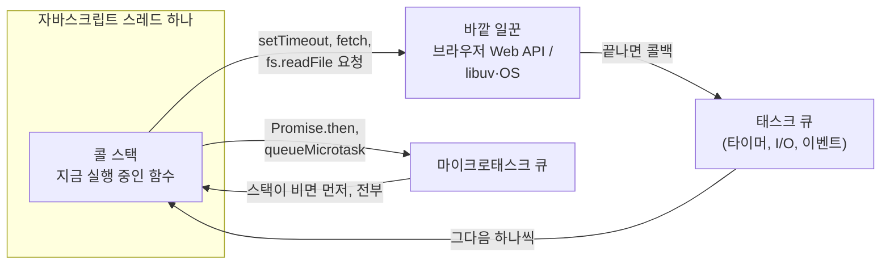
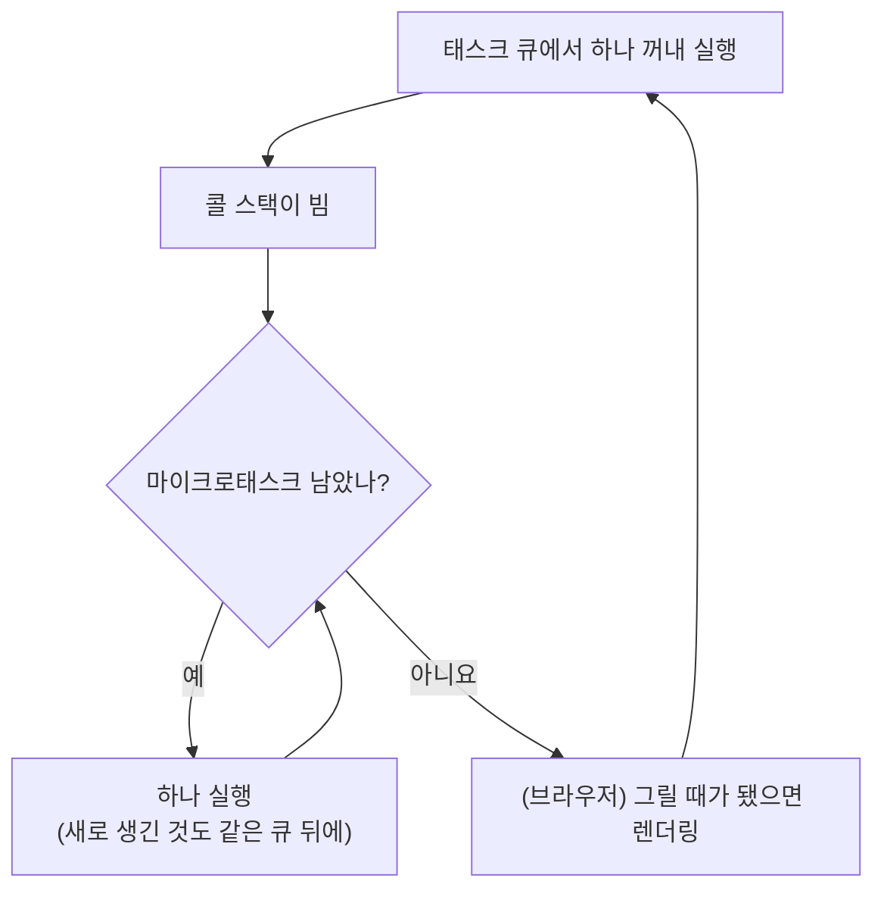

자바스크립트는 스레드 하나로 도는데 어떻게 요청 수천 개를 동시에 받나. 답은 이벤트 루프였다. 내 코드는 한 번에 하나만 돌고, 기다리는 일은 전부 바깥(브라우저나 OS)에 맡긴 뒤 끝났다는 알림이 오면 그때 콜백을 실행한다. 프로세스·스레드 쪽 배경은 [프로세스와 스레드](#/post/os-process-thread)에, 동기·비동기 용어 정리는 [동시성과 병렬성, 동기와 비동기](#/post/os-concurrency-async)에 있다.

## 한 장으로 보는 구조



## 1. 콜 스택과 run-to-completion

1. **콜 스택**: 함수를 부르면 프레임이 하나 쌓이고, 끝나면 빠진다. 자바스크립트 스레드에는 콜 스택이 하나뿐이라 한 순간에 함수 하나만 실행된다.
2. **run-to-completion**: MDN 설명으로는 메시지(태스크) 하나의 처리는 다른 메시지를 시작하기 전에 완전히 끝난다. 실행 중인 함수가 중간에 다른 코드에게 끼어들기를 당하지 않는다. 그래서 스레드 프로그래밍의 경쟁 상태 걱정이 크게 줄지만, 하나가 오래 걸리면 그동안 아무것도 못 한다.
3. **힙**: 객체가 할당되는 큰 메모리 영역. 콜백이 나중에 실행돼도 클로저로 잡은 변수가 살아 있는 이유다.

## 2. 태스크 큐와 마이크로태스크 큐

1. **태스크(매크로태스크)**: 스크립트 첫 실행, 클릭 같은 이벤트, `setTimeout`·`setInterval` 콜백, I/O 완료 콜백. 이벤트 루프는 태스크를 하나 꺼내 콜 스택이 빌 때까지 실행한다.
2. **마이크로태스크**: `Promise`의 `.then/.catch/.finally`, `await` 다음 줄, `queueMicrotask`. 태스크 하나가 끝날 때마다 마이크로태스크 큐를 끝까지 비운 뒤에야 다음 태스크로 간다. 비우는 도중에 새로 들어온 마이크로태스크도 같이 처리한다.
3. **렌더링(브라우저)**: 화면 갱신은 태스크 사이, 마이크로태스크를 다 비운 뒤에 기회가 온다. 그래서 긴 태스크나 끝없는 마이크로태스크는 화면을 멈춘다.



## 3. Node.js의 이벤트 루프 단계

Node는 libuv라는 C 라이브러리로 이벤트 루프를 돌린다. 공식 문서는 한 바퀴를 여러 단계로 나눈다.

| 단계 | 하는 일 |
|---|---|
| timers | 시간이 된 `setTimeout`·`setInterval` 콜백 |
| pending callbacks | 지난 바퀴에서 미뤄진 일부 시스템 콜백 |
| poll | 새 I/O 이벤트를 기다리고 I/O 콜백 실행(대부분의 일이 여기서) |
| check | `setImmediate` 콜백 |
| close callbacks | `socket.on('close')` 같은 닫기 콜백 |

그리고 Node만의 큐가 하나 더 있다. **`process.nextTick`** 큐는 현재 작업이 끝나자마자, Promise 마이크로태스크보다도 먼저 처리된다. 공식 문서는 nextTick이 이벤트 루프 단계와 상관없이 현재 작업 직후에 돈다고 설명하고, 재귀적으로 부르면 I/O가 굶을 수 있다고 경고한다. 다만 이건 CommonJS(`.js`, `require`) 기준이다. ES 모듈(`.mjs`)로 같은 두 줄을 돌려 보니 `promise`가 `nextTick`보다 먼저 찍혔다. ES 모듈은 평가 자체가 Promise 작업 안에서 진행돼서 마이크로태스크가 먼저 비워지는 것으로 알려져 있다.

### 순서 맞히기 (실행 확인)

번호는 실제로 찍힌 순서다. Node 24, 리눅스에서 세 번 돌려 같은 결과가 나왔다.

```js
const fs = require('node:fs');
console.log('1 동기 시작');
setTimeout(() => console.log('6 setTimeout 0'), 0);
setImmediate(() => console.log('7 setImmediate'));
Promise.resolve().then(() => console.log('4 Promise.then'));
queueMicrotask(() => console.log('5 queueMicrotask'));
process.nextTick(() => console.log('3 process.nextTick'));
fs.readFile(__filename, () => {
  console.log('8 readFile 콜백 (poll 단계)');
  setTimeout(() => console.log('10 I/O 안의 setTimeout 0'), 0);
  setImmediate(() => console.log('9 I/O 안의 setImmediate'));
});
console.log('2 동기 끝');
```

```
1 동기 시작
2 동기 끝
3 process.nextTick
4 Promise.then
5 queueMicrotask
6 setTimeout 0
7 setImmediate
8 readFile 콜백 (poll 단계)
9 I/O 안의 setImmediate
10 I/O 안의 setTimeout 0
```

읽는 법은 이렇다. 동기 코드(1, 2)가 먼저 다 돈다. 스택이 비면 nextTick(3), 그다음 Promise 계열 마이크로태스크(4, 5). 그 뒤에야 이벤트 루프 단계로 들어가 timers(6), check(7)가 돈다. 파일 읽기가 끝나면 poll 단계에서 콜백(8)이 돌고, 그 안에서 예약한 것은 poll 다음이 check라서 `setImmediate`(9)가 `setTimeout 0`(10)보다 먼저다.

한 가지 조심할 점. 메인 모듈 맨 위에서 예약한 `setTimeout 0`과 `setImmediate`의 순서(6, 7)는 공식 문서상 보장되지 않는다. 프로세스 성능에 따라 바뀔 수 있다고 적혀 있다. I/O 콜백 안에서는 `setImmediate`가 항상 먼저다.

## 4. 이벤트 루프를 막는 것들

1. **긴 동기 계산**: JSON 수십 MB 파싱, 큰 반복문, 동기 암호 연산. 그동안 다른 요청은 전부 대기한다. [프로세스와 스레드](#/post/os-process-thread)에서 피보나치 40을 메인에서 돌렸을 때 0.8초 동안 타이머가 한 번도 못 돈 실험이 있다.
2. **동기 API**: `fs.readFileSync`처럼 이름에 Sync가 붙은 함수. 서버 시작할 때 설정 읽기 정도에만 쓴다.
3. **끝없는 마이크로태스크**: 마이크로태스크가 계속 마이크로태스크를 넣으면 큐가 안 비어서 태스크 차례가 안 온다.

<details>
<summary>마이크로태스크가 타이머를 굶기는 것 (실행 확인)</summary>

```js
let n = 0;
const t0 = Date.now();
setTimeout(() => console.log(`타이머 실행: ${Date.now() - t0}ms 뒤, 그동안 마이크로태스크 ${n}개`), 0);
function spin() { if (++n < 5_000_000) queueMicrotask(spin); }
spin();
```

```
타이머 실행: 202ms 뒤, 그동안 마이크로태스크 5000000개
```

0ms 타이머가 0.2초 뒤에야 돌았다. 마이크로태스크 500만 개가 다 끝날 때까지 큐가 비지 않았기 때문이다. 끝이 없는 재귀였다면 타이머는 영영 안 돈다. `setTimeout`으로 재귀하면 매번 별도 태스크라 사이사이에 다른 일이 낄 수 있다.

</details>

## 5. async/await는 스레드가 아니다

`await`는 "여기서 잠깐 함수를 멈추고, Promise가 끝나면 나머지를 마이크로태스크로 이어서 실행해 줘"라는 뜻이다. 새 스레드를 만들지 않는다. 그래서 I/O 기다리기를 겹칠 수는 있어도 계산을 빠르게 해 주지는 않는다. 흔한 실수는 서로 상관없는 I/O를 한 줄씩 `await`해서 일부러 차례대로 만드는 것이다.

```js
const sleep = (t) => new Promise(r => setTimeout(r, t));   // 300ms 걸리는 I/O 흉내
async function seq() { await sleep(300); await sleep(300); await sleep(300); }
async function par() { await Promise.all([sleep(300), sleep(300), sleep(300)]); }
```

```
차례로 await 3번: 902ms
Promise.all로 동시에: 301ms
```

기다리는 동안 스레드는 놀고 있으니, 기다릴 일을 먼저 다 걸어 두고 한 번에 기다리면 된다. 앞의 결과가 뒤에 필요할 때만 차례로 `await`한다.

## 6. 그래도 CPU를 더 써야 하면: worker_threads와 cluster

이벤트 루프는 I/O가 많은 서버에 강하고, 계산이 많은 일에 약하다. Node는 두 가지 출구를 준다. 자세한 실험은 [프로세스와 스레드](#/post/os-process-thread)에 있다.

| | worker_threads | cluster |
|---|---|---|
| 무엇을 늘리나 | 한 프로세스 안의 JS 스레드 | 같은 서버 코드를 돌리는 프로세스 |
| 메모리 | 각자 V8 힙, `SharedArrayBuffer`로 공유 가능 | 공유 안 함 |
| 통신 | `postMessage` | 주 프로세스와 IPC 메시지 |
| 쓰는 곳 | 이미지 처리, 압축, 큰 계산을 요청 처리에서 떼어 낼 때 | 코어 수만큼 서버를 띄워 요청을 나눌 때 |

요즘은 cluster 대신 컨테이너를 코어 수만큼 띄우고 [로드밸런서](#/post/infra-load-balancer)나 [쿠버네티스](#/post/cloud-k8s-intro)가 나누게 하는 경우도 많다. 생각은 같다. 이벤트 루프 하나가 코어 하나를 쓴다.

## 흔한 오해

- `setTimeout(fn, 0)`은 바로 실행된다: 최소 지연이다. 지금 태스크와 쌓인 마이크로태스크가 다 끝나야 차례가 온다.
- 자바스크립트는 싱글 스레드라 동시에 아무것도 못 한다: 내 코드가 한 줄씩 돌 뿐이고, 기다리는 일(네트워크, 타이머, 파일)은 바깥에서 동시에 진행된다.
- `async` 함수는 백그라운드 스레드에서 돈다: 같은 스레드다. `await` 앞까지는 동기로 바로 실행된다.
- Promise 콜백과 setTimeout 콜백은 같은 큐에 들어간다: Promise는 마이크로태스크 큐라 먼저다.
- Node에서 `setImmediate`가 `setTimeout 0`보다 항상 늦다(또는 빠르다): 메인 모듈에서는 순서가 보장되지 않고, I/O 콜백 안에서는 `setImmediate`가 먼저다.

## 직접 설명할 수 있어야 할 핵심 개념

1. **이벤트 루프**: 큐에서 할 일을 하나씩 꺼내 콜 스택에서 실행하는 반복. 기다리는 일은 바깥에 맡긴다.
2. **콜 스택과 run-to-completion**: 한 번에 함수 하나, 한 태스크는 끝까지 실행된다.
3. **태스크 vs 마이크로태스크**: 태스크 하나가 끝날 때마다 마이크로태스크를 전부 비운다. Promise와 await는 마이크로태스크.
4. **Node 단계**: timers → pending → poll → check → close. `setImmediate`는 check, I/O 콜백은 poll.
5. **process.nextTick**: 현재 작업 직후, Promise보다 먼저. 남용하면 I/O를 굶긴다.
6. **블로킹**: 긴 동기 계산, Sync API, 끝없는 마이크로태스크가 루프를 멈춘다.
7. **async/await**: 스레드가 아니라 Promise 위의 문법. 독립 I/O는 `Promise.all`로 겹친다.
8. **worker_threads vs cluster**: CPU 계산을 다른 스레드로, 서버를 여러 프로세스로.

## 같이 보면 좋은 글

← [백엔드 map](#/post/be-map)

- [프로세스와 스레드](#/post/os-process-thread): 메모리 구조, 크롬과 Node의 프로세스·스레드 구성
- [동시성과 병렬성, 동기와 비동기](#/post/os-concurrency-async): 블로킹·논블로킹 네 가지 조합
- [소켓과 웹소켓](#/post/net-socket): `select`로 만든 이벤트 루프의 바닥
- [비동기 처리와 메시지 큐](#/post/be-async-queue): 프로세스 밖으로 일을 넘기는 비동기

## 근거 링크

- MDN, JavaScript execution model (이벤트 루프): https://developer.mozilla.org/en-US/docs/Web/JavaScript/Reference/Execution_model
- MDN, Using microtasks in JavaScript with queueMicrotask(): https://developer.mozilla.org/en-US/docs/Web/API/HTML_DOM_API/Microtask_guide
- HTML Standard, Event loops: https://html.spec.whatwg.org/multipage/webappapis.html#event-loops
- Node.js 문서, The Node.js Event Loop: https://nodejs.org/en/learn/asynchronous-work/event-loop-timers-and-nexttick
- Node.js 문서, Don't Block the Event Loop (or the Worker Pool): https://nodejs.org/en/learn/asynchronous-work/dont-block-the-event-loop
- Node.js 문서, Worker threads: https://nodejs.org/api/worker_threads.html
- Node.js 문서, Cluster: https://nodejs.org/api/cluster.html

참고(같은 주제를 그림으로 잘 정리한 글)

- Inpa Dev, 완벽히 이해하는 동기/비동기 & 블로킹/논블로킹: https://inpa.tistory.com/entry/%F0%9F%91%A9%E2%80%8D%F0%9F%92%BB-%EB%8F%99%EA%B8%B0%EB%B9%84%EB%8F%99%EA%B8%B0-%EB%B8%94%EB%A1%9C%ED%82%B9%EB%85%BC%EB%B8%94%EB%A1%9C%ED%82%B9-%EA%B0%9C%EB%85%90-%EC%A0%95%EB%A6%AC
- Inpa Dev, 웹의 비동기(Async) / 동기(Sync) 통신 정리: https://inpa.tistory.com/entry/WEB-%F0%9F%8C%90-%EB%B9%84%EB%8F%99%EA%B8%B0Async%ED%86%B5%EC%8B%A0-%EB%8F%99%EA%B8%B0Sync%ED%86%B5%EC%8B%A0
