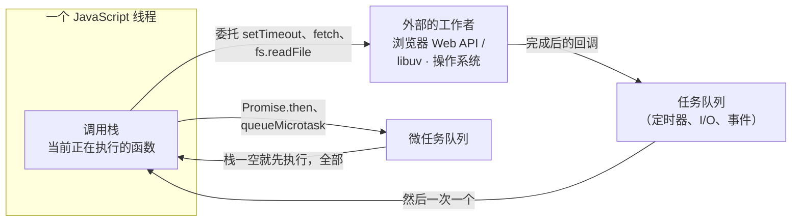
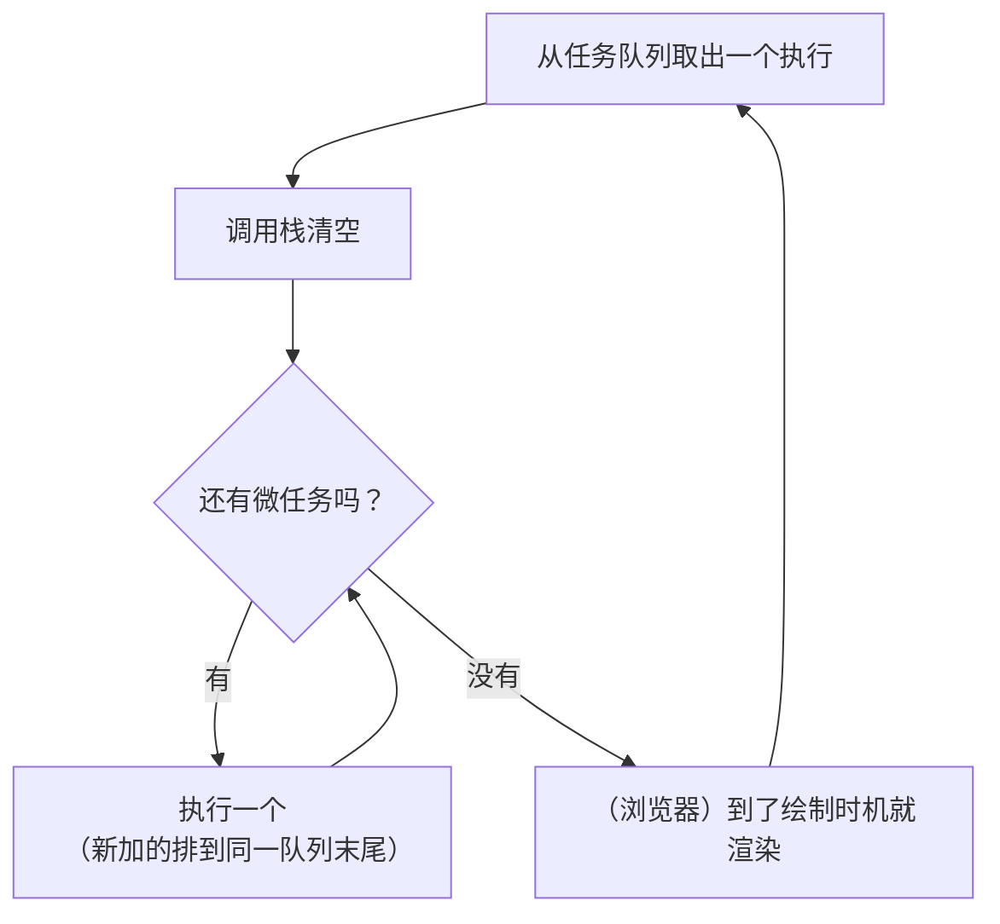

JavaScript 只在一个线程上运行，却怎么能同时接住几千个请求？答案是事件循环。自己的代码一次只运行一段，所有需要等待的工作都交给外部（浏览器或操作系统），等收到“完成了”的通知时再执行回调。进程和线程的背景见 [进程与线程](#/post/os-process-thread)，同步、异步术语的梳理见 [并发与并行、同步与异步](#/post/os-concurrency-async)。

## 一张图看结构



## 1. 调用栈与 run-to-completion

1. **调用栈**：调用函数时压入一帧，结束时弹出。JavaScript 线程只有一个调用栈，所以任何时刻只有一个函数在执行。
2. **run-to-completion**：按 MDN 的说法，一条消息（任务）的处理会在开始下一条之前完全结束。正在执行的函数不会被其他代码中途打断。这大大减少了线程编程里的竞态担忧，但只要有一个任务拖得久，这期间什么都做不了。
3. **堆**：对象分配所在的一大块内存。回调即使稍后才执行，闭包捕获的变量仍然活着，原因就在这里。

## 2. 任务队列与微任务队列

1. **任务（宏任务）**：脚本的首次执行、点击之类的事件、`setTimeout`·`setInterval` 回调、I/O 完成回调。事件循环取出一个任务，一直执行到调用栈清空。
2. **微任务**：`Promise` 的 `.then/.catch/.finally`、`await` 后面的代码、`queueMicrotask`。每个任务结束后，都会把微任务队列清空到底，才进入下一个任务。清空过程中新加入的微任务也会一起处理。
3. **渲染（浏览器）**：屏幕更新的机会出现在任务之间、微任务全部清空之后。所以长任务或没完没了的微任务会让页面卡住。



## 3. Node.js 事件循环的阶段

Node 用名为 libuv 的 C 库运行事件循环。官方文档把一轮分为几个阶段。

| 阶段 | 做什么 |
|---|---|
| timers | 到点的 `setTimeout`·`setInterval` 回调 |
| pending callbacks | 上一轮推迟的部分系统回调 |
| poll | 等待新的 I/O 事件并执行 I/O 回调（大部分工作在这里） |
| check | `setImmediate` 回调 |
| close callbacks | `socket.on('close')` 之类的关闭回调 |

Node 还有一个自己的队列。**`process.nextTick`** 队列在当前操作结束后立即处理，比 Promise 微任务还早。官方文档说明 nextTick 与事件循环阶段无关，在当前操作之后立刻运行，并警告递归调用可能让 I/O 饿死。不过这是 CommonJS（`.js`、`require`）的情况。在 ES 模块（`.mjs`）里运行同样两行，`promise` 比 `nextTick` 先打印。据说这是因为 ES 模块的求值本身就在 Promise 处理过程中进行，所以微任务先被清空。

### 猜顺序（实测）

编号就是实际打印的顺序。在 Node 24、Linux 上运行三次，结果相同。

```js
const fs = require('node:fs');
console.log('1 동기 시작');
setTimeout(() => console.log('6 setTimeout 0'), 0);
setImmediate(() => console.log('7 setImmediate'));
Promise.resolve().then(() => console.log('4 Promise.then'));
queueMicrotask(() => console.log('5 queueMicrotask'));
process.nextTick(() => console.log('3 process.nextTick'));
fs.readFile(__filename, () => {
  console.log('8 readFile 콜백 (poll 단계)');
  setTimeout(() => console.log('10 I/O 안의 setTimeout 0'), 0);
  setImmediate(() => console.log('9 I/O 안의 setImmediate'));
});
console.log('2 동기 끝');
```

```
1 동기 시작
2 동기 끝
3 process.nextTick
4 Promise.then
5 queueMicrotask
6 setTimeout 0
7 setImmediate
8 readFile 콜백 (poll 단계)
9 I/O 안의 setImmediate
10 I/O 안의 setTimeout 0
```

（`동기 시작/끝` 是同步开始/结束，`콜백 (poll 단계)` 是回调（poll 阶段），`I/O 안의` 是 I/O 里面的。）读法如下：同步代码（1、2）先全部执行。栈空后是 nextTick（3），然后是 Promise 类微任务（4、5）。之后才进入事件循环的各阶段：timers（6）、check（7）。文件读完后在 poll 阶段执行回调（8），在其中预约的任务，因为 poll 之后是 check，所以 `setImmediate`（9）先于 `setTimeout 0`（10）。

有一点要注意。在主模块顶层预约的 `setTimeout 0` 和 `setImmediate` 的顺序（6、7），官方文档并不保证，写明会随进程性能而变。在 I/O 回调里面，`setImmediate` 总是先执行。

## 4. 让事件循环停住的东西

1. **长时间的同步计算**：解析几十 MB 的 JSON、大循环、同步加密运算。这期间其他请求全都在等。[进程与线程](#/post/os-process-thread) 里有个实验：在主线程算斐波那契 40，0.8 秒内定时器一次都没能运行。
2. **同步 API**：名字带 Sync 的函数，例如 `fs.readFileSync`。只在服务器启动时读配置之类的场合使用。
3. **没完没了的微任务**：微任务不断加入新的微任务，队列就永远清不空，任务轮不到。

<details>
<summary>微任务让定时器饿死（实测）</summary>

```js
let n = 0;
const t0 = Date.now();
setTimeout(() => console.log(`타이머 실행: ${Date.now() - t0}ms 뒤, 그동안 마이크로태스크 ${n}개`), 0);
function spin() { if (++n < 5_000_000) queueMicrotask(spin); }
spin();
```

```
타이머 실행: 202ms 뒤, 그동안 마이크로태스크 5000000개
```

（意思是“定时器执行：202ms 之后，期间微任务 5000000 个”。）0ms 的定时器 0.2 秒后才运行，因为 500 万个微任务全部执行完之前队列都不会空。如果是无限递归，定时器就永远不会运行。用 `setTimeout` 递归的话，每次都是独立的任务，中间其他工作可以插进来。

</details>

## 5. async/await 不是线程

`await` 的意思是“在这里先暂停函数，等 Promise 完成后，把剩下的部分作为微任务继续执行”。它不会创建新线程。所以它可以让 I/O 等待重叠，但不会让计算变快。常见的失误是把互不相关的 I/O 一行一行地 `await`，硬是变成排队。

```js
const sleep = (t) => new Promise(r => setTimeout(r, t));   // 300ms 걸리는 I/O 흉내
async function seq() { await sleep(300); await sleep(300); await sleep(300); }
async function par() { await Promise.all([sleep(300), sleep(300), sleep(300)]); }
```

```
차례로 await 3번: 902ms
Promise.all로 동시에: 301ms
```

（“依次 await 三次：902ms / 用 Promise.all 同时：301ms”。）等待期间线程是闲着的，所以先把要等的工作全部发起，再一次性等待就好。只有后面需要前一个结果时才依次 `await`。

## 6. 还想用更多 CPU 的话：worker_threads 与 cluster

事件循环擅长 I/O 多的服务器，不擅长计算多的工作。Node 提供了两个出口。详细实验见 [进程与线程](#/post/os-process-thread)。

| | worker_threads | cluster |
|---|---|---|
| 增加什么 | 一个进程内的 JS 线程 | 运行同一份服务器代码的进程 |
| 内存 | 各自的 V8 堆，可用 `SharedArrayBuffer` 共享 | 不共享 |
| 通信 | `postMessage` | 与主进程之间的 IPC 消息 |
| 适用场景 | 把图像处理、压缩、大计算从请求处理中分离出去 | 按核心数启动服务器、分摊请求 |

如今也常常不用 cluster，而是按核心数启动容器，交给 [负载均衡](#/post/infra-load-balancer) 或 [Kubernetes](#/post/cloud-k8s-intro) 分发。思路相同：一个事件循环用一个核心。

## 常见误解

- `setTimeout(fn, 0)` 会立即执行：这只是最小延迟。要等当前任务和积压的微任务全部结束才轮到它。
- JavaScript 是单线程，所以什么都不能同时做：只是自己的代码一行一行地跑，需要等待的工作（网络、定时器、文件）在外部同时进行。
- `async` 函数在后台线程运行：是同一个线程。`await` 之前的部分同步地立即执行。
- Promise 回调和 setTimeout 回调进同一个队列：Promise 进微任务队列，所以先执行。
- 在 Node 里 `setImmediate` 总是比 `setTimeout 0` 晚（或早）：在主模块里顺序不保证，在 I/O 回调里 `setImmediate` 先执行。

## 必须能自己讲清楚的核心概念

1. **事件循环**：从队列里一次取一件事放到调用栈执行的循环。需要等待的工作交给外部。
2. **调用栈与 run-to-completion**：一次一个函数，一个任务执行到底。
3. **任务 vs 微任务**：每个任务结束后清空全部微任务。Promise 和 await 属于微任务。
4. **Node 的阶段**：timers → pending → poll → check → close。`setImmediate` 在 check，I/O 回调在 poll。
5. **process.nextTick**：当前操作之后立刻执行，早于 Promise。滥用会让 I/O 饿死。
6. **阻塞**：长同步计算、Sync API、没完没了的微任务会让循环停住。
7. **async/await**：不是线程，而是建立在 Promise 上的语法。独立的 I/O 用 `Promise.all` 重叠。
8. **worker_threads vs cluster**：CPU 计算放到另一个线程，服务器扩成多个进程。

## 推荐阅读

← [后端 map](#/post/be-map)

- [进程与线程](#/post/os-process-thread)：内存结构，Chrome 和 Node 的进程·线程构成
- [并发与并行、同步与异步](#/post/os-concurrency-async)：阻塞·非阻塞的四种组合
- [套接字与 WebSocket](#/post/net-socket)：用 `select` 搭起来的事件循环基础
- [异步处理与消息队列](#/post/be-async-queue)：把工作交到进程之外的异步

## 参考链接

- MDN, JavaScript execution model （事件循环）: https://developer.mozilla.org/en-US/docs/Web/JavaScript/Reference/Execution_model
- MDN, Using microtasks in JavaScript with queueMicrotask(): https://developer.mozilla.org/en-US/docs/Web/API/HTML_DOM_API/Microtask_guide
- HTML Standard, Event loops: https://html.spec.whatwg.org/multipage/webappapis.html#event-loops
- Node.js 文档, The Node.js Event Loop: https://nodejs.org/en/learn/asynchronous-work/event-loop-timers-and-nexttick
- Node.js 文档, Don't Block the Event Loop (or the Worker Pool): https://nodejs.org/en/learn/asynchronous-work/dont-block-the-event-loop
- Node.js 文档, Worker threads: https://nodejs.org/api/worker_threads.html
- Node.js 文档, Cluster: https://nodejs.org/api/cluster.html

参考（用图解把同一主题讲得很清楚的韩语文章）

- Inpa Dev, 彻底搞懂同步/异步与阻塞/非阻塞: https://inpa.tistory.com/entry/%F0%9F%91%A9%E2%80%8D%F0%9F%92%BB-%EB%8F%99%EA%B8%B0%EB%B9%84%EB%8F%99%EA%B8%B0-%EB%B8%94%EB%A1%9C%ED%82%B9%EB%85%BC%EB%B8%94%EB%A1%9C%ED%82%B9-%EA%B0%9C%EB%85%90-%EC%A0%95%EB%A6%AC
- Inpa Dev, Web 的异步（Async）/同步（Sync）通信总结: https://inpa.tistory.com/entry/WEB-%F0%9F%8C%90-%EB%B9%84%EB%8F%99%EA%B8%B0Async%ED%86%B5%EC%8B%A0-%EB%8F%99%EA%B8%B0Sync%ED%86%B5%EC%8B%A0
