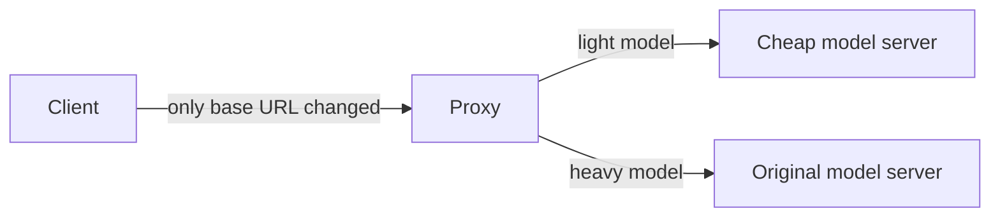

Today I set up a way to mix several AI models on my PC, then deleted it again. What stayed wasn't the install. It was a few concepts.

## One door in front

The idea came up to use the expensive model only for hard work and hand small chores to a cheaper one. Instead of changing every program, you put a proxy in the middle.

1. **API gateway (LLM proxy)**: the client sends requests to the proxy instead of the provider's server. The proxy looks at each request and decides where to forward it. On the client side you only change the base URL, so the code barely moves.
2. **Model routing**: switching the destination based on the model name in the request. Requests for the light model go to the cheap server, heavy ones pass through to the original. Good for cost, but whether the original service's terms allow that kind of relaying is something to check separately.

## Write only the key's name

The config file doesn't hold the key itself. It just says "read it from the environment variable with this name." That way the config can be shown to anyone, and the key gets put in by whoever pays for it. I never see the value. There's an example file with just the empty fields, and you copy it and fill in the real one.

## Ports and binding

The port I first picked was already taken by another server. Only one program can hold a port, so if two collide, the later one fails or requests land on the wrong server. I moved to a different number.

The other thing is the bind address. Binding to `127.0.0.1` (loopback) means only that PC can connect. To use it from someone else's machine you'd open it to the network with something like `0.0.0.0`, and from then on you have to think about who else can get in. While testing, keeping it local feels right.

## What I checked and what I didn't

I sent a request with a fake key and the other server answered "wrong key." Funny, but that's a success. The request reached its destination, so the route works. The pass-through to the original server could only be tested with a real login, so I wrote down that it wasn't verified.

## Even deleting got stuck once

When I tried to remove everything, I got "in use, can't delete." No process was running. The culprit was the shell. If a shell's current directory is inside a folder, Windows locks that folder. I stepped out, tried again, and it was gone.

Installed and uninstalled in one day, but the studying stayed.
