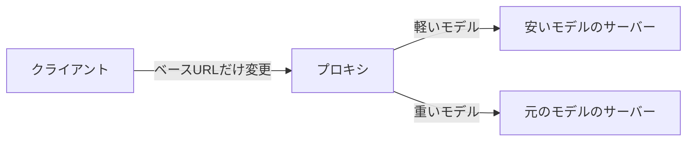

今日は複数のAIモデルを混ぜて使う仕組みを自分のPCに入れてみて、結局また消した。残ったのはインストールではなく、いくつかの概念だった。

## 前に扉をひとつ立てる

高いモデルは難しい仕事だけに使って、雑用は安いモデルに回そうという話が出た。プログラムごとに直す代わりに、間にプロキシをひとつ置く。

1. **APIゲートウェイ(LLMプロキシ)**: クライアントは本来のサーバーではなく、このプロキシにリクエストを送る。プロキシがリクエストを見て、どこへ渡すか決める。クライアント側で変えるのはベースURLひとつだけなので、コードはほぼそのまま。
2. **モデルルーティング**: リクエストに書かれたモデル名を見て行き先を変えること。軽いモデル宛ては安いサーバーへ、重いモデルは元のサーバーへそのまま渡す。コストには効くけど、元のサービスの規約がこういう中継をどう見るかは別に確認が要るらしい。

## キーは名前だけ書く

設定ファイルにはキーの値を直接書かず、「この名前の環境変数から読め」とだけ書いた。そうすれば設定ファイルは人に見せてもいいし、キーはお金を払った本人が自分で入れる。自分はキーの値を見ることがない。空欄だけのサンプルファイルを置いて、本物はそれをコピーして埋めるやり方だ。

## ポートとバインド

最初に考えたポートは、もう別のサーバーが使っていた。ひとつのポートはひとつのプログラムしか掴めないので、ぶつかると後から起動した方が失敗するか、リクエストが違うサーバーへ行く。だから別の番号に移した。

もうひとつはバインドするアドレス。`127.0.0.1`(ループバック)で起動すると、そのPCの中からしか繋がらない。他の人のPCから使うなら`0.0.0.0`のようにネットワーク側へ開く必要があって、その瞬間から誰が入れるかまで考えないといけない。テストの段階では中だけにしておくのがいいと思う。

## 確かめたこと、確かめられなかったこと

偽のキーでリクエストを送ったら、相手のサーバーが「キーが違う」と返してきた。笑えるけど、これが成功だ。リクエストが行き先まで届いたということなので、経路は合っている。逆に元のサーバーへ渡す方は本物のログインで送らないと分からないので、未確認とそのまま書いておいた。

## 消すときにも一度つまずいた

全部消そうとしたら「使用中なので削除できない」と出た。動いているプロセスはなかった。犯人はシェルだった。シェルの今の作業フォルダがそのフォルダの中にあると、Windowsはそのフォルダをロックする。外に出てからもう一度消したら、すぐ消えた。

入れて消した一日だったけど、勉強は残った。
