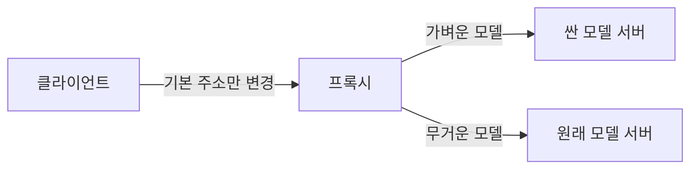

오늘은 AI 모델 여러 개를 섞어 쓰는 구조를 내 PC에 깔아 봤다가, 결국 다시 지웠다. 남은 건 설치 파일이 아니라 몇 가지 개념이었다.

## 앞에 문 하나를 세운다

비싼 모델은 어려운 일에만 쓰고, 잔일은 싼 모델에 넘기자는 얘기가 나왔다. 그걸 프로그램마다 따로 고치는 대신, 중간에 프록시 하나를 둔다.

1. **API 게이트웨이(LLM 프록시)**: 클라이언트는 원래 회사 서버 대신 이 프록시 주소로 요청을 보낸다. 프록시가 요청을 보고 어느 서버로 넘길지 정한다. 클라이언트 쪽에서 바꾸는 건 기본 주소(base URL) 하나뿐이라, 코드는 거의 그대로다.
2. **모델 라우팅**: 요청에 적힌 모델 이름을 보고 목적지를 바꾸는 것. 가벼운 모델로 온 요청은 싼 서버로, 무거운 모델은 원래 서버로 그대로 넘긴다. 비용을 줄이는 데는 좋은데, 원래 서비스 약관에서 이런 중계를 어떻게 보는지는 따로 확인해야 한다더라.

## 키는 이름만 적는다

설정 파일에 키 값을 직접 쓰지 않고, "이 이름의 환경변수에서 읽어라"라고만 적었다. 그러면 설정 파일은 남한테 보여줘도 되고, 키는 그걸 결제한 사람이 자기 손으로 넣는다. 나는 키 값을 볼 일이 없다. 키 양식만 담은 예시 파일을 같이 두고, 진짜 파일은 복사해서 채우는 방식이다.

## 포트와 바인딩

처음 생각한 포트는 이미 다른 서버가 쓰고 있었다. 한 포트는 한 프로그램만 붙잡을 수 있어서, 겹치면 나중에 뜬 쪽이 실패하거나 엉뚱한 서버에 요청이 간다. 그래서 다른 번호로 옮겼다.

또 하나는 바인딩 주소다. `127.0.0.1`(루프백)에 띄우면 그 PC 안에서만 접속된다. 다른 사람 PC에서 쓰려면 `0.0.0.0`처럼 네트워크 쪽으로 열어야 하는데, 그 순간부터는 누가 들어올 수 있는지까지 생각해야 한다. 테스트 단계에선 안에서만 되게 두는 게 맞는 것 같다.

## 확인한 것과 못 한 것

가짜 키를 넣고 요청을 보냈더니 상대 서버가 "키가 틀렸다"고 답했다. 웃기지만 이게 성공이다. 요청이 목적지까지 갔다는 뜻이라 경로는 맞다는 게 확인된다. 반대로 원래 서버로 넘기는 쪽은 진짜 로그인으로 보내 봐야 알 수 있어서, 확인 못 했다고 그대로 적어 뒀다.

## 지우는 데도 한 번 걸렸다

다 지우려는데 "사용 중이라 삭제할 수 없다"가 떴다. 돌고 있는 프로세스는 없었다. 범인은 셸이었다. 셸의 현재 작업 폴더가 그 폴더 안에 있으면, 윈도우는 그 폴더를 잠가 둔다. 밖으로 나와서 다시 지우니 바로 지워졌다.

깔았다 지운 하루였는데, 공부는 남았다.
