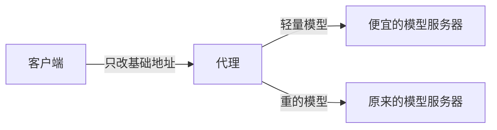

今天在自己电脑上装了一套混用多个AI模型的结构，最后又删掉了。留下来的不是安装文件，而是几个概念。

## 在前面立一扇门

有人提到，贵的模型只用在难的活上，杂活交给便宜的模型。与其每个程序分别改，不如在中间放一个代理。

1. **API网关(LLM代理)**:客户端不再直接请求原来的服务器，而是发给这个代理。代理看了请求再决定转给哪里。客户端只需要改一个基础地址(base URL),代码几乎不用动。
2. **模型路由**:根据请求里写的模型名换目的地。轻量模型的请求发到便宜的服务器，重的模型照原样转给原来的服务器。省钱是省钱，但原服务的条款怎么看待这种转发，得另外确认。

## 密钥只写名字

配置文件里不直接写密钥的值，只写"从这个名字的环境变量里读"。这样配置文件给别人看也没关系，密钥由付钱的人自己填。我根本不会看到密钥的值。旁边放一个只有空字段的示例文件，真正的文件复制过去再填。

## 端口和绑定

一开始想用的端口已经被别的服务器占了。一个端口只能被一个程序占用，撞了的话，后启动的会失败，或者请求跑到错的服务器上。所以换了个号码。

另一件事是绑定地址。绑在`127.0.0.1`(回环)上，只有这台电脑自己能连。要让别人的电脑用，就得像`0.0.0.0`那样向网络开放，从那一刻起就得考虑谁能进来。测试阶段只在本机能用，我觉得是对的。

## 确认了的和没确认的

用假密钥发了请求，对方服务器回了"密钥不对"。有点好笑，但这就是成功。说明请求到达了目的地，路是通的。反过来，转给原服务器那条路要用真的登录发一次才知道，所以照实写了没确认。

## 删的时候也卡了一下

想全部删掉，却跳出"正在使用，无法删除"。并没有在跑的进程。凶手是shell。shell当前的工作目录在那个文件夹里面时，Windows会锁住那个文件夹。退出来再删，马上就删掉了。

装了又删的一天，学到的东西留下了。
