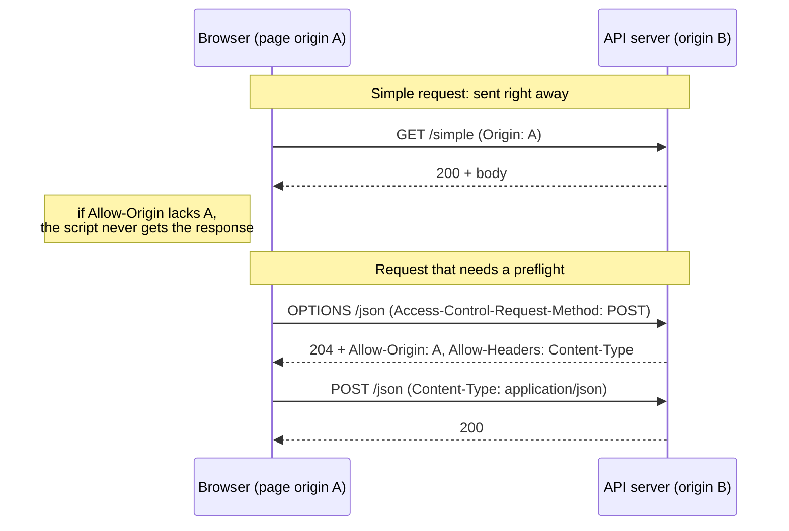

HTTP is a protocol where the server returns a single response after the client sends a request. We have already reviewed the full flow (DNS → TCP → TLS → HTTP) in [Network Basics](#/post/cs-network), and here we dive deeper into HTTP messages themselves, the rules layered on top (methods, status codes, caching), and differences between HTTPS and various versions. The code below was all executed locally.

## Messages are Text

An HTTP/1.1 message consists of a start line, multiple header lines, an empty line, and then the body. Line breaks are `\r\n`. I sent request strings directly via Python sockets and printed the responses as received.

```python
import socket
s = socket.create_connection(('127.0.0.1', port))   # port: 로컬에 띄운 http.server
s.sendall(b'GET / HTTP/1.1\r\nHost: x\r\n\r\n')
print(s.recv(4096).decode())
```

The response looked like this (Date omitted).

```
HTTP/1.1 200 OK
Server: BaseHTTP/0.6 Python/3.13.15
Content-Length: 11
ETag: "8097d38e"
Cache-Control: no-cache

<h1>hi</h1>
```

Here, `Content-Length` is important. Since responses may continue over a single TCP connection, the receiver must know where the body ends. If the length is known in advance, use `Content-Length`; otherwise, send chunked data with `Transfer-Encoding: chunked`. I created a `/chunk` path on the same server and received raw output like this upon request.

```
b'...Transfer-Encoding: chunked\r\n\r\n6\r\nhello \r\n7\r\nchunked\r\n0\r\n\r\n'
```

The `6` and `7` are the lengths of each chunk (in hexadecimal), and the final `0` marks the end. When using `http.client` to receive the same path, the chunks are combined into `b'hello chunked'`. This part is handled by the client library on your behalf.

Even when sending requests consecutively over the same socket, the connection does not break. Since the server responds with `HTTP/1.1`, persistent connections are the default, allowing four requests (GET, conditional GET, chunked GET, POST) to be processed over a single socket.

## Methods: Safe and Idempotent

Methods indicate "what you want to do with this resource," and MDN categorizes them by two properties. **Safe** means read-only operations that do not change server state. **Idempotent** means that sending the same request multiple times results in the same server state as sending it once. All safe methods are idempotent.

| Method | Safe | Idempotent | Cacheable |
|---|---|---|---|
| GET | O | O | O |
| HEAD | O | O | O |
| OPTIONS | O | O | X |
| PUT | X | O | X |
| DELETE | X | O | X |
| POST | X | X | Conditional |
| PATCH | X | X | Conditional |

This table is practically meaningful due to retries. When a response is interrupted mid-way and success is uncertain, re-sending `PUT /users/42` (overwrite entirely) yields the same result, whereas re-sending `POST /users` could create two users. How to choose methods in an API continues in [APIs and REST](#/post/be-api-rest).

<details>
<summary>Sending a POST</summary>

Requests with a body must specify the length using `Content-Length`. I sent this via socket to the same local server, and the first line of the response was `HTTP/1.1 201 Created`.

```python
s.sendall(b'POST /u HTTP/1.1\r\nHost: x\r\nContent-Length: 2\r\n\r\nab')
print(s.recv(4096).decode().splitlines()[0])
```

The fact that the server read only 2 bytes of the body is thanks to the length header. If this length is incorrect, the next request's start will be misread.

</details>

## Status Codes: Read the First Digit

| Class | Meaning |
|---|---|
| 1xx | Informational (intermediate response) |
| 2xx | Success (processed) |
| 3xx | Redirection (additional action required) |
| 4xx | Client Error (request was invalid) |
| 5xx | Server Error (server could not process the request) |

Here are some commonly confused pairs:

- `301` and `302` indicate permanent or temporary redirects, while `307` and `308` are their counterparts that preserve the original method. Thus, even if a POST is redirected, it remains a POST.
- `401 Unauthorized` means "authentication failed," whereas `403 Forbidden` means "you are identified but not authorized." Logging in again won't resolve a `403`.
- `404 Not Found` indicates the resource was not found; some servers use `404` instead of `403` to hide the existence of a resource.
- `429 Too Many Requests` means too many requests were sent within a certain time, while `503 Service Unavailable` means the server is currently unable to handle requests due to maintenance or overload. Both can include a `Retry-After` header to indicate when to retry.
- `304 Not Modified` is not an error but a cacheable response; we'll see more about that below.

## Caching and Conditional Requests

Earlier, the server provided `ETag` and `Cache-Control: no-cache`. Note that `no-cache` does not mean "do not store"; it means "verify with the server before using." To prevent storage entirely, use `no-store`. This pair is often confused due to their names.

| | no-cache | no-store |
|---|---|---|
| Store | Yes | No |
| Reuse | After server verification | Not applicable |
| If unchanged | Returns 304 with no body | Always returns 200 |

Sent a request again on the same connection with the received `ETag` in the `If-None-Match` header.

```
GET / HTTP/1.1
If-None-Match: "8097d38e"

HTTP/1.1 304 Not Modified
ETag: "8097d38e"
```

Only headers arrived without a body. The client can simply reuse its existing copy. If the content has changed, the server returns a 200 status along with a new `ETag` and the new body. For static files where the filename includes a version number, patterns like `Cache-Control: public, max-age=31536000, immutable` inform the server that the resource is fresh for a long time, preventing further checks; this pattern is recommended by MDN. The fact that caching also occurs at intermediate layers (CDNs) rather than just in the browser continues in [more detail → CDNs and Caching Layers](#/post/infra-cdn-cache).

## Statelessness: the server doesn't remember who that was

1. **Stateless**: each HTTP request stands on its own. At the protocol level the server doesn't remember "the person who logged in a moment ago." Even when I sent four requests over one socket above, the server handled each separately. A connection staying open (persistent connection) and remembering state are different things.
2. **Why it was built that way**: if the server keeps no per-client memory, any server can take the next request. Adding servers, or rerouting when one dies, becomes easy. That's why [load balancers](#/post/infra-load-balancer) and [autoscaling](#/post/infra-autoscaling) are easy.
3. **But logins still have to be remembered**: so state rides along with every request. Two ways: store a session on the server and pass only its key (a session ID) in a cookie, or carry the state itself as a signed token (JWT and the like). The difference is covered in [Authentication and Authorization](#/post/be-auth). Either way HTTP itself stays stateless and the state travels in headers.

## Cookies: the header that carries state

A **cookie** is a small value the server hands over with a `Set-Cookie` response header, meaning "hold this and send it next time." The browser stores it and attaches it automatically as a `Cookie` request header on every request that matches. I reproduced it locally.

```python
import threading, urllib.request, http.cookiejar
from http.server import BaseHTTPRequestHandler, ThreadingHTTPServer

class H(BaseHTTPRequestHandler):
    def log_message(self, *a): pass
    def do_GET(self):
        print(f'서버가 받은 Cookie: {self.headers.get("Cookie")}')
        self.send_response(200)
        if self.path == '/login':
            self.send_header('Set-Cookie', 'sid=abc123; Path=/; HttpOnly; SameSite=Lax; Max-Age=3600')
        self.end_headers(); self.wfile.write(b'ok')

srv = ThreadingHTTPServer(('127.0.0.1', 0), H)
threading.Thread(target=srv.serve_forever, daemon=True).start()
base = f'http://127.0.0.1:{srv.server_address[1]}'

jar = http.cookiejar.CookieJar()                       # 브라우저의 쿠키 저장소 역할
opener = urllib.request.build_opener(urllib.request.HTTPCookieProcessor(jar))
for path in ['/', '/login', '/me', '/me']:
    r = opener.open(base + path)
    print(f'GET {path} -> Set-Cookie: {r.headers.get("Set-Cookie")}')
```

```
서버가 받은 Cookie: None
GET / -> Set-Cookie: None
서버가 받은 Cookie: None
GET /login -> Set-Cookie: sid=abc123; Path=/; HttpOnly; SameSite=Lax; Max-Age=3600
서버가 받은 Cookie: sid=abc123
GET /me -> Set-Cookie: None
서버가 받은 Cookie: sid=abc123
GET /me -> Set-Cookie: None
```

(`서버가 받은 Cookie` = "Cookie the server received.") After receiving it once at `/login`, `sid=abc123` was attached to every request without me doing anything. The server is still stateless; the client just shows the state key again every time.

The attributes after `Set-Cookie` are what matter in practice. Summarized from MDN:

| Attribute | Meaning | If you leave it out |
|---|---|---|
| `Expires` / `Max-Age` | how long to keep it | a session cookie that disappears when the browser closes |
| `Domain` / `Path` | which host and path requests get it | sent only to the host that set it (no subdomains) |
| `Secure` | only sent on HTTPS requests | can leak over plain HTTP |
| `HttpOnly` | JavaScript `document.cookie` can't read it | XSS can steal the session cookie |
| `SameSite` | whether to send it on requests started from another site (`Strict`/`Lax`/`None`) | Chrome and others treat it as `Lax`; varies by browser |

`SameSite=None` means "send it from other sites too," so it must come with `Secure`. For a session cookie, `Secure; HttpOnly; SameSite=Lax` (or `Strict`) is a sensible starting point. `SameSite` reduces attacks where another site makes your browser quietly send a request carrying your cookie (CSRF). The attack side is in [Web Vulnerabilities and OWASP](#/post/sec-owasp).

## CORS: why the browser blocks responses from other origins

1. **Origin**: scheme + host + port. `https://a.com`, `https://a.com:8443` and `http://a.com` are all different origins.
2. **Same-origin policy (SOP)**: the browser stops a script from one origin from reading responses from another origin. Without it, a malicious page I open could call my bank's API with my cookies and read the response.
3. **CORS (Cross-Origin Resource Sharing)**: a permission scheme that opens a hole in SOP. When the server says "this origin may read it" with response headers like `Access-Control-Allow-Origin`, the browser hands the response to the script. So a CORS error is less a blocking device than a sign that permission is missing.
4. **Preflight**: for requests that might change server state, the browser first asks with `OPTIONS` before the real request. Only "simple requests" go straight through: GET, HEAD or POST, with headers from the default safe list, and a `Content-Type` that's a form type or `text/plain`. A POST with `Content-Type: application/json` gets a preflight.
5. **Credentialed requests**: to send cookies with `fetch(..., {credentials: 'include'})`, the server must return `Access-Control-Allow-Credentials: true`, and `Allow-Origin` must name the exact origin, not `*`.



I checked it myself. A page on 127.0.0.1:9001 and an API on 127.0.0.1:9002 (different ports, so different origins); I opened the page in headless Chrome and ran two `fetch` calls. The API server logged the requests it received.

```
# API responds without CORS headers
page result   simple GET: TypeError / json POST: TypeError
server log    GET /simple | Origin: http://127.0.0.1:9001
              OPTIONS /json | requested method: POST | requested headers: content-type

# API sends Access-Control-Allow-Origin: http://127.0.0.1:9001
page result   simple GET: secret / json POST: 200
server log    GET /simple, OPTIONS /json, POST /json
```

Two things show up. First, even without permission the simple GET reached the server and was processed. The browser just didn't hand the response to the script. So CORS doesn't protect the server, which is one more reason not to make state-changing operations GETs. Second, when the preflight for the JSON POST was refused, the real request was never sent. That `curl` and server-to-server calls have no CORS is the same story: it's a rule only browsers enforce.

The fix is on the server side. Have the API server answer with the exact allowed origins, or during development use the frontend dev server's proxy so it looks same-origin. Slapping `Access-Control-Allow-Origin: *` everywhere can't even be combined with cookie auth, and should be avoided unless it's a public API.

## HTTPS: TLS Handshake Overview

HTTPS sends HTTP messages inside a TLS channel. The handshake for TLS 1.3 (RFC 8446) generally flows as follows:

1. The client sends a ClientHello, including supported cipher suites and the key exchange public value (`key_share`).
2. The server selects a suite via ServerHello and returns its own `key_share`. From this point onward, both parties can generate handshake keys, so subsequent handshake messages are encrypted.
3. The server sends the certificate chain (Certificate) and signs the entire handshake history up to that point with the private key of that certificate (CertificateVerify) to prove ownership of the key. It confirms the entire content via Finished.
4. Once the client also sends Finished, application data (HTTP) flows through.

For the initial connection, this takes one round trip (1-RTT). If the `key_share` group sent by the server does not match, the process goes back once more with a HelloRetryRequest. If a previously shared key (PSK) exists, 0-RTT is possible by sending data in the first flight; however, this initial data lacks forward secrecy and is vulnerable to replay attacks. Therefore, RFCs specify that only idempotent requests suitable for reprocessing should be sent. The method table above is used again here.

I verified this locally. I created a self-signed certificate using `openssl` and ran both the server and client in the same process using Python's `ssl`.

```python
cc = ssl.create_default_context(cafile='c.pem')
t = cc.wrap_socket(raw, server_hostname='localhost')
print(t.version(), t.cipher())
print(t.getpeercert()['subject'])
t.sendall(b'GET / HTTP/1.1\r\nHost: localhost\r\n\r\n')
```

The output was as follows:

```
TLSv1.3 ('TLS_AES_256_GCM_SHA384', 'TLSv1.3', 256)
((('commonName', 'localhost'),),)
b'HTTP/1.1 200 OK\r\nContent-Length: 2\r\n\r\nok'
```

TLS 1.3 was negotiated, the client verified the certificate name (`server_hostname`), and the decrypted plaintext HTTP request arrived intact at the server-side `recv`. The format of HTTP messages remains unchanged even over TLS. For details on how certificates, signatures, and hashes establish trust, see [more detail → Fundamentals of Encryption, Hashing, and Authentication](#/post/sec-authn-crypto).

<details>
<summary>Execution Environment</summary>

- Python 3.13; `ssl.OPENSSL_VERSION` is OpenSSL 3.0.x; `ssl.HAS_TLSv1_3` is True.
- The certificate was a one-day self-signed certificate created with `openssl req -x509`, with `localhost` added to the subjectAltName.
- Since the local experiment was conducted on a single PC, round-trip time (RTT) differences were not measured.

</details>

## Differences by Version: 1.1, 2, 3

The semantics (methods, status codes, header concepts) are the same across the three versions; the transport differs.

| | HTTP/1.1 | HTTP/2 | HTTP/3 |
|---|---|---|---|
| Format | text | binary frames | binary frames |
| On one connection | requests in order (pipelining existed) | many requests at once (multiplexing) | at once, each stream independent |
| Transport below | TCP | TCP | QUIC (over UDP) |
| Headers | sent as-is every time | compressed (HPACK) | compressed (QPACK) |
| Encryption | optional (TLS if HTTPS) | browsers use it only over TLS | TLS 1.3 built into QUIC, mandatory |
| Round trips before the first request | TCP 1 + TLS 1.3 1 = 2 RTT | same | 1 RTT (0-RTT possible on resumption) |
| Spec | RFC 9112 | RFC 9113 | RFC 9114 (QUIC is RFC 9000) |

1.1 made connections reusable but had a head-of-line problem where the next response couldn't come until the previous one finished, and browsers worked around it by opening up to 6 TCP connections per origin. HTTP/2 removed that limit by allowing parallel requests on one connection. But since it runs on a single TCP connection, when one packet is lost and TCP retransmits it, every stream on that connection waits together. HTTP/3 uses QUIC over UDP instead of TCP, and since QUIC detects loss and retransmits per stream, only the stream that lost data is blocked. TCP's own behavior continues in [Read more → TCP and UDP](#/post/net-tcp-udp).

A bit deeper:

1. **HTTP/1.1's limits**: pipelining had to return responses in request order, so one slow response pushed everything behind it back, and with many intermediary-proxy compatibility problems browsers ended up turning it off by default. So in practice people opened 6 connections and used tricks like merging images into one (sprites) or splitting across domains (domain sharding).
2. **HTTP/2 frames and streams**: a message is cut into HEADERS and DATA frames. Each frame carries a stream number, so even when frames from many requests are interleaved on one connection, the receiver reassembles them by number. Using length-prefixed frames instead of text line breaks is the same idea as length-prefix framing in the [socket post](#/post/net-socket). Thanks to this, the 1.1-era tricks actually became harmful.
3. **HPACK header compression**: cuts the waste of re-sending nearly identical `User-Agent`, `Cookie` and `Accept` on every request. Common headers are sent as an index into a predefined table (the static table), and headers already sent on this connection as an index into a per-connection table (the dynamic table).
4. **Features that went away**: HTTP/2 had server push, where the server sends resources before they're requested, but it underdelivered and Chrome removed support. The original stream priority scheme was also deprecated in RFC 9113, and a simpler `Priority` header scheme (RFC 9218) came separately.
5. **HTTP/3 and QUIC**: merges TCP connection setup and the TLS handshake into one QUIC handshake, cutting round trips before the first request. Connections are identified by a connection ID rather than IP and port, so the connection can continue even when your IP changes switching from Wi-Fi to LTE (connection migration). Being over UDP, congestion control and retransmission are implemented by app-side libraries rather than the OS kernel, so improvements ship faster. The costs: more CPU, and it can't be used on networks that block UDP.
6. **How the version is chosen**: it's negotiated, not picked by the client. HTTP/2 is chosen as `h2` via a TLS handshake extension called ALPN. HTTP/3 can't be used from the very start, so the server announces "h3 works on UDP 443 too" with an `Alt-Svc: h3=":443"` header on an HTTP/2 response (or with a DNS HTTPS record), and the client tries it from then on.

I asked real sites with `curl`.

```
$ curl -s -o /dev/null -D - --http2 https://www.google.com
HTTP/2 200
alt-svc: h3=":443"; ma=2592000,h3-29=":443"; ma=2592000

$ curl -s -o /dev/null -D - --http2 https://dohyunkang.github.io/blog/
HTTP/2 200
```

Google answered over HTTP/2 and announced HTTP/3 with `alt-svc`. This blog (GitHub Pages) also came back over HTTP/2. I also tried an HTTP/3 connection with `curl --http3-only`, but in my environment it hung with no response, so I couldn't confirm it. That's what happens on networks that block UDP; a browser would quietly fall back to HTTP/2 in that case.

## Common Misconceptions

- 304 is not an error; it is a normal response indicating that the cached copy is still valid.
- `no-cache` does not mean "do not cache"; it means to store but verify before reuse.
- 401 and 403 are not the same; one indicates authentication failure, while the other indicates insufficient authorization.
- HTTP/2 does not eliminate all limitations of TCP; those are addressed by HTTP/3.
- Even with HTTPS, the HTTP message itself remains unchanged; only the underlying channel changes.
- A persistent connection means state: even when the connection is reused, each request is independent. Login state rides along again on every request in a cookie or token.
- CORS protects the server: the browser does the blocking, and simple requests reach the server even without permission. It doesn't apply to `curl` or server-to-server calls.
- CORS errors are fixed in the frontend: permission is given with response headers, so you fix it on the server (or a dev proxy).
- An `HttpOnly` cookie is safe: it only stops scripts from reading it. Plain-text transmission is handled by `Secure`, and requests from other sites by `SameSite`.

## Core concepts you should be able to explain yourself

1. **HTTP message**: start line, headers, blank line, body. The end of the body is signaled by `Content-Length` or chunked.
2. **Safe and idempotent**: GET doesn't change state, and PUT/DELETE give the same result however many times they're sent. Whether a retry is OK depends on this.
3. **Status codes**: read the first digit. 401 is not authenticated, 403 is not permitted, 304 means use the cache as-is.
4. **Caching**: `no-cache` is reuse after checking, `no-store` is don't store. `ETag` and `If-None-Match` get you a 304.
5. **Statelessness**: the server doesn't remember between requests. That makes scaling out easy, and state is sent every time via cookies or tokens.
6. **Cookies and attributes**: received with `Set-Cookie`, sent automatically with `Cookie`. Session cookies: `Secure; HttpOnly; SameSite`.
7. **SOP and CORS**: an origin is scheme+host+port. The browser blocks responses from other origins, and the server grants permission with `Access-Control-Allow-*` headers. Requests like a JSON POST get an OPTIONS preflight first.
8. **TLS 1.3**: 1-RTT handshake, verifies the server with a certificate and signature. 0-RTT data is vulnerable to replay.
9. **HTTP/1.1 → 2 → 3**: 2 added multiplexing streams over one TCP connection and header compression; 3 uses QUIC (UDP) to cut TCP's head-of-line problem and setup round trips. The version is negotiated via ALPN and Alt-Svc.

## Related Reading

← [Concept Map](#/post/cs-map)

- [More details → Sockets and WebSockets](#/post/net-socket): More detailed explanation of the socket code used above
- [More details → DNS, IP, and Routing](#/post/net-dns-routing): What happens before establishing a connection
- [More details → APIs and REST](#/post/be-api-rest): How to use methods and status codes in APIs

## Reference Links

- MDN, HTTP request methods: https://developer.mozilla.org/en-US/docs/Web/HTTP/Reference/Methods
- MDN, HTTP response status codes: https://developer.mozilla.org/en-US/docs/Web/HTTP/Reference/Status
- MDN, Evolution of HTTP: https://developer.mozilla.org/en-US/docs/Web/HTTP/Guides/Evolution_of_HTTP
- MDN, HTTP caching: https://developer.mozilla.org/en-US/docs/Web/HTTP/Guides/Caching
- RFC 8446, The Transport Layer Security (TLS) Protocol Version 1.3: https://www.rfc-editor.org/rfc/rfc8446.html
- MDN, Using HTTP cookies: https://developer.mozilla.org/en-US/docs/Web/HTTP/Guides/Cookies
- MDN, Set-Cookie: https://developer.mozilla.org/en-US/docs/Web/HTTP/Reference/Headers/Set-Cookie
- MDN, Cross-Origin Resource Sharing (CORS): https://developer.mozilla.org/en-US/docs/Web/HTTP/Guides/CORS
- MDN, Same-origin policy: https://developer.mozilla.org/en-US/docs/Web/Security/Same-origin_policy
- RFC 9113, HTTP/2: https://www.rfc-editor.org/rfc/rfc9113.html
- RFC 7541, HPACK: https://www.rfc-editor.org/rfc/rfc7541.html
- RFC 9114, HTTP/3: https://www.rfc-editor.org/rfc/rfc9114.html
- RFC 9000, QUIC: https://www.rfc-editor.org/rfc/rfc9000.html
- RFC 7838, HTTP Alternative Services: https://www.rfc-editor.org/rfc/rfc7838.html

Further reading (well-illustrated Korean posts on the same topic)

- Inpa Dev, Stateful vs. Stateless, made easy: https://inpa.tistory.com/entry/WEB-%F0%9F%93%9A-Stateful-Stateless-%EC%A0%95%EB%A6%AC
- Inpa Dev, Working with the browser's Cookie header: https://inpa.tistory.com/entry/HTTP-%F0%9F%8C%90-%EC%9B%B9-%EB%B8%8C%EB%9D%BC%EC%9A%B0%EC%A0%80%EC%9D%98-%EC%BF%A0%ED%82%A4-%EA%B0%9C%EB%85%90-Cookie-%ED%97%A4%EB%8D%94-%EB%8B%A4%EB%A3%A8%EA%B8%B0
- Inpa Dev, The notorious CORS: concepts and fixes: https://inpa.tistory.com/entry/WEB-%F0%9F%93%9A-CORS-%F0%9F%92%AF-%EC%A0%95%EB%A6%AC-%ED%95%B4%EA%B2%B0-%EB%B0%A9%EB%B2%95-%F0%9F%91%8F
- Inpa Dev, HTTP/2 and how it communicates: https://inpa.tistory.com/entry/WEB-%F0%9F%8C%90-HTTP-20-%ED%86%B5%EC%8B%A0-%EA%B8%B0%EC%88%A0-%EC%9D%B4%EC%A0%9C%EB%8A%94-%ED%99%95%EC%8B%A4%ED%9E%88-%EC%9D%B4%ED%95%B4%ED%95%98%EC%9E%90
- Inpa Dev, HTTP/3 and how it communicates: https://inpa.tistory.com/entry/WEB-%F0%9F%8C%90-HTTP-30-%ED%86%B5%EC%8B%A0-%EA%B8%B0%EC%88%A0-%EC%9D%B4%EC%A0%9C%EB%8A%94-%ED%99%95%EC%8B%A4%ED%9E%88-%EC%9D%B4%ED%95%B4%ED%95%98%EC%9E%90
