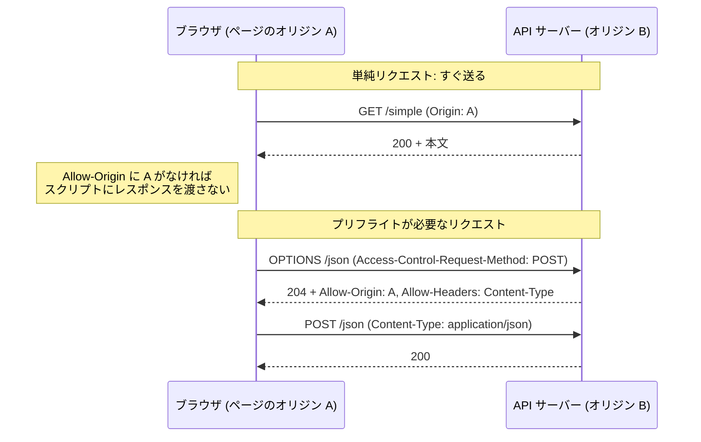

HTTP is a protocol where the server returns one response when the client sends a request. We have already reviewed the entire flow (DNS → TCP → TLS → HTTP) in [Details → Network Basics](#/post/cs-network), and here we look more deeply at the HTTP message itself, the rules layered on top of it (methods, status codes, caching), and the differences between HTTPS and various versions. The code below was all executed locally.

## Messages are Text

An HTTP/1.1 message consists of a start line, multiple header lines, an empty line, and then the body. Line breaks are `\r\n`. I sent request strings directly via Python sockets and printed the responses as they came.

```python
import socket
s = socket.create_connection(('127.0.0.1', port))   # port: 로컬에 띄운 http.server
s.sendall(b'GET / HTTP/1.1\r\nHost: x\r\n\r\n')
print(s.recv(4096).decode())
```

The response looked like this (Date omitted).

```
HTTP/1.1 200 OK
Server: BaseHTTP/0.6 Python/3.13.15
Content-Length: 11
ETag: "8097d38e"
Cache-Control: no-cache

<h1>hi</h1>
```

Here, `Content-Length` is important. Since responses continue over a single TCP connection, the receiver must know where the body ends. If the length is known in advance, use `Content-Length`; otherwise, send chunk-by-chunk lengths using `Transfer-Encoding: chunked`. I created a `/chunk` path on the same server and received it raw as follows.

```
b'...Transfer-Encoding: chunked\r\n\r\n6\r\nhello \r\n7\r\nchunked\r\n0\r\n\r\n'
```

The `6` and `7` are the lengths of each chunk (in hexadecimal), and the final `0` marks the end. If you receive this path via `http.client`, the chunks are merged to produce `b'hello chunked'`. This is the part where the client library handles the decoding for you.

Even if requests are sent consecutively on the same socket, the connection is not broken. When the server responds with `HTTP/1.1`, persistence is the default, so I processed four requests (GET, conditional GET, chunked GET, POST) over a single socket.

## Methods: Safe and Idempotent

Methods state "what you want to do with this resource," and MDN categorizes them by two properties. **Safe** means read-only operations that do not change server state, while **idempotent** means that sending the same request multiple times results in the same server state as sending it once. All safe methods are idempotent.

| Method | Safe | Idempotent | Cacheable |
|---|---|---|---|
| GET | O | O | O |
| HEAD | O | O | O |
| OPTIONS | O | O | X |
| PUT | X | O | X |
| DELETE | X | O | X |
| POST | X | X | Conditional |
| PATCH | X | X | Conditional |

This table is practically meaningful due to retries. When a response is interrupted mid-way and success is uncertain, re-sending `PUT /users/42` (overwriting entirely) yields the same result, whereas re-sending `POST /users` could create two users. How to choose methods in an API continues in [Details → APIs and REST](#/post/be-api-rest).

<details>
<summary>Sending a POST</summary>

Requests with a body must specify the length via `Content-Length`. I sent this to the same local socket, and the first line of the response was `HTTP/1.1 201 Created`.

```python
s.sendall(b'POST /u HTTP/1.1\r\nHost: x\r\nContent-Length: 2\r\n\r\nab')
print(s.recv(4096).decode().splitlines()[0])
```

The server reading only the first 2 bytes of the body is thanks to the length header. If this length is incorrect, the start of the next request will be misread.

</details>

## Status Codes: Read the First Digit

| Class | Meaning |
|---|---|
| 1xx | Informational (intermediate response) |
| 2xx | Success (processed) |
| 3xx | Redirection (additional action required) |
| 4xx | Client Error (request malformed) |
| 5xx | Server Error (unable to process request) |

Here are clarifications on commonly confused pairs:

- **301** and **302** indicate permanent and temporary redirects, respectively. **307** and **308** are their counterparts but differ in that they do not change the method; thus, a POST redirected with 307 remains a POST.
- **401** is named "Unauthorized" but means "authentication failed," whereas **403** means "you are identified but lack permission." Logging in again will resolve 401, but not 403.
- **404** means the resource was not found; however, some servers use 404 instead of 403 to hide the existence of a resource.
- **429** indicates too many requests in a given time window, while **503** means the service is currently unavailable due to maintenance or overload. Both can include a `Retry-After` header to inform when to retry.
- **304** is not an error but a cacheable response; we will see this below.

## Caching and Conditional Requests

The server above provided `ETag` and `Cache-Control: no-cache`. Note that `no-cache` does not mean "do not store"; it means "revalidate with the server before using." To prevent storage entirely, use `no-store`. This is the most commonly confused pair due to their names.

| | no-cache | no-store |
|---|---|---|
| Store | Yes | No |
| Reuse | After server validation | Not applicable |
| If unchanged | 304, no body | Always 200 |

`ETag` を受け取ったものを `If-None-Match` ヘッダーに設定して、同じ接続で再度リクエストを送信した。

```
GET / HTTP/1.1
If-None-Match: "8097d38e"

HTTP/1.1 304 Not Modified
ETag: "8097d38e"
```

本文ではなくヘッダーのみが返ってきた。クライアントは保持しているキャッシュをそのまま使用すればよい。内容が変更された場合、サーバーは新しい `ETag` とともに 200 ステータスコードと新しい本文を返す。ファイル名にバージョンが含まれる静的なファイルについては、MDN が推奨する例として、`Cache-Control: public, max-age=31536000, immutable` のように非常に新鮮であると明示し、サーバーへの問い合わせを回避するパターンが紹介されている。キャッシュがブラウザだけでなく中間（CDN）にも存在するという話は、[詳細 → CDN とキャッシュ階層](#/post/infra-cdn-cache) を参照のこと。

## ステートレス: サーバーはさっきの人を覚えていない

1. **ステートレス (stateless)**: HTTP のリクエストは1つ1つが独立しています。サーバーはプロトコルのレベルでは「さっきログインしたあの人」を覚えていません。上でソケット1つでリクエストを4つ送ったときも、サーバーはそれぞれを別々に処理しました。接続がつながっていること(持続的接続)と状態を覚えていることは別の話です。
2. **なぜそう作ったか**: サーバーがクライアントごとの記憶を持たなければ、どのサーバーが次のリクエストを受けても構いません。サーバーを増やしたり、1台が落ちても別のサーバーに回したりしやすくなります。[ロードバランサー](#/post/infra-load-balancer) や [オートスケーリング](#/post/infra-autoscaling) が簡単な理由です。
3. **それでもログインは覚える必要がある**: なので状態をリクエストごとに載せて送ります。方法は2つです。サーバーにセッションを保存してその鍵(セッション ID)だけをクッキーでやり取りするか、状態そのものを署名したトークン(JWT など)で持ち歩くか。違いは [認証と認可](#/post/be-auth) で詳しく見ます。どちらでも HTTP 自体はステートレスのままで、状態はヘッダーに載って運ばれます。

## クッキー: 状態を運ぶヘッダー

**クッキー** は、サーバーが `Set-Cookie` レスポンスヘッダーで「これを持っておいて次に送って」と渡すと、ブラウザが保存しておき、条件に合うリクエストごとに `Cookie` リクエストヘッダーとして自動で付ける小さな値です。ローカルでそのまま再現してみました。

```python
import threading, urllib.request, http.cookiejar
from http.server import BaseHTTPRequestHandler, ThreadingHTTPServer

class H(BaseHTTPRequestHandler):
    def log_message(self, *a): pass
    def do_GET(self):
        print(f'서버가 받은 Cookie: {self.headers.get("Cookie")}')
        self.send_response(200)
        if self.path == '/login':
            self.send_header('Set-Cookie', 'sid=abc123; Path=/; HttpOnly; SameSite=Lax; Max-Age=3600')
        self.end_headers(); self.wfile.write(b'ok')

srv = ThreadingHTTPServer(('127.0.0.1', 0), H)
threading.Thread(target=srv.serve_forever, daemon=True).start()
base = f'http://127.0.0.1:{srv.server_address[1]}'

jar = http.cookiejar.CookieJar()                       # 브라우저의 쿠키 저장소 역할
opener = urllib.request.build_opener(urllib.request.HTTPCookieProcessor(jar))
for path in ['/', '/login', '/me', '/me']:
    r = opener.open(base + path)
    print(f'GET {path} -> Set-Cookie: {r.headers.get("Set-Cookie")}')
```

```
서버가 받은 Cookie: None
GET / -> Set-Cookie: None
서버가 받은 Cookie: None
GET /login -> Set-Cookie: sid=abc123; Path=/; HttpOnly; SameSite=Lax; Max-Age=3600
서버가 받은 Cookie: sid=abc123
GET /me -> Set-Cookie: None
서버가 받은 Cookie: sid=abc123
GET /me -> Set-Cookie: None
```

(`서버가 받은 Cookie` は「サーバーが受け取った Cookie」です。)`/login` で一度受け取ってからは、私が何もしなくても毎回のリクエストに `sid=abc123` が付きました。サーバーは相変わらずステートレスで、クライアントが状態の鍵を毎回見せ直す構造です。

`Set-Cookie` の後ろに付く属性が実務では重要です。MDN を基準にまとめました。

| 属性 | 意味 | 付け忘れると |
|---|---|---|
| `Expires` / `Max-Age` | いつまで保存するか | ブラウザを閉じると消えるセッションクッキー |
| `Domain` / `Path` | どのホスト・パスへのリクエストに付けるか | クッキーを設定したホストにだけ付く(サブドメインは除く) |
| `Secure` | HTTPS のリクエストにだけ付ける | 平文の HTTP で漏れうる |
| `HttpOnly` | JavaScript の `document.cookie` で読めない | XSS でセッションクッキーを盗まれうる |
| `SameSite` | 別サイトから始まったリクエストに付けるか (`Strict`/`Lax`/`None`) | Chrome などは `Lax` として扱う、ブラウザにより異なる |

`SameSite=None` は別サイトからも送るという意味なので、`Secure` が一緒に必要です。セッションクッキーなら `Secure; HttpOnly; SameSite=Lax`(または `Strict`)が無難な出発点です。`SameSite` は、別のサイトが私のクッキー付きのリクエストをこっそり送らせる攻撃 (CSRF) を減らしてくれます。攻撃側の話は [ウェブ脆弱性と OWASP](#/post/sec-owasp) にあります。

## CORS: ブラウザが別オリジンのレスポンスを止める理由

1. **オリジン (origin)**: スキーム + ホスト + ポート。`https://a.com` と `https://a.com:8443`、`http://a.com` はすべて別のオリジンです。
2. **同一オリジンポリシー (SOP)**: ブラウザは、あるオリジンのスクリプトが別のオリジンのレスポンスを読めないようにします。これがないと、私が開いた悪意のあるページが私のクッキーを載せて銀行の API を呼び、レスポンスまで読めてしまいます。
3. **CORS (オリジン間リソース共有)**: SOP に穴を開ける許可の仕組みです。サーバーが `Access-Control-Allow-Origin` などのレスポンスヘッダーで「このオリジンは読んでいい」と伝えると、ブラウザがスクリプトにレスポンスを渡します。なので CORS エラーは、止める仕組みというより許可がないという印です。
4. **プリフライト (preflight)**: サーバーの状態を変えうるリクエストなら、ブラウザは本リクエストの前に `OPTIONS` で先に尋ねます。GET・HEAD・POST で、ヘッダーが既定の許可リストの範囲内、`Content-Type` がフォームか `text/plain` の「単純リクエスト」だけがそのまま送られます。`Content-Type: application/json` の POST はプリフライトの対象です。
5. **認証情報付きリクエスト**: `fetch(..., {credentials: 'include'})` でクッキーを載せるには、サーバーが `Access-Control-Allow-Credentials: true` を返し、`Allow-Origin` に `*` ではなく正確なオリジンを書く必要があります。



自分で確かめてみました。127.0.0.1:9001 にページを、127.0.0.1:9002 に API を立て(ポートが違うので別オリジン)、ヘッドレス Chrome でページを開いて `fetch` を2つ実行しました。API サーバーは受け取ったリクエストをログに出しました。

```
# CORS ヘッダーなしで応答したとき
ページの結果   simple GET: TypeError / json POST: TypeError
サーバーログ   GET /simple | Origin: http://127.0.0.1:9001
              OPTIONS /json | 要求メソッド: POST | 要求ヘッダー: content-type

# Access-Control-Allow-Origin: http://127.0.0.1:9001 を返したとき
ページの結果   simple GET: secret / json POST: 200
サーバーログ   GET /simple, OPTIONS /json, POST /json
```

ここで2つのことが分かります。1つ目、許可がないときも単純な GET はサーバーまで届いて処理されました。ブラウザがレスポンスをスクリプトに渡さなかっただけです。なので CORS はサーバーを守る仕組みではなく、状態を変える処理を GET で作ってはいけない理由がここにも出てきます。2つ目、JSON の POST はプリフライトが拒否されると本リクエストがまったく送られませんでした。`curl` やサーバー同士の呼び出しに CORS がないのも同じ話です。ブラウザだけが守るルールです。

解決は結局サーバー側です。API サーバーが許可するオリジンを正確に書いて応答するか、開発中ならフロントの開発サーバーのプロキシで同一オリジンに見せます。`Access-Control-Allow-Origin: *` をどこにでも付けるのは、クッキー認証とは一緒に使えませんし、公開 API でなければ避けるべきです。

## HTTPS: TLS ハンドシェイクの概要

HTTPS は HTTP メッセージを TLS チャンネル内に封入して送信するものである。TLS 1.3(RFC 8446) のハンドシェイクは概ね以下の通り進行する。

1. クライアントが ClientHello を送信する。サポートする暗号スイートと、鍵交換用の公開値 (key_share) が含まれる。
2. サーバーが ServerHello でスイートを決定し、自身の key_share を返す。この時点から両者がハンドシェイク用キーを生成できるようになるため、以降のハンドシェイクメッセージは暗号化される。
3. サーバーが証明書チェーン (Certificate) を送信し、その証明書の秘密鍵を用いてこれまでのハンドシェイクに署名 (CertificateVerify) することでキー所有権を証明する。Finished で全体の内容を確認する。
4. クライアントも Finished を送信すると、アプリケーションデータ (HTTP) の通信が始まる。

最初の接続では 1 往復 (1-RTT) である。サーバーから送られた key_share グループが一致しない場合は、HelloRetryRequest でさらにやり取りを行う。以前に共有されたキー (PSK) が存在すれば、最初のフライトでデータを同時に送信する 0-RTT も可能だが、この初期データには順方向の秘密性がなく、再送信攻撃に対して脆弱である。そのため、RFC では冪等なリクエストのように再度処理されても問題ないものだけを傳送すると記載されている。上記のメソッド表はこの文脈で再び利用される。

ローカル環境で確認してみた。`openssl` を用いて自己署名証明書を作成し、Python の `ssl` モジュールを用いてサーバーとクライアントを同じプロセス内で動作させた。

```python
cc = ssl.create_default_context(cafile='c.pem')
t = cc.wrap_socket(raw, server_hostname='localhost')
print(t.version(), t.cipher())
print(t.getpeercert()['subject'])
t.sendall(b'GET / HTTP/1.1\r\nHost: localhost\r\n\r\n')
```

出力は以下の通りだった。

```
TLSv1.3 ('TLS_AES_256_GCM_SHA384', 'TLSv1.3', 256)
((('commonName', 'localhost'),),)
b'HTTP/1.1 200 OK\r\nContent-Length: 2\r\n\r\nok'
```

TLS 1.3 がネゴシエートされ、クライアントが証明書のホスト名を確認した (`server_hostname`)。サーバー側の `recv` では復号化された平文の HTTP リクエストがそのまま到着していた。TLS の上でも HTTP メッセージの形式は一切変わらない。証明書・署名・ハッシュがどのように信頼性を構築するかについては、[詳細 → 暗号化・ハッシュ・認証の基礎](#/post/sec-authn-crypto) を参照のこと。

<details>
<summary>実行環境</summary>

- Python 3.13, `ssl.OPENSSL_VERSION` は OpenSSL 3.0.x, `ssl.HAS_TLSv1_3` は True。
- 証明書は `openssl req -x509` で作成した 1 日間の自己署名証明書であり、subjectAltName に localhost を設定している。
- 上記のローカル実験は同一 PC 内で行ったため、往復時間 (RTT) の差は測定していない。

</details>

## バージョンごとの違い：1.1, 2, 3

3つのバージョンの意味(メソッド、ステータスコード、ヘッダーの概念)は同じで、転送方式が違います。

| | HTTP/1.1 | HTTP/2 | HTTP/3 |
|---|---|---|---|
| 形式 | テキスト | バイナリフレーム | バイナリフレーム |
| 1つの接続で | リクエストを順番に(パイプラインはあった) | 複数のリクエストを同時に(多重化) | 同時に、ストリームごとに独立 |
| 下の転送 | TCP | TCP | QUIC (UDP の上) |
| ヘッダー | 毎回そのまま | 圧縮 (HPACK) | 圧縮 (QPACK) |
| 暗号化 | 任意(HTTPS なら TLS) | ブラウザは TLS 上でのみ使う | QUIC に TLS 1.3 が組み込み、必須 |
| 最初のリクエストまでの往復 | TCP 1 + TLS 1.3 1 = 2 RTT | 同じ | 1 RTT(再接続は 0-RTT 可能) |
| 標準 | RFC 9112 | RFC 9113 | RFC 9114 (QUIC は RFC 9000) |

1.1 は接続を再利用できるようになりましたが、前のレスポンスが終わらないと次のレスポンスを受け取れない head-of-line 問題があり、ブラウザはオリジンあたり TCP 接続を最大6本開いて回避していました。HTTP/2 は1つの接続での並列リクエストを許してこの制約をなくしました。ただし1本の TCP の上で動くので、パケットが1つ失われて TCP が再送している間、その接続のすべてのストリームが一緒に待ちます。HTTP/3 は TCP の代わりに UDP 上の QUIC を使い、QUIC がストリームごとに損失検出と再送を別々に行うので、損失が起きたストリームだけが止まります。TCP 自体の動作は [詳しく → TCP と UDP](#/post/net-tcp-udp) で続けて見ます。

もう少し踏み込みます。

1. **HTTP/1.1 の限界**: パイプライニングはレスポンスをリクエストの順に返す必要があったので、前のレスポンスが1つ遅いと後ろが全部詰まり、中間プロキシとの互換性の問題も多くて、ブラウザは既定で無効にするようになりました。なので実際には接続を6本開き、画像を1枚にまとめる(スプライト)、ドメインを分ける(ドメインシャーディング)といった小技がよく使われました。
2. **HTTP/2 のフレームとストリーム**: メッセージを HEADERS フレームと DATA フレームに切って送ります。フレームごとにストリーム番号が付くので、1つの接続の上で複数のリクエストのフレームが混ざって流れても、受け手が番号で組み立て直します。テキストの改行の代わりに長さを書いたフレームを使うのは、[ソケットの記事](#/post/net-socket) の長さ前置フレーミングと同じ発想です。おかげで 1.1 時代の小技がかえって損になりました。
3. **HPACK ヘッダー圧縮**: リクエストごとにほぼ同じ `User-Agent`、`Cookie`、`Accept` を繰り返し送っていた無駄を減らします。よく使うヘッダーはあらかじめ決めた表(静的テーブル)の番号で、この接続で一度送ったヘッダーは接続ごとの表(動的テーブル)の番号で送ります。
4. **なくなった機能**: HTTP/2 にはリクエストされる前にサーバーがリソースを先に送るサーバープッシュがありましたが、期待ほどの効果がなく Chrome がサポートを外しました。最初の仕様のストリーム優先度の方式も RFC 9113 で廃止され、より単純な `Priority` ヘッダー方式 (RFC 9218) が別に出ました。
5. **HTTP/3 と QUIC**: TCP の接続確立と TLS ハンドシェイクを1つの QUIC ハンドシェイクにまとめ、最初のリクエストまでの往復が減りました。接続を IP・ポートではなく接続 ID で識別するので、Wi-Fi から LTE に切り替わって IP が変わっても接続を続けられます(コネクションマイグレーション)。UDP の上なので、OS カーネルではなくアプリ側のライブラリが輻輳制御と再送を実装し、そのぶん改良が早く配布されます。代償として CPU を多く使い、UDP を遮断するネットワークでは使えません。
6. **バージョンはどう決まるか**: クライアントが選ぶのではなく交渉します。HTTP/2 は TLS ハンドシェイク中に ALPN という拡張で `h2` を選びます。HTTP/3 は最初からは使えないので、サーバーが HTTP/2 のレスポンスに `Alt-Svc: h3=":443"` ヘッダー(または DNS の HTTPS レコード)で「UDP 443 で h3 も使える」と知らせると、次から試します。

`curl` で実際のサイトに聞いてみました。

```
$ curl -s -o /dev/null -D - --http2 https://www.google.com
HTTP/2 200
alt-svc: h3=":443"; ma=2592000,h3-29=":443"; ma=2592000

$ curl -s -o /dev/null -D - --http2 https://dohyunkang.github.io/blog/
HTTP/2 200
```

Google は HTTP/2 で答えつつ、`alt-svc` で HTTP/3 も使えると知らせてきました。このブログ (GitHub Pages) も HTTP/2 で返ってきました。`curl --http3-only` で HTTP/3 接続も試しましたが、私の実行環境では応答がないまま止まり、確認できませんでした。UDP が遮断されたネットワークで起きることで、ブラウザならこういうとき静かに HTTP/2 に戻ります。

## よくある誤解

- 304 はエラーではない。キャッシュされたコピーがまだ有効であるという正常なレスポンスである。
- `no-cache` はキャッシュしないという意味ではない。保存は行うが、再利用する前に確認するという意味である。
- 401 と 403 は同じ意味ではない。認証されていないものと、権限がないものの違いである。
- HTTP/2 が TCP の限界をすべて解消するわけではない。その限界を解決したのは HTTP/3 側である。
- HTTPS でも HTTP メッセージ自体はそのまま変わらない。変化するのはその下のチャネルである。
- 持続的接続なら状態がある: 接続を再利用してもリクエストはそれぞれ独立しています。ログイン状態はクッキーやトークンでリクエストごとに載せ直されます。
- CORS はサーバーを守る: 止めるのはブラウザで、単純リクエストは許可がなくてもサーバーまで届きます。`curl` やサーバー間の呼び出しには適用されません。
- CORS エラーはフロントで直す: 許可はレスポンスヘッダーで出すものなので、サーバー(または開発用プロキシ)で直します。
- `HttpOnly` ならクッキーは安全: スクリプトから読めなくするだけです。平文での送信は `Secure`、別サイト発のリクエストは `SameSite` が別に防ぎます。

## 自分で説明できるべき核心概念

1. **HTTP メッセージ**: 開始行、ヘッダー、空行、本文。本文の終わりは `Content-Length` か chunked で知らせます。
2. **安全とべき等**: GET は状態を変えず、PUT・DELETE は何度送っても結果が同じ。再試行していいかがここで分かれます。
3. **ステータスコード**: 最初の桁で読みます。401 は認証なし、403 は権限なし、304 はキャッシュをそのまま使ってよい。
4. **キャッシュ**: `no-cache` は確認してから再利用、`no-store` は保存禁止。`ETag` と `If-None-Match` で 304 を受け取ります。
5. **ステートレス**: サーバーはリクエスト間を覚えていません。だからサーバーを増やしやすく、状態はクッキー・トークンで毎回載せて送ります。
6. **クッキーと属性**: `Set-Cookie` で受け取り `Cookie` で自動送信。セッションクッキーは `Secure; HttpOnly; SameSite`。
7. **SOP と CORS**: オリジンはスキーム+ホスト+ポート。ブラウザが別オリジンのレスポンスを止め、サーバーが `Access-Control-Allow-*` ヘッダーで許可します。JSON の POST のようなリクエストは OPTIONS のプリフライトが先に行きます。
8. **TLS 1.3**: 1-RTT のハンドシェイク、証明書と署名でサーバーを確認します。0-RTT データはリプレイ攻撃に弱いです。
9. **HTTP/1.1 → 2 → 3**: 2 は1本の TCP 接続にストリームを混ぜる多重化とヘッダー圧縮、3 は QUIC (UDP) で TCP の head-of-line 問題と接続確立の往復を減らしました。バージョンは ALPN と Alt-Svc で交渉します。

## おすすめの記事

← [概念図で](#/post/cs-map)

- [자세히 → 소켓과 웹소켓](#/post/net-socket): 위에서 쓴 소켓 코드를 더 자세히
- [자세히 → DNS 와 IP·라우팅](#/post/net-dns-routing): 연결 맺기 전에 일어나는 일
- [자세히 → API 와 REST](#/post/be-api-rest): 메서드와 상태코드를 API 에서 쓰는 법

## 根拠となるリンク

- MDN, HTTP request methods: https://developer.mozilla.org/en-US/docs/Web/HTTP/Reference/Methods
- MDN, HTTP response status codes: https://developer.mozilla.org/en-US/docs/Web/HTTP/Reference/Status
- MDN, Evolution of HTTP: https://developer.mozilla.org/en-US/docs/Web/HTTP/Guides/Evolution_of_HTTP
- MDN, HTTP caching: https://developer.mozilla.org/en-US/docs/Web/HTTP/Guides/Caching
- RFC 8446, The Transport Layer Security (TLS) Protocol Version 1.3: https://www.rfc-editor.org/rfc/rfc8446.html
- MDN, Using HTTP cookies: https://developer.mozilla.org/en-US/docs/Web/HTTP/Guides/Cookies
- MDN, Set-Cookie: https://developer.mozilla.org/en-US/docs/Web/HTTP/Reference/Headers/Set-Cookie
- MDN, Cross-Origin Resource Sharing (CORS): https://developer.mozilla.org/en-US/docs/Web/HTTP/Guides/CORS
- MDN, Same-origin policy: https://developer.mozilla.org/en-US/docs/Web/Security/Same-origin_policy
- RFC 9113, HTTP/2: https://www.rfc-editor.org/rfc/rfc9113.html
- RFC 7541, HPACK: https://www.rfc-editor.org/rfc/rfc7541.html
- RFC 9114, HTTP/3: https://www.rfc-editor.org/rfc/rfc9114.html
- RFC 9000, QUIC: https://www.rfc-editor.org/rfc/rfc9000.html
- RFC 7838, HTTP Alternative Services: https://www.rfc-editor.org/rfc/rfc7838.html

参考(同じテーマを図で分かりやすくまとめた韓国語の記事)

- Inpa Dev, Stateful / Stateless の違い: https://inpa.tistory.com/entry/WEB-%F0%9F%93%9A-Stateful-Stateless-%EC%A0%95%EB%A6%AC
- Inpa Dev, ブラウザの Cookie ヘッダーの扱い方: https://inpa.tistory.com/entry/HTTP-%F0%9F%8C%90-%EC%9B%B9-%EB%B8%8C%EB%9D%BC%EC%9A%B0%EC%A0%80%EC%9D%98-%EC%BF%A0%ED%82%A4-%EA%B0%9C%EB%85%90-Cookie-%ED%97%A4%EB%8D%94-%EB%8B%A4%EB%A3%A8%EA%B8%B0
- Inpa Dev, 悪名高い CORS の概念と解決法: https://inpa.tistory.com/entry/WEB-%F0%9F%93%9A-CORS-%F0%9F%92%AF-%EC%A0%95%EB%A6%AC-%ED%95%B4%EA%B2%B0-%EB%B0%A9%EB%B2%95-%F0%9F%91%8F
- Inpa Dev, HTTP 2.0 の紹介と通信技術: https://inpa.tistory.com/entry/WEB-%F0%9F%8C%90-HTTP-20-%ED%86%B5%EC%8B%A0-%EA%B8%B0%EC%88%A0-%EC%9D%B4%EC%A0%9C%EB%8A%94-%ED%99%95%EC%8B%A4%ED%9E%88-%EC%9D%B4%ED%95%B4%ED%95%98%EC%9E%90
- Inpa Dev, HTTP 3.0 の紹介と通信技術: https://inpa.tistory.com/entry/WEB-%F0%9F%8C%90-HTTP-30-%ED%86%B5%EC%8B%A0-%EA%B8%B0%EC%88%A0-%EC%9D%B4%EC%A0%9C%EB%8A%94-%ED%99%95%EC%8B%A4%ED%9E%88-%EC%9D%B4%ED%95%B4%ED%95%98%EC%9E%90
