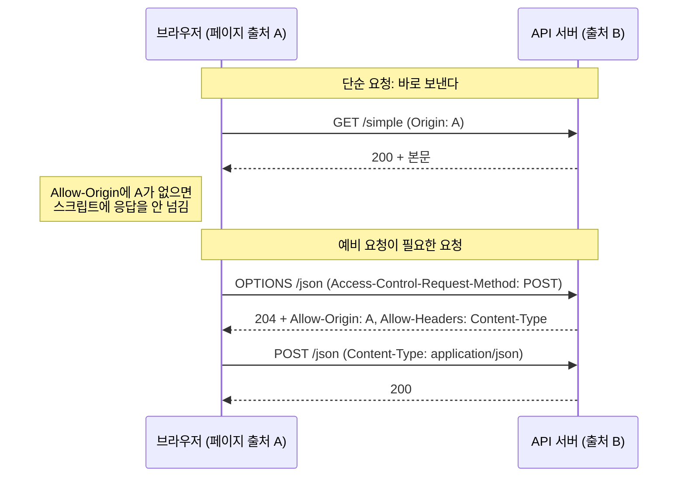

HTTP는 클라이언트가 요청을 보내면 서버가 응답 하나를 돌려주는 프로토콜이다. 전체 흐름(DNS → TCP → TLS → HTTP)은 [자세히 → 네트워크 기초](#/post/cs-network)에서 한 번 훑었고, 여기서는 HTTP 메시지 자체와 그 위에 얹힌 규칙(메서드, 상태코드, 캐시), 그리고 HTTPS와 버전별 차이를 좀 더 깊이 본다. 아래 코드는 전부 로컬에서 실행해 본 것이다.

## 메시지는 텍스트다

HTTP/1.1 메시지는 시작 줄, 헤더 여러 줄, 빈 줄, 본문 순서다. 줄바꿈은 `\r\n`이다. 파이썬 소켓으로 요청 문자열을 직접 보내고 응답을 그대로 찍어 봤다.

```python
import socket
s = socket.create_connection(('127.0.0.1', port))   # port: 로컬에 띄운 http.server
s.sendall(b'GET / HTTP/1.1\r\nHost: x\r\n\r\n')
print(s.recv(4096).decode())
```

응답은 이랬다(Date는 생략).

```
HTTP/1.1 200 OK
Server: BaseHTTP/0.6 Python/3.13.15
Content-Length: 11
ETag: "8097d38e"
Cache-Control: no-cache

<h1>hi</h1>
```

여기서 `Content-Length`가 중요하다. 한 TCP 연결 위로 응답이 이어서 오기 때문에 받는 쪽은 본문이 어디서 끝나는지 알아야 한다. 길이를 미리 알면 `Content-Length`를 쓰고, 모르면 `Transfer-Encoding: chunked`로 조각마다 길이를 붙여 보낸다. 같은 서버에 `/chunk` 경로를 만들어 요청하니 날것으로는 이렇게 왔다.

```
b'...Transfer-Encoding: chunked\r\n\r\n6\r\nhello \r\n7\r\nchunked\r\n0\r\n\r\n'
```

`6`과 `7`은 각 조각의 길이(16진수)이고 마지막 `0`이 끝 표시다. `http.client`로 같은 경로를 받으면 조각이 합쳐져서 `b'hello chunked'`가 나온다. 클라이언트 라이브러리가 대신 풀어 주는 부분이다.

같은 소켓에 요청을 연달아 보내도 연결은 안 끊겼다. 서버가 `HTTP/1.1`로 답하면 기본이 지속 연결이라서, 요청 4개(GET, 조건부 GET, chunk GET, POST)를 소켓 하나로 처리했다.

## 메서드: 안전하다와 멱등하다

메서드는 "이 자원에 뭘 하고 싶은가"를 말하고, MDN은 두 가지 성질로 나눈다. 안전(safe)은 서버 상태를 바꾸지 않는 읽기 전용이라는 뜻이고, 멱등(idempotent)은 같은 요청을 여러 번 보내도 한 번 보낸 것과 서버 상태가 같다는 뜻이다. 안전한 메서드는 전부 멱등하다.

| 메서드 | 안전 | 멱등 | 캐시 가능 |
|---|---|---|---|
| GET | O | O | O |
| HEAD | O | O | O |
| OPTIONS | O | O | X |
| PUT | X | O | X |
| DELETE | X | O | X |
| POST | X | X | 조건부 |
| PATCH | X | X | 조건부 |

이 표가 실무에서 의미 있는 건 재시도 때문이다. 응답이 중간에 끊겨 성공했는지 모를 때 `PUT /users/42`(통째로 덮어쓰기)는 다시 보내도 결과가 같지만, `POST /users`는 사용자가 두 명 생길 수 있다. 메서드를 API에서 어떻게 고르는지는 [자세히 → API와 REST](#/post/be-api-rest)로 이어진다.

<details>
<summary>POST 보내 보기</summary>

본문이 있는 요청은 `Content-Length`로 길이를 알려야 한다. 같은 로컬 서버에 소켓으로 보냈고 응답 첫 줄은 `HTTP/1.1 201 Created`였다.

```python
s.sendall(b'POST /u HTTP/1.1\r\nHost: x\r\nContent-Length: 2\r\n\r\nab')
print(s.recv(4096).decode().splitlines()[0])
```

서버가 본문 2바이트만 읽고 끝낸 것도 길이 헤더 덕분이다. 이 길이가 틀리면 다음 요청의 시작을 잘못 읽게 된다.

</details>

## 상태코드는 첫 자리로 읽는다

| 대역 | 뜻 |
|---|---|
| 1xx | 진행 중(중간 응답) |
| 2xx | 받아서 처리했다 |
| 3xx | 다른 URL로 가야 한다 등 추가 동작 필요 |
| 4xx | 요청이 잘못됐다 |
| 5xx | 서버가 올바른 요청을 처리하지 못했다 |

헷갈리는 쌍만 따로 정리한다.

- 301과 302는 영구/임시 이동이고, 307과 308은 각각 302와 301의 짝인데 메서드를 바꾸지 않는다는 점이 다르다. 그래서 POST를 리다이렉트해도 POST로 남는다.
- 401은 이름은 Unauthorized지만 뜻은 "인증이 안 됐다"이고, 403은 누군지는 아는데 권한이 없다는 뜻이다. 다시 로그인해도 403은 안 풀린다.
- 404는 자원을 못 찾았다는 뜻인데, 존재 자체를 숨기려고 403 대신 404를 쓰는 서버도 있다.
- 429는 일정 시간에 너무 많이 보냈다는 뜻, 503은 점검이나 과부하로 지금은 못 받는다는 뜻이다. 둘 다 `Retry-After` 헤더로 언제 다시 올지 알릴 수 있다.
- 304는 오류가 아니라 캐시 응답이다. 아래에서 본다.

## 캐시와 조건부 요청

위에서 서버가 `ETag`와 `Cache-Control: no-cache`를 내려 줬다. `no-cache`는 "저장하지 마라"가 아니라 "쓰기 전에 서버에 물어봐라"라는 뜻이다. 저장 자체를 막는 건 `no-store`다. 이름 때문에 가장 많이 헷갈리는 쌍이다.

| | no-cache | no-store |
|---|---|---|
| 저장 | 한다 | 안 한다 |
| 재사용 | 서버에 확인 후 | 해당 없음 |
| 변화 없을 때 | 304, 본문 없음 | 매번 200 |

받은 `ETag`를 `If-None-Match`에 실어 같은 연결로 다시 요청했다.

```
GET / HTTP/1.1
If-None-Match: "8097d38e"

HTTP/1.1 304 Not Modified
ETag: "8097d38e"
```

본문 없이 헤더만 왔다. 클라이언트는 갖고 있던 사본을 그대로 쓰면 된다. 내용이 바뀌었다면 서버가 새 `ETag`와 함께 200과 새 본문을 준다. 파일 이름에 버전이 붙는 정적 파일은 `Cache-Control: public, max-age=31536000, immutable`처럼 아예 오래 신선하다고 알려 서버에 묻지도 않게 하는 패턴이 MDN에 권장 예로 나온다. 캐시가 브라우저 말고 중간(CDN)에도 있다는 이야기는 [자세히 → CDN과 캐싱 계층](#/post/infra-cdn-cache)에 이어진다.

## 무상태: 서버는 방금 그 사람을 기억하지 않는다

1. **무상태(stateless)**: HTTP 요청 하나하나는 독립적이다. 서버는 프로토콜 차원에서 "아까 로그인한 그 사람"을 기억하지 않는다. 위에서 소켓 하나로 요청 4개를 보냈을 때도 서버는 각 요청을 따로 처리했다. 연결이 이어져 있다는 것(지속 연결)과 상태를 기억한다는 것은 다른 이야기다.
2. **왜 그렇게 만들었나**: 서버가 클라이언트별 기억을 들고 있지 않으면 아무 서버나 다음 요청을 받아도 된다. 서버를 늘리거나 하나가 죽어도 요청을 다른 서버로 돌리기 쉽다. [로드밸런서](#/post/infra-load-balancer)와 [오토스케일링](#/post/infra-autoscaling)이 쉬운 이유다.
3. **그래도 로그인은 기억해야 한다**: 그래서 상태를 요청마다 실어 보낸다. 방법은 둘이다. 서버에 세션을 저장하고 그 열쇠(세션 ID)만 쿠키로 주고받거나, 상태 자체를 서명한 토큰(JWT 등)으로 들고 다니거나. 둘의 차이는 [인증과 인가](#/post/be-auth)에서 자세히 본다. 어느 쪽이든 HTTP 자체는 무상태로 남고, 상태는 헤더에 실려 다닌다.

## 쿠키: 상태를 실어 나르는 헤더

**쿠키**는 서버가 `Set-Cookie` 응답 헤더로 "이걸 들고 있다가 다음에 보내 줘"라고 주면, 브라우저가 저장했다가 조건이 맞는 요청마다 `Cookie` 요청 헤더로 자동으로 붙이는 작은 값이다. 로컬에서 그대로 재현해 봤다.

```python
import threading, urllib.request, http.cookiejar
from http.server import BaseHTTPRequestHandler, ThreadingHTTPServer

class H(BaseHTTPRequestHandler):
    def log_message(self, *a): pass
    def do_GET(self):
        print(f'서버가 받은 Cookie: {self.headers.get("Cookie")}')
        self.send_response(200)
        if self.path == '/login':
            self.send_header('Set-Cookie', 'sid=abc123; Path=/; HttpOnly; SameSite=Lax; Max-Age=3600')
        self.end_headers(); self.wfile.write(b'ok')

srv = ThreadingHTTPServer(('127.0.0.1', 0), H)
threading.Thread(target=srv.serve_forever, daemon=True).start()
base = f'http://127.0.0.1:{srv.server_address[1]}'

jar = http.cookiejar.CookieJar()                       # 브라우저의 쿠키 저장소 역할
opener = urllib.request.build_opener(urllib.request.HTTPCookieProcessor(jar))
for path in ['/', '/login', '/me', '/me']:
    r = opener.open(base + path)
    print(f'GET {path} -> Set-Cookie: {r.headers.get("Set-Cookie")}')
```

```
서버가 받은 Cookie: None
GET / -> Set-Cookie: None
서버가 받은 Cookie: None
GET /login -> Set-Cookie: sid=abc123; Path=/; HttpOnly; SameSite=Lax; Max-Age=3600
서버가 받은 Cookie: sid=abc123
GET /me -> Set-Cookie: None
서버가 받은 Cookie: sid=abc123
GET /me -> Set-Cookie: None
```

`/login`에서 한 번 받은 뒤로는 내가 아무것도 안 해도 매 요청에 `sid=abc123`이 붙었다. 서버는 여전히 무상태인데, 클라이언트가 상태 열쇠를 매번 다시 보여 주는 구조다.

`Set-Cookie` 뒤에 붙은 속성들이 실무에서 중요하다. MDN 기준으로 정리했다.

| 속성 | 뜻 | 빼먹으면 |
|---|---|---|
| `Expires` / `Max-Age` | 언제까지 저장할지 | 브라우저를 닫으면 사라지는 세션 쿠키 |
| `Domain` / `Path` | 어느 호스트·경로 요청에 붙일지 | 쿠키를 준 호스트에만 붙음(하위 도메인 제외) |
| `Secure` | HTTPS 요청에만 붙임 | 평문 HTTP로 새어 나갈 수 있음 |
| `HttpOnly` | 자바스크립트 `document.cookie`로 못 읽음 | XSS로 세션 쿠키를 훔칠 수 있음 |
| `SameSite` | 다른 사이트에서 시작된 요청에 붙일지(`Strict`/`Lax`/`None`) | 크롬 등은 `Lax`로 취급, 브라우저마다 다름 |

`SameSite=None`은 다른 사이트에서도 보내겠다는 뜻이라 `Secure`가 같이 있어야 한다. 세션 쿠키라면 `Secure; HttpOnly; SameSite=Lax`(또는 `Strict`)가 무난한 출발점이다. `SameSite`는 다른 사이트가 내 쿠키를 실은 요청을 몰래 보내게 하는 공격(CSRF)을 줄여 준다. 공격 쪽 이야기는 [웹 취약점과 OWASP](#/post/sec-owasp)에 있다.

## CORS: 브라우저가 다른 출처의 응답을 막는 이유

1. **출처(origin)**: 스킴 + 호스트 + 포트. `https://a.com`과 `https://a.com:8443`, `http://a.com`은 전부 다른 출처다.
2. **동일 출처 정책(SOP)**: 브라우저는 한 출처의 스크립트가 다른 출처의 응답을 읽지 못하게 막는다. 이게 없으면 내가 연 악성 페이지가 내 쿠키를 실어 은행 API를 부르고 응답까지 읽을 수 있다.
3. **CORS(교차 출처 리소스 공유)**: SOP에 구멍을 내는 허가 방식이다. 서버가 `Access-Control-Allow-Origin` 같은 응답 헤더로 "이 출처는 읽어도 된다"고 알려 주면 브라우저가 스크립트에 응답을 넘긴다. 그러니 CORS 오류는 막는 장치라기보다 허가가 없다는 표시다.
4. **예비 요청(preflight)**: 서버 상태를 바꿀 수 있는 요청이면 브라우저가 본 요청 전에 `OPTIONS`로 먼저 묻는다. GET·HEAD·POST이면서 헤더가 기본 허용 목록 안이고 `Content-Type`이 폼이나 `text/plain`인 "단순 요청"만 바로 간다. `Content-Type: application/json`인 POST는 예비 요청 대상이다.
5. **인증 정보가 있는 요청**: `fetch(..., {credentials: 'include'})`로 쿠키를 실으려면 서버가 `Access-Control-Allow-Credentials: true`를 주고, `Allow-Origin`에 `*`가 아니라 정확한 출처를 적어야 한다.



직접 확인해 봤다. 127.0.0.1:9001에 페이지를, 127.0.0.1:9002에 API를 띄우고(포트가 다르니 다른 출처), 헤드리스 크롬으로 페이지를 열어 `fetch` 두 개를 실행했다. API 서버는 받은 요청을 로그로 찍었다.

```
# CORS 헤더 없이 응답할 때
페이지 결과   simple GET: TypeError / json POST: TypeError
서버 로그     GET /simple | Origin: http://127.0.0.1:9001
              OPTIONS /json | 요청할 메서드: POST | 요청할 헤더: content-type

# Access-Control-Allow-Origin: http://127.0.0.1:9001 을 줄 때
페이지 결과   simple GET: secret / json POST: 200
서버 로그     GET /simple, OPTIONS /json, POST /json
```

여기서 두 가지가 보인다. 첫째, 허가가 없을 때도 단순 GET은 서버까지 가서 처리됐다. 브라우저는 응답을 스크립트에 안 넘겼을 뿐이다. 그래서 CORS는 서버를 지키는 장치가 아니고, 상태를 바꾸는 작업을 GET으로 만들면 안 되는 이유가 여기서도 나온다. 둘째, JSON POST는 예비 요청이 거절되자 본 요청이 아예 안 나갔다. `curl`이나 서버끼리의 호출에는 CORS가 없다는 점도 같은 맥락이다. 브라우저만 지키는 규칙이다.

해결은 결국 서버 쪽이다. API 서버가 허용할 출처를 정확히 적어 응답하거나, 개발 중이면 프론트 개발 서버의 프록시로 같은 출처처럼 보이게 한다. `Access-Control-Allow-Origin: *`을 아무 데나 붙이는 건 쿠키 인증과는 같이 쓸 수도 없고, 공개 API가 아니면 피하는 게 맞다.

## HTTPS: TLS 핸드셰이크 개요

HTTPS는 HTTP 메시지를 TLS 채널 안에 넣어 보내는 것이다. TLS 1.3(RFC 8446)의 핸드셰이크는 크게 이렇게 흐른다.

1. 클라이언트가 ClientHello를 보낸다. 지원하는 암호 스위트와 함께 키 교환용 공개값(key_share)이 들어 있다.
2. 서버가 ServerHello로 스위트를 고르고 자기 key_share를 돌려준다. 이 시점부터 양쪽이 핸드셰이크용 키를 만들 수 있어서 이후 핸드셰이크 메시지는 암호화된다.
3. 서버가 인증서 체인(Certificate)을 보내고, 그 인증서의 개인 키로 지금까지의 핸드셰이크에 서명(CertificateVerify)해서 키 소유를 증명한다. Finished로 전체 내용을 확인한다.
4. 클라이언트도 Finished를 보내면 애플리케이션 데이터(HTTP)가 흐른다.

처음 연결할 때 1 왕복(1-RTT)이다. 서버가 보낸 key_share 그룹이 맞지 않으면 HelloRetryRequest로 한 번 더 오간다. 이전에 공유한 키(PSK)가 있으면 첫 비행에 데이터를 같이 보내는 0-RTT도 되는데, 이 초기 데이터는 순방향 비밀성이 없고 재전송 공격에 약하다. 그래서 멱등한 요청처럼 다시 처리돼도 괜찮은 것만 보내라고 RFC가 적는다. 위의 메서드 표가 여기서 다시 쓰인다.

로컬에서 확인해 봤다. `openssl`로 자체 서명 인증서를 만들고, 파이썬 `ssl`로 서버와 클라이언트를 같은 프로세스에 띄웠다.

```python
cc = ssl.create_default_context(cafile='c.pem')
t = cc.wrap_socket(raw, server_hostname='localhost')
print(t.version(), t.cipher())
print(t.getpeercert()['subject'])
t.sendall(b'GET / HTTP/1.1\r\nHost: localhost\r\n\r\n')
```

출력은 이랬다.

```
TLSv1.3 ('TLS_AES_256_GCM_SHA384', 'TLSv1.3', 256)
((('commonName', 'localhost'),),)
b'HTTP/1.1 200 OK\r\nContent-Length: 2\r\n\r\nok'
```

TLS 1.3이 협상됐고, 클라이언트가 인증서의 이름을 확인했고(`server_hostname`), 서버 쪽 `recv`에는 복호화된 평문 HTTP 요청이 그대로 도착했다. TLS 위에서도 HTTP 메시지 모양은 하나도 안 바뀐다. 인증서·서명·해시가 어떻게 신뢰를 만드는지는 [자세히 → 암호화·해시·인증 기초](#/post/sec-authn-crypto)에 있다.

<details>
<summary>실행한 환경</summary>

- 파이썬 3.13, `ssl.OPENSSL_VERSION`은 OpenSSL 3.0.x, `ssl.HAS_TLSv1_3`은 True.
- 인증서는 `openssl req -x509`로 만든 1일짜리 자체 서명이고 subjectAltName에 localhost를 넣었다.
- 위 로컬 실험은 한 PC 안이라 왕복 시간(RTT) 차이는 측정하지 않았다.

</details>

## 버전별로 달라진 것: 1.1, 2, 3

세 버전의 의미(메서드, 상태코드, 헤더 개념)는 같고 전송 방식이 다르다.

| | HTTP/1.1 | HTTP/2 | HTTP/3 |
|---|---|---|---|
| 형식 | 텍스트 | 바이너리 프레임 | 바이너리 프레임 |
| 연결 하나에서 | 요청을 순서대로(파이프라인은 있었음) | 여러 요청을 동시에(멀티플렉싱) | 동시에, 스트림별로 독립 |
| 아래 전송 | TCP | TCP | QUIC(UDP 위) |
| 헤더 | 매번 그대로 | 압축(HPACK) | 압축(QPACK) |
| 암호화 | 선택(HTTPS면 TLS) | 브라우저는 TLS에서만 씀 | QUIC 안에 TLS 1.3이 들어 있음, 필수 |
| 첫 요청까지 왕복 | TCP 1 + TLS 1.3 1 = 2 RTT | 같음 | 1 RTT(재접속은 0-RTT 가능) |
| 표준 | RFC 9112 | RFC 9113 | RFC 9114 (QUIC은 RFC 9000) |

1.1은 연결을 재사용하게 됐지만 앞 응답이 끝나야 다음 응답을 받는 head-of-line 문제가 있었고, 브라우저는 출처당 TCP 연결을 6개까지 열어서 우회했다. HTTP/2는 한 연결에서 병렬 요청을 허용해 이 제약을 없앴다. 다만 TCP 하나 위에서 돌기 때문에 패킷이 하나 손실되어 TCP가 재전송하는 동안 그 연결의 모든 스트림이 같이 기다린다. HTTP/3은 TCP 대신 UDP 위의 QUIC을 쓰고, QUIC이 스트림마다 손실 감지와 재전송을 따로 해서 손실이 생긴 스트림만 막힌다. TCP 자체의 동작은 [자세히 → TCP와 UDP](#/post/net-tcp-udp)에서 이어서 본다.

조금 더 들어가 본다.

1. **HTTP/1.1의 한계**: 파이프라이닝은 응답을 요청 순서대로 돌려줘야 해서 앞 응답 하나가 느리면 뒤가 다 밀렸고, 중간 프록시 호환 문제도 많아 브라우저들이 기본으로 끄게 됐다. 그래서 실제로는 연결 6개를 열고, 이미지를 하나로 합치거나(스프라이트) 도메인을 나누는(도메인 샤딩) 꼼수가 흔했다.
2. **HTTP/2의 프레임과 스트림**: 메시지를 HEADERS 프레임과 DATA 프레임으로 잘라 보낸다. 프레임마다 스트림 번호가 붙어서, 한 연결 위에 여러 요청의 프레임이 섞여 흘러도 받는 쪽이 번호로 다시 모은다. 텍스트 줄바꿈 대신 길이가 적힌 프레임을 쓰는 건 [소켓 글](#/post/net-socket)의 길이 접두 프레이밍과 같은 생각이다. 덕분에 1.1 때의 꼼수들이 오히려 손해가 됐다.
3. **HPACK 헤더 압축**: 요청마다 거의 같은 `User-Agent`, `Cookie`, `Accept`를 반복 보내던 낭비를 줄인다. 자주 쓰는 헤더는 미리 정한 표(정적 테이블)의 번호로, 이 연결에서 한 번 보낸 헤더는 연결별 표(동적 테이블)의 번호로 보낸다.
4. **사라진 기능들**: HTTP/2에는 서버가 요청받기 전에 자원을 미리 보내는 서버 푸시가 있었지만, 효과가 기대에 못 미쳐 크롬이 지원을 뺐다. 처음 스펙의 스트림 우선순위 방식도 RFC 9113에서 폐기됐고, 더 단순한 `Priority` 헤더 방식(RFC 9218)이 따로 나왔다.
5. **HTTP/3과 QUIC**: TCP의 연결 수립과 TLS 핸드셰이크를 QUIC 핸드셰이크 하나로 합쳐 첫 요청까지 왕복이 줄었다. 연결을 IP·포트가 아니라 연결 ID로 구분해서, 와이파이에서 LTE로 바뀌어 IP가 달라져도 연결을 이어 갈 수 있다(연결 이전). UDP 위라서 OS 커널이 아니라 앱 쪽 라이브러리가 혼잡 제어와 재전송을 구현하고, 그래서 개선이 빨리 배포된다. 대가로 CPU를 더 쓰고, UDP를 막는 네트워크에서는 쓸 수 없다.
6. **버전은 어떻게 정하나**: 클라이언트가 고르는 게 아니라 협상한다. HTTP/2는 TLS 핸드셰이크 중 ALPN이라는 확장으로 `h2`를 고른다. HTTP/3은 처음부터 바로 쓸 수 없어서, 서버가 HTTP/2 응답에 `Alt-Svc: h3=":443"` 헤더(또는 DNS의 HTTPS 레코드)로 "UDP 443에서 h3도 된다"고 알려 주면 다음부터 시도한다.

`curl`로 실제 사이트에 물어봤다.

```
$ curl -s -o /dev/null -D - --http2 https://www.google.com
HTTP/2 200
alt-svc: h3=":443"; ma=2592000,h3-29=":443"; ma=2592000

$ curl -s -o /dev/null -D - --http2 https://dohyunkang.github.io/blog/
HTTP/2 200
```

구글은 HTTP/2로 답하면서 `alt-svc`로 HTTP/3도 된다고 알려 줬다. 이 블로그(GitHub Pages)도 HTTP/2로 왔다. `curl --http3-only`로 HTTP/3 연결도 시도했는데, 내 실행 환경에서는 응답 없이 멈춰서 확인하지 못했다. UDP가 막힌 네트워크에서 생기는 일이고, 브라우저라면 이럴 때 조용히 HTTP/2로 돌아간다.

## 흔한 오해

- 304는 에러가 아니다. 캐시 사본이 아직 유효하다는 정상 응답이다.
- `no-cache`는 캐시하지 말라는 뜻이 아니다. 저장은 하되 재사용 전에 확인하라는 뜻이다.
- 401과 403은 같은 말이 아니다. 인증이 안 된 것과 권한이 없는 것이다.
- HTTP/2가 TCP의 한계까지 없애 주지는 않는다. 그 한계를 푼 게 HTTP/3 쪽이다.
- 지속 연결이면 상태가 있는 것이다: 연결을 재사용해도 요청은 각각 독립적이다. 로그인 상태는 쿠키나 토큰으로 요청마다 다시 실린다.
- CORS는 서버를 보호한다: 막는 건 브라우저이고, 단순 요청은 허가가 없어도 서버까지 간다. `curl`이나 서버 간 호출에는 적용되지 않는다.
- CORS 오류는 프론트에서 고친다: 허가는 응답 헤더로 주는 것이라 서버(또는 개발용 프록시)에서 고친다.
- `HttpOnly`면 쿠키가 안전하다: 스크립트로 못 읽게 할 뿐이다. 평문 전송은 `Secure`, 다른 사이트발 요청은 `SameSite`가 따로 막는다.
- HTTPS여도 HTTP 메시지 자체는 그대로다. 바뀌는 건 그 아래 채널이다.

## 직접 설명할 수 있어야 할 핵심 개념

1. **HTTP 메시지**: 시작 줄, 헤더, 빈 줄, 본문. 본문 끝은 `Content-Length`나 chunked로 알린다.
2. **안전과 멱등**: GET은 상태를 안 바꾸고, PUT·DELETE는 여러 번 보내도 결과가 같다. 재시도해도 되는지가 여기서 갈린다.
3. **상태코드**: 첫 자리로 읽는다. 401은 인증 없음, 403은 권한 없음, 304는 캐시 그대로 써도 됨.
4. **캐시**: `no-cache`는 확인 후 재사용, `no-store`는 저장 금지. `ETag`와 `If-None-Match`로 304를 받는다.
5. **무상태**: 서버는 요청 사이를 기억하지 않는다. 그래서 서버를 늘리기 쉽고, 상태는 쿠키·토큰으로 매번 실어 보낸다.
6. **쿠키와 속성**: `Set-Cookie`로 받고 `Cookie`로 자동 전송. 세션 쿠키는 `Secure; HttpOnly; SameSite`.
7. **SOP와 CORS**: 출처는 스킴+호스트+포트. 브라우저가 다른 출처 응답을 막고, 서버가 `Access-Control-Allow-*` 헤더로 허가한다. JSON POST 같은 요청은 OPTIONS 예비 요청이 먼저 간다.
8. **TLS 1.3**: 1-RTT 핸드셰이크, 인증서와 서명으로 서버를 확인한다. 0-RTT 데이터는 재전송 공격에 약하다.
9. **HTTP/1.1 → 2 → 3**: 2는 한 TCP 연결에 스트림을 섞는 멀티플렉싱과 헤더 압축, 3은 QUIC(UDP)으로 TCP의 head-of-line 문제와 연결 수립 왕복을 줄였다. 버전은 ALPN과 Alt-Svc로 협상한다.

## 같이 보면 좋은 글

← [개념 지도로](#/post/cs-map)

- [자세히 → 소켓과 웹소켓](#/post/net-socket): 위에서 쓴 소켓 코드를 더 자세히
- [자세히 → DNS와 IP·라우팅](#/post/net-dns-routing): 연결 맺기 전에 일어나는 일
- [자세히 → API와 REST](#/post/be-api-rest): 메서드와 상태코드를 API에서 쓰는 법

## 근거 링크

- MDN, HTTP request methods: https://developer.mozilla.org/en-US/docs/Web/HTTP/Reference/Methods
- MDN, HTTP response status codes: https://developer.mozilla.org/en-US/docs/Web/HTTP/Reference/Status
- MDN, Evolution of HTTP: https://developer.mozilla.org/en-US/docs/Web/HTTP/Guides/Evolution_of_HTTP
- MDN, HTTP caching: https://developer.mozilla.org/en-US/docs/Web/HTTP/Guides/Caching
- RFC 8446, The Transport Layer Security (TLS) Protocol Version 1.3: https://www.rfc-editor.org/rfc/rfc8446.html
- MDN, Using HTTP cookies: https://developer.mozilla.org/en-US/docs/Web/HTTP/Guides/Cookies
- MDN, Set-Cookie: https://developer.mozilla.org/en-US/docs/Web/HTTP/Reference/Headers/Set-Cookie
- MDN, Cross-Origin Resource Sharing (CORS): https://developer.mozilla.org/en-US/docs/Web/HTTP/Guides/CORS
- MDN, Same-origin policy: https://developer.mozilla.org/en-US/docs/Web/Security/Same-origin_policy
- RFC 9113, HTTP/2: https://www.rfc-editor.org/rfc/rfc9113.html
- RFC 7541, HPACK: https://www.rfc-editor.org/rfc/rfc7541.html
- RFC 9114, HTTP/3: https://www.rfc-editor.org/rfc/rfc9114.html
- RFC 9000, QUIC: https://www.rfc-editor.org/rfc/rfc9000.html
- RFC 7838, HTTP Alternative Services: https://www.rfc-editor.org/rfc/rfc7838.html

참고(같은 주제를 그림으로 잘 정리한 글)

- Inpa Dev, 아주 쉽게 이해하는 Stateful / Stateless 차이: https://inpa.tistory.com/entry/WEB-%F0%9F%93%9A-Stateful-Stateless-%EC%A0%95%EB%A6%AC
- Inpa Dev, 웹 브라우저의 Cookie 헤더 다루기: https://inpa.tistory.com/entry/HTTP-%F0%9F%8C%90-%EC%9B%B9-%EB%B8%8C%EB%9D%BC%EC%9A%B0%EC%A0%80%EC%9D%98-%EC%BF%A0%ED%82%A4-%EA%B0%9C%EB%85%90-Cookie-%ED%97%A4%EB%8D%94-%EB%8B%A4%EB%A3%A8%EA%B8%B0
- Inpa Dev, 악명 높은 CORS 개념 & 해결법: https://inpa.tistory.com/entry/WEB-%F0%9F%93%9A-CORS-%F0%9F%92%AF-%EC%A0%95%EB%A6%AC-%ED%95%B4%EA%B2%B0-%EB%B0%A9%EB%B2%95-%F0%9F%91%8F
- Inpa Dev, HTTP 2.0 소개 & 통신 기술: https://inpa.tistory.com/entry/WEB-%F0%9F%8C%90-HTTP-20-%ED%86%B5%EC%8B%A0-%EA%B8%B0%EC%88%A0-%EC%9D%B4%EC%A0%9C%EB%8A%94-%ED%99%95%EC%8B%A4%ED%9E%88-%EC%9D%B4%ED%95%B4%ED%95%98%EC%9E%90
- Inpa Dev, HTTP 3.0 소개 & 통신 기술: https://inpa.tistory.com/entry/WEB-%F0%9F%8C%90-HTTP-30-%ED%86%B5%EC%8B%A0-%EA%B8%B0%EC%88%A0-%EC%9D%B4%EC%A0%9C%EB%8A%94-%ED%99%95%EC%8B%A4%ED%9E%88-%EC%9D%B4%ED%95%B4%ED%95%98%EC%9E%90
