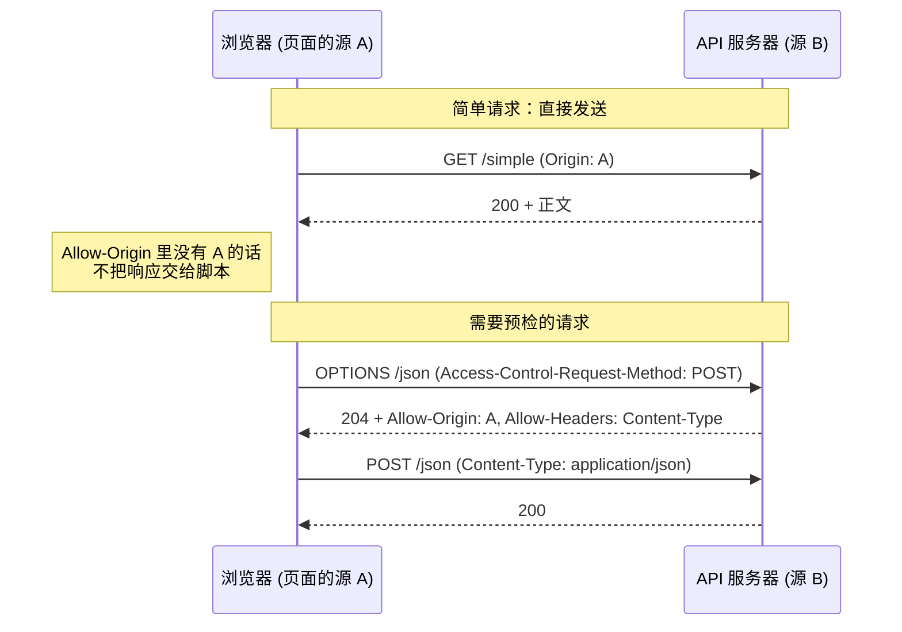

HTTP 是一种协议，当客户端发送请求时，服务器会返回一个响应。整个流程（DNS → TCP → TLS → HTTP）已在 [详见 → 网络基础](#/post/cs-network) 中概述，本文将深入探讨 HTTP 消息本身及其上的规则（方法、状态码、缓存），以及 HTTPS 和不同版本之间的差异。以下代码均已在本地运行测试。

## 消息是文本

HTTP/1.1 消息由起始行、多行头部、空行和本体组成。换行符为 `\r\n`。我通过 Python socket 直接发送了请求字符串，并打印了原始响应。

```python
import socket
s = socket.create_connection(('127.0.0.1', port))   # port: 로컬에 띄운 http.server
s.sendall(b'GET / HTTP/1.1\r\nHost: x\r\n\r\n')
print(s.recv(4096).decode())
```

响应如下（Date 字段已省略）：

```
HTTP/1.1 200 OK
Server: BaseHTTP/0.6 Python/3.13.15
Content-Length: 11
ETag: "8097d38e"
Cache-Control: no-cache

<h1>hi</h1>
```

此处 `Content-Length` 非常重要。由于响应会连续到达同一个 TCP 连接上，接收方必须知道本体何时结束。如果预先知道长度，则使用 `Content-Length`；否则使用 `Transfer-Encoding: chunked`，以块为单位附加长度信息。在相同服务器上创建 `/chunk` 路径并发起请求，原始响应如下：

```
b'...Transfer-Encoding: chunked\r\n\r\n6\r\nhello \r\n7\r\nchunked\r\n0\r\n\r\n'
```

其中的 `6` 和 `7` 是每个块的长度（十六进制），最后的 `0` 表示结束标记。如果使用 `http.client` 接收相同路径的请求，块会被合并，得到 `b'hello chunked'`。这是客户端库代为解析的部分。

即使连续向同一个 socket 发送多个请求，连接也不会断开。由于服务器响应 `HTTP/1.1`，默认启用持久连接，因此通过单个 socket 处理了 4 个请求（GET、条件 GET、chunk GET、POST）。

## 方法：安全与幂等

HTTP 方法表示“希望对该资源执行什么操作”。MDN 将其分为两种属性：安全（safe）指不改变服务器状态的只读操作；幂等（idempotent）指多次发送相同请求后，服务器状态与发送一次后的结果一致。所有安全的方法都是幂等的。

| 方法 | 安全 | 幂等 | 可缓存 |
|---|---|---|---|
| GET | O | O | O |
| HEAD | O | O | O |
| OPTIONS | O | O | X |
| PUT | X | O | X |
| DELETE | X | O | X |
| POST | X | X | 条件 |
| PATCH | X | X | 条件 |

此表在实际工作中有意义的原因在于重试场景。当响应中途中断导致无法判断是否成功时，`PUT /users/42`（整体覆盖）再次发送会得到相同结果；而 `POST /users` 可能导致创建两个用户。如何在 API 中选择方法可参考 [详见 → API 与 REST](#/post/be-api-rest)。

<details>
<summary>尝试发送 POST</summary>

包含本体的请求必须通过 `Content-Length` 告知长度。向同一本地服务器通过 socket 发送后，响应首行为 `HTTP/1.1 201 Created`。

```python
s.sendall(b'POST /u HTTP/1.1\r\nHost: x\r\nContent-Length: 2\r\n\r\nab')
print(s.recv(4096).decode().splitlines()[0])
```

服务器仅读取了 2 字节本体即结束，这得益于长度头部。若该长度错误，会导致后续请求起始位置被误读。

</details>

## 状态码从第一位开始解读

| 类别 | 含义 |
|---|---|
| 1xx | 进行中（中间响应） |
| 2xx | 已接收并处理 |
| 3xx | 需执行额外操作，如重定向到其他 URL |
| 4xx | 请求错误 |
| 5xx | 服务器无法正确处理有效请求 |

单独整理易混淆的组合：

- 301 和 302 分别表示永久/临时重定向；307 和 308 分别是 302 和 301 的对应版本，区别在于它们不会改变请求方法。因此即使 POST 被重定向，仍保持为 POST。
- 401 名称为 Unauthorized，实际含义是“未认证”；403 表示已知用户但无权限，重新登录也无法解决 403。
- 404 表示资源未找到，有些服务器为避免暴露资源存在性而用 404 代替 403。
- 429 表示在单位时间内请求过多；503 表示因维护或过载暂时不可用。两者均可通过 `Retry-After` 头部告知何时重试。
- 304 并非错误，而是缓存响应，下文将详细说明。

## 缓存与条件请求

前述服务器已下发 `ETag` 和 `Cache-Control: no-cache`。`no-cache` 并非“禁止存储”，而是“写入前需向服务器确认”；真正禁止存储的是 `no-store`。因名称相似，这是最容易混淆的一对。

| | no-cache | no-store |
|---|---|---|
| 是否存储 | 是 | 否 |
| 是否可重用 | 经服务器验证后 | 不可用 |
| 内容未变化时 | 返回 304，无本体 | 每次返回 200 |

收到 `ETag` 并将其放入 `If-None-Match` 头字段，通过相同的连接再次发起请求。

```
GET / HTTP/1.1
If-None-Match: "8097d38e"

HTTP/1.1 304 Not Modified
ETag: "8097d38e"
```

服务器仅返回了响应头，没有正文。客户端可以直接使用本地已有的副本。如果内容已更改，服务器会返回状态码 200、新的 `ETag` 以及新的正文。对于文件名中包含版本号的静态文件，可以采用类似 `Cache-Control: public, max-age=31536000, immutable` 的方式，明确告知其长期有效且不可变，从而避免向服务器发起验证请求；这种模式在 MDN 的推荐示例中有所提及。关于缓存不仅存在于浏览器中还存在于中间层（CDN）的情况，详见 [详细 → CDN 与缓存层级](#/post/infra-cdn-cache)。

## 无状态：服务器不记得刚才那个人

1. **无状态 (stateless)**：每个 HTTP 请求都是独立的。在协议层面，服务器不记得“刚才登录的那个人”。上面用一个 socket 发四个请求时，服务器也是分别处理每个请求。连接保持着（持久连接）和记住状态是两回事。
2. **为什么这样设计**：服务器不保存每个客户端的记忆，下一个请求交给哪台服务器都可以。增加服务器、或者某台挂了把请求转到别的服务器都很容易。这就是 [负载均衡](#/post/infra-load-balancer) 和 [自动扩缩容](#/post/infra-autoscaling) 好做的原因。
3. **可登录状态还是得记住**：所以每个请求都把状态带上。方法有两种：在服务器上保存会话，只用 cookie 来回传它的钥匙（会话 ID）；或者把状态本身做成签名的令牌（JWT 等）随身带着。两者的区别在 [认证与授权](#/post/be-auth) 里细讲。无论哪种，HTTP 本身仍是无状态的，状态装在请求头里传来传去。

## Cookie：搬运状态的请求头

**Cookie** 是这样一个小值：服务器用 `Set-Cookie` 响应头说“拿着这个，下次再发给我”，浏览器把它存起来，之后对每个符合条件的请求自动以 `Cookie` 请求头附上。我在本地原样复现了一下。

```python
import threading, urllib.request, http.cookiejar
from http.server import BaseHTTPRequestHandler, ThreadingHTTPServer

class H(BaseHTTPRequestHandler):
    def log_message(self, *a): pass
    def do_GET(self):
        print(f'서버가 받은 Cookie: {self.headers.get("Cookie")}')
        self.send_response(200)
        if self.path == '/login':
            self.send_header('Set-Cookie', 'sid=abc123; Path=/; HttpOnly; SameSite=Lax; Max-Age=3600')
        self.end_headers(); self.wfile.write(b'ok')

srv = ThreadingHTTPServer(('127.0.0.1', 0), H)
threading.Thread(target=srv.serve_forever, daemon=True).start()
base = f'http://127.0.0.1:{srv.server_address[1]}'

jar = http.cookiejar.CookieJar()                       # 브라우저의 쿠키 저장소 역할
opener = urllib.request.build_opener(urllib.request.HTTPCookieProcessor(jar))
for path in ['/', '/login', '/me', '/me']:
    r = opener.open(base + path)
    print(f'GET {path} -> Set-Cookie: {r.headers.get("Set-Cookie")}')
```

```
서버가 받은 Cookie: None
GET / -> Set-Cookie: None
서버가 받은 Cookie: None
GET /login -> Set-Cookie: sid=abc123; Path=/; HttpOnly; SameSite=Lax; Max-Age=3600
서버가 받은 Cookie: sid=abc123
GET /me -> Set-Cookie: None
서버가 받은 Cookie: sid=abc123
GET /me -> Set-Cookie: None
```

（`서버가 받은 Cookie` 的意思是“服务器收到的 Cookie”。）在 `/login` 收到一次之后，我什么都不用做，每个请求都带上了 `sid=abc123`。服务器依旧无状态，只是客户端每次重新出示状态的钥匙。

`Set-Cookie` 后面的属性在实际工作中很重要。按 MDN 整理如下。

| 属性 | 含义 | 漏写的话 |
|---|---|---|
| `Expires` / `Max-Age` | 保存到什么时候 | 关掉浏览器就消失的会话 cookie |
| `Domain` / `Path` | 附加到哪些主机、路径的请求 | 只发给设置它的主机（不含子域名） |
| `Secure` | 只在 HTTPS 请求里发送 | 可能通过明文 HTTP 泄露 |
| `HttpOnly` | JavaScript 的 `document.cookie` 读不到 | 会话 cookie 可能被 XSS 偷走 |
| `SameSite` | 由其他站点发起的请求要不要带上（`Strict`/`Lax`/`None`） | Chrome 等按 `Lax` 处理，各浏览器不同 |

`SameSite=None` 表示其他站点发起的请求也带上，所以必须同时有 `Secure`。会话 cookie 的话，`Secure; HttpOnly; SameSite=Lax`（或 `Strict`）是稳妥的起点。`SameSite` 能减少别的网站让我的浏览器偷偷发出带我 cookie 的请求这种攻击 (CSRF)。攻击方面的内容见 [Web 漏洞与 OWASP](#/post/sec-owasp)。

## CORS：浏览器为什么拦截其他源的响应

1. **源 (origin)**：协议 + 主机 + 端口。`https://a.com`、`https://a.com:8443`、`http://a.com` 都是不同的源。
2. **同源策略 (SOP)**：浏览器不让一个源的脚本读取另一个源的响应。没有它，我打开的恶意页面就能带着我的 cookie 调用银行的 API，还能读到响应。
3. **CORS（跨源资源共享）**：在 SOP 上开口子的许可机制。服务器用 `Access-Control-Allow-Origin` 等响应头告诉浏览器“这个源可以读”，浏览器才把响应交给脚本。所以 CORS 错误与其说是拦截机制，不如说是缺少许可的标志。
4. **预检请求 (preflight)**：对可能改变服务器状态的请求，浏览器会在正式请求之前先用 `OPTIONS` 询问。只有“简单请求”会直接发出：方法是 GET、HEAD 或 POST，请求头都在默认允许列表里，`Content-Type` 是表单类型或 `text/plain`。`Content-Type: application/json` 的 POST 需要预检。
5. **带凭据的请求**：要用 `fetch(..., {credentials: 'include'})` 带上 cookie，服务器必须返回 `Access-Control-Allow-Credentials: true`，而且 `Allow-Origin` 里要写准确的源而不是 `*`。



我亲自验证了一下。页面放在 127.0.0.1:9001，API 放在 127.0.0.1:9002（端口不同，所以是不同的源），用无头 Chrome 打开页面执行两个 `fetch`。API 服务器把收到的请求打印成日志。

```
# 响应不带 CORS 头时
页面结果     simple GET: TypeError / json POST: TypeError
服务器日志   GET /simple | Origin: http://127.0.0.1:9001
             OPTIONS /json | 请求方法: POST | 请求头: content-type

# 返回 Access-Control-Allow-Origin: http://127.0.0.1:9001 时
页面结果     simple GET: secret / json POST: 200
服务器日志   GET /simple, OPTIONS /json, POST /json
```

这里能看出两点。第一，没有许可时，简单的 GET 也到达了服务器并被处理了，只是浏览器没有把响应交给脚本。所以 CORS 不是保护服务器的机制，这也是不能把改变状态的操作做成 GET 的又一个理由。第二，JSON 的 POST 在预检被拒后，正式请求根本没有发出。`curl` 和服务器之间的调用没有 CORS，也是同一个道理：这是只有浏览器遵守的规则。

解决办法终究在服务器端。让 API 服务器在响应里准确写出允许的源；开发阶段则可以用前端开发服务器的代理，让请求看起来是同源的。到处加 `Access-Control-Allow-Origin: *` 不仅不能和 cookie 认证一起用，不是公开 API 的话也应该避免。

## HTTPS: TLS 握手概述

HTTPS 是将 HTTP 消息封装在 TLS 通道中进行传输。TLS 1.3 (RFC 8446) 的握手流程大致如下：

1. 客户端发送 ClientHello，其中包含支持的加密套件以及用于密钥交换的公钥（key_share）。
2. 服务器通过 ServerHello 选择加密套件并返回其 key_share。从此时起，双方均可生成用于握手的密钥，因此后续的握手消息将被加密。
3. 服务器发送证书链（Certificate），并使用该证书的私钥对之前的握手过程进行签名（CertificateVerify）以证明密钥所有权。最后通过 Finished 消息确认整个握手内容。
4. 当客户端也发送 Finished 后，应用数据（HTTP）即可开始传输。

首次连接需要 1 次往返（1-RTT）。如果服务器返回的 key_share 组不匹配，则需通过 HelloRetryRequest 再次协商。如果之前已共享密钥（PSK），则可以在第一次飞行中同时发送数据（0-RTT），但这些初始数据不具备前向保密性且易受重放攻击。因此，RFC 规定仅应发送那些即使被重新处理也无妨的幂等请求。上述方法表在此处再次适用。

我在本地进行了验证。使用 `openssl` 创建了自签名证书，并通过 Python 的 `ssl` 库在同一进程中启动了服务器和客户端。

```python
cc = ssl.create_default_context(cafile='c.pem')
t = cc.wrap_socket(raw, server_hostname='localhost')
print(t.version(), t.cipher())
print(t.getpeercert()['subject'])
t.sendall(b'GET / HTTP/1.1\r\nHost: localhost\r\n\r\n')
```

输出结果如下：

```
TLSv1.3 ('TLS_AES_256_GCM_SHA384', 'TLSv1.3', 256)
((('commonName', 'localhost'),),)
b'HTTP/1.1 200 OK\r\nContent-Length: 2\r\n\r\nok'
```

协商成功使用了 TLS 1.3，客户端已验证了证书名称（`server_hostname`），而服务器端的 `recv` 接收到了解密后的明文 HTTP 请求。在 TLS 之上，HTTP 消息的格式完全保持不变。关于证书、签名和哈希如何建立信任的详细内容，请参阅 [详细 → 加密·哈希·认证基础](#/post/sec-authn-crypto)。

<details>
<summary>运行环境</summary>

- Python 3.13，`ssl.OPENSSL_VERSION` 为 OpenSSL 3.0.x，`ssl.HAS_TLSv1_3` 为 True。
- 证书是使用 `openssl req -x509` 生成的有效期为 1 天的自签名证书，subjectAltName 中包含了 localhost。
- 上述本地实验在同一台 PC 上进行，因此未测量往返时间（RTT）差异。

</details>

## 各版本间的差异：1.1, 2, 3

三个版本的语义（方法、状态码、请求头的概念）相同，传输方式不同。

| | HTTP/1.1 | HTTP/2 | HTTP/3 |
|---|---|---|---|
| 格式 | 文本 | 二进制帧 | 二进制帧 |
| 在一个连接上 | 按顺序处理请求（曾有管线化） | 同时处理多个请求（多路复用） | 同时，且每个流相互独立 |
| 下层传输 | TCP | TCP | QUIC（基于 UDP） |
| 请求头 | 每次原样发送 | 压缩 (HPACK) | 压缩 (QPACK) |
| 加密 | 可选（HTTPS 时用 TLS） | 浏览器只在 TLS 上使用 | QUIC 内置 TLS 1.3，强制 |
| 第一个请求前的往返 | TCP 1 + TLS 1.3 1 = 2 RTT | 相同 | 1 RTT（重连可 0-RTT） |
| 标准 | RFC 9112 | RFC 9113 | RFC 9114（QUIC 为 RFC 9000） |

1.1 让连接可以复用，但存在队头阻塞（head-of-line）问题：前一个响应没结束就收不到下一个，浏览器通过对每个源最多开 6 个 TCP 连接来绕开。HTTP/2 允许在一个连接上并行请求，去掉了这个限制。但它跑在一个 TCP 上，一旦丢了一个包，TCP 重传期间这个连接上的所有流都得一起等。HTTP/3 用基于 UDP 的 QUIC 代替 TCP，QUIC 按流分别做丢包检测和重传，所以只有丢包的那个流被阻塞。TCP 本身的行为见 [详见 → TCP 与 UDP](#/post/net-tcp-udp)。

再深入一点。

1. **HTTP/1.1 的局限**：管线化要求按请求顺序返回响应，前面一个响应慢，后面的就全被堵住，加上和中间代理的兼容问题很多，浏览器后来都默认关闭了它。所以实际上大家开 6 个连接，再用把图片合成一张（雪碧图）、拆分到多个域名（域名分片）之类的技巧。
2. **HTTP/2 的帧与流**：把消息切成 HEADERS 帧和 DATA 帧发送。每个帧都带有流编号，即使多个请求的帧在一个连接上交错流动，接收方也能按编号重新组装。用写明长度的帧代替文本换行，和 [socket 那篇](#/post/net-socket) 里的长度前缀分帧是同一个思路。也因此，1.1 时代的那些技巧反而变成了负担。
3. **HPACK 请求头压缩**：减少每个请求都重复发送几乎相同的 `User-Agent`、`Cookie`、`Accept` 的浪费。常用请求头用预先定好的表（静态表）的编号发送，这个连接上发过一次的请求头用每个连接各自的表（动态表）的编号发送。
4. **消失的功能**：HTTP/2 曾有服务器推送，服务器可以在请求之前先把资源发过来，但效果不如预期，Chrome 去掉了对它的支持。最初规范里的流优先级方案也在 RFC 9113 中被废弃，另外出现了更简单的 `Priority` 请求头方案 (RFC 9218)。
5. **HTTP/3 与 QUIC**：把 TCP 建连和 TLS 握手合并成一次 QUIC 握手，减少了第一个请求前的往返。连接不是靠 IP 和端口、而是靠连接 ID 来识别，所以从 Wi-Fi 切到 LTE、IP 变了，连接也能继续（连接迁移）。因为基于 UDP，拥塞控制和重传由应用侧的库而不是操作系统内核实现，所以改进能更快上线。代价是更耗 CPU，并且在屏蔽 UDP 的网络里用不了。
6. **版本怎么定**：不是客户端单方面选，而是协商。HTTP/2 在 TLS 握手中通过名为 ALPN 的扩展选定 `h2`。HTTP/3 没法一开始就用，服务器会在 HTTP/2 响应里用 `Alt-Svc: h3=":443"` 头（或 DNS 的 HTTPS 记录）告知“UDP 443 上也支持 h3”，客户端下次再尝试。

我用 `curl` 实际问了几个网站。

```
$ curl -s -o /dev/null -D - --http2 https://www.google.com
HTTP/2 200
alt-svc: h3=":443"; ma=2592000,h3-29=":443"; ma=2592000

$ curl -s -o /dev/null -D - --http2 https://dohyunkang.github.io/blog/
HTTP/2 200
```

Google 用 HTTP/2 回应，同时通过 `alt-svc` 告知也支持 HTTP/3。这个博客（GitHub Pages）也是用 HTTP/2 返回的。我还用 `curl --http3-only` 试了 HTTP/3 连接，但在我的运行环境里一直没有响应，所以没能确认。这是屏蔽 UDP 的网络里会发生的事，换成浏览器的话会悄悄退回 HTTP/2。

## 常见误解

- 304 不是错误。它是表示缓存副本仍然有效的正常响应。
- `no-cache` 并不意味着不要缓存。它的意思是：可以存储，但在重新使用之前需要向服务器验证。
- 401 和 403 含义不同。401 表示未通过认证，而 403 表示无权访问。
- HTTP/2 并不能消除 TCP 的所有限制。解决这些限制的改进体现在 HTTP/3 中。
- 即使是 HTTPS，HTTP 消息本身也保持不变。发生变化的是其下方的传输通道。
- 持久连接就是有状态：即使复用连接，每个请求也是独立的。登录状态每次都要靠 cookie 或令牌重新带上。
- CORS 保护服务器：拦截的是浏览器，简单请求即使没有许可也会到达服务器。对 `curl` 或服务器之间的调用不适用。
- CORS 错误在前端修：许可是通过响应头给出的，所以要在服务器（或开发用代理）上修。
- 有 `HttpOnly` 的 cookie 就安全：它只是让脚本读不到。明文传输靠 `Secure`，其他站点发起的请求靠 `SameSite` 来另外防范。

## 必须能自己讲清楚的核心概念

1. **HTTP 消息**：起始行、请求头、空行、正文。正文的结尾用 `Content-Length` 或 chunked 来表示。
2. **安全与幂等**：GET 不改变状态，PUT、DELETE 发多少次结果都一样。能不能重试就取决于此。
3. **状态码**：看第一位。401 是未认证，403 是没有权限，304 表示可以直接用缓存。
4. **缓存**：`no-cache` 是确认后再复用，`no-store` 是禁止保存。用 `ETag` 和 `If-None-Match` 拿到 304。
5. **无状态**：服务器不记得请求之间的事。所以容易横向扩展，状态每次通过 cookie、令牌带上。
6. **Cookie 与属性**：用 `Set-Cookie` 接收，用 `Cookie` 自动发送。会话 cookie 用 `Secure; HttpOnly; SameSite`。
7. **SOP 与 CORS**：源是协议+主机+端口。浏览器拦截其他源的响应，服务器用 `Access-Control-Allow-*` 头给出许可。JSON POST 这类请求会先发 OPTIONS 预检。
8. **TLS 1.3**：1-RTT 握手，用证书和签名确认服务器。0-RTT 数据容易受到重放攻击。
9. **HTTP/1.1 → 2 → 3**：2 带来在一个 TCP 连接上混合多个流的多路复用和请求头压缩，3 用 QUIC (UDP) 减少了 TCP 的队头阻塞和建连往返。版本通过 ALPN 和 Alt-Svc 协商。

## 推荐阅读

← [概念地图](#/post/cs-map)

- [详细 → Socket 与 WebSocket](#/post/net-socket): 对上面使用的 Socket 代码进行更详细的说明
- [详细 → DNS 与 IP·路由](#/post/net-dns-routing): 建立连接之前发生的事件
- [详细 → API 与 REST](#/post/be-api-rest): 在 API 中使用方法和状态码的方法

## 参考链接

- MDN, HTTP 请求方法：https://developer.mozilla.org/en-US/docs/Web/HTTP/Reference/Methods
- MDN, HTTP 响应状态码：https://developer.mozilla.org/en-US/docs/Web/HTTP/Reference/Status
- MDN, HTTP 的演进：https://developer.mozilla.org/en-US/docs/Web/HTTP/Guides/Evolution_of_HTTP
- MDN, HTTP 缓存：https://developer.mozilla.org/en-US/docs/Web/HTTP/Guides/Caching
- RFC 8446, The Transport Layer Security (TLS) Protocol Version 1.3: https://www.rfc-editor.org/rfc/rfc8446.html
- MDN, Using HTTP cookies: https://developer.mozilla.org/en-US/docs/Web/HTTP/Guides/Cookies
- MDN, Set-Cookie: https://developer.mozilla.org/en-US/docs/Web/HTTP/Reference/Headers/Set-Cookie
- MDN, Cross-Origin Resource Sharing (CORS): https://developer.mozilla.org/en-US/docs/Web/HTTP/Guides/CORS
- MDN, Same-origin policy: https://developer.mozilla.org/en-US/docs/Web/Security/Same-origin_policy
- RFC 9113, HTTP/2: https://www.rfc-editor.org/rfc/rfc9113.html
- RFC 7541, HPACK: https://www.rfc-editor.org/rfc/rfc7541.html
- RFC 9114, HTTP/3: https://www.rfc-editor.org/rfc/rfc9114.html
- RFC 9000, QUIC: https://www.rfc-editor.org/rfc/rfc9000.html
- RFC 7838, HTTP Alternative Services: https://www.rfc-editor.org/rfc/rfc7838.html

参考（用图解把同一主题讲得很清楚的韩语文章）

- Inpa Dev, Stateful 与 Stateless 的区别: https://inpa.tistory.com/entry/WEB-%F0%9F%93%9A-Stateful-Stateless-%EC%A0%95%EB%A6%AC
- Inpa Dev, 浏览器 Cookie 头的用法: https://inpa.tistory.com/entry/HTTP-%F0%9F%8C%90-%EC%9B%B9-%EB%B8%8C%EB%9D%BC%EC%9A%B0%EC%A0%80%EC%9D%98-%EC%BF%A0%ED%82%A4-%EA%B0%9C%EB%85%90-Cookie-%ED%97%A4%EB%8D%94-%EB%8B%A4%EB%A3%A8%EA%B8%B0
- Inpa Dev, 臭名昭著的 CORS：概念与解决方法: https://inpa.tistory.com/entry/WEB-%F0%9F%93%9A-CORS-%F0%9F%92%AF-%EC%A0%95%EB%A6%AC-%ED%95%B4%EA%B2%B0-%EB%B0%A9%EB%B2%95-%F0%9F%91%8F
- Inpa Dev, HTTP/2 介绍与通信技术: https://inpa.tistory.com/entry/WEB-%F0%9F%8C%90-HTTP-20-%ED%86%B5%EC%8B%A0-%EA%B8%B0%EC%88%A0-%EC%9D%B4%EC%A0%9C%EB%8A%94-%ED%99%95%EC%8B%A4%ED%9E%88-%EC%9D%B4%ED%95%B4%ED%95%98%EC%9E%90
- Inpa Dev, HTTP/3 介绍与通信技术: https://inpa.tistory.com/entry/WEB-%F0%9F%8C%90-HTTP-30-%ED%86%B5%EC%8B%A0-%EA%B8%B0%EC%88%A0-%EC%9D%B4%EC%A0%9C%EB%8A%94-%ED%99%95%EC%8B%A4%ED%9E%88-%EC%9D%B4%ED%95%B4%ED%95%98%EC%9E%90
