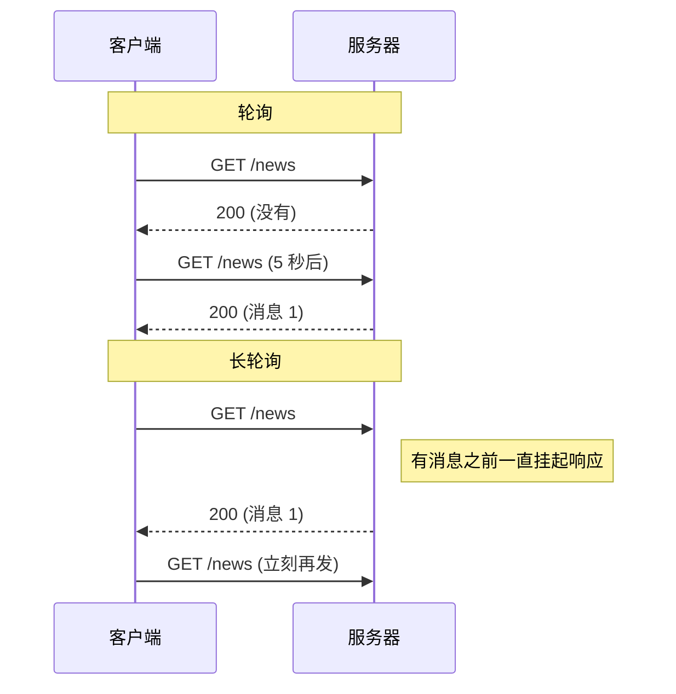
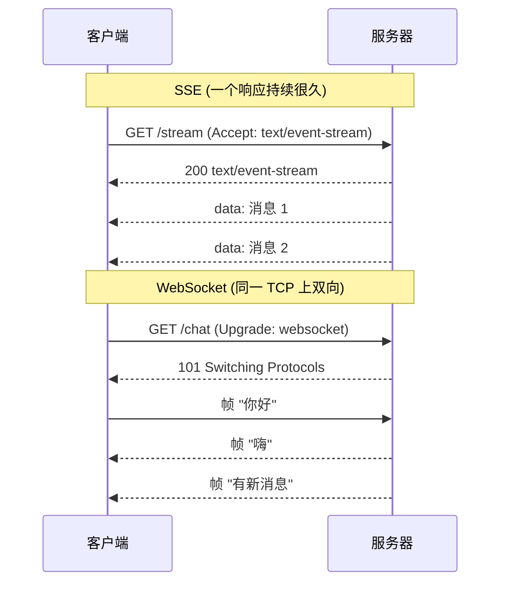

Socket 是操作系统提供的通信端点，TCP Socket 仅传递字节流而非消息。WebSocket 始于一次 HTTP 请求，其规则是在同一个 TCP 连接上允许双方随时发送消息。

概述见 [网络基础](#/post/cs-network) 和 [操作系统基础](#/post/cs-os)，本文重点在于直接操作 Socket API 以观察其行为。

## Socket 是什么

程序若要通过网络通信，必须向操作系统求助，而 Socket 便是发出请求的“抓手”。在 Python 中，`socket.socket()` 返回的对象即为 Socket，可将其视为类似文件的读写对象，并绑定到由 IP 地址和端口组成的端点上。

Python 官方 Socket HOWTO 明确区分了服务器 Socket 与客户端 Socket：服务器 Socket 既不发送也不接收数据，仅用于创建客户端 Socket。按调用顺序来看如下：

| | 服务器 | 客户端 |
|---|---|---|
| 1 | `socket()` 创建端点 | `socket()` |
| 2 | `bind()` 绑定地址与端口 | |
| 3 | `listen()` 监听连接 | |
| 4 | `accept()` 取出一个连接并接收新 Socket | `connect()` |
| 5 | `recv()` / `sendall()` | `sendall()` / `recv()` |
| 6 | `close()` | `close()` |

`accept()` 返回的 Socket 用于实际对话，而监听 Socket 则继续保留以接收后续连接。3-way handshake（三次握手）由操作系统在 `connect()` 与 `accept()` 之间的某个时刻自动完成。这部分内容将在 [TCP 与 UDP](#/post/net-tcp-udp) 中单独讨论。

## recv 并不返回完整消息

初学 Socket 时最常见的误解是“发送一次就能接收一次”。我曾亲自测试：客户端分两次分别发送 `hello` 和 `world`，服务器则在 0.3 秒后读取数据。

```python
import socket, threading, time
srv = socket.socket(); srv.bind(('127.0.0.1', 0)); srv.listen()
port = srv.getsockname()[1]
def server():
    c, addr = srv.accept()
    time.sleep(0.3)
    print('recv 1:', c.recv(100))
    print('recv 2:', c.recv(100))
    c.close()
threading.Thread(target=server).start()
c = socket.create_connection(('127.0.0.1', port))
c.sendall(b'hello'); c.sendall(b'world')
c.close()
```

输出结果如下：

```
recv 1: b'helloworld'
recv 2: b''
```

两次发送的内容被合并为一次返回，而第二次 `recv` 收到的是空字节流。空字节流表示对方已关闭连接。HOWTO 中也提到同样的观点：Socket 没有消息结束标记，因此必须约定消息边界——要么采用固定长度，要么使用分隔符，要么在开头注明长度，要么通过关闭连接来通知。

合并返回的情况是在我本地 PC 上设置延迟所致，具体如何分割则因环境而异。但无论如何，应用程序都必须自行确定消息边界。

## 带长度的帧（Framing）

实践中常见的方法是添加长度前缀：在前 4 个字节中写入正文长度，然后读取相应数量的数据。这里还需注意一点：`recv(n)` 并非承诺返回 n 个字节，而是表示最多返回 n 个字节，因此需循环调用直到恰好收到 n 个字节。HOWTO 也指出，一次 `recv` 可能无法接收完长度为 5 的字符串。

```python
import socket, struct, threading

def recv_exact(s, n):
    buf = b''
    while len(buf) < n:
        chunk = s.recv(n - len(buf))
        if not chunk:
            raise ConnectionError('closed')
        buf += chunk
    return buf

def send_msg(s, data):
    s.sendall(struct.pack('!I', len(data)) + data)

def recv_msg(s):
    (n,) = struct.unpack('!I', recv_exact(s, 4))
    return recv_exact(s, n)

srv = socket.socket(); srv.bind(('127.0.0.1', 0)); srv.listen()
port = srv.getsockname()[1]
def server():
    c, _ = srv.accept()
    for _ in range(3):
        print('받음:', recv_msg(c))
    c.close()
threading.Thread(target=server).start()
c = socket.create_connection(('127.0.0.1', port))
for m in [b'hello', b'world', '안녕'.encode()]:
    send_msg(c, m)
c.close()
```

```
받음: b'hello'
받음: b'world'
받음: b'\xec\x95\x88\xeb\x85\x95'
```

`'!I'` 是无符号 4 字节整数，采用网络字节序（大端序）。对于中文字符串，长度是按 UTF-8 编码后的字节数计算的。正是由于遵循此规则，相同的数据才会在本例中被精确分割为三个部分，而不同于前面的示例。

HTTP 通过 `Content-Length` 头或 chunked 传输机制解决类似问题。WebSocket 帧中也包含长度字段，将在后文介绍。

## 阻塞与并发连接

`accept()` 和 `recv()` 默认是阻塞式的：在数据到达前会一直挂起当前线程。HOWTO 警告说，若对方未关闭连接却已断开，Socket 可能会长时间挂起。虽然为每个连接分配一个线程较为简单，但阻塞的连接会持续占用该线程。关于线程的更多内容将在 [进程与线程](#/post/os-process-thread) 中继续探讨。

替代方案是非阻塞 Socket 和 `select`。根据 HOWTO 的描述，`select` 可筛选出可读或可写的 Socket；当服务器 Socket 变为可读状态时，调用 `accept()` 几乎必然成功。此外，在 Windows 上 `select` 仅适用于 Socket，而在 Unix 系统上也可用于文件。我使用 Python 标准库 `selectors` 封装后，用单个线程同时处理了三个客户端。

<details>
<summary>使用 selectors 实现的单线程 Echo 服务器（运行验证）</summary>

```python
import socket, selectors, threading
sel = selectors.DefaultSelector()
srv = socket.socket(); srv.bind(('127.0.0.1', 0)); srv.listen(); srv.setblocking(False)
port = srv.getsockname()[1]
sel.register(srv, selectors.EVENT_READ, 'accept')

def loop():
    done = 0
    while done < 3:
        for key, _ in sel.select(timeout=2):
            if key.data == 'accept':
                c, _ = srv.accept(); c.setblocking(False)
                sel.register(c, selectors.EVENT_READ, 'client')
            else:
                c = key.fileobj
                d = c.recv(100)
                if d:
                    c.sendall(d.upper())
                else:
                    sel.unregister(c); c.close(); done += 1

t = threading.Thread(target=loop); t.start()
res = {}
def client(i):
    s = socket.create_connection(('127.0.0.1', port))
    s.sendall(f'client{i}'.encode()); res[i] = s.recv(100); s.close()
cs = [threading.Thread(target=client, args=(i,)) for i in range(3)]
[x.start() for x in cs]; [x.join() for x in cs]; t.join()
print(sorted(res.items()))
```

```
[(0, b'CLIENT0'), (1, b'CLIENT1'), (2, b'CLIENT2')]
```

服务器循环仅使用一个线程，而三个客户端各自在独立线程中运行。这是一个简单示例，假设 Echo 数据较短，`sendall` 能立即完成。若服务器需处理大数据量，则还需关注可写事件。

</details>

这种方式就是事件循环。Python 的 `asyncio` 或 Node.js 都采用类似的模式，这类服务器不针对每个请求创建新线程，而是通过这种方式处理大量连接。关于 HTTP 请求的具体处理流程，请参阅 [请求处理流程](#/post/be-request-flow)。

## 为什么需要 WebSocket

HTTP 协议要求客户端必须先发起请求，服务器才能响应。对于聊天、股价行情或通知等需要服务器主动推送的场景，必须使用轮询（polling）机制定期询问。WebSocket 改变了这一模式。根据 MDN 的描述，WebSocket 在浏览器和服务器之间建立双向会话，从而可以在不进行轮询的情况下进行消息收发。

RFC 6455 中有一句关键的话：WebSocket 是独立于 HTTP、运行在 TCP 之上的协议；它与 HTTP 的关系仅在于握手过程是一个有效的 HTTP Upgrade 请求。因此，80 和 443 端口可以与 HTTP 服务器共用。

## 握手：从 HTTP 开始，以 101 状态码结束

客户端发送普通的 HTTP GET 请求。请求头中包含 `Upgrade: websocket`、由 16 字节随机数经 base64 编码生成的 `Sec-WebSocket-Key`，以及版本号 13。服务器则以 `101 Switching Protocols` 响应，并在 `Sec-WebSocket-Accept` 头中填入计算后的值。

- 在客户端密钥字符串后追加固定 GUID `258EAFA5-E914-47DA-95CA-C5AB0DC85B11`。
- 计算 SHA-1 哈希值。
- 将结果进行 base64 编码。

我使用 RFC 中给出的示例密钥进行了计算：

```python
import hashlib, base64
GUID = '258EAFA5-E914-47DA-95CA-C5AB0DC85B11'
key = 'dGhlIHNhbXBsZSBub25jZQ=='
print(base64.b64encode(hashlib.sha1((key + GUID).encode()).digest()).decode())
# s3pPLMBiTxaQ9kYGzzhZRbK+xOo=
```

得到了这个值。该计算过程用于证明服务器理解 WebSocket 握手，并非用于认证或加密。加密由 `wss://`（即 TLS）负责。如果收到非 101 的状态码，则意味着升级失败，将按普通 HTTP 规则处理。这种请求/响应格式与在 [HTTP 和 HTTPS](#/post/net-http) 中看到的相同。

## 帧：连接上交换的数据单元

握手完成后，同一个 TCP 连接便成为 WebSocket 帧的传输通道。前面提到 TCP 不提供消息边界，而 WebSocket 通过在帧头中指定长度来解决这一问题。根据 RFC 标准，帧头的结构如下：

| 字段 | 含义 |
|---|---|
| FIN | 该帧是否为消息的最后一片 |
| opcode | 0x1 文本、0x2 二进制、0x8 关闭、0x9 ping、0xA pong、0x0 延续片 |
| MASK | 是否附加了掩码密钥 |
| 长度 | 0~125 表示实际长度；126 表示后续 2 字节为长度；127 表示后续 8 字节为长度 |

客户端发送的帧必须经过掩码处理，服务器应拒绝未掩码的帧。服务器发送的帧则不需要掩码。其原理是对 payload 的第 i 个字节与密钥的第 `i mod 4` 个字节进行 XOR 运算。RFC 规定这样做是为了防止中间设备（如缓存代理）产生混淆，并阻止恶意脚本随意篡改传输中的字节。密钥必须是不可预测的。请注意，掩码并非加密。

ping 和 pong 是用于连接保活的控制帧。接收方需用 pong 响应 ping，双方交换 close 帧则关闭 TCP 连接。

## 用 Python 实现一次 WebSocket 通信

以上述规则为基础，我尝试仅使用 socket 库（不依赖第三方库）实现了 WebSocket。服务器端负责处理握手响应以及帧的读写，客户端发送经过掩码处理的文本帧。该实现故意省略了长度大于 126 的消息、分片消息及 ping 处理，属于最小化实现。

<details>
<summary>仅用 socket 实现的 WebSocket 回声服务（可运行验证）</summary>

```python
import socket, threading, hashlib, base64, os, struct
GUID = '258EAFA5-E914-47DA-95CA-C5AB0DC85B11'

def recv_exact(s, n):
    b = b''
    while len(b) < n:
        c = s.recv(n - len(b))
        if not c: raise ConnectionError
        b += c
    return b

def read_frame(s):
    b1, b2 = recv_exact(s, 2)
    op, masked, n = b1 & 0x0F, b2 & 0x80, b2 & 0x7F
    if n == 126: n = struct.unpack('!H', recv_exact(s, 2))[0]
    elif n == 127: n = struct.unpack('!Q', recv_exact(s, 8))[0]
    mask = recv_exact(s, 4) if masked else None
    p = recv_exact(s, n)
    if mask: p = bytes(x ^ mask[i % 4] for i, x in enumerate(p))
    return op, p

def make_frame(op, payload, mask):
    h = bytes([0x80 | op])
    n = len(payload); m = 0x80 if mask else 0
    h += bytes([m | n]) if n < 126 else bytes([m | 126]) + struct.pack('!H', n)
    if mask:
        k = os.urandom(4)
        payload = k + bytes(x ^ k[i % 4] for i, x in enumerate(payload))
    return h + payload

srv = socket.socket(); srv.bind(('127.0.0.1', 0)); srv.listen()
port = srv.getsockname()[1]

def server():
    c, _ = srv.accept()
    req = b''
    while b'\r\n\r\n' not in req: req += c.recv(1024)
    hdr = dict(l.split(': ', 1) for l in req.decode().split('\r\n')[1:] if ': ' in l)
    acc = base64.b64encode(hashlib.sha1((hdr['Sec-WebSocket-Key'] + GUID).encode()).digest()).decode()
    c.sendall(('HTTP/1.1 101 Switching Protocols\r\nUpgrade: websocket\r\nConnection: Upgrade\r\n'
               f'Sec-WebSocket-Accept: {acc}\r\n\r\n').encode())
    op, p = read_frame(c)
    print('서버가 받은 것:', op, p)
    c.sendall(make_frame(1, b'echo: ' + p, mask=False))
    c.close()

threading.Thread(target=server).start()
c = socket.create_connection(('127.0.0.1', port))
key = base64.b64encode(os.urandom(16)).decode()
c.sendall((f'GET /chat HTTP/1.1\r\nHost: 127.0.0.1:{port}\r\nUpgrade: websocket\r\nConnection: Upgrade\r\n'
           f'Sec-WebSocket-Key: {key}\r\nSec-WebSocket-Version: 13\r\n\r\n').encode())
resp = b''
while b'\r\n\r\n' not in resp: resp += c.recv(1024)
print(resp.decode().split('\r\n')[0])
exp = base64.b64encode(hashlib.sha1((key + GUID).encode()).digest()).decode()
print('accept 일치:', exp in resp.decode())
c.sendall(make_frame(1, 'hi'.encode(), mask=True))
print('클라가 받은 것:', read_frame(c))
```

```
HTTP/1.1 101 Switching Protocols
accept 일치: True
서버가 받은 것: 1 b'hi'
클라가 받은 것: (1, b'echo: hi')
```

opcode 1 代表文本帧。在握手阶段读取头部的代码并未假设单次 `recv` 就能获取完整请求，而是循环读取直到出现空行为止。前面提到的边界问题在此处依然存在。

</details>

从结果可以看出，WebSocket 并非一种新的传输机制，而是在 TCP socket 之上叠加了“用 HTTP 打招呼、用帧说话”的约定。

## 服务器主动通知的四种方法

答案不只有 WebSocket。浏览器接收服务器消息的方法大致有四种，选哪种取决于“谁说话、说得多频繁”。

1. **轮询 (Polling)**：客户端每隔固定时间（例如 5 秒）用普通 HTTP 请求问一次“有新的吗？”。没有新消息时请求和响应也照样往返，有了新消息也要等到下一次询问才知道。
2. **长轮询 (Long Polling)**：请求一样，但服务器不立刻回答，而是把响应挂起，直到有新消息或超时。客户端收到响应后马上发出下一个请求。延迟变短了，但每条消息仍然需要一个新请求。
3. **SSE (Server-Sent Events)**：一次请求，响应不结束而是一直流下去。在 `Content-Type: text/event-stream` 响应的正文里，连续写入由 `data: ...` 行组成、以空行结尾的事件。它是服务器到客户端的单向通道，而且就是普通 HTTP，所以代理、认证、HTTP/2 都能照常使用。
4. **WebSocket**：如上所述，先用 HTTP 打招呼，然后把同一个 TCP 连接变成双向的帧通道。双方随时都能发送。





| | 轮询 | 长轮询 | SSE | WebSocket |
|---|---|---|---|---|
| 方向 | 客户端→服务器提问 | 客户端→服务器提问 | 服务器→客户端 | 双向 |
| 协议 | HTTP | HTTP | HTTP（响应保持打开） | 以 HTTP 开始，之后是 WebSocket 帧 |
| 延迟 | 最多一个轮询间隔 | 短 | 短 | 短 |
| 空请求浪费 | 多 | 少 | 无 | 无 |
| 服务器要持有的 | 几乎没有 | 等待中的请求 | 打开的响应 | 打开的连接 |
| 断开后重连 | 下一次轮询就是重试 | 应用重新请求 | 浏览器 `EventSource` 自动重连 | 应用自己实现 |
| 数据 | 任意 | 任意 | UTF-8 文本 | 文本、二进制 |

什么时候用哪个。我是这样划分的。

- 几分钟才变一次的仪表盘、任务进度这类，**轮询**最简单也够用。服务器不需要保存状态。
- 消息很少但一来就要马上知道，而基础设施又不喜欢长连接，就用**长轮询**。WebSocket 出现之前聊天就是这样做的，现在 WebSocket 被挡住时也还拿它当备用方案。
- 服务器单方面持续推送的通知、日志、token 流式输出，适合 **SSE**。客户端有话要说时，另外发一个普通 POST 就行。
- 聊天、协同编辑、游戏这种双方频繁说话的场景，用 **WebSocket**。

### 为什么 LLM 流式输出用 SSE

ChatGPT 或 Claude 的回答一点点冒出来，大多是 SSE。Anthropic 文档写着设置 `"stream": true` 后，响应会通过 server-sent events 逐步返回，实际的事件就是 `event: content_block_delta` 和 `data: {...}` 行的重复。请求只有一次（携带提示词的 POST），之后只有服务器在说话，所以没必要用到双向的 WebSocket。它就是普通 HTTP，可以直接沿用现有的负载均衡器和认证，这一点也很重要。

有一个坑。浏览器的 `EventSource` 只能发 GET，也不能附加自定义请求头。LLM 调用需要把提示词放在正文里 POST，还要带上 API 密钥的请求头，所以不用 `EventSource`，而是用 `fetch` 发请求，把响应正文当作流来读，自己切分 `data:` 行。前面说的“边界由应用来定”在这里同样成立：空行就是事件的边界。

<details>
<summary>直接接收原始 SSE 响应（已运行确认）</summary>

我用 Python 的 `http.server` 写了一个每隔 0.2 秒推送一个 token、共四个的服务器，再用 socket 接收并打印到达时间。

```python
import socket, threading, time
from http.server import BaseHTTPRequestHandler, ThreadingHTTPServer

class H(BaseHTTPRequestHandler):
    protocol_version = 'HTTP/1.1'
    def log_message(self, *a): pass
    def do_GET(self):
        self.send_response(200)
        self.send_header('Content-Type', 'text/event-stream')
        self.send_header('Cache-Control', 'no-cache')
        self.end_headers()
        for i, tok in enumerate(['안', '녕', '하', '세요']):
            self.wfile.write(f'id: {i}\ndata: {tok}\n\n'.encode()); self.wfile.flush()
            time.sleep(0.2)
        self.wfile.write(b'event: done\ndata: [DONE]\n\n'); self.wfile.flush()
        self.close_connection = True

srv = ThreadingHTTPServer(('127.0.0.1', 0), H)
port = srv.server_address[1]
threading.Thread(target=srv.serve_forever, daemon=True).start()

s = socket.create_connection(('127.0.0.1', port))
s.sendall(b'GET /stream HTTP/1.1\r\nHost: x\r\nAccept: text/event-stream\r\n\r\n')
t0 = time.perf_counter()
while (d := s.recv(4096)):
    for line in d.decode().splitlines():
        if line.startswith('data:'):
            print(f'{time.perf_counter()-t0:.1f}s', line)
```

```
0.0s data: 안
0.2s data: 녕
0.4s data: 하
0.6s data: 세요
0.8s data: [DONE]
```

只有一个响应，但正文每 0.2 秒到一点。这个例子既没有 `Content-Length` 也没有 chunked，而是靠关闭连接来表示结束。实际的服务器通常用 chunked 发送。如果用浏览器的 `EventSource` 接收，`id:` 会被记住，断线重连时通过 `Last-Event-ID` 请求头发回服务器。MDN 提到，以冒号开头的行是注释，会被忽略，可以用作保持连接的信号。

</details>

MDN 还指出了 SSE 的一个限制。不走 HTTP/2 时，浏览器对每个域名最多只开 6 个连接，所以开多个标签页时 SSE 会把连接占满。HTTP/2 在一个连接里混用多个流（默认大约 100 个），这个问题基本不存在。版本差异见 [HTTP 和 HTTPS](#/post/net-http)。

## 常见误解

- "WebSocket 与 TCP 是不同的连接"：它们实际上是同一个 TCP 连接。握手完成后，仅仅是该连接的通信方式发生了变化。
- "一次 `send` 对应对方的一次 `recv`"：数据可以像上述实验那样连续发送，应用程序需要自行界定边界。
- "掩码是安全功能"：RFC 中阐明的目的是防止中间设备混淆以及恶意脚本对字节的篡改。隐藏内容是由 TLS 完成的。
- "WebSocket 总是优于轮询"：由于连接保持打开状态，服务器必须为每个连接持有资源。这一点会引出与 [负载均衡器](#/post/infra-load-balancer) 或 [异步处理与消息队列](#/post/be-async-queue) 相关的设计考量。
- "浏览器 `WebSocket` 会自动调节速度"：MDN 指出该 API 不支持背压（即接收方无法承受时，发送方减速的机制）。如果消息到达速度快于处理能力，可能导致内存耗尽或 CPU 占用率达到 100%；若遇到此类问题，建议使用 WebTransport API。
- “实时就一定要用 WebSocket”：只有服务器说话的通知或 LLM token 流式输出用 SSE 就够了，还能沿用 HTTP 基础设施。几分钟才变一次的数据用轮询更简单。
- “SSE 是没人用的老技术”：主流 LLM API 的流式响应用的就是 SSE 格式。

## 必须能自己讲清楚的核心概念

1. **Socket**：操作系统提供的通信端点。TCP socket 只传递字节流，不提供消息边界。
2. **分帧**：由应用决定边界的方法。固定长度、分隔符、长度前缀、关闭连接四选一。WebSocket 帧的长度字段和 SSE 的空行都是同一个问题的答案。
3. **阻塞与事件循环**：`recv()` 默认会等待并停住。用 `select` 一类只挑出就绪的 socket 处理，一个线程就能应付很多连接。
4. **WebSocket 握手**：HTTP GET + `Upgrade: websocket`，服务器用 101 和 `Sec-WebSocket-Accept` 回应。之后同一个 TCP 连接变成双向帧通道。
5. **掩码**：只有客户端→服务器的帧做 XOR 掩码。它是防止中间设备混淆的机制，不是加密。
6. **轮询、长轮询、SSE、WebSocket**：按谁提问、谁说话来选。只有服务器一直说就用 SSE，双方都说用 WebSocket，很少变化用轮询。
7. **LLM 流式输出 = SSE**：一次 POST 之后服务器推送 `data:` 事件。在浏览器里常常用 `fetch` 流而不是 `EventSource` 来读。

## 推荐阅读文章

← [CS·设计基础地图](#/post/cs-map)（概念图）

- [详细 → TCP 与 UDP](#/post/net-tcp-udp)：负责在套接字层管理连接和传输的组件
- [详细 → HTTP 与 HTTPS](#/post/net-http)：WebSocket 握手所基于的 HTTP 形态
- [详细 → 同步与死锁](#/post/os-sync-deadlock)：使用线程处理套接字时随之而来的问题

## 参考链接

- Python 官方文档，Socket Programming HOWTO: https://docs.python.org/3/howto/sockets.html
- RFC 6455, The WebSocket Protocol（仅阅读前 100,000 字符）: https://www.rfc-editor.org/rfc/rfc6455.html
- MDN, The WebSocket API: https://developer.mozilla.org/en-US/docs/Web/API/WebSockets_API
- MDN, Using server-sent events: https://developer.mozilla.org/en-US/docs/Web/API/Server-sent_events/Using_server-sent_events
- Anthropic 文档, Streaming Messages: https://docs.anthropic.com/en/docs/build-with-claude/streaming

参考（用图解把同一主题讲得很清楚的韩语文章）

- Inpa Dev, Polling / Long Polling / Server Sent Event / WebSocket 总结: https://inpa.tistory.com/entry/WEB-%F0%9F%93%9A-Polling-Long-Polling-Server-Sent-Event-WebSocket-%EC%9A%94%EC%95%BD-%EC%A0%95%EB%A6%AC
- Inpa Dev, Server Sent Events 总结（含用法）: https://inpa.tistory.com/entry/NODE-%F0%9F%93%9A-Server-Sent-Events-%F0%9F%92%AF-%EC%A0%95%EB%A6%AC-%EC%82%AC%EC%9A%A9%EB%B2%95
- Inpa Dev, 从历史讲起的 WebSocket: https://inpa.tistory.com/entry/WEB-%F0%9F%8C%90-%EC%9B%B9-%EC%86%8C%EC%BC%93-Socket-%EC%97%AD%EC%82%AC%EB%B6%80%ED%84%B0-%EC%A0%95%EB%A6%AC
