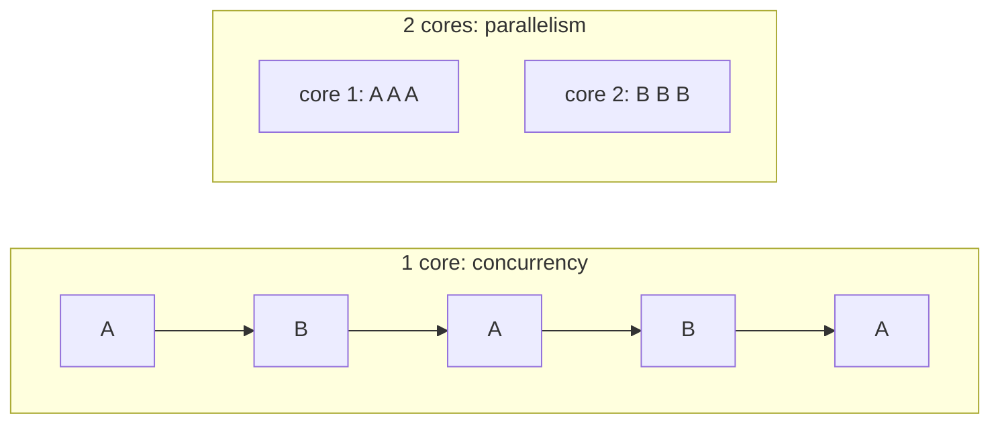
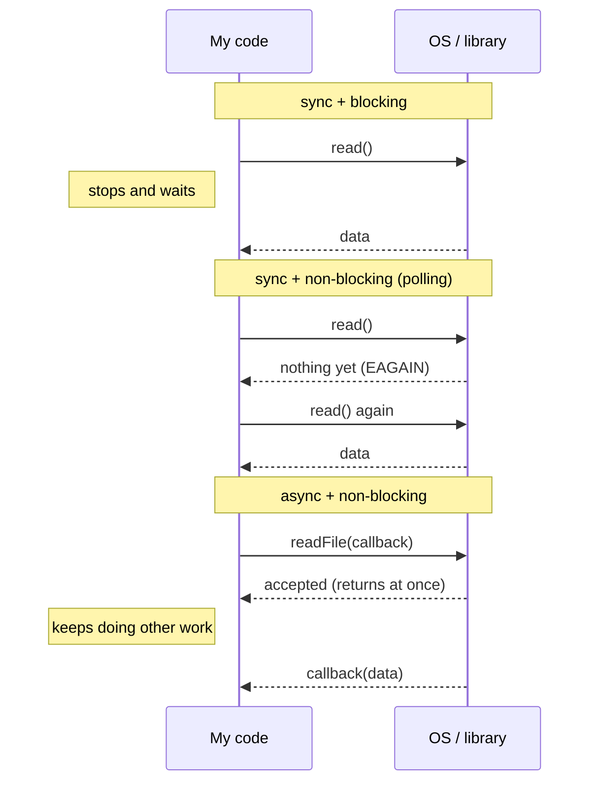

"Async," "non-blocking," "concurrency," "parallel" sound alike and get mixed up easily, but each answers a different question. Concurrency vs. parallelism is "how do tasks overlap," sync vs. async is "who collects the result and when," and blocking vs. non-blocking is "does the caller stop and wait." Separating these three put threads, asyncio and the Node event loop into one picture for me. The execution units themselves are in [Processes and Threads](#/post/os-process-thread).

## 1. Concurrency and parallelism

1. **Concurrency**: making progress on several tasks over the same period by alternating between them. One core is enough. When the OS switches in very short slices (time sharing), it looks simultaneous to a human.
2. **Parallelism**: actually executing several tasks at the same instant. Requires multiple cores (or machines).
3. **The relationship**: concurrency is a way of structuring a program; parallelism is a way of executing it. That's the distinction Rob Pike, one of Go's creators, made in the talk "Concurrency is not parallelism." A concurrently structured program can run in parallel given many cores, or alternate on one.



Which one speeds things up depends on the work. **I/O-bound** work, mostly waiting, gets much faster with concurrency alone: do something else while waiting. **CPU-bound** work, mostly computing, only gets faster with parallelism, using more cores.

## 2. Sync vs. async, blocking vs. non-blocking

1. **Synchronous**: I collect the result of the work I called myself. I check that it's done and get the result before moving to the next line.
2. **Asynchronous**: I hand off the work and the other side tells me when it's done (callback, Promise, event). When the result is collected is separate from my code's flow.
3. **Blocking**: the called function doesn't return control until the work is done. My thread stops meanwhile.
4. **Non-blocking**: the called function returns right away even if the work isn't done, with a "not yet."

They're different axes, so there are four combinations.

| | Blocking | Non-blocking |
|---|---|---|
| **Sync** | call `recv()` and stop until data arrives. The most common code | keep asking a non-blocking socket "anything?" (polling). I collect the result but never stop |
| **Async** | hand it off asynchronously, then immediately stop and wait for that very result. A pointless combo that usually happens by mistake | Node `fs.readFile(cb)`, `fetch().then()`. Hand it off, do other things, get notified when done |

I/O multiplexing like `select`/`epoll` doesn't fit this table neatly. Each socket stays non-blocking, but you stop and wait on many at once "until something is ready." So which cell it goes in depends on who's classifying. Look at "who waits, and who collects the result" rather than the label.



### Seeing it with sockets (ran it)

```python
import socket, time
a, b = socket.socketpair()          # 서로 연결된 소켓 한 쌍(데이터는 아직 없음)

a.settimeout(1.0)                   # 블로킹(최대 1초까지만 기다리게)
t0 = time.perf_counter()
try:
    a.recv(10)
except socket.timeout:
    print(f'블로킹 recv: {time.perf_counter()-t0:.2f}초 동안 멈춰 있다가 timeout')

a.setblocking(False)                # 논블로킹
t0 = time.perf_counter()
try:
    a.recv(10)
except BlockingIOError as e:
    print(f'논블로킹 recv: {(time.perf_counter()-t0)*1e6:.0f}마이크로초 만에 돌아옴 ->', e)

b.sendall(b'hi')
tries = 0
while True:                         # 동기 + 논블로킹: 될 때까지 내가 계속 확인(폴링)
    tries += 1
    try:
        print('데이터:', a.recv(10), f'(시도 {tries}번)'); break
    except BlockingIOError:
        time.sleep(0.001)
```

```
블로킹 recv: 1.00초 동안 멈춰 있다가 timeout
논블로킹 recv: 29마이크로초 만에 돌아옴 -> [Errno 11] Resource temporarily unavailable
데이터: b'hi' (시도 1번)
```

(= "blocking recv: stopped for 1.00s then timed out / non-blocking recv: returned in 29 µs -> EAGAIN / data: b'hi' (1 try).") With no data, the blocking `recv` sat stopped for the full second, while the non-blocking `recv` threw "nothing right now" (EAGAIN) and came back in 29 microseconds. Poking a non-blocking socket in a loop is sync + non-blocking; handing the waiting on many sockets to the OS is the `select` server in the [socket post](#/post/net-socket).

## 3. Three ways to overlap waiting

I timed handling three I/O operations that take 1 second each.

```python
import asyncio, time, threading

def blocking_io():            # 1초 걸리는 블로킹 I/O 흉내
    time.sleep(1)

async def async_io():         # 1초 걸리는 논블로킹 I/O 흉내
    await asyncio.sleep(1)

t0 = time.perf_counter()
for _ in range(3): blocking_io()
print(f'동기·블로킹 3번      {time.perf_counter()-t0:.2f}s')

t0 = time.perf_counter()
ts = [threading.Thread(target=blocking_io) for _ in range(3)]
[t.start() for t in ts]; [t.join() for t in ts]
print(f'스레드 3개           {time.perf_counter()-t0:.2f}s')

async def main():
    t0 = time.perf_counter()
    await asyncio.gather(*(async_io() for _ in range(3)))
    print(f'asyncio.gather 3개   {time.perf_counter()-t0:.2f}s  (스레드 {threading.active_count()}개)')
    t0 = time.perf_counter()
    async def bad(): time.sleep(1)       # async 함수 안에서 블로킹 호출
    await asyncio.gather(bad(), bad(), bad())
    print(f'async 안에서 time.sleep 3개 {time.perf_counter()-t0:.2f}s')
asyncio.run(main())
```

```
동기·블로킹 3번      3.00s
스레드 3개           1.00s
asyncio.gather 3개   1.00s  (스레드 1개)
async 안에서 time.sleep 3개 3.00s
```

(Lines: sync+blocking ×3, 3 threads, asyncio.gather ×3 (1 thread), time.sleep ×3 inside async.)

1. **Threads**: keep the blocking code and add threads. When one thread stops, others run. The OS forcibly switches between them (preemptive), so shared data needs locks.
2. **Event loop + coroutines (asyncio, Node)**: one thread registers all the waits and resumes whichever is ready first. As shown, one thread finished in 1 second. Coroutines are cooperative: they yield only at `await`.
3. **Processes**: run CPU-bound work in parallel on several cores. This is how to speed up computation in a language with a GIL like Python.

The last line is the trap. Calling a blocking function like `time.sleep` inside `async def` stops the whole event loop, so the three ran one after another and took 3 seconds. Inside async code, use awaitable libraries, or hand unavoidable blocking calls to a thread with `asyncio.to_thread`. In cooperative multitasking, if someone doesn't yield, everyone waits.

| | Threads | Event loop (async) | Processes |
|---|---|---|---|
| Concurrency/parallelism | concurrency (parallel in some languages) | concurrency | parallelism |
| Switching | forced by the OS (preemptive) | self-yield at `await` (cooperative) | forced by the OS |
| Cost | a stack per thread | very light, tens of thousands of connections | heaviest |
| Risk | race conditions, deadlocks | one blocking call stalls everything | IPC cost |
| Good for | I/O with blocking libraries | network I/O with huge numbers of connections | CPU computation |

## Common misconceptions

- Async means fast: it only overlaps waiting. Computation doesn't get faster, and CPU-bound work actually blocks the event loop.
- Async = non-blocking, sync = blocking: they're different axes. Sync + non-blocking (polling) exists too.
- Concurrency = parallelism: concurrency works on one core. Parallelism needs several.
- Adding `async def` makes it async: call a blocking function inside and it can be worse than plain sync code.
- More threads means more throughput: past the core count, switching costs and lock contention grow.

## Core concepts you should be able to explain yourself

1. **Concurrency vs. parallelism**: progress by alternating (structure) vs. executing at the same instant (multiple cores).
2. **I/O-bound vs. CPU-bound**: lots of waiting → concurrency; lots of computing → parallelism.
3. **Sync vs. async**: do I collect the result, or am I told when it's done?
4. **Blocking vs. non-blocking**: does the call stop until done, or return at once?
5. **The four combinations**: sync/blocking (normal code), sync/non-blocking (polling), async/non-blocking (callbacks, Promises), async/blocking (usually a mistake).
6. **I/O multiplexing**: wait on many sockets at once with `select`/`epoll`. The floor of the event loop.
7. **Preemptive vs. cooperative**: threads switched forcibly by the OS vs. coroutines yielding at `await`. In cooperative code one blocking call stalls everything.

## Related reading

← [Operating System Fundamentals](#/post/cs-os)

- [Processes and Threads](#/post/os-process-thread): execution units and memory layout
- [The JavaScript Event Loop](#/post/js-event-loop): a real implementation of async/non-blocking
- [Synchronization and Deadlock](#/post/os-sync-deadlock): the price of thread concurrency
- [CPU Scheduling](#/post/os-scheduling): how time sharing alternates work

## Reference links

- Python docs, socket — setblocking / settimeout: https://docs.python.org/3/library/socket.html#notes-on-socket-timeouts
- Python docs, asyncio — Coroutines and Tasks: https://docs.python.org/3/library/asyncio-task.html
- Linux man-pages, epoll(7): https://man7.org/linux/man-pages/man7/epoll.7.html
- OSTEP, Event-based Concurrency: https://pages.cs.wisc.edu/~remzi/OSTEP/threads-events.pdf
- Rob Pike, Concurrency is not Parallelism (Go blog): https://go.dev/blog/waza-talk
- Node.js docs, Overview of Blocking vs Non-Blocking: https://nodejs.org/en/learn/asynchronous-work/overview-of-blocking-vs-non-blocking

Further reading (well-illustrated Korean posts on the same topic)

- Inpa Dev, Sync/async and blocking/non-blocking, fully explained: https://inpa.tistory.com/entry/%F0%9F%91%A9%E2%80%8D%F0%9F%92%BB-%EB%8F%99%EA%B8%B0%EB%B9%84%EB%8F%99%EA%B8%B0-%EB%B8%94%EB%A1%9C%ED%82%B9%EB%85%BC%EB%B8%94%EB%A1%9C%ED%82%B9-%EA%B0%9C%EB%85%90-%EC%A0%95%EB%A6%AC
- Inpa Dev, Multitasking and multiprocessing in one go: https://inpa.tistory.com/entry/%F0%9F%91%A9%E2%80%8D%F0%9F%92%BB-multi-programming-tasking-processing
- Inpa Dev, Do more threads always mean better performance?: https://inpa.tistory.com/entry/%F0%9F%91%A9%E2%80%8D%F0%9F%92%BB-Is-more-threads-always-better
