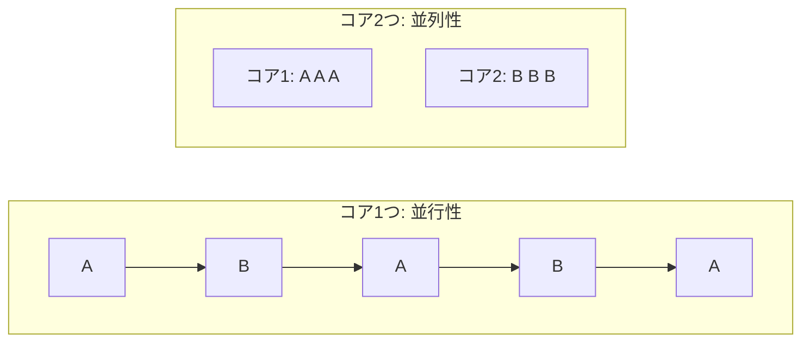
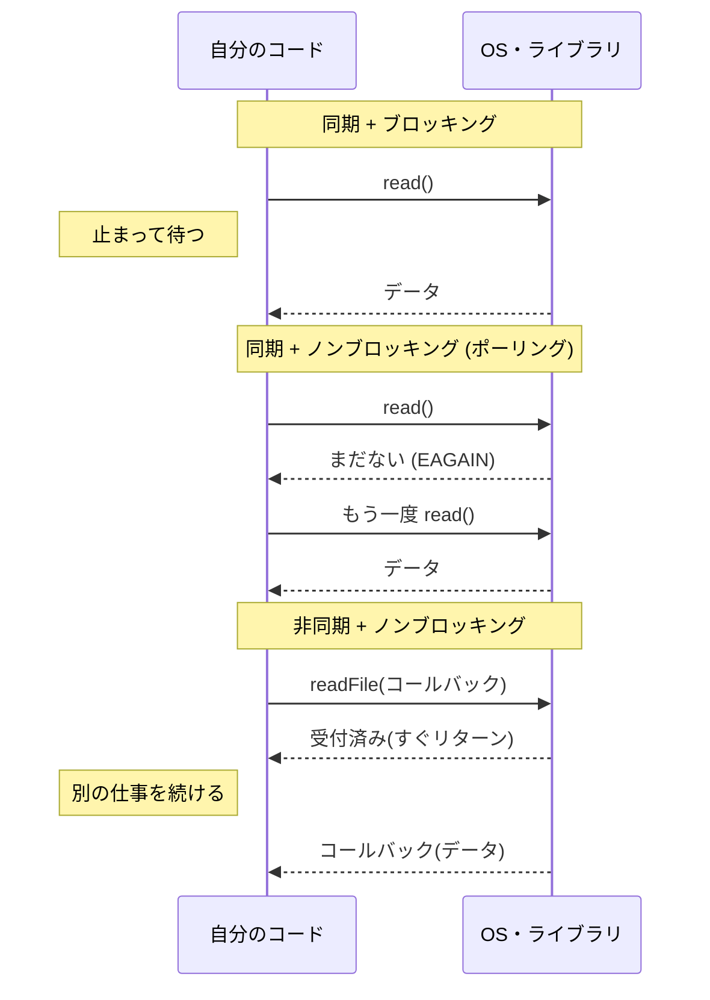

「非同期」「ノンブロッキング」「並行性」「並列」は似て聞こえるので混ぜて使いがちですが、それぞれ問いが違います。並行性と並列性は「仕事がどう重なるか」、同期と非同期は「結果を誰がいつ受け取るか」、ブロッキングとノンブロッキングは「呼び出した側が待って止まるか」です。この3つを分けてみると、スレッド、asyncio、Node のイベントループが1枚の絵に収まりました。実行単位そのものは [プロセスとスレッド](#/post/os-process-thread) にあります。

## 1. 並行性と並列性

1. **並行性 (concurrency)**: 複数の仕事を交互に進めて、同じ期間に一緒に進捗させること。コアが1つでも構いません。OS がとても短く区切って交互に動かせば(時分割)、人の目には同時に動いているように見えます。
2. **並列性 (parallelism)**: 複数の仕事を本当に同じ瞬間に実行すること。コア(またはマシン)が複数必要です。
3. **関係**: 並行性はプログラムの組み方で、並列性は実行の仕方です。Go の作者の一人ロブ・パイクが講演「Concurrency is not parallelism」で使った区別です。並行的に組んだプログラムは、コアが多ければ並列に動き、コアが1つなら交互に動きます。



どちらで速くなるかは仕事の性質で決まります。待ち時間がほとんどの **I/O バウンド** の仕事は、並行性だけでも大きく速くなります。待っている間に別の仕事をすればいいからです。計算がほとんどの **CPU バウンド** の仕事は、並列でコアを多く使わないと速くなりません。

## 2. 同期と非同期、ブロッキングとノンブロッキング

1. **同期 (synchronous)**: 自分が呼んだ仕事の結果を自分で受け取ります。終わったかを自分で確認し、結果を受け取ってから次の行に進みます。
2. **非同期 (asynchronous)**: 仕事を任せておき、終わったら相手が知らせてくれます(コールバック、Promise、イベント)。結果を受け取るタイミングが自分のコードの流れとは別です。
3. **ブロッキング (blocking)**: 呼んだ関数が仕事が終わるまで制御を返しません。その間、自分のスレッドは止まります。
4. **ノンブロッキング (non-blocking)**: 呼んだ関数が仕事が終わっていなくてもすぐ戻ってきます。「まだだよ」という答えと一緒に。

2つは別の軸なので、4通りに組み合わさります。

| | ブロッキング | ノンブロッキング |
|---|---|---|
| **同期** | `recv()` を呼んでデータが来るまで止まる。一番よくあるコード | ノンブロッキングのソケットに「来た?」と聞き続ける(ポーリング)。結果は自分で受け取るが止まりはしない |
| **非同期** | 非同期で任せておいて、結局すぐその結果を待って止まる。意味のない組み合わせで、普通はミスで生まれる | Node の `fs.readFile(cb)`、`fetch().then()`。任せてすぐ別の仕事、終わったら通知 |

`select`・`epoll` のような I/O 多重化はこの表にきれいに収まりません。ソケット1つ1つはノンブロッキングにしておき、「準備できたものが出るまで」一度に複数を待って止まります。なので分類する人によってマスが違います。名前より「誰が待ち、誰が結果を受け取るか」を見ればいいです。



### ソケットで直接見る (実行確認)

```python
import socket, time
a, b = socket.socketpair()          # 서로 연결된 소켓 한 쌍(데이터는 아직 없음)

a.settimeout(1.0)                   # 블로킹(최대 1초까지만 기다리게)
t0 = time.perf_counter()
try:
    a.recv(10)
except socket.timeout:
    print(f'블로킹 recv: {time.perf_counter()-t0:.2f}초 동안 멈춰 있다가 timeout')

a.setblocking(False)                # 논블로킹
t0 = time.perf_counter()
try:
    a.recv(10)
except BlockingIOError as e:
    print(f'논블로킹 recv: {(time.perf_counter()-t0)*1e6:.0f}마이크로초 만에 돌아옴 ->', e)

b.sendall(b'hi')
tries = 0
while True:                         # 동기 + 논블로킹: 될 때까지 내가 계속 확인(폴링)
    tries += 1
    try:
        print('데이터:', a.recv(10), f'(시도 {tries}번)'); break
    except BlockingIOError:
        time.sleep(0.001)
```

```
블로킹 recv: 1.00초 동안 멈춰 있다가 timeout
논블로킹 recv: 29마이크로초 만에 돌아옴 -> [Errno 11] Resource temporarily unavailable
데이터: b'hi' (시도 1번)
```

(「ブロッキング recv: 1.00秒止まってから timeout / ノンブロッキング recv: 29マイクロ秒で戻る -> EAGAIN / データ: b'hi' (1回目)」という意味です。)データがないとき、ブロッキングの `recv` は1秒間ずっと止まっていて、ノンブロッキングの `recv` は29マイクロ秒で「今はない」(EAGAIN) を投げて戻ってきました。ノンブロッキングのソケットをループで突き続けるのが同期+ノンブロッキングで、これを複数のソケットについて OS に代わりに待ってもらうのが [ソケットの記事](#/post/net-socket) の `select` サーバーです。

## 3. 待ちを重ねる3つの方法

1秒かかる I/O を3つ処理する時間を測りました。

```python
import asyncio, time, threading

def blocking_io():            # 1초 걸리는 블로킹 I/O 흉내
    time.sleep(1)

async def async_io():         # 1초 걸리는 논블로킹 I/O 흉내
    await asyncio.sleep(1)

t0 = time.perf_counter()
for _ in range(3): blocking_io()
print(f'동기·블로킹 3번      {time.perf_counter()-t0:.2f}s')

t0 = time.perf_counter()
ts = [threading.Thread(target=blocking_io) for _ in range(3)]
[t.start() for t in ts]; [t.join() for t in ts]
print(f'스레드 3개           {time.perf_counter()-t0:.2f}s')

async def main():
    t0 = time.perf_counter()
    await asyncio.gather(*(async_io() for _ in range(3)))
    print(f'asyncio.gather 3개   {time.perf_counter()-t0:.2f}s  (스레드 {threading.active_count()}개)')
    t0 = time.perf_counter()
    async def bad(): time.sleep(1)       # async 함수 안에서 블로킹 호출
    await asyncio.gather(bad(), bad(), bad())
    print(f'async 안에서 time.sleep 3개 {time.perf_counter()-t0:.2f}s')
asyncio.run(main())
```

```
동기·블로킹 3번      3.00s
스레드 3개           1.00s
asyncio.gather 3개   1.00s  (스레드 1개)
async 안에서 time.sleep 3개 3.00s
```

(各行は、同期・ブロッキング3回、スレッド3つ、asyncio.gather 3つ(スレッド1つ)、async の中で time.sleep 3つ、です。)

1. **スレッド**: ブロッキングのコードはそのままにしてスレッドを増やします。1つのスレッドが止まっても他のスレッドが動きます。OS が強制的に切り替えるプリエンプティブ方式なので、共有データにロックが必要です。
2. **イベントループ + コルーチン (asyncio、Node)**: 1つのスレッドで待つ仕事を全部仕掛けておき、準備できたものから続けて実行します。上の結果のようにスレッド1つで1秒で終わりました。コルーチンは `await` でだけ譲る協調方式です。
3. **プロセス**: CPU バウンドの仕事を複数のコアで並列に実行します。Python のように GIL がある言語で計算を速くする方法です。

最後の行が落とし穴です。`async def` の中で `time.sleep` のようなブロッキング関数を呼ぶとイベントループ全体が止まり、3つが順番に動いて3秒かかりました。async のコードの中では `await` できるライブラリを使うか、どうしようもないブロッキング呼び出しは `asyncio.to_thread` でスレッドに渡します。協調方式では、誰かが譲らないと全員が待ちます。

| | スレッド | イベントループ (async) | プロセス |
|---|---|---|---|
| 並行性/並列性 | 並行性(言語によっては並列) | 並行性 | 並列性 |
| 切り替え | OS が強制(プリエンプティブ) | `await` で自ら(協調) | OS が強制 |
| コスト | スレッドごとにスタック | とても軽い、接続数万も可能 | 一番重い |
| リスク | 競合状態、デッドロック | ブロッキング呼び出し1つが全体を止める | IPC のコスト |
| 向いている仕事 | ブロッキングのライブラリを使う I/O | 接続がとても多いネットワーク I/O | CPU 計算 |

## よくある誤解

- 非同期なら速い: 待ちを重ねるだけです。計算そのものは速くならず、CPU バウンドの仕事はむしろイベントループを止めます。
- 非同期 = ノンブロッキング、同期 = ブロッキング: 別の軸です。同期+ノンブロッキング(ポーリング)もあります。
- 並行性 = 並列性: コア1つでも並行性は成り立ちます。並列性には複数のコアが必要です。
- `async def` を付けさえすれば非同期になる: 中でブロッキング関数を呼ぶと、ただの同期コードより悪くなることもあります。
- スレッドを増やすほど処理量が増える: コア数を超えると切り替えコストとロックの競合が大きくなります。

## 自分で説明できるべき核心概念

1. **並行性 vs 並列性**: 交互に進捗(構造) vs 同じ瞬間に実行(複数コア)。
2. **I/O バウンド vs CPU バウンド**: 待ちが多ければ並行性、計算が多ければ並列性。
3. **同期 vs 非同期**: 結果を自分で受け取るか、終わったら知らせてもらうか。
4. **ブロッキング vs ノンブロッキング**: 呼び出しが終わるまで止まるか、すぐ戻るか。
5. **4つの組み合わせ**: 同期・ブロッキング(普通のコード)、同期・ノンブロッキング(ポーリング)、非同期・ノンブロッキング(コールバック・Promise)、非同期・ブロッキング(たいていミス)。
6. **I/O 多重化**: `select`/`epoll` で複数のソケットを一度に待つ。イベントループの土台。
7. **プリエンプティブ vs 協調**: OS が強制的に切り替えるスレッド vs `await` で譲るコルーチン。協調方式ではブロッキング呼び出し1つが全体を止める。

## おすすめの記事

← [OS の基礎](#/post/cs-os)

- [プロセスとスレッド](#/post/os-process-thread): 実行単位とメモリ構造
- [JavaScript のイベントループ](#/post/js-event-loop): 非同期・ノンブロッキングの実際の実装
- [同期とデッドロック](#/post/os-sync-deadlock): スレッドの並行性の代償
- [CPU スケジューリング](#/post/os-scheduling): 時分割で交互に動かす方法

## 根拠となるリンク

- Python ドキュメント, socket — setblocking / settimeout: https://docs.python.org/3/library/socket.html#notes-on-socket-timeouts
- Python ドキュメント, asyncio — Coroutines and Tasks: https://docs.python.org/3/library/asyncio-task.html
- Linux man-pages, epoll(7): https://man7.org/linux/man-pages/man7/epoll.7.html
- OSTEP, Event-based Concurrency: https://pages.cs.wisc.edu/~remzi/OSTEP/threads-events.pdf
- Rob Pike, Concurrency is not Parallelism (Go blog): https://go.dev/blog/waza-talk
- Node.js ドキュメント, Overview of Blocking vs Non-Blocking: https://nodejs.org/en/learn/asynchronous-work/overview-of-blocking-vs-non-blocking

参考(同じテーマを図で分かりやすくまとめた韓国語の記事)

- Inpa Dev, 同期/非同期とブロッキング/ノンブロッキングを完全理解: https://inpa.tistory.com/entry/%F0%9F%91%A9%E2%80%8D%F0%9F%92%BB-%EB%8F%99%EA%B8%B0%EB%B9%84%EB%8F%99%EA%B8%B0-%EB%B8%94%EB%A1%9C%ED%82%B9%EB%85%BC%EB%B8%94%EB%A1%9C%ED%82%B9-%EA%B0%9C%EB%85%90-%EC%A0%95%EB%A6%AC
- Inpa Dev, マルチタスキングとマルチプロセッシングの概念まとめ: https://inpa.tistory.com/entry/%F0%9F%91%A9%E2%80%8D%F0%9F%92%BB-multi-programming-tasking-processing
- Inpa Dev, スレッドを増やすほど常に速くなるか?: https://inpa.tistory.com/entry/%F0%9F%91%A9%E2%80%8D%F0%9F%92%BB-Is-more-threads-always-better
