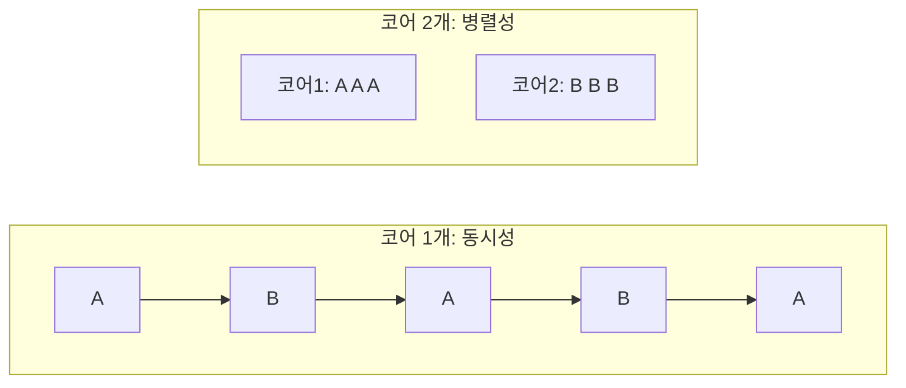
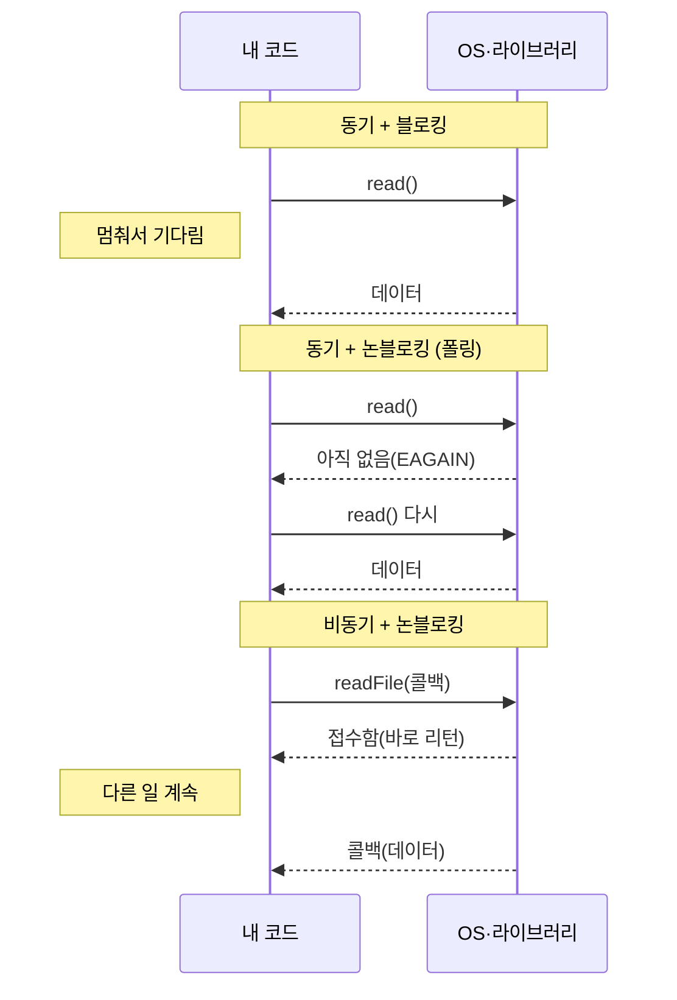

"비동기", "논블로킹", "동시성", "병렬"은 비슷하게 들려서 섞어 쓰기 쉬운데, 각각 묻는 질문이 다르다. 동시성과 병렬성은 "일이 어떻게 겹치나", 동기와 비동기는 "결과를 누가 언제 챙기나", 블로킹과 논블로킹은 "호출한 쪽이 기다리며 멈추나"다. 이 셋을 나눠 놓으니 스레드, asyncio, Node 이벤트 루프가 한 그림에 들어왔다. 실행 단위 자체는 [프로세스와 스레드](#/post/os-process-thread)에 있다.

## 1. 동시성과 병렬성

1. **동시성(concurrency)**: 여러 일을 번갈아 진행해서 같은 기간에 함께 진척되게 하는 것. 코어가 하나여도 된다. OS가 아주 짧게 나눠 번갈아 돌리면(시분할) 사람 눈에는 동시에 도는 것처럼 보인다.
2. **병렬성(parallelism)**: 여러 일을 정말 같은 순간에 실행하는 것. 코어(또는 기계)가 여러 개 있어야 한다.
3. **관계**: 동시성은 프로그램을 짜는 구조이고, 병렬성은 실행하는 방식이다. Go를 만든 롭 파이크가 "Concurrency is not parallelism" 발표에서 쓴 구분이다. 동시적으로 짠 프로그램은 코어가 많으면 병렬로 돌 수 있고, 코어가 하나면 번갈아 돈다.



어느 쪽이 빨라지는지는 일의 성격으로 갈린다. 기다리는 시간이 대부분인 **I/O 바운드** 일은 동시성만으로도 크게 빨라진다. 기다리는 동안 다른 일을 하면 되니까. 계산이 대부분인 **CPU 바운드** 일은 병렬로 코어를 더 써야 빨라진다.

## 2. 동기와 비동기, 블로킹과 논블로킹

1. **동기(synchronous)**: 내가 부른 작업의 결과를 내가 직접 챙긴다. 끝났는지 내가 확인하고, 결과를 받은 뒤 다음 줄로 간다.
2. **비동기(asynchronous)**: 작업을 맡겨 두고, 끝나면 그쪽이 알려 준다(콜백, Promise, 이벤트). 결과를 챙기는 시점이 내 코드 흐름과 따로다.
3. **블로킹(blocking)**: 호출한 함수가 일이 끝날 때까지 제어권을 안 돌려준다. 그동안 내 스레드는 멈춘다.
4. **논블로킹(non-blocking)**: 호출한 함수가 일이 안 끝났어도 바로 돌아온다. "아직이야"라는 답과 함께.

둘은 다른 축이라 네 가지로 조합된다.

| | 블로킹 | 논블로킹 |
|---|---|---|
| **동기** | `recv()`를 부르고 데이터가 올 때까지 멈춤. 가장 흔한 코드 | 논블로킹 소켓에 "왔어?"를 계속 물어봄(폴링). 결과는 내가 챙기지만 멈추지는 않음 |
| **비동기** | 비동기로 맡겨 놓고 결국 바로 그 결과를 기다리며 멈춤. 의미 없는 조합이라 보통 실수로 생긴다 | Node `fs.readFile(cb)`, `fetch().then()`. 맡기고 바로 다른 일, 끝나면 알림 |

`select`·`epoll` 같은 I/O 멀티플렉싱은 이 표에 깔끔하게 안 들어간다. 소켓 하나하나는 논블로킹으로 두고, "준비된 게 생길 때까지" 한 번에 여러 개를 기다리며 멈춘다. 그래서 분류하는 사람에 따라 칸이 다르다. 이름보다 "누가 기다리고, 누가 결과를 챙기나"를 보면 된다.



### 소켓으로 직접 보기 (실행 확인)

```python
import socket, time
a, b = socket.socketpair()          # 서로 연결된 소켓 한 쌍(데이터는 아직 없음)

a.settimeout(1.0)                   # 블로킹(최대 1초까지만 기다리게)
t0 = time.perf_counter()
try:
    a.recv(10)
except socket.timeout:
    print(f'블로킹 recv: {time.perf_counter()-t0:.2f}초 동안 멈춰 있다가 timeout')

a.setblocking(False)                # 논블로킹
t0 = time.perf_counter()
try:
    a.recv(10)
except BlockingIOError as e:
    print(f'논블로킹 recv: {(time.perf_counter()-t0)*1e6:.0f}마이크로초 만에 돌아옴 ->', e)

b.sendall(b'hi')
tries = 0
while True:                         # 동기 + 논블로킹: 될 때까지 내가 계속 확인(폴링)
    tries += 1
    try:
        print('데이터:', a.recv(10), f'(시도 {tries}번)'); break
    except BlockingIOError:
        time.sleep(0.001)
```

```
블로킹 recv: 1.00초 동안 멈춰 있다가 timeout
논블로킹 recv: 29마이크로초 만에 돌아옴 -> [Errno 11] Resource temporarily unavailable
데이터: b'hi' (시도 1번)
```

데이터가 없을 때 블로킹 `recv`는 1초 내내 멈춰 있었고, 논블로킹 `recv`는 29마이크로초 만에 "지금은 없음"(EAGAIN)을 던지고 돌아왔다. 논블로킹 소켓을 반복문으로 계속 찌르는 게 동기+논블로킹이고, 이걸 여러 소켓에 대해 OS에게 대신 기다려 달라고 맡긴 게 [소켓 글](#/post/net-socket)의 `select` 서버다.

## 3. 기다림을 겹치는 세 가지 방법

1초 걸리는 I/O 세 개를 처리하는 시간을 쟀다.

```python
import asyncio, time, threading

def blocking_io():            # 1초 걸리는 블로킹 I/O 흉내
    time.sleep(1)

async def async_io():         # 1초 걸리는 논블로킹 I/O 흉내
    await asyncio.sleep(1)

t0 = time.perf_counter()
for _ in range(3): blocking_io()
print(f'동기·블로킹 3번      {time.perf_counter()-t0:.2f}s')

t0 = time.perf_counter()
ts = [threading.Thread(target=blocking_io) for _ in range(3)]
[t.start() for t in ts]; [t.join() for t in ts]
print(f'스레드 3개           {time.perf_counter()-t0:.2f}s')

async def main():
    t0 = time.perf_counter()
    await asyncio.gather(*(async_io() for _ in range(3)))
    print(f'asyncio.gather 3개   {time.perf_counter()-t0:.2f}s  (스레드 {threading.active_count()}개)')
    t0 = time.perf_counter()
    async def bad(): time.sleep(1)       # async 함수 안에서 블로킹 호출
    await asyncio.gather(bad(), bad(), bad())
    print(f'async 안에서 time.sleep 3개 {time.perf_counter()-t0:.2f}s')
asyncio.run(main())
```

```
동기·블로킹 3번      3.00s
스레드 3개           1.00s
asyncio.gather 3개   1.00s  (스레드 1개)
async 안에서 time.sleep 3개 3.00s
```

1. **스레드**: 블로킹 코드를 그대로 두고 스레드를 늘린다. 한 스레드가 멈춰도 다른 스레드가 돈다. OS가 강제로 번갈아 돌리는 선점형이라 공유 데이터에 락이 필요하다.
2. **이벤트 루프 + 코루틴(asyncio, Node)**: 스레드 하나에서 기다릴 일을 전부 걸어 두고, 준비된 것부터 이어서 실행한다. 위 결과처럼 스레드 1개로 1초에 끝났다. 코루틴은 `await`에서만 양보하는 협력형이다.
3. **프로세스**: CPU 바운드 일을 코어 여러 개로 병렬 실행한다. 파이썬처럼 GIL이 있는 언어에서 계산을 빠르게 하는 방법이다.

마지막 줄이 함정이다. `async def` 안에서 `time.sleep` 같은 블로킹 함수를 부르면 이벤트 루프 전체가 멈춰서, 셋이 차례로 돌아 3초가 걸렸다. async 코드 안에서는 `await` 가능한 라이브러리를 쓰거나, 어쩔 수 없는 블로킹 호출은 `asyncio.to_thread`로 스레드에 넘긴다. 협력형은 누군가 양보를 안 하면 모두가 기다린다.

| | 스레드 | 이벤트 루프(async) | 프로세스 |
|---|---|---|---|
| 동시성/병렬성 | 동시성(언어에 따라 병렬) | 동시성 | 병렬성 |
| 전환 | OS가 강제(선점형) | `await`에서 스스로(협력형) | OS가 강제 |
| 비용 | 스레드마다 스택 | 아주 가벼움, 연결 수만 개 가능 | 가장 무거움 |
| 위험 | 경쟁 상태, 교착상태 | 블로킹 호출 하나가 전체를 멈춤 | IPC 비용 |
| 잘 맞는 일 | 블로킹 라이브러리를 쓰는 I/O | 연결이 아주 많은 네트워크 I/O | CPU 계산 |

## 흔한 오해

- 비동기면 빠르다: 기다림을 겹칠 뿐이다. 계산 자체는 안 빨라지고, CPU 바운드 일은 오히려 이벤트 루프를 막는다.
- 비동기 = 논블로킹, 동기 = 블로킹: 다른 축이다. 동기+논블로킹(폴링)도 있다.
- 동시성 = 병렬성: 코어 하나에서도 동시성은 된다. 병렬성은 여러 코어가 있어야 한다.
- `async def`만 붙이면 비동기가 된다: 안에서 블로킹 함수를 부르면 그냥 동기 코드보다 나쁠 수 있다.
- 스레드를 많이 만들수록 처리량이 는다: 코어 수를 넘으면 전환 비용과 락 경합이 커진다.

## 직접 설명할 수 있어야 할 핵심 개념

1. **동시성 vs 병렬성**: 번갈아 진척(구조) vs 같은 순간 실행(코어 여러 개).
2. **I/O 바운드 vs CPU 바운드**: 기다림이 많으면 동시성, 계산이 많으면 병렬성.
3. **동기 vs 비동기**: 결과를 내가 챙기나, 끝나면 알려 주나.
4. **블로킹 vs 논블로킹**: 호출이 끝날 때까지 멈추나, 바로 돌아오나.
5. **네 가지 조합**: 동기·블로킹(보통 코드), 동기·논블로킹(폴링), 비동기·논블로킹(콜백·Promise), 비동기·블로킹(대개 실수).
6. **I/O 멀티플렉싱**: `select`/`epoll`로 여러 소켓을 한 번에 기다린다. 이벤트 루프의 바닥.
7. **선점형 vs 협력형**: OS가 강제로 바꾸는 스레드 vs `await`에서 양보하는 코루틴. 협력형에서는 블로킹 호출 하나가 전체를 멈춘다.

## 같이 보면 좋은 글

← [운영체제 기초](#/post/cs-os)

- [프로세스와 스레드](#/post/os-process-thread): 실행 단위와 메모리 구조
- [자바스크립트 이벤트 루프](#/post/js-event-loop): 비동기·논블로킹의 실제 구현
- [동기화와 교착상태](#/post/os-sync-deadlock): 스레드 동시성의 대가
- [CPU 스케줄링](#/post/os-scheduling): 시분할로 번갈아 돌리는 방법

## 근거 링크

- Python 문서, socket — setblocking / settimeout: https://docs.python.org/3/library/socket.html#notes-on-socket-timeouts
- Python 문서, asyncio — Coroutines and Tasks: https://docs.python.org/3/library/asyncio-task.html
- Linux man-pages, epoll(7): https://man7.org/linux/man-pages/man7/epoll.7.html
- OSTEP, Event-based Concurrency: https://pages.cs.wisc.edu/~remzi/OSTEP/threads-events.pdf
- Rob Pike, Concurrency is not Parallelism (Go blog): https://go.dev/blog/waza-talk
- Node.js 문서, Overview of Blocking vs Non-Blocking: https://nodejs.org/en/learn/asynchronous-work/overview-of-blocking-vs-non-blocking

참고(같은 주제를 그림으로 잘 정리한 글)

- Inpa Dev, 완벽히 이해하는 동기/비동기 & 블로킹/논블로킹: https://inpa.tistory.com/entry/%F0%9F%91%A9%E2%80%8D%F0%9F%92%BB-%EB%8F%99%EA%B8%B0%EB%B9%84%EB%8F%99%EA%B8%B0-%EB%B8%94%EB%A1%9C%ED%82%B9%EB%85%BC%EB%B8%94%EB%A1%9C%ED%82%B9-%EA%B0%9C%EB%85%90-%EC%A0%95%EB%A6%AC
- Inpa Dev, 멀티 태스킹 & 멀티 프로세싱 개념 한방 정리: https://inpa.tistory.com/entry/%F0%9F%91%A9%E2%80%8D%F0%9F%92%BB-multi-programming-tasking-processing
- Inpa Dev, 스레드를 많이 쓸수록 항상 성능이 좋아질까?: https://inpa.tistory.com/entry/%F0%9F%91%A9%E2%80%8D%F0%9F%92%BB-Is-more-threads-always-better
