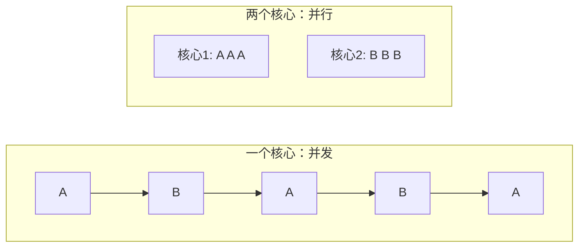
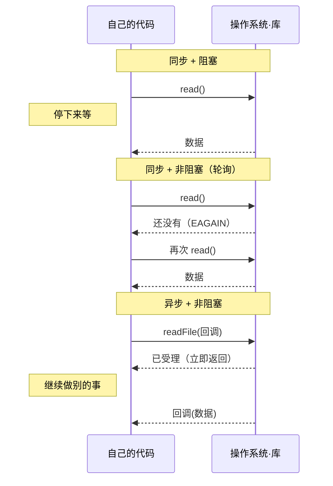

“异步”“非阻塞”“并发”“并行”听起来很像，常常被混用，但它们回答的问题不同。并发与并行问的是“工作怎么重叠”，同步与异步问的是“结果由谁、在什么时候接收”，阻塞与非阻塞问的是“调用方会不会停下来等”。把这三个分开来看，线程、asyncio、Node 事件循环就能放进同一张图。执行单位本身见 [进程与线程](#/post/os-process-thread)。

## 1. 并发与并行

1. **并发（concurrency）**：交替推进多项工作，让它们在同一段时间里一起取得进展。一个核心也可以。操作系统切成很短的片段轮流执行（分时），人眼看起来就像同时在运行。
2. **并行（parallelism）**：在同一瞬间真正执行多项工作。需要多个核心（或多台机器）。
3. **关系**：并发是程序的组织方式，并行是执行方式。这是 Go 作者之一 Rob Pike 在演讲“Concurrency is not parallelism”中用的区分。按并发方式组织的程序，核心多就并行运行，只有一个核心就交替运行。



哪种方式能提速取决于工作的性质。大部分时间都在等待的 **I/O 密集型** 工作，只靠并发就能大幅提速，因为等待期间可以做别的事。大部分时间都在计算的 **CPU 密集型** 工作，必须并行地用上更多核心才会变快。

## 2. 同步与异步，阻塞与非阻塞

1. **同步（synchronous）**：自己调用的工作，结果由自己接收。自己确认是否完成，拿到结果后才执行下一行。
2. **异步（asynchronous）**：把工作交出去，完成后由对方通知（回调、Promise、事件）。接收结果的时机与自己代码的流程是分开的。
3. **阻塞（blocking）**：被调用的函数在工作完成前不交回控制权。这期间自己的线程停着。
4. **非阻塞（non-blocking）**：被调用的函数即使工作没完成也立即返回，并附带一个“还没好”的回答。

两者是不同的轴，所以有四种组合。

| | 阻塞 | 非阻塞 |
|---|---|---|
| **同步** | 调用 `recv()`，一直停到数据到来。最常见的代码 | 不停地问非阻塞套接字“来了吗？”（轮询）。结果自己接收，但不会停住 |
| **异步** | 异步地交出去，却马上停下来等它的结果。没有意义的组合，通常是失误造成的 | Node 的 `fs.readFile(cb)`、`fetch().then()`。交出去后立刻做别的，完成时收到通知 |

`select`·`epoll` 这类 I/O 多路复用不太好放进这张表。每个套接字都设成非阻塞，然后一次性等待多个，“直到有准备好的”才停下来。所以不同的人会把它归到不同的格子。与其看名字，不如看“谁在等、谁接收结果”。



### 用套接字亲眼看（实测）

```python
import socket, time
a, b = socket.socketpair()          # 서로 연결된 소켓 한 쌍(데이터는 아직 없음)

a.settimeout(1.0)                   # 블로킹(최대 1초까지만 기다리게)
t0 = time.perf_counter()
try:
    a.recv(10)
except socket.timeout:
    print(f'블로킹 recv: {time.perf_counter()-t0:.2f}초 동안 멈춰 있다가 timeout')

a.setblocking(False)                # 논블로킹
t0 = time.perf_counter()
try:
    a.recv(10)
except BlockingIOError as e:
    print(f'논블로킹 recv: {(time.perf_counter()-t0)*1e6:.0f}마이크로초 만에 돌아옴 ->', e)

b.sendall(b'hi')
tries = 0
while True:                         # 동기 + 논블로킹: 될 때까지 내가 계속 확인(폴링)
    tries += 1
    try:
        print('데이터:', a.recv(10), f'(시도 {tries}번)'); break
    except BlockingIOError:
        time.sleep(0.001)
```

```
블로킹 recv: 1.00초 동안 멈춰 있다가 timeout
논블로킹 recv: 29마이크로초 만에 돌아옴 -> [Errno 11] Resource temporarily unavailable
데이터: b'hi' (시도 1번)
```

（意思是“阻塞 recv：停 1.00 秒后 timeout / 非阻塞 recv：29 微秒返回 -> EAGAIN / 数据：b'hi'（第 1 次）”。）没有数据时，阻塞的 `recv` 一直停了 1 秒，非阻塞的 `recv` 在 29 微秒内抛出“现在没有”（EAGAIN）并返回。用循环不断戳非阻塞套接字就是同步+非阻塞，而让操作系统替自己对多个套接字做这件事，就是 [套接字一文](#/post/net-socket) 中的 `select` 服务器。

## 3. 让等待重叠的三种方法

测量了处理三个各需 1 秒的 I/O 所用的时间。

```python
import asyncio, time, threading

def blocking_io():            # 1초 걸리는 블로킹 I/O 흉내
    time.sleep(1)

async def async_io():         # 1초 걸리는 논블로킹 I/O 흉내
    await asyncio.sleep(1)

t0 = time.perf_counter()
for _ in range(3): blocking_io()
print(f'동기·블로킹 3번      {time.perf_counter()-t0:.2f}s')

t0 = time.perf_counter()
ts = [threading.Thread(target=blocking_io) for _ in range(3)]
[t.start() for t in ts]; [t.join() for t in ts]
print(f'스레드 3개           {time.perf_counter()-t0:.2f}s')

async def main():
    t0 = time.perf_counter()
    await asyncio.gather(*(async_io() for _ in range(3)))
    print(f'asyncio.gather 3개   {time.perf_counter()-t0:.2f}s  (스레드 {threading.active_count()}개)')
    t0 = time.perf_counter()
    async def bad(): time.sleep(1)       # async 함수 안에서 블로킹 호출
    await asyncio.gather(bad(), bad(), bad())
    print(f'async 안에서 time.sleep 3개 {time.perf_counter()-t0:.2f}s')
asyncio.run(main())
```

```
동기·블로킹 3번      3.00s
스레드 3개           1.00s
asyncio.gather 3개   1.00s  (스레드 1개)
async 안에서 time.sleep 3개 3.00s
```

（各行分别是：同步·阻塞 3 次、3 个线程、asyncio.gather 3 个（1 个线程）、在 async 里 time.sleep 3 个。）

1. **线程**：阻塞代码保持原样，只增加线程。一个线程停住，其他线程照常运行。由操作系统强制切换，属于抢占式，所以共享数据需要加锁。
2. **事件循环 + 协程（asyncio、Node）**：在一个线程里把所有要等的工作都发起，哪个准备好就接着执行哪个。如上面的结果，一个线程 1 秒就完成了。协程只在 `await` 处让出，属于协作式。
3. **进程**：把 CPU 密集型工作放到多个核心上并行执行。在 Python 这种有 GIL 的语言里，这是让计算变快的办法。

最后一行是个陷阱。在 `async def` 里调用 `time.sleep` 这样的阻塞函数，整个事件循环都会停住，三个任务依次执行，用了 3 秒。在 async 代码里要用可以 `await` 的库，实在避不开的阻塞调用就用 `asyncio.to_thread` 交给线程。协作式下，只要有一个不让出，所有人都得等。

| | 线程 | 事件循环（async） | 进程 |
|---|---|---|---|
| 并发/并行 | 并发（有的语言可并行） | 并发 | 并行 |
| 切换 | 操作系统强制（抢占式） | 在 `await` 处主动让出（协作式） | 操作系统强制 |
| 开销 | 每个线程一个栈 | 非常轻，可支撑数万连接 | 最重 |
| 风险 | 竞态条件、死锁 | 一个阻塞调用会让整体停住 | IPC 开销 |
| 适合的工作 | 使用阻塞库的 I/O | 连接非常多的网络 I/O | CPU 计算 |

## 常见误解

- 异步就会快：只是让等待重叠。计算本身不会变快，CPU 密集型工作反而会让事件循环停住。
- 异步 = 非阻塞，同步 = 阻塞：它们是不同的轴。也存在同步+非阻塞（轮询）。
- 并发 = 并行：一个核心也能实现并发。并行需要多个核心。
- 只要加上 `async def` 就变成异步了：在里面调用阻塞函数，可能比普通同步代码还糟。
- 线程越多吞吐量越大：超过核心数后，切换开销和锁竞争会越来越大。

## 必须能自己讲清楚的核心概念

1. **并发 vs 并行**：交替推进（结构） vs 同一瞬间执行（多核心）。
2. **I/O 密集型 vs CPU 密集型**：等待多就靠并发，计算多就靠并行。
3. **同步 vs 异步**：结果自己接收，还是完成后被通知。
4. **阻塞 vs 非阻塞**：调用是停到完成，还是立即返回。
5. **四种组合**：同步·阻塞（普通代码）、同步·非阻塞（轮询）、异步·非阻塞（回调·Promise）、异步·阻塞（多半是失误）。
6. **I/O 多路复用**：用 `select`/`epoll` 一次等待多个套接字。事件循环的基础。
7. **抢占式 vs 协作式**：操作系统强制切换的线程 vs 在 `await` 处让出的协程。协作式下一个阻塞调用就会让整体停住。

## 推荐阅读

← [操作系统基础](#/post/cs-os)

- [进程与线程](#/post/os-process-thread)：执行单位与内存结构
- [JavaScript 事件循环](#/post/js-event-loop)：异步·非阻塞的实际实现
- [同步与死锁](#/post/os-sync-deadlock)：线程并发的代价
- [CPU 调度](#/post/os-scheduling)：分时轮流执行的方法

## 参考链接

- Python 文档, socket — setblocking / settimeout: https://docs.python.org/3/library/socket.html#notes-on-socket-timeouts
- Python 文档, asyncio — Coroutines and Tasks: https://docs.python.org/3/library/asyncio-task.html
- Linux man-pages, epoll(7): https://man7.org/linux/man-pages/man7/epoll.7.html
- OSTEP, Event-based Concurrency: https://pages.cs.wisc.edu/~remzi/OSTEP/threads-events.pdf
- Rob Pike, Concurrency is not Parallelism (Go blog): https://go.dev/blog/waza-talk
- Node.js 文档, Overview of Blocking vs Non-Blocking: https://nodejs.org/en/learn/asynchronous-work/overview-of-blocking-vs-non-blocking

参考（用图解把同一主题讲得很清楚的韩语文章）

- Inpa Dev, 彻底搞懂同步/异步与阻塞/非阻塞: https://inpa.tistory.com/entry/%F0%9F%91%A9%E2%80%8D%F0%9F%92%BB-%EB%8F%99%EA%B8%B0%EB%B9%84%EB%8F%99%EA%B8%B0-%EB%B8%94%EB%A1%9C%ED%82%B9%EB%85%BC%EB%B8%94%EB%A1%9C%ED%82%B9-%EA%B0%9C%EB%85%90-%EC%A0%95%EB%A6%AC
- Inpa Dev, 一次讲清多任务与多处理: https://inpa.tistory.com/entry/%F0%9F%91%A9%E2%80%8D%F0%9F%92%BB-multi-programming-tasking-processing
- Inpa Dev, 线程越多性能就一定越好吗？: https://inpa.tistory.com/entry/%F0%9F%91%A9%E2%80%8D%F0%9F%92%BB-Is-more-threads-always-better
