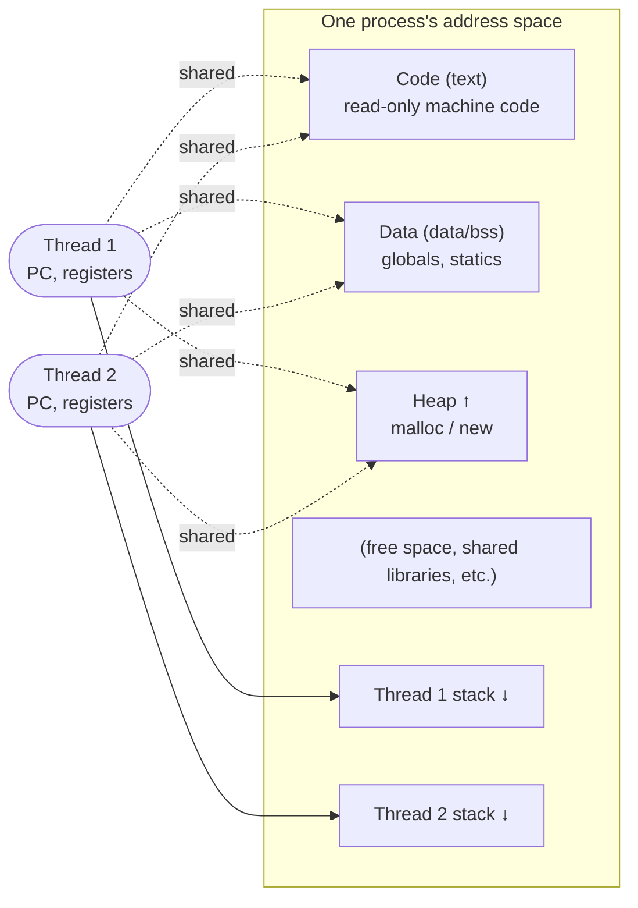
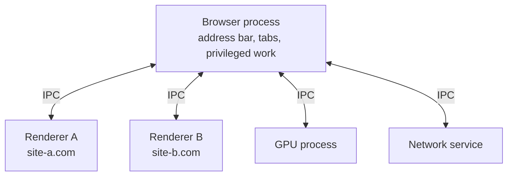
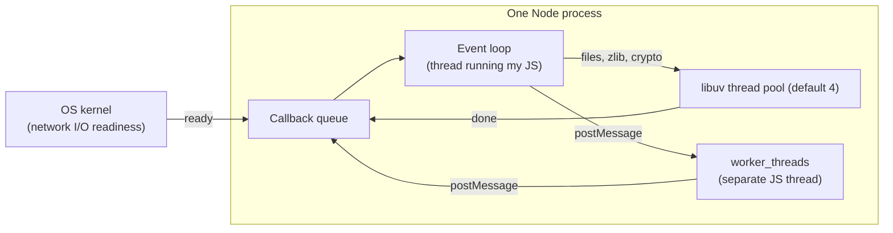

The difference between processes and threads boils down almost entirely to whether they share address space or use it separately; creation cost, context switch overhead, communication methods, and the scope of impact when one dies all follow from this distinction. For a broader view of the operating system, see [Overview](#/post/cs-os), so here we focus deeply on just these two concepts.

## What Processes Have

A program is merely a collection of instructions stored on disk; it becomes a process once the OS loads it into memory and executes it. OSTEP defines a process as "a running program" and states that to understand a process, one must examine its machine state. Machine state comprises accessible memory (address space), registers (including the program counter and stack pointer), and input/output information such as open files.

When the OS turns a program into a process, it performs specific actions: it loads code and static data into memory, allocates a stack to populate `main()` arguments (`argc`, `argv`), sets up I/O, and then jumps to `main()`. Modern OSes do not perform this all at once but instead load only the necessary pieces on demand, a method known as lazy loading. This topic leads to [Memory Management and Virtual Memory](#/post/os-memory).

The OS maintains a structure (PCB, Process Control Block) for each process, storing register values, state, and memory information.

## Process States

OSTEP describes process states in three categories:

| State | Meaning |
|---|---|
| Running | Executing instructions on the CPU |
| Ready | Runnable, but the OS has selected another process to run currently |
| Blocked | Waiting for I/O (e.g., disk read); cannot execute until that operation completes |

```
Ready --(스케줄러가 고름)--> Running --(I/O 요청)--> Blocked
Ready <--(시간이 다 됨)----- Running
Ready <--(I/O 끝남)--------- Blocked
```

The existence of a separate Blocked state is useful: assigning CPU time to a process waiting for I/O would be wasteful, so the OS can run other processes in the meantime. Deciding which process to promote to Running is the subject of [CPU Scheduling](#/post/os-scheduling). Real-world operating systems have more states than this (the textbook description is simplified).

## What Threads Have

In OSTEP, a thread is defined as "another execution point within a single process". With multiple threads, there are multiple program counters. Each thread maintains its own set of registers and shares the same address space to access the same data.

To summarize:

| | Between Processes | Between Threads in the Same Process |
|---|---|---|
| Address Space (Code, Heap, Global Variables) | Separate | Shared |
| Stack | Separate | Separate per thread |
| Registers / Program Counter | Separate | Separate per thread |
| Open Files | Separate (inheritance possible) | Shared |
| State Storage Location | PCB | TCB (Thread Control Block); multiple per process |

The reason the stack is separate for each thread is that function call records and local variables are stored there. If two threads shared a stack, their execution flows would become mixed. Thus, creating a thread results in an additional stack within the address space.

<details>
<summary>Threads can see global variables; processes cannot (execution verified)</summary>

We tested modifying a global variable `counter` from both a thread and a child process using Python 3.13 on Windows.

```python
import threading, multiprocessing as mp, os

counter = 0
def bump():
    global counter
    counter += 1

def child_bump(q):
    global counter
    counter += 100
    q.put(counter)

if __name__ == "__main__":
    t = threading.Thread(target=bump); t.start(); t.join()
    print("after thread: counter =", counter)
    q = mp.Queue()
    p = mp.Process(target=child_bump, args=(q,)); p.start()
    print("child saw", q.get()); p.join()
    print("after process: counter =", counter)
    print(mp.get_start_method())
```

The output was as follows:

```
after thread: counter = 1
child saw 100
after process: counter = 1
spawn
```

The value of 1 set by the thread was visible to the parent, while the increment of 100 made by the child process was visible only within the child. To receive results, we had to use a `Queue`. Processes must create separate channels (pipes, queues, sockets, shared memory, etc.) for such communication. [Sockets and WebSockets](#/post/net-socket) are examples of such channels.

The `spawn` at the end of the output aligns with Python documentation stating that this is the default startup method on Windows and macOS: the parent starts a new Python interpreter process, and the child inherits only the resources needed for `run()`. According to the documentation, `fork` is used only in POSIX environments, where the child starts in essentially the same state as the parent.
</details>

## Drawing the inside of the address space

Here is the "shared vs. separate" table as a picture. One process's address space is usually explained as four regions, listed here from low addresses up.

1. **Code (text) region**: the machine code to run. It's read-only, so when you launch the same program several times the OS can let them share one copy in physical memory.
2. **Data region**: global and `static` variables. It splits again into those with initial values (data) and those starting at zero (bss). They live until the program ends.
3. **Heap**: memory requested at runtime with `malloc` or `new`. Data whose size isn't known in advance goes here. By convention it's drawn growing upward.
4. **Stack**: every function call piles up local variables, parameters and the return address here. When the function returns, that slot is cleared right away. Drawn growing downward.



Threads share code, data and heap; each thread has its own stack and registers (including the program counter). The `counter` experiment above is exactly this picture. The global variable lives in the data region, so the value a thread changed was visible to the parent, while the child process has an entirely separate address space and couldn't see it.

The real layout is messier than the picture. Modern OSes randomize region start addresses on every run for security (ASLR), and thread stacks are placed separately somewhere between heap and stack. Use the picture only as a map of "what belongs where." How addresses turn into real memory is in [Memory Management and Virtual Memory](#/post/os-memory).

## Differences in Context Switching

OSTEP describes the process of switching from executing Process A to Process B on a single CPU as follows: When a timer interrupt occurs, hardware saves A's user registers to A's kernel stack and switches to kernel mode. If the OS decides to switch from A to B, the `switch()` routine saves A's kernel registers to A's process structure, restores B's registers, and updates the kernel stack to point to B's. Finally, a return-from-trap restores B's registers, allowing B to resume execution. The textbook notes that register saving occurs twice: once by hardware and once by software.

The transition between threads is almost the same process, but with one key difference: while saving T1's registers and restoring T2's registers remains unchanged, the address space stays intact, so there is no need to change the page table. This is the most significant distinction between process switching and thread switching as described in OSTEP.

Changing the address space is expensive because, as explained in [Memory Management and Virtual Memory](#/post/os-memory) and [Memory Hierarchy and Caching](#/post/ca-memory-hierarchy), the address translation information and data cached become useless for the new process. However, the measured costs vary depending on the environment. The textbook uses a tool called lmbench to measure these costs: on a 200MHz machine from 1996, context switching took about 6 microseconds, whereas modern machines running at 2–3 GHz achieve less than 1 microsecond.

## Cost of Creation

It's not just the transition that differs; creation also varies. Threads only require creating a stack and a TCB (Thread Control Block), whereas processes must prepare the entire address space. I measured this on my PC (Windows, Python 3.13) by repeatedly creating functions that do nothing as threads and processes, then waiting until they finish.

<details>
<summary>Creation Cost Comparison (Verified with Execution)</summary>

```python
import threading, multiprocessing as mp, time
def noop(): pass

if __name__ == "__main__":
    N = 100
    t0 = time.perf_counter()
    for _ in range(N):
        t = threading.Thread(target=noop); t.start(); t.join()
    th = (time.perf_counter() - t0) / N
    N2 = 20
    t0 = time.perf_counter()
    for _ in range(N2):
        p = mp.Process(target=noop); p.start(); p.join()
    pr = (time.perf_counter() - t0) / N2
    print(f"thread {th*1e6:.0f} us, process {pr*1e3:.1f} ms, ratio {pr/th:.0f}x")
```

After running it twice, the results were as follows:

```
thread 788 us, process 596.1 ms, ratio 757x
thread 1939 us, process 258.0 ms, ratio 133x
```

The numbers fluctuated significantly between runs. What can be stated with certainty is that processes are several orders of magnitude more expensive. The process value includes the time taken to spawn a new interpreter via `spawn`, so it does not reflect only the OS's process creation cost.
</details>

## Creating Processes in UNIX: fork, exec, wait

UNIX splits process creation into two calls. According to OSTEP, `fork()` creates a copy of the calling process (the child), and `exec()` overwrites the current process's code and static data with those from a different executable file. `exec()` does not create a new process but instead replaces the running program with another one; upon success, it does not return. `wait()` makes the parent wait until the child finishes.

Immediately after `fork()`, both the parent and child are executable, so it is undetermined which one prints first. The textbook explains that adding `wait()` makes the output order deterministic.

Why split it into two? Because the shell can insert code between `fork()` and `exec()`. Redirections like `wc p3.c > newfile.txt` are implemented by having the child close standard output and open `newfile.txt` before calling `exec()`. Since open file descriptors persist after `exec()`, `wc` runs without knowing whether its output is going to a file. This behavior also forms a foundational background for understanding process isolation in [Docker and Containers](#/post/cloud-docker).

## Reasons for Using Threads and Their Costs

The advantages of threads mentioned in OSTEP are parallel execution and the ability for a program to continue doing other work while waiting due to I/O. Sharing the same data makes such division of labor easy.

The cost is illustrated by a counter example from the same book. Code that increments a shared variable involves three steps in machine code: read, add, and write. If thread 1 reads the value, adds to it, and then switches before writing, while thread 2 reads and writes the same original value, the increment disappears when thread 1 resumes writing. This timing-dependent scenario is called a race condition, and the method to prevent it is mutual exclusion. For more details, see [Synchronization and Deadlock](#/post/os-sync-deadlock).

<details>
<summary>Switching between read and write causes the increment to disappear (Verified with Execution)</summary>

In Python 3.13, simply running `n += 1` does not reproduce the issue. Instead, I split the read and write operations and inserted `time.sleep(0)` between them to force a context switch, deliberately creating the switching scenario.

```python
import threading, time
n = 0
def inc(k, yield_):
    global n
    for _ in range(k):
        tmp = n
        if yield_: time.sleep(0)
        n = tmp + 1

for y in (False, True):
    n = 0
    ts = [threading.Thread(target=inc, args=(20000, y)) for _ in range(4)]
    [t.start() for t in ts]; [t.join() for t in ts]
    print("yield" if y else "plain", n, "expected 80000")

n = 0; lock = threading.Lock()
def inc2(k):
    global n
    for _ in range(k):
        with lock:
            tmp = n; time.sleep(0); n = tmp + 1
ts = [threading.Thread(target=inc2, args=(20000,)) for _ in range(4)]
[t.start() for t in ts]; [t.join() for t in ts]
print("locked", n)
```

```
plain 80000 expected 80000
yield 20134 expected 80000
locked 80000
```

By inserting the sleep call, the value dropped from the expected 80000 to 20134. Even with the same code, applying a lock ensures that the value remains 80000 despite the sleep call. The fact that 80000 was obtained without the sleep is not because the code is safe, but because no context switch occurred in between.
</details>

Conversely, processes have separated memory spaces, which reduces such issues, but to exchange data, channels must be created and copying costs incurred.

## One Observation in Python

There are cases where dividing CPU-intensive computations among four threads does not speed up execution. The Python documentation states that `multiprocessing` uses subprocesses instead of threads to avoid the Global Interpreter Lock (GIL), thereby allowing full utilization of multiple processors.

<details>
<summary>Sequential, Threaded, and Processed CPU Computations (Verified with Execution)</summary>

We measured the time taken to process the same calculation (sum of squares for 3 million numbers) four times. This PC has 24 logical cores.

```python
import threading, time, multiprocessing as mp, sys
def work(n):
    s = 0
    for i in range(n): s += i*i
    return s
N = 3_000_000
if __name__ == "__main__":
    t0 = time.perf_counter(); [work(N) for _ in range(4)]; seq = time.perf_counter() - t0
    ts = [threading.Thread(target=work, args=(N,)) for _ in range(4)]
    t0 = time.perf_counter(); [t.start() for t in ts]; [t.join() for t in ts]; th = time.perf_counter() - t0
    ps = [mp.Process(target=work, args=(N,)) for _ in range(4)]
    t0 = time.perf_counter(); [p.start() for p in ps]; [p.join() for p in ps]; pr = time.perf_counter() - t0
    print(f"seq {seq:.2f}s thread {th:.2f}s process {pr:.2f}s")
    print("gil enabled:", sys._is_gil_enabled())
```

```
seq 0.41s thread 0.38s process 0.23s
gil enabled: True
```

Threads performed almost identically to sequential execution, while processes were faster. Even though the process approach included the overhead of launching an interpreter, it was still quicker. The difference would widen further with longer computations. For I/O-bound tasks, threads are also beneficial.
</details>

## Multi-process or multi-thread?

When splitting work into several streams, you choose between launching several processes or keeping several threads inside one process. The differences so far, in one table:

| | Multi-process | Multi-thread |
|---|---|---|
| Memory | separate address spaces, uses more | one shared space, only stacks are added |
| Cost to create/switch | high (prepare address space, swap page tables) | low |
| Passing data | needs IPC, costs copying | directly via variables, but needs locks |
| When one dies | only that process dies | the whole process can go down |
| Typical bugs | communication protocol mistakes | race conditions, deadlocks |
| Security isolation | the OS enforces it | same memory, no isolation |
| Fits | mutually untrusted work, work that may crash, CPU-bound work (when there's a GIL like Python) | work that shares lots of data, work with lots of I/O waiting |

There's no single right answer, so real programs mix the two. The next two examples do.

## Real examples: Chrome and Node.js

### Chrome splits tabs into processes

Chrome is the classic multi-process program. According to the Chrome developer blog there's a process per role.

1. **Browser process**: the outer UI like the address bar, tabs and back button, plus managing the other processes. Privileged work such as files and network is done here or in separate service processes.
2. **Renderer process**: runs a web page's HTML, CSS and JavaScript. One per site (Site Isolation). Cross-site iframes also go to separate renderers.
3. **GPU process**: handles drawing in one place.
4. **Network/utility processes**: features like networking split out as services.



The reason for the split is two rows of the table above: "when one dies" and "security isolation." If one tab's page loops forever or crashes, only that renderer dies and the other tabs survive. Renderers run in a sandbox with minimal privileges, so even if a malicious page takes over a renderer, it can't directly read another site's memory or my files. The price is memory. Each process needs its own address space and base resources, and per the blog Chrome caps the number of processes based on the device's memory and CPU; when it hits the cap, it runs several tabs from the same site in one process. Open Chrome's task manager (Shift+Esc) and you can see these processes.

### Node.js starts with one thread and adds more when needed

Node.js starts from the other end. My JavaScript runs on a single thread by default.

1. **Event loop**: the one thread running JavaScript takes callbacks off a to-do queue one at a time. The official Node docs describe the loop in phases such as timers, pending callbacks, poll (I/O), check (`setImmediate`) and close callbacks. Network I/O is handed to the OS and only the "done" notice comes back, so like the `select` server in the [socket post](#/post/net-socket), one thread handles thousands of connections.
2. **libuv thread pool**: work the OS can't do asynchronously (file reads, some crypto, compression, `dns.lookup`) is done by a background thread pool. The default size is 4, changeable with `UV_THREADPOOL_SIZE`. So "Node is single-threaded" only applies to my JS code.
3. **cluster**: a module that runs the same server code as several processes to use every core. Per the official docs, the default on every platform except Windows is for the primary process to accept connections on the port and hand them to workers round-robin. Workers share no memory. It's multi-process.
4. **worker_threads**: more JavaScript threads inside one process. Each worker has its own event loop and exchanges messages with `postMessage`, and can also share memory via `SharedArrayBuffer`. The official docs say to use them for CPU-intensive JS, and that they don't help much with I/O.



<details>
<summary>Computation blocking the event loop vs. moving it to a worker (ran it)</summary>

I set a timer that fires every 100ms and computed Fibonacci 40 on the main thread and on a worker thread. Node 24 on Linux.

```js
const { Worker, isMainThread, parentPort, workerData } = require('node:worker_threads');
function fib(n) { return n < 2 ? n : fib(n - 1) + fib(n - 2); }

if (isMainThread) {
  const mode = process.argv[2];               // 'main' 또는 'worker'
  const t0 = Date.now();
  let ticks = 0;
  const iv = setInterval(() => ticks++, 100);  // 100ms마다 한 번씩 오면 정상
  const done = (r) => {
    clearInterval(iv);
    console.log(`${mode}: fib=${r}, ${Date.now() - t0}ms 동안 타이머 ${ticks}번`);
  };
  if (mode === 'main') {
    setTimeout(() => done(fib(40)), 0);       // 메인 스레드에서 계산
  } else {
    const w = new Worker(__filename, { workerData: 40 });
    w.on('message', done);                    // 워커 스레드에서 계산
  }
} else {
  parentPort.postMessage(fib(workerData));
}
```

```
main: fib=102334155, 830ms 동안 타이머 0번
worker: fib=102334155, 847ms 동안 타이머 8번
```

(`동안 타이머 N번` = "the timer fired N times during that.") While the main thread computed for 0.8 seconds, the timer never ran once. On a server, that means every request stalled for that long. Moved to a worker, the timer ran 8 times in the same span. The computation time itself is about the same. It didn't get faster; the event loop just stopped being blocked.

I also tried cluster. Two worker processes open a server on the same port 8124, and the primary sends 6 requests.

```js
const cluster = require('node:cluster');
const http = require('node:http');
if (cluster.isPrimary) {
  for (let i = 0; i < 2; i++) cluster.fork();
  // 둘 다 listening이 되면 fetch 6번 → 응답에 담긴 pid를 센다
} else {
  http.createServer((req, res) => res.end(String(process.pid))).listen(8124);
}
```

```
primary 185877 응답한 워커: { '185884': 3, '185885': 3 }
```

Two processes with different pids took 3 each. Several processes can share one port because the primary accepts the connections and passes them on.

</details>

## How processes talk to each other (IPC)

Processes have separate address spaces, so they have to talk through channels the OS provides. That's IPC (inter-process communication). Only the common ones:

| Method | How | Where you see it |
|---|---|---|
| **Pipe** | a byte channel: one side writes, the other reads. Anonymous pipes are between parent and child | shell `ls \| grep`, Python `multiprocessing.Pipe` |
| **Named pipe (FIFO)** | a pipe with a name in the file system, so unrelated processes can connect | simple local integration |
| **Message queue** | put and take bounded messages | POSIX message queues, `multiprocessing.Queue` (a pipe + serialization inside) |
| **Shared memory** | the same physical memory attached to two address spaces. No copying, so fastest | large data, but you handle synchronization (locks, semaphores) yourself |
| **Socket** | the same API as networking. Unix domain sockets on the same machine | DB connections, same code across machines |
| **Signal** | a notice that's just a number (e.g., SIGTERM, "please exit") | `kill`, Ctrl+C |
| **Memory-mapped file** | map a file into address spaces so several processes read and write it | sharing large files |

Rough rule: a byte stream, use a pipe; message units, a queue; big, frequently changing data, shared memory; might move to another machine later, start with sockets. Worth remembering: the moment you use shared memory, the race conditions we saw with threads come right back between processes. The IPC arrows in the Chrome picture and the communication between cluster's primary and workers are all built on this list.

## Common Misconceptions

- Threads are just lightweight processes: Sharing address space changes safety and communication mechanisms; being "lightweight" is a consequence of this.
- Processes are always slower than threads: While creation and context switching are expensive, processes may be the right choice when isolation and core utilization are needed (as seen in the CPU computation experiment above).
- `fork()` runs a new program: It only creates a copy; to run a different program, you use `exec()`.
- Increasing threads always speeds things up: Beyond the number of cores, context switching increases, and locks become necessary for shared data.
- Blocked processes hold onto the CPU while waiting: During wait states, the CPU is assigned to other processes.
- Chrome is one process per tab: the unit is closer to the site than the tab. Cross-site iframes get their own process, and when the process count hits its cap, same-site tabs may share one.
- Node.js is fully single-threaded: only the thread running my JS is single; file I/O and the like run on the libuv thread pool. You can add JS threads with `worker_threads`.
- `worker_threads` speeds up I/O: the official docs say they're for CPU work. I/O is already handled without blocking the event loop.

## Core concepts you should be able to explain yourself

1. **Process and thread**: a process is a running program with its own address space. A thread is an execution flow inside it that shares that address space.
2. **Memory regions**: code, data and heap are shared among threads; stack and registers are per thread. Locals on the stack, globals in data, things made with `new` on the heap.
3. **Context switching**: saving and restoring registers. A process switch also swaps the address space (page tables), so it costs more.
4. **fork / exec / wait**: make a copy, change into another program, wait for it to finish.
5. **Race condition**: when several threads read and write shared data at once, the result depends on timing. Locks prevent it.
6. **Multi-process vs multi-thread**: isolation and stability, or lightness and easy sharing. Chrome split into processes for isolation.
7. **Node event loop and scaling**: JS runs callbacks one by one on one thread. CPU work goes to `worker_threads`; using all cores is `cluster` (multiple processes).
8. **IPC**: pipes, message queues, shared memory, sockets, signals. Shared memory is fast but synchronization is on you.

## Reference Links

- OSTEP, The Abstraction: The Process: https://pages.cs.wisc.edu/~remzi/OSTEP/cpu-intro.pdf
- OSTEP, Interlude: Process API: https://pages.cs.wisc.edu/~remzi/OSTEP/cpu-api.pdf
- OSTEP, Mechanism: Limited Direct Execution: https://pages.cs.wisc.edu/~remzi/OSTEP/cpu-mechanisms.pdf
- OSTEP, Concurrency: An Introduction: https://pages.cs.wisc.edu/~remzi/OSTEP/threads-intro.pdf
- Python documentation, multiprocessing: https://docs.python.org/3/library/multiprocessing.html
- Chrome for Developers, Inside look at modern web browser (part 1): https://developer.chrome.com/blog/inside-browser-part1
- Chromium, Multi-process Architecture: https://www.chromium.org/developers/design-documents/multi-process-architecture/
- Chromium, Site Isolation: https://www.chromium.org/Home/chromium-security/site-isolation/
- Node.js docs, The Node.js Event Loop: https://nodejs.org/en/learn/asynchronous-work/event-loop-timers-and-nexttick
- Node.js docs, Cluster: https://nodejs.org/api/cluster.html
- Node.js docs, Worker threads: https://nodejs.org/api/worker_threads.html
- Linux man-pages, pipe(7) · shm_overview(7) · unix(7): https://man7.org/linux/man-pages/man7/pipe.7.html

Further reading (well-illustrated Korean posts on the same topic)

- Inpa Dev, Process vs. thread, fully explained: https://inpa.tistory.com/entry/%F0%9F%91%A9%E2%80%8D%F0%9F%92%BB-%ED%94%84%EB%A1%9C%EC%84%B8%EC%8A%A4-%E2%9A%94%EF%B8%8F-%EC%93%B0%EB%A0%88%EB%93%9C-%EC%B0%A8%EC%9D%B4
- Inpa Dev, Multi-process vs. multi-thread compared: https://inpa.tistory.com/entry/%F0%9F%91%A9%E2%80%8D%F0%9F%92%BB-multi-process-multi-thread
- Inpa Dev, Do more threads always mean better performance?: https://inpa.tistory.com/entry/%F0%9F%91%A9%E2%80%8D%F0%9F%92%BB-Is-more-threads-always-better

← Concept map (#/post/cs-map)

Related posts: [CPU Scheduling](#/post/os-scheduling) · [Synchronization and Deadlock](#/post/os-sync-deadlock) · [Memory Management and Virtual Memory](#/post/os-memory)