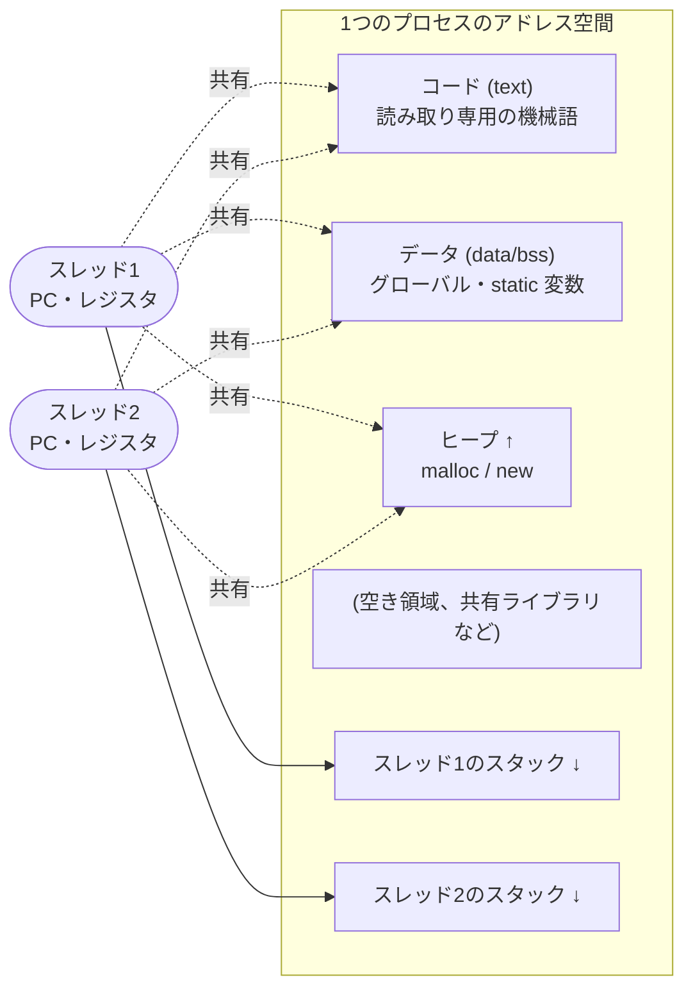
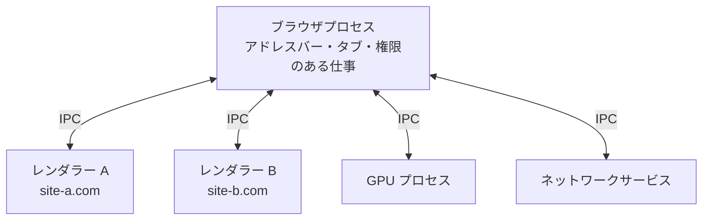
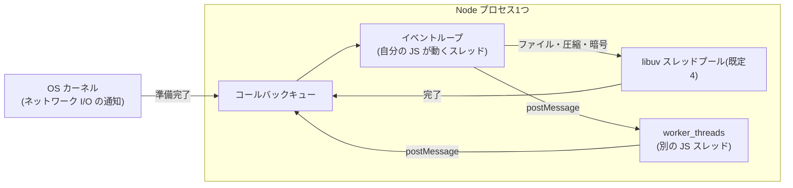

プロセスとスレッドの違いは、アドレス空間を共有するか別々に使うかという点でほぼ整理できます。生成コスト、切り替えコスト、通信方法、片方が終了した際の被害範囲などはすべてそこから派生します。OS の全体像については [概要](#/post/cs-os) にあるので、ここではこの 2 つに焦点を当てて深く見ていきます。

## プロセスが持つもの

プログラムはディスク上の命令の塊であり、OS がそれをメモリ上に展開して実行させるとプロセスになります。OSTEP はプロセスを「実行中のプログラム」と定義しており、プロセスを理解するにはマシン状態を見る必要があると述べています。マシン状態とは、アクセス可能なメモリ（アドレス空間）、レジスタ（プログラムカウンタ、スタックポインタを含む）、オープンされたファイルなどの入出力情報です。

OS がプログラムをプロセスに変える際に行う作業も決まっています。コードと静的データをメモリ上に展開し、スタックを割り当てて `main()` の引数 (argc, argv) を埋め、入出力設定を行った後、`main()` にジャンプします。現代の OS はこれを一度にではなく、必要な分だけをその都度読み込む方式（lazy loading）をとります。こちらは [メモリ管理と仮想メモリ](#/post/os-memory) につながります。

OS はプロセスごとに情報をまとめた構造体（PCB: プロセス制御ブロック）を一つずつ持っています。レジスタ値、状態、メモリ情報がそこに格納されます。

## プロセスの状態

OSTEP では状態を 3 つに説明しています。

| 状態 | 意味 |
|---|---|
| Running | CPU で命令を実行中 |
| Ready | 実行可能だが、OS は現在他のプロセスを選んでいる |
| Blocked | ディスク読み取りなどの I/O を開始しており、その完了まで実行できない |

```
Ready --(스케줄러가 고름)--> Running --(I/O 요청)--> Blocked
Ready <--(시간이 다 됨)----- Running
Ready <--(I/O 끝남)--------- Blocked
```

Blocked が独立して存在する理由は有用です。I/O を待機しているプロセスに CPU を割り当てるのは無駄なので、その間他のプロセスを回すことができます。誰を Running 状態にするかは [CPU スケジューリング](#/post/os-scheduling) のテーマです。実際の OS ではこのほかに状態がさらに多く存在します（教科書の説明も単純化されたものです）。

## スレッドが持つもの

OSTEP ではスレッドは「プロセス内の別の実行点」と定義されます。スレッドが複数あるとプログラムカウンタも複数になります。各スレッドは独自のレジスタセットを持ち、同じアドレス空間を共有して同じデータにアクセスします。

まとめると以下のようになります。

| | プロセス同士 | 同じプロセス内のスレッド同士 |
|---|---|---|
| アドレス空間（コード・ヒープ・グローバル変数） | 別々 | 共有 |
| スタック | 別々 | スレッドごとに別々 |
| レジスタ・プログラムカウンタ | 別々 | スレッドごとに別々 |
| オープンされたファイル | 別々（継承は可能） | 共有 |
| 状態を記録する場所 | PCB | TCB（スレッド制御ブロック）、プロセスあたり複数 |

スタックがスレッドごとに別々の理由は、関数呼び出しの履歴とローカル変数がそこに蓄積されるためです。2 つのスレッドがスタックを共有すると互いの呼び出しフローが混ざってしまいます。そのためスレッドを作成すると、アドレス空間内にスタックが一つずつ追加されます。

<details>
<summary>同じ変数をスレッドは見てプロセスは見えない（実行確認済み）</summary>

グローバル変数 `counter` をスレッドと子プロセスでそれぞれ操作しました。Windows で Python 3.13 を使用して実行しました。

```python
import threading, multiprocessing as mp, os

counter = 0
def bump():
    global counter
    counter += 1

def child_bump(q):
    global counter
    counter += 100
    q.put(counter)

if __name__ == "__main__":
    t = threading.Thread(target=bump); t.start(); t.join()
    print("after thread: counter =", counter)
    q = mp.Queue()
    p = mp.Process(target=child_bump, args=(q,)); p.start()
    print("child saw", q.get()); p.join()
    print("after process: counter =", counter)
    print(mp.get_start_method())
```

出力は以下の通りでした。

```
after thread: counter = 1
child saw 100
after process: counter = 1
spawn
```

スレッドが書き込んだ 1 は親プロセス側で確認できましたが、子プロセスが 100 を足した部分は子プロセス内でのみ表示されました。結果を受け取るために `Queue` を使う必要がありました。プロセス同士はこのようにパイプ、キュー、ソケット、共有メモリなどの通路を別途作る必要があります。[ソケットと Web ソケット](#/post/net-socket) もそのような通路の一つです。

出力最後の `spawn` は、Python のドキュメントが Windows と macOS のデフォルトの起動方式として記載していることと一致します。この方式では親プロセスが新しい Python インタープリタプロセスを開始し、子プロセスは `run()` に必要なリソースのみを継承します。ドキュメントによると `fork` は POSIX 環境でのみ使用され、子プロセスは親プロセスと実質的に同じ状態で開始されます。
</details>

## アドレス空間の中を描いてみる

表で見た「共有する/別々に持つ」を図にするとこうなります。1つのプロセスのアドレス空間は、普通4つの領域に分けて説明します。低いアドレスから順に書きました。

1. **コード (text) 領域**: 実行する機械語。読み取り専用なので、同じプログラムを何度も起動すると OS は物理メモリ1つ分を共有させられます。
2. **データ領域**: グローバル変数と `static` 変数。初期値のあるもの (data) と0で始まるもの (bss) にさらに分かれます。プログラムが終わるまで生きています。
3. **ヒープ (heap)**: 実行中に `malloc` や `new` で要求したメモリ。サイズが事前に分からないデータがここに入ります。上に向かって伸びるように描くのが慣例です。
4. **スタック (stack)**: 関数を呼ぶたびにローカル変数、引数、戻り先アドレスを積む場所。関数が終わるとその枠はすぐ片付けられます。下に向かって伸びるように描きます。



スレッドが共有するのはコード、データ、ヒープで、スレッドごとに別々なのはスタックとレジスタ(プログラムカウンタを含む)です。前の `counter` 実験はこの図そのままです。グローバル変数はデータ領域にあるので、スレッドが変えた値は親から見え、子プロセスはアドレス空間が丸ごと別なので見えませんでした。

実際の配置はこの図より複雑です。最近の OS はセキュリティのために領域の開始アドレスを実行ごとにばらし (ASLR)、スレッドのスタックはヒープとスタックの間のどこかに別に確保されます。図は「何がどこに属するか」を見る地図としてだけ使えば十分です。アドレスが実メモリにどう変換されるかは [メモリ管理と仮想メモリ](#/post/os-memory) にあります。

## コンテキストスイッチングで変わる点

CPU がプロセス A を実行しているのを B に切り替える過程について、OSTEP は以下のように説明しています。タイマー割り込みが発生すると、ハードウェアが A のユーザーレジスタを A のカーネルスタックに保存し、カーネルモードに入ります。OS が A から B に切り替えることを決定すると、`switch()` ルーチンが A のカーネルレジスタを A のプロセス構造体に保存し、B のものを復元し、カーネルスタックを B のものに切り替えます。最後に return-from-trap で B のレジスタが復元され、B が実行されます。教科書ではレジスタの保存が 2 回（ハードウェアによる 1 回、ソフトウェアによる 1 回）行われることを指摘しています。

スレッド間の切り替えはほぼ同じプロセスですが、1 つの違いがあります。T1 のレジスタを保存し T2 のレジスタを復元する点は同じですが、アドレス空間がそのまま残るためページテーブルを変更する必要がありません。OSTEP が述べているプロセス切り替えとスレッド切り替えの最大の違い就在这里です。

アドレス空間を変更すると高価になる理由は、[メモリ管理と仮想メモリ](#/post/os-memory) と [メモリ階層とキャッシュ](#/post/ca-memory-hierarchy) を読むことで理解できます。アドレス変換情報やキャッシュに保持されていたデータが新しいプロセスには役に立たなくなるためです。ただし、このコストを実測した数値は環境によって異なります。教科書では lmbench というツールで測定しており、1996 年の 200MHz マシンではコンテキストスイッチが約 6 マイクロ秒だったのに対し、現代のマシンでは 2〜3GHz で 1 マイクロ秒未満になるとされています。

## 作成コスト

切り替えだけでなく、作成も異なります。スレッドはスタックと TCB（タスク制御ブロック）程度で作れば済みますが、プロセスはアドレス空間全体を準備する必要があります。私の PC（Windows, Python 3.13）で何もしない関数をスレッドとして、プロセスとしてそれぞれ作成し、終了まで待って測定しました。

<details>
<summary>作成コストの比較（実行確認済み）</summary>

```python
import threading, multiprocessing as mp, time
def noop(): pass

if __name__ == "__main__":
    N = 100
    t0 = time.perf_counter()
    for _ in range(N):
        t = threading.Thread(target=noop); t.start(); t.join()
    th = (time.perf_counter() - t0) / N
    N2 = 20
    t0 = time.perf_counter()
    for _ in range(N2):
        p = mp.Process(target=noop); p.start(); p.join()
    pr = (time.perf_counter() - t0) / N2
    print(f"thread {th*1e6:.0f} us, process {pr*1e3:.1f} ms, ratio {pr/th:.0f}x")
```

2 回実行した結果がこちらです。

```
thread 788 us, process 596.1 ms, ratio 757x
thread 1939 us, process 258.0 ms, ratio 133x
```

実行ごとに数値が大きく変動しました。確実に言えるのは、プロセス側が桁違いに高かったということです。このプロセスの値には `spawn` が新しいインタプリタを起動する時間が含まれており、OS のプロセス作成コストだけの数値ではありません。
</details>

## UNIX のプロセス作成：fork, exec, wait

UNIX はプロセスを作成する際に呼び出しを 2 つに分けます。OSTEP の説明では、`fork()` が呼び出したプロセスのコピー（子プロセス）を作成し、`exec()` が現在のプロセスのコードと静的データを別の実行ファイルで上書きします。`exec()` は新しいプロセスを作成せず、実行中のプログラムを別のプログラムに置き換え、成功すると戻りません。`wait()` は親プロセスが子が終了するまで待ちます。

`fork()` の直後は親と子両方が実行可能であるため、どちらが先に出力するかは決まっていません。教科書では `wait()` を入れることで出力順序が決定的になると説明しています。

なぜわざわざ 2 つに分けたのでしょうか。シェルが `fork()` と `exec()` の間にコードを挿入できるからです。`wc p3.c > newfile.txt` などのリダイレクトは、子が `exec()` 前に標準出力を閉じ、`newfile.txt` を開くことで実装されます。開いたファイルディスクリプターは `exec()` の後も維持されるため、`wc` は自分の出力がファイルに行くのかどうか知らないまま動きます。この動作は [Docker とコンテナ](#/post/cloud-docker) などのプロセス隔離を理解する際の基本的な背景知識となります。

## スレッドを使う理由と代償

OSTEP が挙げるスレッドの利点は並列実行と、I/O で止まっている間もプログラムが他の作業を続けられる点です。同じデータを共有するため、このような分担は容易です。

代償は同じ書のカウンター例で示されています。共有変数に 1 を加えるコードはアセンブリ言語では読み込み、加算、書き込みの 3 ステップです。スレッド 1 が値を読み、加算した後、書き込み直前に切り替えられてスレッド 2 が同じ値を読み書きすると、スレッド 1 が続きで書き込む際に増加分が失われます。このような実行タイミングに依存する状況を競合状態（race condition）と呼び、防ぐ方法は相互排他です。詳細は [同期とデッドロック](#/post/os-sync-deadlock) に譲ります。

<details>
<summary>読み書きの間に切り替えが入ると増加分が消える（実行確認済み）</summary>

Python 3.13 で単に `n += 1` を回すと問題が再現しませんでした。代わりに読み書きを分け、その間に `time.sleep(0)` で CPU を譲るようにして、意図的に切り替えが入る状況を作りました。

```python
import threading, time
n = 0
def inc(k, yield_):
    global n
    for _ in range(k):
        tmp = n
        if yield_: time.sleep(0)
        n = tmp + 1

for y in (False, True):
    n = 0
    ts = [threading.Thread(target=inc, args=(20000, y)) for _ in range(4)]
    [t.start() for t in ts]; [t.join() for t in ts]
    print("yield" if y else "plain", n, "expected 80000")

n = 0; lock = threading.Lock()
def inc2(k):
    global n
    for _ in range(k):
        with lock:
            tmp = n; time.sleep(0); n = tmp + 1
ts = [threading.Thread(target=inc2, args=(20000,)) for _ in range(4)]
[t.start() for t in ts]; [t.join() for t in ts]
print("locked", n)
```

```
plain 80000 expected 80000
yield 20134 expected 80000
locked 80000
```

譲りを入れると本来 80000 になる値が 20134 に落ちました。同じコードにロックをかけると譲りが入っても 80000 が出ます。譲りなしで 80000 が出たのはコードが安全だからではなく、その間に切り替えが入らなかったためです。
</details>

逆にプロセスはメモリが分離しているためこのような問題は減りますが、データをやり取りするには経路を作り、複製コストを支払う必要があります。

## Python で見られる 1 つの事例

CPU を長く使う計算をスレッド 4 つに分けても速くならない場合があります。Python のドキュメントでは `multiprocessing` がスレッドではなくサブプロセスを使い、グローバルインタプリタロック（GIL）を回避し、そのため複数のプロセッサを完全に使えると記載されています。

<details>
<summary>CPU 計算を順次・スレッド・プロセスで（実行確認済み）</summary>

同じ計算（300 万回の二乗和）を 4 回処理する時間を計測した。この PC は論理コアが 24 個ある。

```python
import threading, time, multiprocessing as mp, sys
def work(n):
    s = 0
    for i in range(n): s += i*i
    return s
N = 3_000_000
if __name__ == "__main__":
    t0 = time.perf_counter(); [work(N) for _ in range(4)]; seq = time.perf_counter() - t0
    ts = [threading.Thread(target=work, args=(N,)) for _ in range(4)]
    t0 = time.perf_counter(); [t.start() for t in ts]; [t.join() for t in ts]; th = time.perf_counter() - t0
    ps = [mp.Process(target=work, args=(N,)) for _ in range(4)]
    t0 = time.perf_counter(); [p.start() for p in ps]; [p.join() for p in ps]; pr = time.perf_counter() - t0
    print(f"seq {seq:.2f}s thread {th:.2f}s process {pr:.2f}s")
    print("gil enabled:", sys._is_gil_enabled())
```

```
seq 0.41s thread 0.38s process 0.23s
gil enabled: True
```

スレッドは順次処理とほぼ同じ時間だったが、プロセスの方が速かった。計算時間がさらに長ければ、その差はより大きくなるだろう。I/O を待機する場合は、スレッドも役立つ。
</details>

## マルチプロセスか、マルチスレッドか

仕事をいくつかの流れに分けるとき、プロセスを複数立ち上げるか、1つのプロセスの中にスレッドを複数置くかを選ぶ必要があります。ここまでの違いを1つの表にまとめるとこうです。

| | マルチプロセス | マルチスレッド |
|---|---|---|
| メモリ | それぞれのアドレス空間、多く使う | 1つを分け合い、スタックだけ追加 |
| 作成・切り替えコスト | 大きい(アドレス空間の準備、ページテーブルの交換) | 小さい |
| データのやり取り | IPC が必要でコピーのコストがかかる | 変数で直接、代わりにロックが必要 |
| 1つが落ちたら | そのプロセスだけ落ちる | 同じプロセス全体が落ちうる |
| よくあるバグ | 通信プロトコルのミス | 競合状態、デッドロック |
| セキュリティ隔離 | OS が守ってくれる | 同じメモリなので隔離なし |
| 向いている仕事 | 互いに信頼しない処理、落ちてもいい処理、CPU 計算(Python のように GIL があるとき) | データを多く共有する処理、I/O 待ちが多い処理 |

正解は1つではありません。なので実際のプログラムは両方を混ぜます。次の2つの例がそうです。

## 実例: Chrome と Node.js

### Chrome はタブをプロセスに分ける

Chrome は代表的なマルチプロセスのプログラムです。Chrome 開発者ブログの説明では、役割ごとにプロセスが分かれています。

1. **ブラウザプロセス**: アドレスバー、タブ、戻るボタンなど外側の画面と、他のプロセスの管理。ファイル・ネットワークのような権限のある仕事は、ここか別のサービスプロセスが担当します。
2. **レンダラープロセス**: ウェブページの HTML、CSS、JavaScript を実行します。サイトごとに別に立ち上げます (Site Isolation)。別サイトの iframe も別のレンダラーに行きます。
3. **GPU プロセス**: 画面の描画を1か所で処理します。
4. **ネットワーク・ユーティリティプロセス**: ネットワークなどの機能をサービスとして切り出したもの。



こう分けた理由は、上の表の「1つが落ちたら」と「セキュリティ隔離」の2行です。あるタブのページが無限ループに陥ったり落ちたりしても、そのレンダラーだけが落ちて他のタブは生きています。レンダラーは権限を最小にしたサンドボックスの中で動くので、悪意のあるページがレンダラーを乗っ取っても、他のサイトのメモリや私のファイルをすぐには読めません。代償はメモリです。プロセスごとにアドレス空間と基本リソースが別にかかるので、ブログの説明では、Chrome は端末のメモリと CPU に合わせてプロセス数に上限を設け、上限に達すると同じサイトの複数のタブを1つのプロセスで動かします。Chrome のタスクマネージャー (Shift+Esc) を開くと、これらのプロセスが実際に見えます。

### Node.js は1スレッドで始めて、必要なときに増やす

Node.js は反対側から出発します。自分の JavaScript コードは既定で1つのスレッドで動きます。

1. **イベントループ**: JavaScript を実行する1つのスレッドが「やることキュー」からコールバックを1つずつ取り出して実行します。Node の公式ドキュメントは、ループを timers、pending callbacks、poll (I/O)、check (`setImmediate`)、close callbacks といったフェーズで説明しています。ネットワーク I/O は OS に任せて終わったという通知だけを受け取るので、[ソケットの記事](#/post/net-socket) の `select` サーバーのように、1スレッドで数千の接続を扱えます。
2. **libuv スレッドプール**: OS が非同期でやってくれない仕事(ファイル読み込み、一部の暗号処理、圧縮、`dns.lookup`)は裏でスレッドプールが処理します。既定サイズは4で、`UV_THREADPOOL_SIZE` で変えられます。なので「Node はシングルスレッド」は自分の JS コードに限った話です。
3. **cluster**: 同じサーバーコードを複数のプロセスで立ち上げてコアを全部使うモジュールです。公式ドキュメントによると、Windows 以外の既定は、プライマリプロセスがポートで接続を受けてワーカーにラウンドロビンで配る方式です。ワーカー同士はメモリを共有しません。マルチプロセスです。
4. **worker_threads**: 1つのプロセスの中に JavaScript のスレッドを追加します。各ワーカーは自分のイベントループを持ち、`postMessage` でメッセージをやり取りし、`SharedArrayBuffer` でメモリを共有することもできます。公式ドキュメントは CPU を多く使う JS の処理に使うよう勧め、I/O の処理にはあまり役立たないと書いています。



<details>
<summary>計算がイベントループを止める場合とワーカーに移した場合 (実行確認)</summary>

100ms ごとに動くタイマーをかけておき、フィボナッチ40をメインスレッドとワーカースレッドでそれぞれ計算しました。Node 24、Linux で実行しました。

```js
const { Worker, isMainThread, parentPort, workerData } = require('node:worker_threads');
function fib(n) { return n < 2 ? n : fib(n - 1) + fib(n - 2); }

if (isMainThread) {
  const mode = process.argv[2];               // 'main' 또는 'worker'
  const t0 = Date.now();
  let ticks = 0;
  const iv = setInterval(() => ticks++, 100);  // 100ms마다 한 번씩 오면 정상
  const done = (r) => {
    clearInterval(iv);
    console.log(`${mode}: fib=${r}, ${Date.now() - t0}ms 동안 타이머 ${ticks}번`);
  };
  if (mode === 'main') {
    setTimeout(() => done(fib(40)), 0);       // 메인 스레드에서 계산
  } else {
    const w = new Worker(__filename, { workerData: 40 });
    w.on('message', done);                    // 워커 스레드에서 계산
  }
} else {
  parentPort.postMessage(fib(workerData));
}
```

```
main: fib=102334155, 830ms 동안 타이머 0번
worker: fib=102334155, 847ms 동안 타이머 8번
```

(`동안 타이머 N번` は「その間にタイマーが N 回動いた」という意味です。)メインで計算した0.8秒の間、タイマーは一度も動けませんでした。サーバーなら、その間すべてのリクエストが止まっていたということです。ワーカーに移すと、同じ時間にタイマーが8回動きました。計算時間そのものはほぼ同じです。速くなったのではなく、イベントループが止まらなくなったのです。

cluster も動かしてみました。ワーカープロセス2つが同じ8124番ポートでサーバーを開き、プライマリプロセスがリクエストを6つ送りました。

```js
const cluster = require('node:cluster');
const http = require('node:http');
if (cluster.isPrimary) {
  for (let i = 0; i < 2; i++) cluster.fork();
  // 둘 다 listening이 되면 fetch 6번 → 응답에 담긴 pid를 센다
} else {
  http.createServer((req, res) => res.end(String(process.pid))).listen(8124);
}
```

```
primary 185877 응답한 워커: { '185884': 3, '185885': 3 }
```

pid の違う2つのプロセスが3回ずつ分けて受けました。1つのポートを複数のプロセスで共有できるのは、プライマリプロセスが接続を受けて渡しているからです。

</details>

## プロセス同士が話す方法 (IPC)

プロセスはアドレス空間が分かれているので、OS が用意した通路で話す必要があります。これを IPC (プロセス間通信) と呼びます。よく見るものだけ絞りました。

| 方法 | 仕組み | 使われる場所 |
|---|---|---|
| **パイプ** | 片方が書くともう片方が読むバイトの通路。名前のないパイプは親子の間 | シェルの `ls \| grep`、Python の `multiprocessing.Pipe` |
| **名前付きパイプ (FIFO)** | ファイルシステムに名前があるパイプ。無関係なプロセス同士もつなげる | 簡単なローカル連携 |
| **メッセージキュー** | 境界のあるメッセージ単位で入れて取り出す | POSIX メッセージキュー、`multiprocessing.Queue`(中身はパイプ+シリアライズ) |
| **共有メモリ** | 同じ物理メモリを2つのアドレス空間に付ける。コピーがないので最速 | 大容量データ、代わりに同期(ロック・セマフォ)は自分で |
| **ソケット** | ネットワークと同じ API。同じマシンなら Unix ドメインソケット | DB 接続、別のマシンとも同じコード |
| **シグナル** | 番号1つだけの通知(例: 終了を求める SIGTERM) | `kill`、Ctrl+C |
| **メモリマップトファイル** | ファイルをアドレス空間にマップして複数で読み書き | 大きなファイルの共有 |

選ぶ基準はだいたいこうです。バイトの流れならパイプ、メッセージ単位ならキュー、大きくて頻繁に変わるデータなら共有メモリ、あとで別のマシンに移るかもしれないなら最初からソケット。共有メモリを使った瞬間、スレッドで見た競合状態がプロセス間でそのまま戻ってくる点は覚えておく価値があります。前の Chrome の図でプロセスをつなぐ IPC の矢印も、cluster のプライマリとワーカー間の通信も、すべてこのリストの上に作られています。

## よくある誤解

- スレッドは軽いプロセスに過ぎない：アドレス空間を共有するという違いが、安全性と通信方式を変化させる。「軽い」というのはその結果である。
- プロセスは常にスレッドより遅い：生成や切り替えは高価だが、隔離やコアの活用が必要であれば、プロセスを選ぶべき場合もある（上記の CPU 計算実験参照）。
- `fork()` は新しいプログラムを実行する：コピーを作成するだけで、別のプログラムを動かすのは `exec()` の役割である。
- スレッドを増やせば速くなる：コア数を超えると切り替えが増え、共有データにはロックが必要になる。
- Blocked（ブロック）されたプロセスが CPU を占有して待機している：待機中は CPU は他のプロセスに割り当てられる。
- Chrome はタブ1つにプロセス1つ: 基準はタブよりサイトに近いです。別サイトの iframe は別プロセスに行き、プロセス数が上限に達すると同じサイトのタブ同士で1つのプロセスを使うこともあります。
- Node.js は完全なシングルスレッド: 自分の JS コードが動くスレッドが1つなだけで、ファイル I/O などは libuv スレッドプールが処理します。`worker_threads` で JS スレッドも増やせます。
- `worker_threads` を使うと I/O が速くなる: 公式ドキュメントは CPU 処理用と書いています。I/O はもともとイベントループを止めずに処理されます。

## 自分で説明できるべき核心概念

1. **プロセスとスレッド**: プロセスは実行中のプログラムで、自分のアドレス空間を持ちます。スレッドはその中の実行の流れで、アドレス空間を共有します。
2. **メモリ領域**: コード・データ・ヒープはスレッド間で共有、スタックとレジスタはスレッドごとに別。ローカル変数はスタック、グローバル変数はデータ、`new` で作ったものはヒープ。
3. **コンテキストスイッチ**: レジスタを保存・復元すること。プロセスの切り替えはアドレス空間(ページテーブル)まで替えるので、より高くつきます。
4. **fork / exec / wait**: コピーを作り、別のプログラムに着替え、終わるのを待つ。
5. **競合状態**: 共有データを複数のスレッドが同時に読み書きすると、タイミングで結果が変わります。ロックで防ぎます。
6. **マルチプロセス vs マルチスレッド**: 隔離と安定性か、軽さと共有のしやすさか。Chrome は隔離のためにプロセスを分けました。
7. **Node のイベントループと拡張**: JS は1つのスレッドでコールバックを順に回します。CPU 計算は `worker_threads`、コア全体の活用は `cluster`(複数プロセス)。
8. **IPC**: パイプ、メッセージキュー、共有メモリ、ソケット、シグナル。共有メモリは速いけれど同期は自分の責任です。

## 根拠となるリンク

- OSTEP, The Abstraction: The Process: https://pages.cs.wisc.edu/~remzi/OSTEP/cpu-intro.pdf
- OSTEP, Interlude: Process API: https://pages.cs.wisc.edu/~remzi/OSTEP/cpu-api.pdf
- OSTEP, Mechanism: Limited Direct Execution: https://pages.cs.wisc.edu/~remzi/OSTEP/cpu-mechanisms.pdf
- OSTEP, Concurrency: An Introduction: https://pages.cs.wisc.edu/~remzi/OSTEP/threads-intro.pdf
- Python ドキュメント、multiprocessing: https://docs.python.org/3/library/multiprocessing.html
- Chrome for Developers, Inside look at modern web browser (part 1): https://developer.chrome.com/blog/inside-browser-part1
- Chromium, Multi-process Architecture: https://www.chromium.org/developers/design-documents/multi-process-architecture/
- Chromium, Site Isolation: https://www.chromium.org/Home/chromium-security/site-isolation/
- Node.js ドキュメント, The Node.js Event Loop: https://nodejs.org/en/learn/asynchronous-work/event-loop-timers-and-nexttick
- Node.js ドキュメント, Cluster: https://nodejs.org/api/cluster.html
- Node.js ドキュメント, Worker threads: https://nodejs.org/api/worker_threads.html
- Linux man-pages, pipe(7) · shm_overview(7) · unix(7): https://man7.org/linux/man-pages/man7/pipe.7.html

参考(同じテーマを図で分かりやすくまとめた韓国語の記事)

- Inpa Dev, プロセス vs スレッドの概念を完全理解: https://inpa.tistory.com/entry/%F0%9F%91%A9%E2%80%8D%F0%9F%92%BB-%ED%94%84%EB%A1%9C%EC%84%B8%EC%8A%A4-%E2%9A%94%EF%B8%8F-%EC%93%B0%EB%A0%88%EB%93%9C-%EC%B0%A8%EC%9D%B4
- Inpa Dev, マルチプロセス vs マルチスレッド比較: https://inpa.tistory.com/entry/%F0%9F%91%A9%E2%80%8D%F0%9F%92%BB-multi-process-multi-thread
- Inpa Dev, スレッドを増やすほど常に速くなるか?: https://inpa.tistory.com/entry/%F0%9F%91%A9%E2%80%8D%F0%9F%92%BB-Is-more-threads-always-better

← 概念図へ (#/post/cs-map)

関連記事：[CPU スケジューリング](#/post/os-scheduling) · [同期とデッドロック](#/post/os-sync-deadlock) · [メモリ管理と仮想メモリ](#/post/os-memory)