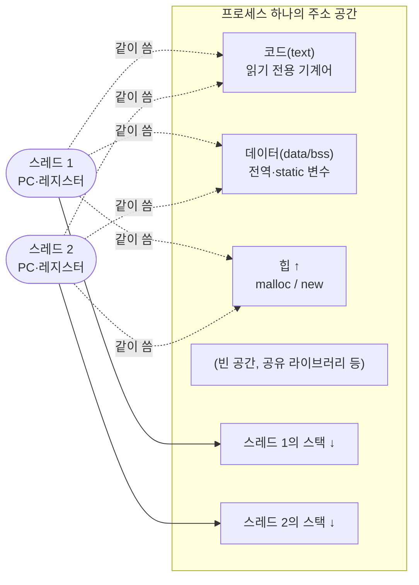
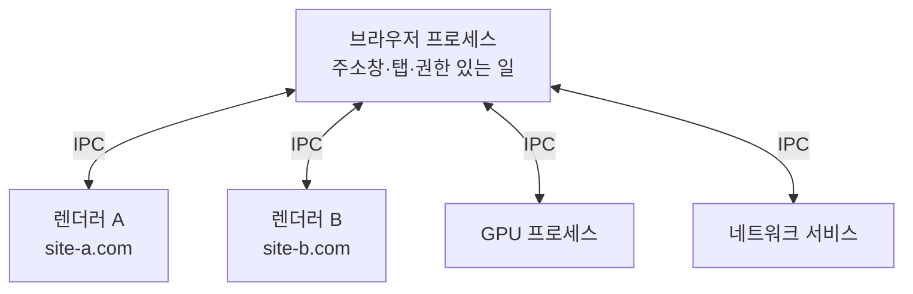
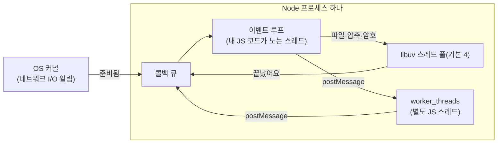

프로세스와 스레드의 차이는 주소 공간을 같이 쓰느냐 따로 쓰느냐 하나로 거의 정리된다. 생성 비용, 전환 비용, 통신 방법, 한쪽이 죽었을 때의 피해 범위가 전부 거기서 따라 나왔다. 운영체제 전체 그림은 [개요](#/post/cs-os)에 있으니 여기서는 이 둘만 깊게 본다.

## 프로세스가 가진 것

프로그램은 디스크에 있는 명령어 덩어리이고, OS가 그걸 메모리에 올려 실행시키면 프로세스가 된다. OSTEP은 프로세스를 "실행 중인 프로그램"이라 정의하고, 프로세스를 이해하려면 머신 상태를 봐야 한다고 한다. 머신 상태는 접근 가능한 메모리(주소 공간), 레지스터(프로그램 카운터, 스택 포인터 포함), 열어 둔 파일 같은 입출력 정보다.

OS가 프로그램을 프로세스로 만들 때 하는 일도 정해져 있다. 코드와 정적 데이터를 메모리에 올리고, 스택을 할당해서 `main()`의 인자(argc, argv)를 채우고, 입출력 설정을 한 뒤 `main()`으로 점프한다. 현대 OS는 이걸 한꺼번에 하지 않고 필요한 조각만 그때그때 올리는 방식(lazy loading)이라고 한다. 이쪽은 [메모리 관리와 가상 메모리](#/post/os-memory)로 이어진다.

OS는 프로세스마다 정보를 모아 둔 구조체(PCB, 프로세스 제어 블록)를 하나씩 들고 있다. 레지스터 값, 상태, 메모리 정보가 거기 들어간다.

## 프로세스의 상태

OSTEP은 상태를 셋으로 설명한다.

| 상태 | 뜻 |
|---|---|
| Running | CPU에서 명령어를 실행 중 |
| Ready | 실행할 수 있지만 OS가 지금은 다른 프로세스를 골랐음 |
| Blocked | 디스크 읽기 같은 I/O를 시작해서, 그 일이 끝날 때까지 실행할 수 없음 |

```
Ready --(스케줄러가 고름)--> Running --(I/O 요청)--> Blocked
Ready <--(시간이 다 됨)----- Running
Ready <--(I/O 끝남)--------- Blocked
```

Blocked가 따로 있는 이유가 쓸모 있다. I/O를 기다리는 프로세스에 CPU를 주면 낭비라서, 그 사이에 다른 프로세스를 돌릴 수 있다. 누구를 Running으로 올릴지는 [CPU 스케줄링](#/post/os-scheduling)의 주제다. 실제 OS는 이보다 상태가 더 많다(교재의 설명도 단순화한 것이다).

## 스레드가 가진 것

OSTEP에서 스레드는 "프로세스 하나 안의 또 다른 실행 지점"이다. 스레드가 여럿이면 프로그램 카운터도 여럿이다. 각 스레드는 자기 레지스터 집합을 따로 가지고, 같은 주소 공간을 공유해서 같은 데이터에 접근한다.

정리하면 이렇다.

| | 프로세스끼리 | 같은 프로세스의 스레드끼리 |
|---|---|---|
| 주소 공간(코드·힙·전역 변수) | 따로 | 공유 |
| 스택 | 따로 | 스레드마다 따로 |
| 레지스터·프로그램 카운터 | 따로 | 스레드마다 따로 |
| 열린 파일 | 따로(상속은 가능) | 공유 |
| 상태를 적어 두는 곳 | PCB | TCB(스레드 제어 블록), 프로세스당 여러 개 |

스택이 스레드마다 따로인 이유는 함수 호출 기록과 지역 변수가 거기 쌓이기 때문이다. 두 스레드가 스택을 같이 쓰면 서로의 호출 흐름이 섞인다. 그래서 스레드를 만들면 주소 공간 안에 스택이 하나씩 더 생긴다.

<details>
<summary>같은 변수를 스레드는 보고 프로세스는 못 본다 (실행 확인함)</summary>

전역 변수 `counter`를 스레드와 자식 프로세스가 각각 건드려 봤다. Windows에서 Python 3.13으로 돌렸다.

```python
import threading, multiprocessing as mp, os

counter = 0
def bump():
    global counter
    counter += 1

def child_bump(q):
    global counter
    counter += 100
    q.put(counter)

if __name__ == "__main__":
    t = threading.Thread(target=bump); t.start(); t.join()
    print("after thread: counter =", counter)
    q = mp.Queue()
    p = mp.Process(target=child_bump, args=(q,)); p.start()
    print("child saw", q.get()); p.join()
    print("after process: counter =", counter)
    print(mp.get_start_method())
```

출력은 이랬다.

```
after thread: counter = 1
child saw 100
after process: counter = 1
spawn
```

스레드가 올린 1은 부모에서 보였고, 자식 프로세스가 100을 더한 건 자식 안에서만 보였다. 결과를 돌려받으려고 `Queue`를 써야 했다. 프로세스끼리는 이렇게 통로(파이프, 큐, 소켓, 공유 메모리 등)를 따로 만들어야 한다. [소켓과 웹소켓](#/post/net-socket)도 그런 통로 중 하나다.

출력 마지막의 `spawn`은 Python 문서가 Windows와 macOS의 기본 시작 방식이라고 적은 것과 같다. 이 방식은 부모가 새 Python 인터프리터 프로세스를 시작하고, 자식은 `run()`에 필요한 자원만 물려받는다. 문서에 따르면 `fork`는 POSIX에서만 쓰고, 자식이 부모와 사실상 똑같은 상태로 시작한다.
</details>

## 주소 공간 안을 그려 보면

표로 본 "공유한다/따로 갖는다"를 그림으로 옮기면 이렇다. 프로세스 하나의 주소 공간은 보통 네 구역으로 나눠 설명한다. 낮은 주소부터 적었다.

1. **코드(text) 영역**: 실행할 기계어. 읽기 전용이라 같은 프로그램을 여러 번 띄우면 OS가 물리 메모리 한 벌을 같이 쓰게 할 수 있다.
2. **데이터 영역**: 전역 변수와 `static` 변수. 초깃값이 있는 것(data)과 0으로 시작하는 것(bss)으로 다시 나뉜다. 프로그램이 끝날 때까지 산다.
3. **힙(heap)**: 실행 중에 `malloc`이나 `new`로 달라고 한 메모리. 크기를 미리 모르는 데이터가 여기 간다. 위쪽으로 자란다고 그리는 게 관례다.
4. **스택(stack)**: 함수를 부를 때마다 지역 변수, 매개변수, 돌아갈 주소를 쌓는 곳. 함수가 끝나면 그 칸이 바로 치워진다. 아래쪽으로 자란다고 그린다.



스레드가 공유하는 건 코드, 데이터, 힙이고, 스레드마다 따로인 건 스택과 레지스터(프로그램 카운터 포함)다. 앞의 `counter` 실험이 이 그림 그대로다. 전역 변수는 데이터 영역에 있으니 스레드가 바꾼 값이 부모에게 보였고, 자식 프로세스는 주소 공간이 통째로 따로라 안 보였다.

실제 배치는 이 그림보다 복잡하다. 요즘 OS는 보안을 위해 구역의 시작 주소를 실행마다 흩뜨리고(ASLR), 스레드 스택은 힙과 스택 사이 어딘가에 따로 잡힌다. 그림은 "무엇이 어디 속하나"를 보는 지도로만 쓰면 된다. 주소가 실제 메모리로 어떻게 바뀌는지는 [메모리 관리와 가상 메모리](#/post/os-memory)에 있다.

## 컨텍스트 스위칭에서 달라지는 점

CPU 하나가 프로세스 A를 돌리다 B로 넘어가는 과정을 OSTEP은 이렇게 설명한다. 타이머 인터럽트가 걸리면 하드웨어가 A의 사용자 레지스터를 A의 커널 스택에 저장하고 커널로 들어간다. OS가 A에서 B로 바꾸기로 하면 `switch()` 루틴이 A의 커널 레지스터를 A의 프로세스 구조체에 저장하고, B의 것을 복원하고, 커널 스택을 B의 것으로 바꾼다. 마지막에 return-from-trap이 B의 레지스터를 복원하며 B가 달린다. 교재는 레지스터 저장이 두 번(하드웨어가 하나, 소프트웨어가 하나) 일어난다는 점을 짚는다.

스레드 사이의 전환은 거의 같은 과정이지만 한 가지가 다르다. T1의 레지스터를 저장하고 T2의 레지스터를 복원하는 건 같은데, 주소 공간이 그대로라서 페이지 테이블을 바꿀 필요가 없다. OSTEP이 말하는 프로세스 전환과 스레드 전환의 가장 큰 차이가 이것이다.

주소 공간을 바꾸면 왜 비싼지는 [메모리 관리와 가상 메모리](#/post/os-memory)와 [메모리 계층과 캐시](#/post/ca-memory-hierarchy)를 보면 이해가 된다. 주소 변환 정보와 캐시에 올라가 있던 데이터가 새 프로세스에는 쓸모가 없어지기 때문이다. 다만 이 비용을 실측한 숫자는 환경마다 다르다. 교재는 lmbench라는 도구로 측정하는데, 1996년 200MHz 기계에서 컨텍스트 스위치가 약 6마이크로초였고 요즘 기계는 2~3GHz에서 1마이크로초 미만이라고 한다.

## 만드는 비용

전환만이 아니라 생성도 다르다. 스레드는 스택과 TCB 정도만 만들면 되지만, 프로세스는 주소 공간 전체를 준비해야 한다. 내 PC(Windows, Python 3.13)에서 아무 일도 안 하는 함수를 스레드로, 프로세스로 만들어 끝날 때까지 기다리는 걸 반복해 쟀다.

<details>
<summary>생성 비용 비교 (실행 확인함)</summary>

```python
import threading, multiprocessing as mp, time
def noop(): pass

if __name__ == "__main__":
    N = 100
    t0 = time.perf_counter()
    for _ in range(N):
        t = threading.Thread(target=noop); t.start(); t.join()
    th = (time.perf_counter() - t0) / N
    N2 = 20
    t0 = time.perf_counter()
    for _ in range(N2):
        p = mp.Process(target=noop); p.start(); p.join()
    pr = (time.perf_counter() - t0) / N2
    print(f"thread {th*1e6:.0f} us, process {pr*1e3:.1f} ms, ratio {pr/th:.0f}x")
```

두 번 돌렸더니 이렇게 나왔다.

```
thread 788 us, process 596.1 ms, ratio 757x
thread 1939 us, process 258.0 ms, ratio 133x
```

실행마다 숫자가 크게 흔들렸다. 확실히 말할 수 있는 건 프로세스 쪽이 두세 자릿수 비싸게 나왔다는 것 정도다. 이 프로세스 값에는 `spawn`이 새 인터프리터를 띄우는 시간이 통째로 들어 있어서, OS의 프로세스 생성 비용만 잰 숫자가 아니다.
</details>

## UNIX의 프로세스 만들기: fork, exec, wait

UNIX는 프로세스를 만들 때 호출을 둘로 쪼갠다. OSTEP 설명으로는 `fork()`가 호출한 프로세스의 복사본(자식)을 만들고, `exec()`는 지금 프로세스의 코드와 정적 데이터를 다른 실행 파일 것으로 덮어쓴다. `exec()`는 새 프로세스를 만들지 않고 돌고 있던 프로그램을 다른 프로그램으로 바꾸며, 성공하면 돌아오지 않는다. `wait()`는 부모가 자식이 끝날 때까지 기다린다.

`fork()` 직후에는 부모와 자식이 둘 다 실행 가능해서 누가 먼저 출력하는지는 정해져 있지 않다. 교재는 `wait()`를 넣으면 출력 순서가 결정적이 된다고 설명한다.

왜 굳이 둘로 나눴을까. 셸이 `fork()`와 `exec()` 사이에 코드를 끼워 넣을 수 있기 때문이다. `wc p3.c > newfile.txt` 같은 리다이렉션은, 자식이 `exec()` 전에 표준 출력을 닫고 `newfile.txt`를 열어 두는 것으로 구현된다. 열린 파일 디스크립터는 `exec()` 뒤에도 유지되니, `wc`는 자기 출력이 파일로 가는지 모른 채 돈다. 이 동작은 [Docker와 컨테이너](#/post/cloud-docker) 같은 프로세스 격리를 이해할 때도 기본 배경이 된다.

## 스레드를 쓰는 이유와 대가

OSTEP이 드는 스레드의 이점은 병렬 실행과, I/O 때문에 멈추는 동안에도 프로그램이 다른 일을 계속할 수 있다는 점이다. 같은 데이터를 공유하니 이런 분업이 쉽다.

대가는 같은 책의 카운터 예제가 보여 준다. 공유 변수에 1을 더하는 코드는 기계어로는 읽기, 더하기, 쓰기 세 단계다. 스레드 1이 값을 읽고 더한 뒤 쓰기 직전에 전환되어 스레드 2가 같은 값을 읽고 쓰면, 스레드 1이 이어서 쓸 때 증가분 하나가 사라진다. 이런 결과가 실행 타이밍에 달린 상황을 경쟁 상태(race condition)라 하고, 막는 방법이 상호 배제다. 자세한 건 [동기화와 교착상태](#/post/os-sync-deadlock)로 넘긴다.

<details>
<summary>읽기-쓰기 사이에 전환이 끼면 증가분이 사라진다 (실행 확인함)</summary>

Python 3.13에서 그냥 `n += 1`을 돌리면 문제가 재현되지 않았다. 대신 읽기와 쓰기를 나눠 쓰고 그 사이에 `time.sleep(0)`으로 CPU를 양보하게 만들어 전환이 끼는 상황을 일부러 만들었다.

```python
import threading, time
n = 0
def inc(k, yield_):
    global n
    for _ in range(k):
        tmp = n
        if yield_: time.sleep(0)
        n = tmp + 1

for y in (False, True):
    n = 0
    ts = [threading.Thread(target=inc, args=(20000, y)) for _ in range(4)]
    [t.start() for t in ts]; [t.join() for t in ts]
    print("yield" if y else "plain", n, "expected 80000")

n = 0; lock = threading.Lock()
def inc2(k):
    global n
    for _ in range(k):
        with lock:
            tmp = n; time.sleep(0); n = tmp + 1
ts = [threading.Thread(target=inc2, args=(20000,)) for _ in range(4)]
[t.start() for t in ts]; [t.join() for t in ts]
print("locked", n)
```

```
plain 80000 expected 80000
yield 20134 expected 80000
locked 80000
```

양보를 끼우자 80000이 되어야 할 값이 20134로 떨어졌다. 같은 코드에 락을 걸면 양보가 끼어도 80000이 나왔다. 양보 없이 80000이 나온 것은 코드가 안전해서가 아니라 전환이 그 사이에 끼지 않았기 때문이다.
</details>

반대로 프로세스는 메모리가 갈라져 있어서 이런 문제가 줄지만, 데이터를 주고받으려면 통로를 만들고 복사 비용을 내야 한다.

## 파이썬에서 보이는 한 가지

CPU를 오래 쓰는 계산을 스레드 넷으로 나눠도 빨라지지 않는 경우가 있다. Python 문서는 `multiprocessing`이 스레드 대신 하위 프로세스를 써서 전역 인터프리터 락(GIL)을 피하고, 그래서 여러 프로세서를 온전히 쓸 수 있다고 적는다.

<details>
<summary>CPU 계산을 순차·스레드·프로세스로 (실행 확인함)</summary>

같은 계산(300만 번 제곱 합)을 네 번 처리하는 시간을 쟀다. 이 PC는 논리 코어가 24개다.

```python
import threading, time, multiprocessing as mp, sys
def work(n):
    s = 0
    for i in range(n): s += i*i
    return s
N = 3_000_000
if __name__ == "__main__":
    t0 = time.perf_counter(); [work(N) for _ in range(4)]; seq = time.perf_counter() - t0
    ts = [threading.Thread(target=work, args=(N,)) for _ in range(4)]
    t0 = time.perf_counter(); [t.start() for t in ts]; [t.join() for t in ts]; th = time.perf_counter() - t0
    ps = [mp.Process(target=work, args=(N,)) for _ in range(4)]
    t0 = time.perf_counter(); [p.start() for p in ps]; [p.join() for p in ps]; pr = time.perf_counter() - t0
    print(f"seq {seq:.2f}s thread {th:.2f}s process {pr:.2f}s")
    print("gil enabled:", sys._is_gil_enabled())
```

```
seq 0.41s thread 0.38s process 0.23s
gil enabled: True
```

스레드는 순차와 거의 같았고, 프로세스는 빨랐다. 프로세스 쪽 시간에는 인터프리터를 띄우는 시간이 들어 있는데도 그랬다. 계산이 더 길면 차이가 더 벌어질 것이다. I/O를 기다리는 일이면 스레드도 도움이 된다.
</details>

## 멀티 프로세스냐 멀티 스레드냐

일을 여러 갈래로 나눌 때 프로세스를 여럿 띄울지, 한 프로세스 안에 스레드를 여럿 둘지 골라야 한다. 지금까지 본 차이를 한 표로 모으면 이렇다.

| | 멀티 프로세스 | 멀티 스레드 |
|---|---|---|
| 메모리 | 각자 주소 공간, 많이 쓴다 | 하나를 나눠 쓰고, 스택만 추가 |
| 만드는·바꾸는 비용 | 크다(주소 공간 준비, 페이지 테이블 교체) | 작다 |
| 데이터 주고받기 | IPC가 필요하고 복사 비용이 든다 | 변수로 바로, 대신 락이 필요 |
| 하나가 죽으면 | 그 프로세스만 죽는다 | 같은 프로세스 전체가 죽을 수 있다 |
| 흔한 버그 | 통신 프로토콜 실수 | 경쟁 상태, 교착상태 |
| 보안 격리 | OS가 막아 준다 | 같은 메모리라 격리 없음 |
| 어울리는 일 | 서로 믿지 않는 작업, 죽어도 되는 작업, CPU 계산(파이썬처럼 GIL이 있을 때) | 데이터를 많이 공유하는 작업, I/O 대기가 많은 작업 |

정답이 하나는 아니다. 그래서 실제 프로그램은 둘을 섞는다. 아래 두 예가 그렇다.

## 실제 예: 크롬과 Node.js

### 크롬은 탭을 프로세스로 나눈다

크롬은 대표적인 멀티 프로세스 프로그램이다. Chrome 개발자 블로그 설명으로는 역할마다 프로세스가 따로 있다.

1. **브라우저 프로세스**: 주소창, 탭, 뒤로 가기 같은 바깥 화면과 다른 프로세스 관리. 파일·네트워크 같은 권한 있는 일은 여기나 별도 서비스 프로세스가 맡는다.
2. **렌더러 프로세스**: 웹 페이지의 HTML, CSS, 자바스크립트를 실행한다. 사이트마다 따로 띄운다(Site Isolation). 다른 사이트의 iframe도 별도 렌더러로 간다.
3. **GPU 프로세스**: 화면 그리기를 한곳에서 처리한다.
4. **네트워크·유틸리티 프로세스**: 네트워크 같은 기능을 서비스로 떼어 낸 것.



이렇게 나눈 이유가 위 표의 "하나가 죽으면"과 "보안 격리" 두 줄이다. 한 탭의 페이지가 무한 루프에 빠지거나 죽어도 그 렌더러만 죽고 나머지 탭은 산다. 렌더러는 권한을 최소로 줄인 샌드박스 안에서 돌아서, 악성 페이지가 렌더러를 장악해도 다른 사이트의 메모리나 내 파일을 바로 읽지 못한다. 대가는 메모리다. 프로세스마다 주소 공간과 기본 자원이 따로 들기 때문에, 블로그 설명으로는 크롬이 기기 메모리와 CPU에 맞춰 프로세스 수에 한도를 두고, 한도에 닿으면 같은 사이트의 탭 여러 개를 한 프로세스에서 돌린다. 크롬 작업 관리자(Shift+Esc)를 열면 이 프로세스들이 실제로 보인다.

### Node.js는 스레드 하나로 시작해서 필요할 때 늘린다

Node.js는 반대쪽에서 출발한다. 내 자바스크립트 코드는 기본적으로 스레드 하나에서 돈다.

1. **이벤트 루프**: 자바스크립트를 실행하는 스레드 하나가 "할 일 큐"에서 콜백을 하나씩 꺼내 실행한다. Node 공식 문서는 루프를 timers, pending callbacks, poll(I/O), check(`setImmediate`), close callbacks 같은 단계로 설명한다. 네트워크 I/O는 OS에 맡기고 끝났다는 알림만 받으니, 앞 [소켓 글](#/post/net-socket)의 `select` 서버처럼 스레드 하나로 연결 수천 개를 다룬다.
2. **libuv 스레드 풀**: OS가 비동기로 못 해 주는 일(파일 읽기, 일부 암호 연산, 압축, `dns.lookup`)은 뒤에서 스레드 풀이 처리한다. 기본 크기는 4이고 `UV_THREADPOOL_SIZE`로 바꾼다. 그러니 "Node는 단일 스레드"는 내 JS 코드에 한정된 말이다.
3. **cluster**: 같은 서버 코드를 프로세스 여러 개로 띄워 코어를 다 쓰는 모듈이다. 공식 문서에 따르면 Windows를 뺀 플랫폼의 기본은 주 프로세스가 포트에서 연결을 받아 워커들에 라운드 로빈으로 나눠 주는 방식이다. 워커끼리는 메모리를 공유하지 않는다. 멀티 프로세스다.
4. **worker_threads**: 한 프로세스 안에 자바스크립트 스레드를 더 만든다. 각 워커는 자기 이벤트 루프를 갖고 `postMessage`로 메시지를 주고받으며, `SharedArrayBuffer`로 메모리를 공유할 수도 있다. 공식 문서는 CPU를 많이 쓰는 JS 작업에 쓰라고 하고, I/O 작업에는 별 도움이 안 된다고 적는다.



<details>
<summary>계산이 이벤트 루프를 막는 것과 워커로 옮긴 것 (실행 확인)</summary>

100ms마다 도는 타이머를 걸어 두고, 피보나치 40을 메인 스레드와 워커 스레드에서 각각 계산했다. Node 24, 리눅스에서 돌렸다.

```js
const { Worker, isMainThread, parentPort, workerData } = require('node:worker_threads');
function fib(n) { return n < 2 ? n : fib(n - 1) + fib(n - 2); }

if (isMainThread) {
  const mode = process.argv[2];               // 'main' 또는 'worker'
  const t0 = Date.now();
  let ticks = 0;
  const iv = setInterval(() => ticks++, 100);  // 100ms마다 한 번씩 오면 정상
  const done = (r) => {
    clearInterval(iv);
    console.log(`${mode}: fib=${r}, ${Date.now() - t0}ms 동안 타이머 ${ticks}번`);
  };
  if (mode === 'main') {
    setTimeout(() => done(fib(40)), 0);       // 메인 스레드에서 계산
  } else {
    const w = new Worker(__filename, { workerData: 40 });
    w.on('message', done);                    // 워커 스레드에서 계산
  }
} else {
  parentPort.postMessage(fib(workerData));
}
```

```
main: fib=102334155, 830ms 동안 타이머 0번
worker: fib=102334155, 847ms 동안 타이머 8번
```

메인에서 계산한 0.8초 동안 타이머는 한 번도 못 돌았다. 서버였다면 그동안 모든 요청이 멈췄다는 뜻이다. 워커로 옮기자 같은 시간 동안 타이머가 8번 돌았다. 계산 시간 자체는 비슷하다. 빨라진 게 아니라 이벤트 루프가 안 막힌 것이다.

cluster도 돌려 봤다. 워커 프로세스 둘이 같은 8124 포트로 서버를 열고, 주 프로세스가 요청 6개를 보냈다.

```js
const cluster = require('node:cluster');
const http = require('node:http');
if (cluster.isPrimary) {
  for (let i = 0; i < 2; i++) cluster.fork();
  // 둘 다 listening이 되면 fetch 6번 → 응답에 담긴 pid를 센다
} else {
  http.createServer((req, res) => res.end(String(process.pid))).listen(8124);
}
```

```
primary 185877 응답한 워커: { '185884': 3, '185885': 3 }
```

pid가 다른 두 프로세스가 3번씩 나눠 받았다. 포트 하나를 프로세스 여럿이 같이 쓰는 건 주 프로세스가 연결을 받아 넘겨 주기 때문이다.

</details>

## 프로세스끼리 말하는 방법(IPC)

프로세스는 주소 공간이 갈라져 있으니 OS가 마련한 통로로 말해야 한다. 이걸 IPC(프로세스 간 통신)라 한다. 자주 보는 것만 추렸다.

| 방법 | 어떻게 | 쓰는 곳 |
|---|---|---|
| **파이프** | 한쪽이 쓰면 다른 쪽이 읽는 바이트 통로. 이름 없는 파이프는 부모·자식 사이 | 셸의 `ls \| grep`, 파이썬 `multiprocessing.Pipe` |
| **이름 있는 파이프(FIFO)** | 파일 시스템에 이름이 있는 파이프. 관계없는 프로세스끼리도 연결 | 간단한 로컬 연동 |
| **메시지 큐** | 경계가 있는 메시지 단위로 넣고 꺼냄 | POSIX 메시지 큐, `multiprocessing.Queue`(속은 파이프+직렬화) |
| **공유 메모리** | 같은 물리 메모리를 두 주소 공간에 붙임. 복사가 없어 제일 빠름 | 대용량 데이터, 대신 동기화(락·세마포어)를 직접 |
| **소켓** | 네트워크와 같은 API. 같은 기계면 유닉스 도메인 소켓 | DB 접속, 다른 기계와도 같은 코드 |
| **시그널** | 번호 하나짜리 알림(예: 종료하라는 SIGTERM) | `kill`, Ctrl+C |
| **메모리 맵 파일** | 파일을 주소 공간에 매핑해 여럿이 읽고 씀 | 큰 파일 공유 |

고르는 기준은 대충 이렇다. 바이트 흐름이면 파이프, 메시지 단위면 큐, 크고 자주 바뀌는 데이터면 공유 메모리, 나중에 다른 기계로 갈 수 있으면 처음부터 소켓. 공유 메모리를 쓰는 순간 스레드에서 본 경쟁 상태가 프로세스 사이에서 그대로 돌아온다는 점은 기억해 둘 만하다. 앞의 크롬 그림에서 프로세스를 잇는 IPC 화살표, cluster의 주 프로세스와 워커 사이 통신도 전부 이 목록 위에 만든 것이다.

## 흔한 오해

- 스레드는 가벼운 프로세스일 뿐이다: 주소 공간을 공유한다는 차이가 안전성과 통신 방식을 바꾼다. 가볍다는 건 그 결과다.
- 프로세스는 스레드보다 항상 느리다: 생성·전환은 비싸지만, 격리와 코어 활용이 필요하면 프로세스가 맞는 경우가 있다(위 CPU 계산 실험).
- `fork()`는 새 프로그램을 실행한다: 복사본을 만들 뿐이고, 다른 프로그램을 돌리는 건 `exec()`다.
- 스레드를 늘리면 빨라진다: 코어 수를 넘으면 전환이 늘고, 공유 데이터에는 락이 필요해진다.
- Blocked 프로세스가 CPU를 잡고 기다린다: 기다리는 동안 CPU는 다른 프로세스에게 넘어간다.

- 크롬은 탭 하나에 프로세스 하나다: 기준은 탭이 아니라 사이트에 가깝다. 다른 사이트의 iframe은 별도 프로세스로 가고, 프로세스 수가 한도에 닿으면 같은 사이트 탭끼리 한 프로세스를 쓰기도 한다.
- Node.js는 완전한 단일 스레드다: 내 JS 코드가 도는 스레드가 하나일 뿐이고, 파일 I/O 등은 libuv 스레드 풀이 처리한다. `worker_threads`로 JS 스레드도 늘릴 수 있다.
- `worker_threads`를 쓰면 I/O가 빨라진다: 공식 문서는 CPU 작업용이라고 적는다. I/O는 원래 이벤트 루프가 안 막고 처리한다.

## 직접 설명할 수 있어야 할 핵심 개념

1. **프로세스와 스레드**: 프로세스는 실행 중인 프로그램이고 자기 주소 공간을 가진다. 스레드는 그 안의 실행 흐름이고 주소 공간을 공유한다.
2. **메모리 구역**: 코드·데이터·힙은 스레드끼리 공유, 스택과 레지스터는 스레드마다 따로. 지역 변수는 스택, 전역 변수는 데이터, `new`로 만든 건 힙.
3. **컨텍스트 스위칭**: 레지스터를 저장·복원하는 일. 프로세스 전환은 주소 공간(페이지 테이블)까지 바꿔서 더 비싸다.
4. **fork / exec / wait**: 복사본을 만들고, 다른 프로그램으로 갈아입고, 끝나길 기다린다.
5. **경쟁 상태**: 공유 데이터를 여러 스레드가 동시에 읽고 쓰면 타이밍에 따라 결과가 바뀐다. 락으로 막는다.
6. **멀티 프로세스 vs 멀티 스레드**: 격리와 안정성이냐, 가벼움과 쉬운 공유냐. 크롬은 격리를 위해 프로세스를 나눴다.
7. **Node 이벤트 루프와 확장**: JS는 스레드 하나에서 콜백을 차례로 돈다. CPU 계산은 `worker_threads`, 코어 전체 활용은 `cluster`(프로세스 여러 개).
8. **IPC**: 파이프, 메시지 큐, 공유 메모리, 소켓, 시그널. 공유 메모리는 빠르지만 동기화가 내 몫이다.

## 근거 링크

- OSTEP, The Abstraction: The Process: https://pages.cs.wisc.edu/~remzi/OSTEP/cpu-intro.pdf
- OSTEP, Interlude: Process API: https://pages.cs.wisc.edu/~remzi/OSTEP/cpu-api.pdf
- OSTEP, Mechanism: Limited Direct Execution: https://pages.cs.wisc.edu/~remzi/OSTEP/cpu-mechanisms.pdf
- OSTEP, Concurrency: An Introduction: https://pages.cs.wisc.edu/~remzi/OSTEP/threads-intro.pdf
- Python 문서, multiprocessing: https://docs.python.org/3/library/multiprocessing.html
- Chrome for Developers, Inside look at modern web browser (part 1): https://developer.chrome.com/blog/inside-browser-part1
- Chromium, Multi-process Architecture: https://www.chromium.org/developers/design-documents/multi-process-architecture/
- Chromium, Site Isolation: https://www.chromium.org/Home/chromium-security/site-isolation/
- Node.js 문서, The Node.js Event Loop: https://nodejs.org/en/learn/asynchronous-work/event-loop-timers-and-nexttick
- Node.js 문서, Cluster: https://nodejs.org/api/cluster.html
- Node.js 문서, Worker threads: https://nodejs.org/api/worker_threads.html
- Linux man-pages, pipe(7) · shm_overview(7) · unix(7): https://man7.org/linux/man-pages/man7/pipe.7.html

참고(같은 주제를 그림으로 잘 정리한 글)

- Inpa Dev, 완전히 정복하는 프로세스 vs 스레드 개념: https://inpa.tistory.com/entry/%F0%9F%91%A9%E2%80%8D%F0%9F%92%BB-%ED%94%84%EB%A1%9C%EC%84%B8%EC%8A%A4-%E2%9A%94%EF%B8%8F-%EC%93%B0%EB%A0%88%EB%93%9C-%EC%B0%A8%EC%9D%B4
- Inpa Dev, 멀티 프로세스 vs 멀티 스레드 비교 총정리: https://inpa.tistory.com/entry/%F0%9F%91%A9%E2%80%8D%F0%9F%92%BB-multi-process-multi-thread
- Inpa Dev, 스레드를 많이 쓸수록 항상 성능이 좋아질까?: https://inpa.tistory.com/entry/%F0%9F%91%A9%E2%80%8D%F0%9F%92%BB-Is-more-threads-always-better

← 개념 지도로 (#/post/cs-map)

관련 글: [CPU 스케줄링](#/post/os-scheduling) · [동기화와 교착상태](#/post/os-sync-deadlock) · [메모리 관리와 가상 메모리](#/post/os-memory)
