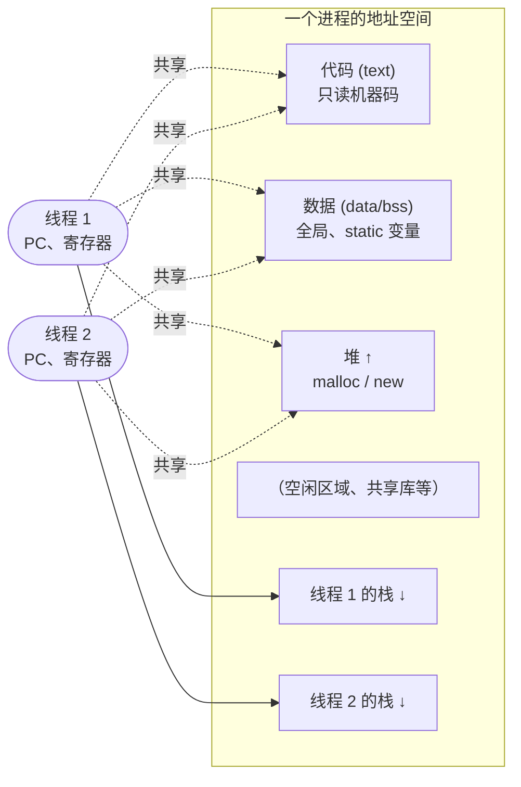
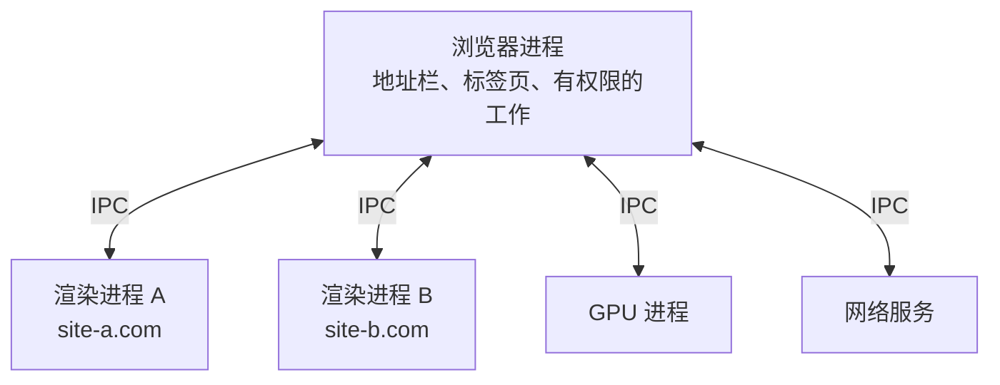
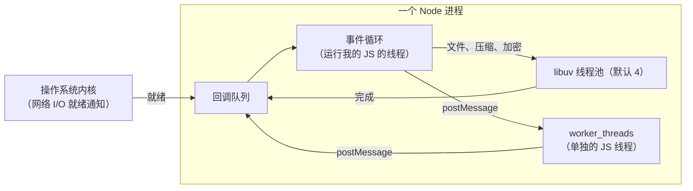

进程与线程的区别几乎可以归结为是否共享地址空间。创建开销、切换成本、通信方式以及一方终止时的影响范围，都由此衍生出来。操作系统的全貌在 [概述](#/post/cs-os) 中已有介绍，此处将深入探讨这两者。

## 进程所拥有的资源

程序是存储在磁盘上的指令集合，当操作系统将其加载到内存并执行时，它就变成了进程。OSTEP 将进程定义为“正在执行的程序”，要理解进程，必须查看其机器状态。机器状态包括可访问的内存（地址空间）、寄存器（包含程序计数器、栈指针等）以及打开的文件等输入输出信息。

操作系统在将程序创建为进程时也会执行一系列固定操作：将代码和静态数据加载到内存，分配栈并填充 `main()` 的参数（argc, argv），进行输入输出设置，然后跳转到 `main()`。现代操作系统并非一次性完成所有这些操作，而是采用按需加载（lazy loading）的方式，仅在需要时加载相应的片段。相关内容可参见 [内存管理与虚拟内存](#/post/os-memory)。

操作系统为每个进程维护一个包含其信息的结构体（PCB，进程控制块），其中存储了寄存器值、状态和内存信息。

## 进程的状态

OSTEP 将进程状态分为三类：

| 状态 | 含义 |
|---|---|
| Running | 正在 CPU 上执行指令 |
| Ready | 可以执行，但操作系统当前选择了其他进程 |
| Blocked | 已启动如磁盘读取等 I/O 操作，直到该操作完成前无法执行 |

```
Ready --(스케줄러가 고름)--> Running --(I/O 요청)--> Blocked
Ready <--(시간이 다 됨)----- Running
Ready <--(I/O 끝남)--------- Blocked
```

单独设立 Blocked 状态是有意义的。向等待 I/O 的进程分配 CPU 会造成资源浪费，此时转而运行其他进程更为高效。选择将哪个进程设为 Running 状态是 [CPU 调度](#/post/os-scheduling) 的主题。实际操作系统中的状态比这更多（教材的描述也进行了简化）。

## 线程所拥有的资源

在 OSTEP 中，线程被定义为“进程内的另一个执行点”。若有多个线程，则存在多个程序计数器。每个线程拥有独立的寄存器集合，但共享相同的地址空间，从而访问相同的数据。

总结如下：

| | 进程之间 | 同一进程内的线程之间 |
|---|---|---|
| 地址空间（代码、堆、全局变量） | 独立 | 共享 |
| 栈 | 独立 | 每个线程独立 |
| 寄存器·程序计数器 | 独立 | 每个线程独立 |
| 打开的文件 | 独立（可继承） | 共享 |
| 状态记录位置 | PCB | TCB（线程控制块），每个进程有多个 |

栈为每个线程独立存在，是因为函数调用记录和局部变量存储于此。若两个线程共享同一个栈，它们的调用流程便会相互干扰。因此，创建线程时会在地址空间内增加一个独立的栈。

<details>
<summary>线程可见全局变量而进程不可见（已验证执行）</summary>

分别让线程和子进程修改了全局变量 `counter`。在 Windows 上使用 Python 3.13 运行测试。

```python
import threading, multiprocessing as mp, os

counter = 0
def bump():
    global counter
    counter += 1

def child_bump(q):
    global counter
    counter += 100
    q.put(counter)

if __name__ == "__main__":
    t = threading.Thread(target=bump); t.start(); t.join()
    print("after thread: counter =", counter)
    q = mp.Queue()
    p = mp.Process(target=child_bump, args=(q,)); p.start()
    print("child saw", q.get()); p.join()
    print("after process: counter =", counter)
    print(mp.get_start_method())
```

输出结果如下：

```
after thread: counter = 1
child saw 100
after process: counter = 1
spawn
```

线程增加的 1 被父进程看到，而子进程增加的 100 仅在子进程内部可见。为了接收结果，必须使用 `Queue`。进程之间需要建立专门的通道（如管道、队列、套接字、共享内存等）。[套接字与 Web 套接字](#/post/net-socket) 也是此类通道之一。

输出末尾的 `spawn` 表示 Python 文档中所述的 Windows 和 macOS 默认启动方式：父进程启动新的 Python 解释器进程，子进程仅继承运行 `run()` 所需的资源。根据文档，`fork` 仅在 POSIX 系统中使用，且子进程以与父进程几乎完全相同的状态启动。
</details>

## 把地址空间里面画出来

把表格里“共享/各自拥有”画成图就是这样。一个进程的地址空间通常分成四个区域来讲，下面从低地址往上写。

1. **代码 (text) 区**：要执行的机器码。它是只读的，所以同一个程序启动多次时，操作系统可以让它们共用一份物理内存。
2. **数据区**：全局变量和 `static` 变量。又分为有初始值的 (data) 和从 0 开始的 (bss)。一直存活到程序结束。
3. **堆 (heap)**：运行时用 `malloc` 或 `new` 申请的内存。事先不知道大小的数据放在这里。惯例上画成向上增长。
4. **栈 (stack)**：每次调用函数，都会在这里压入局部变量、参数和返回地址。函数结束后那一格马上被清掉。画成向下增长。



线程共享的是代码、数据和堆，每个线程各自拥有的是栈和寄存器（包括程序计数器）。前面的 `counter` 实验正是这张图。全局变量在数据区，所以线程改的值父进程看得到；子进程的地址空间整个是另一份，所以看不到。

实际布局比这张图复杂。现代操作系统为了安全，每次运行都会打乱各区域的起始地址 (ASLR)，线程栈则另外分配在堆和栈之间的某处。这张图只当作看“什么属于哪里”的地图就够了。地址如何变成实际内存，见 [内存管理与虚拟内存](#/post/os-memory)。

## 上下文切换中的差异

OSTEP 对 CPU 从执行进程 A 切换到 B 的过程描述如下：当定时器中断发生时，硬件将 A 的用户寄存器保存到 A 的内核栈中，并进入内核。操作系统决定从 A 切换到 B 后，`switch()` 例程将 A 的内核寄存器保存到 A 的进程结构体中，恢复 B 的寄存器，并将内核栈切换为 B 的。最后，通过返回陷阱（return-from-trap）恢复 B 的寄存器，B 开始执行。教材指出寄存器保存发生了两次（一次由硬件完成，一次由软件完成）。

线程之间的切换过程几乎相同，但有一点不同：虽然都是保存 T1 的寄存器并恢复 T2 的寄存器，但由于地址空间保持不变，因此无需更改页表。OSTEP 所提到的进程切换与线程切换的最大区别就在于此。

改变地址空间为何代价高昂，可以通过 [内存管理与虚拟内存](#/post/os-memory) 和 [内存层次结构与缓存](#/post/ca-memory-hierarchy) 来理解。这是因为地址转换信息和驻留在缓存中的数据对新进程而言已无用。不过，实测的成本数值因环境而异。教材使用名为 lmbench 的工具进行测量：在 1996 年的 200MHz 机器上，上下文切换约为 6 微秒；而如今的机器在 2~3GHz 频率下，耗时不足 1 微秒。

## 创建的成本

不仅切换不同，创建过程也不同。线程只需创建栈和 TCB（线程控制块），而进程则需要准备整个地址空间。我在自己的 PC（Windows, Python 3.13）上进行了测试：分别以线程和进程的形式创建一个什么都不做的函数，并重复运行直到结束，以此测量其耗时。

<details>
<summary>创建成本对比（已执行验证）</summary>

```python
import threading, multiprocessing as mp, time
def noop(): pass

if __name__ == "__main__":
    N = 100
    t0 = time.perf_counter()
    for _ in range(N):
        t = threading.Thread(target=noop); t.start(); t.join()
    th = (time.perf_counter() - t0) / N
    N2 = 20
    t0 = time.perf_counter()
    for _ in range(N2):
        p = mp.Process(target=noop); p.start(); p.join()
    pr = (time.perf_counter() - t0) / N2
    print(f"thread {th*1e6:.0f} us, process {pr*1e3:.1f} ms, ratio {pr/th:.0f}x")
```

运行两次后得到了如下结果：

```
thread 788 us, process 596.1 ms, ratio 757x
thread 1939 us, process 258.0 ms, ratio 133x
```

每次运行的数值波动较大。可以明确的是，进程方向的开销高出两到三个数量级。需要注意的是，该进程数值中包含了 `spawn` 启动新解释器的时间，因此并非仅衡量操作系统层面的进程创建成本。
</details>

## UNIX 中的进程创建：fork、exec、wait

UNIX 在创建进程时将调用拆分为两部分。根据 OSTEP 的解释，`fork()` 会创建被调用进程的副本（子进程），而 `exec()` 则将当前进程的代码和静态数据覆盖为另一个可执行文件的内容。`exec()` 并不会创建新进程，而是将正在运行的程序替换为另一个程序；若成功，则不会返回。`wait()` 则使父进程等待子进程结束。

在 `fork()` 之后，父进程和子进程均可执行，因此谁先输出是不确定的。教材指出，加入 `wait()` 后输出顺序便变得确定。

为何要将其分为两部分？这是因为 shell 可以在 `fork()` 和 `exec()` 之间插入代码。例如，`wc p3.c > newfile.txt` 这样的重定向是通过子进程在调用 `exec()` 之前关闭标准输出并打开 `newfile.txt` 来实现的。由于打开的文件描述符在 `exec()` 之后仍然保留，因此 `wc` 会 unaware 自己的输出是否已重定向到文件而继续运行。这种机制也是理解 [Docker 与容器](#/post/cloud-docker) 等进程隔离的基础背景。

## 使用线程的原因及其代价

OSTEP 提出的线程优势在于支持并行执行，并且即使在因 I/O 操作而暂停时，程序也能继续处理其他任务。由于共享相同的数据，这种分工协作变得容易实现。

其代价则如书中计数器示例所示：向共享变量加 1 的代码在机器语言层面包含读取、加法和写入三个步骤。如果线程 1 读取了值并执行加法后，在写入前被切换，而线程 2 读取了相同的旧值并进行写入，那么当线程 1 继续执行写入时，增量就会丢失。这种依赖于执行时序的情况称为竞态条件（race condition），解决方法是互斥机制。详细内容请参见 [同步与死锁](#/post/os-sync-deadlock)。

<details>
<summary>若在读写之间发生切换，增量将丢失（已执行验证）</summary>

在 Python 3.13 中直接运行 `n += 1` 并未重现该问题。因此，我们将读取和写入操作分开，并在其间使用 `time.sleep(0)` 主动让出 CPU，从而人为制造切换发生的场景。

```python
import threading, time
n = 0
def inc(k, yield_):
    global n
    for _ in range(k):
        tmp = n
        if yield_: time.sleep(0)
        n = tmp + 1

for y in (False, True):
    n = 0
    ts = [threading.Thread(target=inc, args=(20000, y)) for _ in range(4)]
    [t.start() for t in ts]; [t.join() for t in ts]
    print("yield" if y else "plain", n, "expected 80000")

n = 0; lock = threading.Lock()
def inc2(k):
    global n
    for _ in range(k):
        with lock:
            tmp = n; time.sleep(0); n = tmp + 1
ts = [threading.Thread(target=inc2, args=(20000,)) for _ in range(4)]
[t.start() for t in ts]; [t.join() for t in ts]
print("locked", n)
```

```
plain 80000 expected 80000
yield 20134 expected 80000
locked 80000
```

加入让出操作后，原本应为 80000 的值下降到了 20134。若对相同代码加锁，即使有让出操作，结果仍为 80000。在没有让出的情况下得到 80000，并非因为代码本身安全，而是因为切换并未在此期间发生。
</details>

相反，由于进程的内存是隔离的，这类问题会减少，但若进程间需要交换数据，则必须建立通信通道并付出复制数据的成本。

## Python 中观察到的一个现象

即使将占用 CPU 的计算任务分配给四个线程，速度也可能不会提升。Python 文档指出，`multiprocessing` 模块使用子进程而非线程来避免全局解释器锁（GIL），从而能够充分利用多核处理器。

<details>
<summary>对比顺序执行、多线程与多进程下的 CPU 计算（已执行验证）</summary>

我们测量了四次处理相同计算（300 万次求和）的时间。这台 PC 拥有 24 个逻辑核心。

```python
import threading, time, multiprocessing as mp, sys
def work(n):
    s = 0
    for i in range(n): s += i*i
    return s
N = 3_000_000
if __name__ == "__main__":
    t0 = time.perf_counter(); [work(N) for _ in range(4)]; seq = time.perf_counter() - t0
    ts = [threading.Thread(target=work, args=(N,)) for _ in range(4)]
    t0 = time.perf_counter(); [t.start() for t in ts]; [t.join() for t in ts]; th = time.perf_counter() - t0
    ps = [mp.Process(target=work, args=(N,)) for _ in range(4)]
    t0 = time.perf_counter(); [p.start() for p in ps]; [p.join() for p in ps]; pr = time.perf_counter() - t0
    print(f"seq {seq:.2f}s thread {th:.2f}s process {pr:.2f}s")
    print("gil enabled:", sys._is_gil_enabled())
```

```
seq 0.41s thread 0.38s process 0.23s
gil enabled: True
```

线程的运行时间与顺序执行几乎相同，而进程反而更快。尽管进程耗时中包含了启动解释器的时间，结果依然如此。如果计算量更大，差异会更加明显。如果是等待 I/O 的场景，使用线程也会有所帮助。
</details>

## 多进程还是多线程

把工作分成几路时，要在“启动多个进程”和“在一个进程里放多个线程”之间做选择。把目前看到的区别汇总成一张表：

| | 多进程 | 多线程 |
|---|---|---|
| 内存 | 各自的地址空间，占用多 | 共用一个，只多出栈 |
| 创建、切换成本 | 高（准备地址空间、切换页表） | 低 |
| 交换数据 | 需要 IPC，有复制成本 | 直接通过变量，但需要锁 |
| 一个崩溃时 | 只有那个进程崩溃 | 整个进程都可能崩溃 |
| 常见 bug | 通信协议写错 | 竞态条件、死锁 |
| 安全隔离 | 操作系统负责隔离 | 同一块内存，没有隔离 |
| 适合的工作 | 互不信任的任务、崩了也没关系的任务、CPU 计算（像 Python 这样有 GIL 时） | 大量共享数据的任务、I/O 等待多的任务 |

没有唯一的正确答案，所以实际的程序会把两者混着用。下面两个例子就是这样。

## 实际例子：Chrome 和 Node.js

### Chrome 把标签页拆成进程

Chrome 是典型的多进程程序。按 Chrome 开发者博客的说明，不同角色各有自己的进程。

1. **浏览器进程**：地址栏、标签页、后退按钮这些外层界面，以及管理其他进程。文件、网络这类有权限的工作由它或单独的服务进程负责。
2. **渲染进程**：执行网页的 HTML、CSS 和 JavaScript。每个站点单独启动一个 (Site Isolation)。跨站点的 iframe 也会放到单独的渲染进程。
3. **GPU 进程**：在一个地方统一处理绘制。
4. **网络、工具进程**：把网络等功能拆成服务。



这样拆分的理由就是上表里“一个崩溃时”和“安全隔离”这两行。某个标签页的页面陷入死循环或崩溃，也只有那个渲染进程挂掉，其他标签页照常运行。渲染进程运行在权限最小化的沙箱里，即使恶意页面控制了渲染进程，也无法直接读取其他站点的内存或我的文件。代价是内存。每个进程都要单独的地址空间和基础资源，博客里说 Chrome 会根据设备的内存和 CPU 给进程数设上限，达到上限后就把同一站点的多个标签页放在一个进程里运行。打开 Chrome 的任务管理器 (Shift+Esc) 就能真正看到这些进程。

### Node.js 从一个线程起步，需要时再增加

Node.js 从另一端出发。我写的 JavaScript 代码默认在一个线程上运行。

1. **事件循环**：执行 JavaScript 的那一个线程，从“待办队列”里一次取出一个回调执行。Node 官方文档把循环分成 timers、pending callbacks、poll (I/O)、check (`setImmediate`)、close callbacks 等阶段来说明。网络 I/O 交给操作系统，只接收“完成了”的通知，所以就像 [socket 那篇](#/post/net-socket) 里的 `select` 服务器一样，一个线程就能处理成千上万个连接。
2. **libuv 线程池**：操作系统没法异步完成的工作（读文件、部分加密运算、压缩、`dns.lookup`）由后台的线程池处理。默认大小是 4，可以用 `UV_THREADPOOL_SIZE` 修改。所以“Node 是单线程”只是针对我的 JS 代码而言。
3. **cluster**：把同一份服务器代码启动成多个进程、用满所有核心的模块。按官方文档，除 Windows 外所有平台的默认做法，是主进程在端口上接受连接，再以轮转 (round-robin) 方式分给各个工作进程。工作进程之间不共享内存。这是多进程。
4. **worker_threads**：在一个进程里再创建 JavaScript 线程。每个 worker 有自己的事件循环，用 `postMessage` 收发消息，也可以通过 `SharedArrayBuffer` 共享内存。官方文档建议把它用于 CPU 密集的 JS 任务，并说明它对 I/O 任务帮助不大。



<details>
<summary>计算阻塞事件循环 vs 移到 worker（已运行确认）</summary>

我设了一个每 100ms 触发一次的定时器，然后分别在主线程和 worker 线程里计算斐波那契 40。在 Linux 上用 Node 24 运行。

```js
const { Worker, isMainThread, parentPort, workerData } = require('node:worker_threads');
function fib(n) { return n < 2 ? n : fib(n - 1) + fib(n - 2); }

if (isMainThread) {
  const mode = process.argv[2];               // 'main' 또는 'worker'
  const t0 = Date.now();
  let ticks = 0;
  const iv = setInterval(() => ticks++, 100);  // 100ms마다 한 번씩 오면 정상
  const done = (r) => {
    clearInterval(iv);
    console.log(`${mode}: fib=${r}, ${Date.now() - t0}ms 동안 타이머 ${ticks}번`);
  };
  if (mode === 'main') {
    setTimeout(() => done(fib(40)), 0);       // 메인 스레드에서 계산
  } else {
    const w = new Worker(__filename, { workerData: 40 });
    w.on('message', done);                    // 워커 스레드에서 계산
  }
} else {
  parentPort.postMessage(fib(workerData));
}
```

```
main: fib=102334155, 830ms 동안 타이머 0번
worker: fib=102334155, 847ms 동안 타이머 8번
```

（`동안 타이머 N번` 的意思是“这段时间里定时器触发了 N 次”。）在主线程计算的 0.8 秒里，定时器一次都没能执行。如果是服务器，就意味着这段时间所有请求都卡住了。移到 worker 之后，同样的时间里定时器执行了 8 次。计算时间本身差不多。不是变快了，而是事件循环不再被阻塞。

我也试了 cluster。两个工作进程在同一个 8124 端口上开服务器，主进程发了 6 个请求。

```js
const cluster = require('node:cluster');
const http = require('node:http');
if (cluster.isPrimary) {
  for (let i = 0; i < 2; i++) cluster.fork();
  // 둘 다 listening이 되면 fetch 6번 → 응답에 담긴 pid를 센다
} else {
  http.createServer((req, res) => res.end(String(process.pid))).listen(8124);
}
```

```
primary 185877 응답한 워커: { '185884': 3, '185885': 3 }
```

两个 pid 不同的进程各接了 3 个。多个进程能共用一个端口，是因为主进程接受连接后再转交出去。

</details>

## 进程之间怎么说话 (IPC)

进程的地址空间是分开的，所以必须通过操作系统准备的通道来说话。这叫 IPC（进程间通信）。只挑常见的几种：

| 方法 | 怎么做 | 用在哪里 |
|---|---|---|
| **管道** | 一端写、另一端读的字节通道。匿名管道用于父子进程之间 | shell 的 `ls \| grep`、Python 的 `multiprocessing.Pipe` |
| **命名管道 (FIFO)** | 在文件系统里有名字的管道，无亲缘关系的进程也能连接 | 简单的本地对接 |
| **消息队列** | 以有边界的消息为单位放入和取出 | POSIX 消息队列、`multiprocessing.Queue`（内部是管道+序列化） |
| **共享内存** | 把同一块物理内存挂到两个地址空间。没有复制，最快 | 大数据量，但同步（锁、信号量）要自己做 |
| **Socket** | 和网络一样的 API。同一台机器上用 Unix 域套接字 | 数据库连接，跨机器也是同一套代码 |
| **信号** | 只有一个编号的通知（例如要求退出的 SIGTERM） | `kill`、Ctrl+C |
| **内存映射文件** | 把文件映射到地址空间，多个进程一起读写 | 共享大文件 |

大致的选择标准是：字节流用管道，按消息就用队列，又大又经常变的数据用共享内存，以后可能搬到别的机器就一开始用 socket。值得记住的是，一旦用了共享内存，线程那里看到的竞态条件就会原样回到进程之间。前面 Chrome 图里连接进程的 IPC 箭头，以及 cluster 主进程和工作进程之间的通信，都是建立在这张清单之上的。

## 常见误区

- 线程只是轻量级的进程：共享地址空间这一区别改变了安全性和通信方式。“轻量”是由此产生的结果。
- 进程总是比线程慢：虽然创建和切换开销较大，但在需要隔离或利用多个核心时（如上述 CPU 计算实验），使用进程更为合适。
- `fork()` 会启动新程序：它仅创建副本，运行其他程序的是 `exec()`。
- 增加线程数就能提速：一旦超过核心数量，上下文切换会增加，且共享数据需要加锁。
- Blocked 状态的进程仍占用 CPU 等待：在等待期间，CPU 会被分配给其他进程。
- Chrome 是一个标签页一个进程：单位更接近站点而不是标签页。跨站点的 iframe 会进入单独的进程，进程数达到上限时，同一站点的标签页也可能共用一个进程。
- Node.js 是彻底的单线程：只是运行我的 JS 代码的线程只有一个，文件 I/O 等由 libuv 线程池处理。用 `worker_threads` 也能增加 JS 线程。
- 用 `worker_threads` 能让 I/O 变快：官方文档说它是给 CPU 任务用的。I/O 本来就不会阻塞事件循环。

## 必须能自己讲清楚的核心概念

1. **进程与线程**：进程是运行中的程序，拥有自己的地址空间。线程是其中的执行流，共享地址空间。
2. **内存区域**：代码、数据、堆由线程共享，栈和寄存器每个线程各一份。局部变量在栈上，全局变量在数据区，`new` 出来的在堆上。
3. **上下文切换**：保存和恢复寄存器。进程切换还要换地址空间（页表），所以更贵。
4. **fork / exec / wait**：复制一份、换成另一个程序、等待它结束。
5. **竞态条件**：多个线程同时读写共享数据，结果随时序变化。用锁来防止。
6. **多进程 vs 多线程**：要隔离和稳定，还是要轻量和容易共享。Chrome 为了隔离拆成了多个进程。
7. **Node 事件循环与扩展**：JS 在一个线程上依次执行回调。CPU 计算交给 `worker_threads`，用满所有核心靠 `cluster`（多个进程）。
8. **IPC**：管道、消息队列、共享内存、socket、信号。共享内存快，但同步要自己负责。

## 参考链接

- OSTEP, The Abstraction: The Process: https://pages.cs.wisc.edu/~remzi/OSTEP/cpu-intro.pdf
- OSTEP, Interlude: Process API: https://pages.cs.wisc.edu/~remzi/OSTEP/cpu-api.pdf
- OSTEP, Mechanism: Limited Direct Execution: https://pages.cs.wisc.edu/~remzi/OSTEP/cpu-mechanisms.pdf
- OSTEP, Concurrency: An Introduction: https://pages.cs.wisc.edu/~remzi/OSTEP/threads-intro.pdf
- Python 文档，multiprocessing: https://docs.python.org/3/library/multiprocessing.html
- Chrome for Developers, Inside look at modern web browser (part 1): https://developer.chrome.com/blog/inside-browser-part1
- Chromium, Multi-process Architecture: https://www.chromium.org/developers/design-documents/multi-process-architecture/
- Chromium, Site Isolation: https://www.chromium.org/Home/chromium-security/site-isolation/
- Node.js 文档, The Node.js Event Loop: https://nodejs.org/en/learn/asynchronous-work/event-loop-timers-and-nexttick
- Node.js 文档, Cluster: https://nodejs.org/api/cluster.html
- Node.js 文档, Worker threads: https://nodejs.org/api/worker_threads.html
- Linux man-pages, pipe(7) · shm_overview(7) · unix(7): https://man7.org/linux/man-pages/man7/pipe.7.html

参考（用图解把同一主题讲得很清楚的韩语文章）

- Inpa Dev, 彻底搞懂进程与线程: https://inpa.tistory.com/entry/%F0%9F%91%A9%E2%80%8D%F0%9F%92%BB-%ED%94%84%EB%A1%9C%EC%84%B8%EC%8A%A4-%E2%9A%94%EF%B8%8F-%EC%93%B0%EB%A0%88%EB%93%9C-%EC%B0%A8%EC%9D%B4
- Inpa Dev, 多进程与多线程对比: https://inpa.tistory.com/entry/%F0%9F%91%A9%E2%80%8D%F0%9F%92%BB-multi-process-multi-thread
- Inpa Dev, 线程越多性能就一定越好吗？: https://inpa.tistory.com/entry/%F0%9F%91%A9%E2%80%8D%F0%9F%92%BB-Is-more-threads-always-better

← 概念地图 (#/post/cs-map)

相关文章：[CPU 调度](#/post/os-scheduling) · [同步与死锁](#/post/os-sync-deadlock) · [内存管理与虚拟内存](#/post/os-memory)