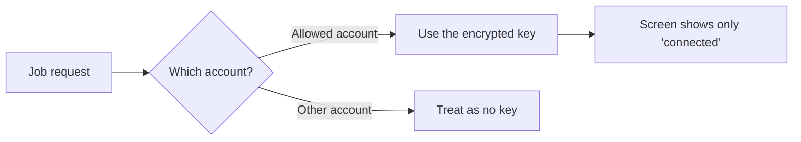

Today I sorted out how the automation app connects to outside services with keys. I learned I had to decide "how far is this key allowed to go" before deciding where to put it.

## A personal key came in

The app runs several accounts on the same engine. But I decided to use my own personal key for just one of them. Even if another account starts using the same service later, it must not touch this key. If the code just says "use the key if it's there," some other account could quietly pick it up one day.

So here's what came up today.

1. **Least privilege**: give keys and permissions only to the scope that really needs them. This time I pinned the key to a single account, and any other account asking for it gets "no key." Sharing it is faster at first, but when something goes wrong you can't tell how far it spread.
2. **Tenant isolation**: when one app holds several users or accounts, keep their settings, data and secrets from leaking into each other. Store settings per account, and when picking a key, ask "whose job is this?" first.
3. **Write-only secret fields**: enter a key once, store it encrypted, and never show it again. The screen only shows a masked status like "connected / not connected." The key value lives in an environment file that's left out of version control.

## Settings in one place

A screen rule came out the same day. If the same setting is copied into several tabs, you fix one and the others keep the old value. So each setting lives in exactly one tab, and the rest just link to it. It's the single source of truth idea, applied to the screen.

The run schedule changed in a similar way. Instead of picking from a few fixed templates, the cadence is saved as a setting and the scheduler computes the next run time from it. Templates only fill in the starting values.

It was just adding one key, but deciding the scope first made everything else simpler.
