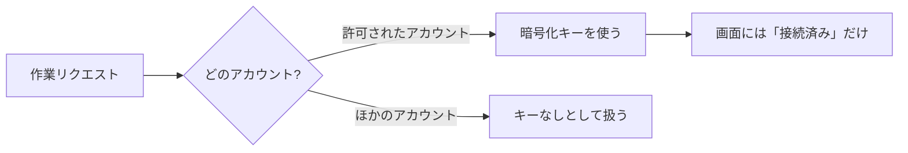

今日は自動化アプリに外部サービスのキーをつなぐ部分を整理した。キーをどこに入れるかより、「このキーはどこまで使っていいのか」を先に決めないといけないと分かった。

## 個人のキーがひとつ入ってきた

アプリはいくつかのアカウントを同じエンジンで回している。でもそのうちひとつだけに、自分の個人キーを使うことにした。ほかのアカウントがあとで同じサービスを使うことになっても、このキーは使ってはいけない。コードが「キーがあれば使う」だけだと、いつか別のアカウントがこっそり拾ってしまうかもしれない。

今日出てきた概念はこんな感じ。

1. **最小権限(least privilege)**:キーや権限は本当に必要な範囲にだけ渡す。今回はキーを特定のアカウントひとつに固定して、ほかのアカウントが探しても「キーなし」として扱うようにした。共用にすると最初は楽だけど、事故が起きたときにどこまで広がったか分からない。
2. **テナント分離(tenant isolation)**:ひとつのアプリに複数のユーザーやアカウントがあるとき、お互いの設定・データ・秘密が混ざらないように分けること。設定をアカウントごとに保存して、キーを選ぶときも「今どのアカウントの仕事か」を先に聞くようにする。
3. **書き込み専用の秘密フィールド(write-only secret)**:キーは一度入力したら暗号化して保存し、画面には二度と表示しない。代わりに「接続済み/未接続」みたいな状態だけを伏せて見せる。キーの値は環境変数ファイルに置いて、そのファイルはバージョン管理から外しておく。

## 設定は一か所に

同じ日に画面整理のルールもひとつできた。同じ設定が複数のタブにコピーされていると、片方だけ直してもう片方は古い値のまま残る。だから設定はひとつのタブにだけ置いて、ほかはそこへのリンクだけにした。データの世界でいう単一の情報源(single source of truth)を画面にも当てはめた感じだ。

実行の周期も似たように変えた。決まったいくつかのテンプレートから選ぶのではなく、周期を設定値として保存し、スケジューラがその値から次の実行時刻を計算する。テンプレートは最初の値を埋めるだけ。

キーをひとつ入れるだけの話だったけど、範囲を先に決めたら残りがむしろ単純になった。
