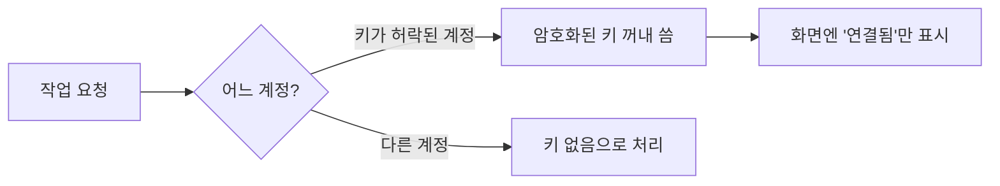

오늘은 자동화 앱에 외부 서비스 키를 연결하는 부분을 정리했다. 키를 어디에 넣을지보다 "이 키는 어디까지 쓰여도 되나"를 먼저 정해야 한다는 걸 알게 됐다.

## 개인 키가 하나 들어왔다

앱은 여러 계정을 같은 엔진으로 돌린다. 그런데 그중 한 계정에만 내 개인 키를 쓰기로 했다. 다른 계정이 나중에 같은 서비스를 쓰게 되더라도 이 키는 쓰면 안 된다. 코드가 "키가 있으면 쓴다"로만 되어 있으면, 언젠가 다른 계정이 이 키를 슬쩍 집어 쓸 수 있다.

그래서 오늘 나온 개념은 이렇다.

1. **최소 권한(least privilege)**: 키나 권한은 꼭 필요한 범위에만 준다. 이번엔 키를 특정 계정 하나에 못 박고, 다른 계정이 찾으면 없는 것으로 처리하게 했다. 편하게 공용으로 두면 처음엔 빠르지만, 사고가 나면 어디까지 번졌는지 알 수가 없다.
2. **테넌트 격리(tenant isolation)**: 한 앱 안에 여러 사용자나 계정이 있을 때, 서로의 설정·데이터·비밀이 넘어가지 않게 나누는 것. 설정을 계정별로 저장하고, 키를 고를 때도 "지금 어느 계정 일인지"를 먼저 묻게 하면 된다.
3. **쓰기 전용 비밀 필드(write-only secret)**: 키는 한 번 입력하면 암호화해서 저장하고, 화면에는 다시 보여주지 않는다. 대신 "연결됨 / 안 됨" 같은 상태만 가려서 보여준다. 키 값은 저장소에 올라가지 않게 환경 변수 파일에 두고 그 파일은 버전 관리에서 빼 둔다.

## 설정은 한 곳에

같은 날 화면 정리 규칙도 하나 생겼다. 같은 설정이 탭 여러 군데에 복사돼 있으면, 한쪽만 고치고 다른 쪽은 옛날 값으로 남는다. 그래서 설정은 딱 한 탭에만 두고 나머지는 거기로 가는 링크만 두기로 했다. 데이터 쪽에서 말하는 단일 원본(single source of truth)을 화면에도 적용한 셈이다.

실행 주기도 비슷하게 바꿨다. 정해 둔 몇 가지 틀 중에서 고르는 대신, 주기를 설정값으로 저장해 두고 스케줄러가 그 값으로 다음 실행 시각을 계산한다. 틀은 처음 값을 채워 주는 역할만 한다.

키 하나 넣는 일이었는데, 범위를 먼저 정하니까 나머지가 오히려 단순해졌다.
