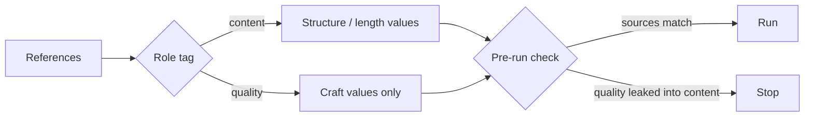

Today I was stuck on reference material getting mixed up in the automation app. The output looked off, and when I traced it back, some values had come from the wrong source.

## Why it got mixed

The app reads reference material and pulls baseline values out of it. But there were two kinds of references: ones whose content and structure we actually want to follow, and ones we only added to look at craft quality, content aside. Both went into the same bucket as just "references," so content from the quality-only ones quietly leaked into the structure values.

So today's concepts came down to these.

1. **Data provenance**: carrying, with every value, where it came from. This time each reference got a role tag: content, or quality. Later, when you look at a value and ask "which source was this from?", you can answer right away. Same idea people call lineage on the data side.
2. **Pre-flight check**: checking conditions before actually running, and blocking the start if they don't hold. If even one content value came from a quality-only reference, the check before the run button fails. Catching it at the door is much cheaper than a person hunting for it after everything is built. Close in spirit to fail fast.
3. **Avoiding a single point of failure**: if material only comes from one place, the whole thing stops the day that place is empty or blocked. So material now gets picked from a pool of many sources. If one comes up empty, another fills in.

Roughly, the flow looks like this.

## Don't touch what's running

The same day I also started a bigger design job, on the condition that it doesn't affect the work currently running. If the running thing and the new design sit in the same place, it's hard to tell which side caused a problem.

Writing down where each value came from looked like a chore. Today it was the fastest way to find the cause.
