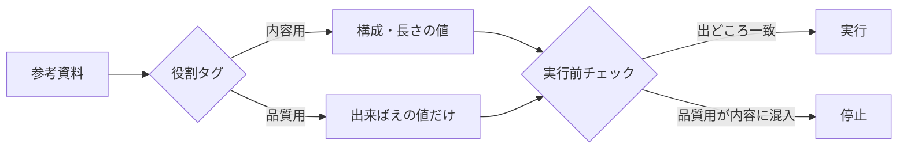

今日は自動化アプリで参考資料が混ざる問題に取り組んでいた。出来上がりがなんだか変で、たどってみると値が見当違いの資料から来ていた。

## 混ざった理由

アプリは参考資料を読んで、そこから基準値を取り出す。ところが参考資料が二種類あった。内容と構成をまねしたい資料と、内容は関係なく出来ばえだけ見たくて入れた資料。どちらもただの「参考資料」として同じ箱に入っていたので、出来ばえ用の資料の内容が構成側の値にこっそり混ざっていた。

それで今日出てきた概念はこう整理できる。

1. **データの出どころ追跡(provenance)**: 値ごとに、どこから来たかを一緒に持たせること。今回は参考資料ごとに役割タグをつけた。内容用か、品質用か。そうすると後で値を見て「これはどの資料から来た?」とすぐ答えられる。データの分野でリネージ(lineage)と呼ぶのと同じ考え方だ。
2. **事前検証ゲート(pre-flight check)**: 実際に動かす前に条件を確かめて、合わなければ開始を止めること。内容側の値がひとつでも品質用の資料から来ていたら、実行ボタン前のチェックで失敗するようにした。全部作ったあとで人が目で探すより、入口で弾くほうがずっと安い。フェイルファスト(fail fast)に近い。
3. **単一障害点を避ける(no single point of failure)**: 材料を一か所からしか取らないと、そこが空だったり止まったりした日に全体が止まる。だから材料は複数の出どころを集めたプール(pool)から選ぶことにした。ひとつ出なくても、ほかで埋める。

流れにするとだいたいこう。

## 動いているものには触らない

同じ日にもっと大きな設計作業も始めたけど、今動いている作業には影響を与えないという条件にした。動いているものと新しい設計を同じ場所に置くと、何かおかしくなったときにどちらが原因か見分けにくい。

値の出どころを書いておくのは面倒に見えたけど、今日はそれがいちばん早く原因を見つけさせてくれた。
