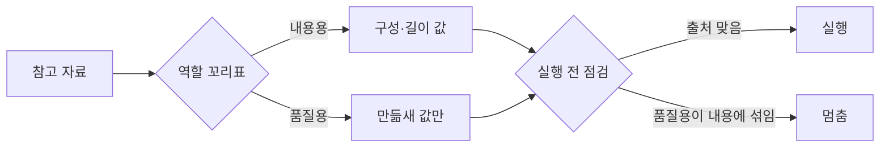

오늘은 자동화 앱에서 참고 자료가 섞이는 문제를 붙잡고 있었다. 결과물이 이상하게 나왔는데, 따라가 보니 값이 엉뚱한 자료에서 와 있었다.

## 섞인 이유

앱은 참고 자료를 읽고 거기서 기준값을 뽑는다. 그런데 참고 자료가 두 종류였다. 내용과 구성을 따라 할 자료, 그리고 내용은 상관없고 만듦새만 보려고 넣은 자료. 둘 다 그냥 "참고 자료"로 같은 통에 들어가 있으니, 만듦새만 보려던 자료의 내용이 구성 쪽 값에 슬쩍 섞여 들어갔다.

그래서 오늘 나온 개념은 이렇게 정리된다.

1. **데이터 출처 추적(provenance)**: 값마다 어디서 왔는지를 같이 들고 다니는 것. 이번엔 참고 자료마다 역할 꼬리표를 달았다. 내용용인지, 품질용인지. 그러면 나중에 어떤 값을 보고 "이건 어느 자료에서 왔지?"를 바로 답할 수 있다. 데이터 쪽에서 리니지(lineage)라고 부르는 것과 같은 생각이다.
2. **사전 검증 게이트(pre-flight check)**: 실제로 돌리기 전에 조건을 확인하고, 안 맞으면 시작을 막는 것. 내용 쪽 값 중 하나라도 품질용 자료에서 왔으면 실행 버튼 전 점검에서 실패하게 했다. 다 만든 뒤에 사람이 눈으로 찾는 것보다, 들어가는 문 앞에서 거르는 게 훨씬 싸다. 페일 패스트(fail fast)랑 비슷한 결이다.
3. **단일 장애점 피하기(no single point of failure)**: 재료를 한 군데에서만 가져오면 그곳이 비거나 막히는 날 전체가 멈춘다. 그래서 재료는 여러 출처를 모은 풀(pool)에서 고르기로 했다. 하나가 안 나와도 다른 데서 채운다.

흐름으로 그리면 대충 이렇다.

## 돌고 있는 건 건드리지 않기

같은 날 더 큰 설계 작업도 같이 시작했는데, 지금 돌고 있는 작업에는 영향을 주지 않는 조건으로 했다. 실행 중인 것과 새 설계를 같은 자리에 두면, 뭐가 잘못됐을 때 원인이 어느 쪽인지 가려내기 어렵다.

값이 어디서 왔는지 적어 두는 게 귀찮아 보였는데, 오늘은 그게 제일 빨리 원인을 찾게 해 줬다.
