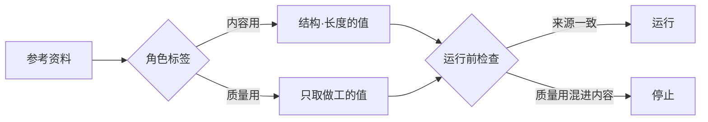

今天一直在处理自动化应用里参考资料混在一起的问题。结果看着不对劲，顺着查下去，发现有些值来自不该用的资料。

## 为什么会混

应用会读参考资料，从里面取出基准值。可参考资料其实有两种：一种是内容和结构要跟着学的，另一种跟内容无关，只是放进来看做工质量的。两种都被当成"参考资料"放进同一个桶里，于是只看质量的资料里的内容，悄悄混进了结构那边的值。

所以今天遇到的概念可以这样整理。

1. **数据来源追踪(provenance)**: 让每个值都带着它从哪里来的信息。这次给每份参考资料加了角色标签：内容用，还是质量用。之后看到某个值问"这是从哪份资料来的?"，马上就能回答。和数据领域说的血缘(lineage)是同一个思路。
2. **预检关卡(pre-flight check)**: 真正运行之前先检查条件，不满足就不让开始。只要内容那边有一个值来自质量用的资料，运行按钮前的检查就会失败。比起全部做完再让人用眼睛找，在门口挡掉便宜得多。和快速失败(fail fast)是一个路子。
3. **避免单点故障(no single point of failure)**: 材料只从一个地方拿，那个地方哪天空了或者卡住，整个流程就停了。所以改成从汇集多个来源的池子(pool)里挑材料。一个没有，就从别处补。

画成流程大概是这样。

## 不碰正在跑的东西

同一天还开始了一个更大的设计工作，条件是不影响正在运行的任务。正在跑的东西和新设计放在同一个地方，出问题时很难分清是哪边的原因。

把每个值从哪来记下来，看起来挺麻烦。今天却是它让我最快找到了原因。
